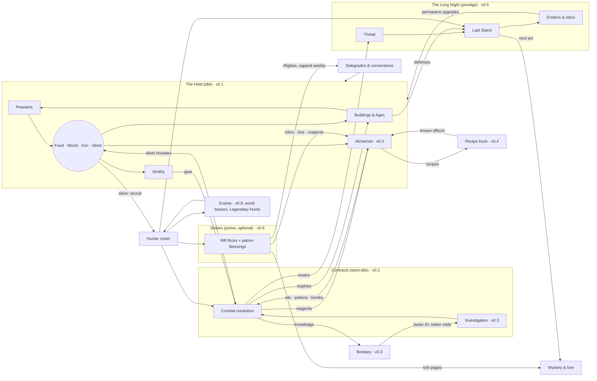

# The Last Hold — Game Design Document

**Status:** Draft. Sections 1–4 written; sections 5–10 pending.
**Markers:** **[JC]** = judgment call; the owner can override any of them. *(vX.Y)* = the milestone that introduces something.
**Related docs:** `lore-bible.md` (world truth and spoilers), `technical-design.md`, `implementation-plan.md`, `decisions.md`.

---

## 1. Vision & Pillars

### 1.1 Elevator pitch

You are the warden of Stanholm, a ruined fortress on the edge of the Gloamreach, a frontier swallowed by monsters, cursed ruins, and something older beneath the ground.

You rebuild the hold, recruit monster hunters, and send them on contracts for frightened villages. You learn what the dark is made of, and you push it back.

The dark always returns. Each cycle ends in a Last Stand that you choose when to make. The next warden inherits what you remembered. Each cycle also uncovers another piece of the betrayal that broke the hold in the first place.

### 1.2 Experience goals

| Moment | The player should feel… |
|---|---|
| Opening the game | "My fortress kept working while I was gone." The game opens on a report, not a chore list. |
| Choosing a contract | Like a hunter studying a case. The decision is *what* to bring and *who* to send, not how fast to tap. |
| Reading a fight log | That the outcome was fair and explainable, and that better preparation would have changed it. |
| Late in a cycle | Rising pressure, plus a real choice: make the stand now, or hold one more day? |
| After the Long Night | Stronger, a little wiser, and hungry for the next piece of the story. |

### 1.3 Pillars

Every feature must serve at least one pillar and must not break any.

1. **Heroic with dark edges.** The dark is real and sometimes cruel, but the hold is a light. Hunters are brave, villagers are grateful, and victories feel earned. Horror is seasoning, not the meal.
   - *Test:* Does this make the player feel like a protector rather than a victim?
2. **Layers interlock.** Every layer produces something another layer needs. No system is a dead end.
   - *Test:* Can you name where this resource comes from and where it goes? (See §4.)
3. **Numbers are visible.** Every formula, chance, and modifier can be inspected in-game, and every fight leaves a readable log. Full transparency is the default (D10).
   - *Test:* Could the player predict this outcome from what the screen shows?
4. **Knowledge is progression.** The bestiary, the recipe book, and the lore make later play faster and better, not just more complete.
   - *Test:* Does learning this make the next contract or brew measurably easier?
5. **Respect my time.** Single-player, no monetization patterns, and no timers designed to frustrate. Offline progress is fair. Nothing important expires while you're away.
   - *Test:* Would missing a day feel like a punishment? If so, redesign it.

Determinism (seeded RNG, reproducible fights) is a technical requirement in support of pillar 3. It is specified in `technical-design.md`.

### 1.4 Non-goals

- Twitch skill, reflex timing, or tap-speed rewards.
- Daily login streaks, limited-time FOMO rewards, or anything that punishes absence.
- Gacha or randomized hunter pulls. Hunters come from recruitment, contracts, and events.
- Multiplayer, leaderboards, monetization, audio (out of scope for now).
- A tutorial or onboarding flow (D12: audience is just the owner). In-game help text and inspectable formulas stand in for it.

---

## 2. Setting & Naming Rules

### 2.1 Tone guide (D01: heroic fantasy with dark edges)

- **Light:** Villagers bring gifts after good contracts. Hunters banter in logs. The hold visibly grows from ruin into a fortress.
- **Dark:** Monsters were often people, or were made by people. Cursed ruins carry real tragedies. The central mystery is a betrayal with no clean villain.
- **Humor:** Dry and occasional, mostly in hunter traits and log flavor lines. Never parody.
- **Violence:** Shown through outcomes and logs ("Bjarna is wounded: 3 days to recover"), not gore. Pixel art keeps it stylized.

### 2.2 Folklore blend (D05: Slavic + Nordic)

The Gloamreach sits between forested river country with Slavic flavor (the lowland villages) and cold fells and fjord-cut highlands with Nordic flavor (the northern ruins). Monsters, names, and material culture shift along that gradient. Lowland contracts feel Slavic; highland contracts feel Nordic; the deep places belong to neither.

### 2.3 Originality rules

All content is original. The influences supply *feel*, never names, characters, terminology, designs, or plots.

**Folklore creatures** may be used under their real-world folklore names and standard folklore spellings. Their designs and behavior must come from folklore sources, not from any game's version.

**Avoid list.** These terms and signature elements are off-limits:

| Source | Avoid |
|---|---|
| The Witcher | "witcher"; Signs; mutagens; decoctions; schools of monster hunters; game-specific monster spellings and coinages (leshen, kikimore, striga, noonwraith, nekker, drowner, bruxa); signature plots (e.g., a cursed princess cured by a night in a crypt); named potions or oils from the games |
| Elder Scrolls / Skyrim | Dragonborn; shouts / Thu'um; Daedra; Dwemer; standing stones as skill signs; "jarl" **[JC: a real Norse title, but too strongly Skyrim-coded; use "thane" or "headman"]** |
| Warcraft / WoW | Scourge; Lich King; Horde / Alliance; named classes (paladin, death knight) as hunter classes; WoW faction names |
| Age of Empires | Named civilizations; age names beyond the generic Hamlet → Keep → Citadel → Bastion |
| Warhammer 40K / Tacticus | Primarch; Astartes; Chapter; Heresy; Emperor; Salamanders / Vulkan or any named chapter, legion, or character; "promethium" |
| Hades | Boons; Mirror of Night; named gods' roles; "Darkness" as the reset currency |

**Process rule:** Before any proper noun goes into a content file, it gets a quick web search against those games. Collisions are logged in `decisions.md`. Real historical or generic words (thane, warden, hold, contract, oil, bomb) are allowed.

### 2.4 Approved folklore creature pool (starter)

| Creature | Origin | Folklore basis to design from |
|---|---|---|
| Leshy | Slavic | Forest lord; leads travelers astray; changes size with the trees |
| Kikimora | Slavic | Household or swamp spirit; nighttime mischief that turns malicious |
| Rusalka | Slavic | Drowned maiden; river and field spirit; lures and drowns |
| Vodyanoy | Slavic | Old man of the water; drowns the careless; bound to mills and weirs |
| Poludnitsa (Lady Midday) | Slavic | Field spirit at noon; strikes down workers with heatstroke and madness |
| Upyr | Slavic | Restless dead; drinks blood; risen from improper burial |
| Strzyga | Slavic (Polish) | Person with two souls; after death, one soul hunts the living |
| Bies | Slavic | Malevolent spirit of the wilds |
| Likho | Slavic | One-eyed embodiment of misfortune |
| Mara / Mora | Slavic + Nordic | Nightmare spirit that sits on sleepers' chests |
| Draugr | Nordic | Barrow-dead; swollen, heavy, guarding treasure; can change size |
| Nix / Nøkk | Nordic | Water spirit; shapeshifts (often a horse); music lures victims |
| Huldra | Nordic | Forest woman with a hidden tail; seduces and punishes |
| Troll | Nordic | Stone-hided, sun-averse giants of the fells |
| Lindworm | Nordic | Wingless serpent-dragon |
| Domovoi | Slavic | Friendly household spirit; **not a monster**. A resident of the hold. |

**Original creatures** are encouraged for the cursed ruins and the deep (the Unlit and its spawn). Those live in `lore-bible.md`.

### 2.5 Naming style

- **Places:** Compounds that mix the two roots: Slavic *-grad, -ov, -no, stan-, vel-* with Nordic *-holm, -fell, -mark, -vik*. Examples: Stanholm, Velkvik, Dubno Ford, Ravenfell.
- **People:** Lowlanders use Slavic-style given names (Dobrava, Milosz, Vesna). Highlanders use Nordic-style names (Yrsa, Halvar, Bjarna). Many hunters carry an epithet earned in the field ("Halvar Two-Smokes").
- **The Emberwrights:** Ranks and titles in plain English: Forge-Mother, Firstblade, Wright, Apprentice.
- **Lore names in the outline are working names** (Gloamreach, Stanholm, Emberwrights, Hearthseal, the Unlit, Firstblade). They get collision-checked before v0.5. **[JC: the Firstblade's name changes from the outline's placeholder to "Yrsa Varn" to fit the Nordic naming style; the Forge-Mother is "Dobrava Halsten".]**

---

## 3. Core Loops

### 3.1 Loops by timescale

| Loop | Length | What you do | Key decisions | What you get | From |
|---|---|---|---|---|---|
| **Check-in** | 2–3 min | Read "While you were away"; build and upgrade; reassign peasants; collect contract results; launch new contracts | What to build next; which contract, which party, which preparation | Resources, trophies, reagents, bestiary progress | v0.1 (hold), v0.2 (contracts) |
| **Session** | 15–30 min | Delve runs; alchemy experiments; roster and gear planning; read lore | Blessing picks; ingredient combinations; long-term roster shape | Relics, rift currency, recipes, lore | v0.4 (alchemy), v0.6 (delves) |
| **Daily** | Once per real day | World-boss attempts with different hunters each time | Who to spend on which attempt | Boss rewards, event points | v0.8 |
| **Cycle** | 3–5 days | Age up the hold; keep Threat in check; pick the moment for the Last Stand | When to make the Last Stand | Embers (permanent currency), relics, the next act of the mystery | v0.5 |
| **Meta** | Weeks | Fill the bestiary and recipe book; raise hunter stars; finish Legendary Hunts; advance Orders | Long-term investment | Permanent power and knowledge; the full story | v0.3–v0.9 |

### 3.2 The check-in, step by step

This is the heart of the game and must stay fast. **Target: a routine check-in in 15 taps or fewer.**

1. **Open.** The "While you were away" sheet summarizes elapsed time (capped at 12 h; D08), resources gained, contracts resolved (success or failure, injuries, loot), and anything new in the bestiary. Tap once to dismiss. Every line can be expanded into its full log.
2. **Spend.** The Hold screen highlights affordable builds and upgrades with a badge. Buy in one tap; long-press for the formula and cost breakdown.
3. **Contracts.** The board shows open contracts. For each one: pick a party (with a suggested party pre-filled), pick preparation, then see the success odds with a full breakdown before launching.
4. **Leave.** Nothing demands attention until the next visit.

### 3.3 Anti-frustration rules for loops

- **The contract board fills up and waits.** New contracts arrive over time, up to a cap. They never expire. **[JC: one new contract every 2 h, board cap of 6 in v0.2.]**
- **Finished contracts wait to be collected.** Results sit there until you open the game. A finished contract never sits idle "wasting" a hunter; the hunter simply waits at the hold.
- **Injuries heal on real time,** including while you're offline.
- **No resource is lost to an overflow cap in v0.1** (D24, no storage caps). If caps arrive later, the UI warns well before you hit them.
- **Events** (v0.8) give enough attempts that skipping a day costs a little progress, never the reward itself. **[JC: event milestones are reachable with about 70% participation.]**

### 3.4 What exists when

| Milestone | Playable loops |
|---|---|
| v0.1 | Check-in (hold only): build, assign peasants, Age up to Keep |
| v0.2 | Check-in with contracts, hunters, combat logs |
| v0.3 | Contracts gain investigation, the bestiary, and preparation |
| v0.4 | Session loop begins (alchemy experiments) |
| v0.5 | Cycle loop: Threat, Last Stand, Long Night, Embers, mystery act 1 |
| v0.6 | Session loop gains Delves |
| v0.7–v0.9 | Meta loop deepens: stars and talents, events, Orders |

---

## 4. Resource Flow

### 4.1 Resource catalog

"Survives the Long Night" means the item persists through the prestige reset.

| Resource | Kind | Produced by | Consumed by | Survives the Long Night? | From |
|---|---|---|---|---|---|
| **Food** | Basic | Farms, fishery; peasants | Peasant growth and upkeep; hunter upkeep | No | v0.1 |
| **Wood** | Basic | Woodcutter's camp; peasants | Buildings; bomb casings; arrow shafts | No | v0.1 |
| **Iron** | Basic | Mine; peasants | Buildings; smithy gear | No | v0.1 |
| **Silver** | Basic + currency **[JC: silver is both a material and the bounty currency]** | Silver mine (slow); **contract bounties (main source)** | Silvered gear; recruitment; Age-ups | No | v0.1 |
| **Peasants** | Population | Houses + food surplus | Assigned to gathering jobs | No | v0.1 |
| **Hunters** | Roster | Recruitment (silver); later contracts and events | Contracts, Delves, bosses | **Yes**, the roster persists; rank and gear partly reset **[JC; detailed in v0.5]** | v0.2 |
| **Trophies** | Per monster family | Contract and Delve kills | Hunter rank-ups (v0.7); trophy-hall bonuses (v0.2) | Partly (a set conversion rate into Embers) | v0.2 |
| **Reagents** | Ingredients | Contracts; herb garden; Delves | Alchemy: oils, potions, bombs | No | v0.3 |
| **Gear** | Items | Smithy (iron + silver + wood) | Equipped by hunters | No (relics are the persistent gear) | v0.2 |
| **Oils / Potions / Bombs** | Consumables | Alchemist's hut, from reagents | Contract preparation | No | v0.3 |
| **Knowledge** | Unlocks | Investigating and killing monsters; alchemy experiments | Never spent; reduces investigation time and raises odds | **Yes** | v0.3 |
| **Threat** | Pressure meter | Rises with time and with failed or ignored contracts | Lowered by completed contracts and defenses; sets Last Stand difficulty | Resets to 0 | v0.5 |
| **Embers** | Prestige currency | The Last Stand (payout curve) plus trophy conversion | Permanent warden upgrades | **Yes** | v0.5 |
| **Relics** | Persistent items | Last Stand milestones; Delves | Equipped on the hold or on hunters | **Yes** | v0.5 / v0.6 |
| **Riftglass** | Delve currency, **capped weekly** (D20) | Delve floors | Sidegrades, convenience upgrades (e.g., +1 h offline cap), cosmetic hold improvements | **Yes** | v0.6 |
| **Lore documents** | Collectibles | Contracts, Delves, Long Night | Mystery progression; some give small hints or bonuses | **Yes** | v0.5 |
| **Boss marks / Hunt points** | Event currencies | World bosses; Legendary Hunts | Event rewards; unlocking a legendary hunter | **Yes** | v0.8 |
| **Reputation** | Per Order | Order questlines and aligned contracts | Order rewards and unlocks | **Yes** | v0.9 |

### 4.2 Flow diagram

### 4.3 Interlock check

Every layer has at least one input from another layer and one output to another layer:

| Layer | Needs from others | Gives to others |
|---|---|---|
| Hold | Silver and trophies (Contracts); Embers (Long Night); sidegrades (Delves) | Gear, consumables, recruits (Contracts); defenses (Last Stand) |
| Contracts | Gear, consumables, recruits (Hold); knowledge (Bestiary) | Silver, trophies, reagents (Hold); Threat reduction (Long Night) |
| Delves | Hunters (roster) | Relics, lore, reagents, riftglass |
| Long Night | Defenses (Hold); hunters; Threat state | Embers, relics, story progression |
| Events | Roster depth | Legendary hunters, event rewards |

**Delve-optional check (D20):** Every resource Delves give either has an idle-path source (reagents, lore, and relics also come from contracts and Last Stands) or is a sidegrade or convenience. Idle-only play reaches all content about 20–30% slower. The balance simulator will verify this from v0.6 on.

---

## Judgment calls in sections 1–4

1. **Silver is both a material and the bounty currency.** One fewer resource to track; contracts become the main source of silver.
2. **The hunter roster persists through the Long Night,** with rank and gear partly resetting. Details come with v0.5.
3. **Contract board:** one new contract every 2 h, up to 6, never expiring.
4. **Event participation:** event milestones are reachable with about 70% participation.
5. **Routine check-in target:** 15 taps or fewer.
6. **Avoid "jarl"** as too Skyrim-coded; use "thane" or "headman" instead.
7. **Character names:** Firstblade "Yrsa Varn", Forge-Mother "Dobrava Halsten".
8. **Strzyga and Lady Midday are in the creature pool,** with designs drawn from folklore only and no reuse of the games' signature contract plots.
9. **The domovoi is a friendly resident of the hold,** not a monster.
10. **Prestige currency is named Embers; Delve currency is named Riftglass.**

---

## 5–10. *(pending)*

Next up: §5 Systems (full detail for v0.1–v0.3).
