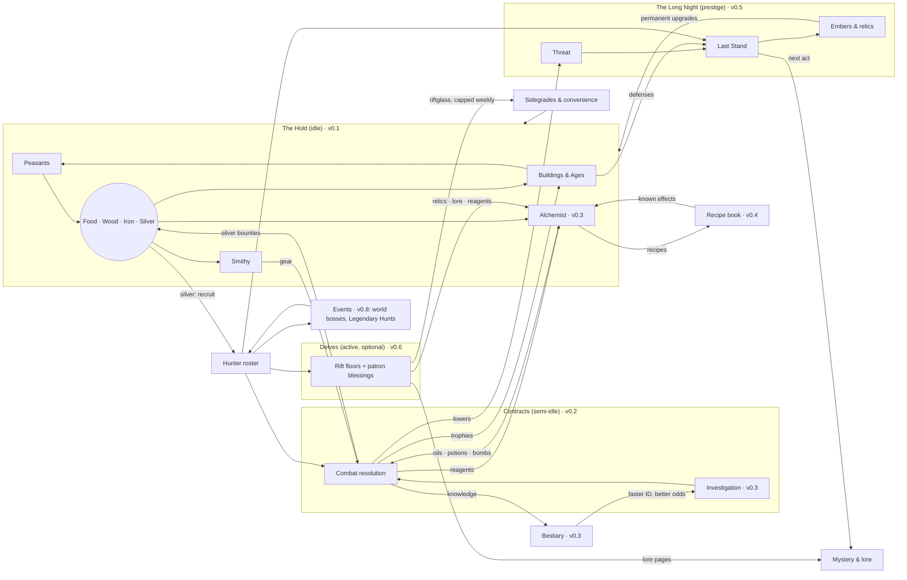

# The Last Hold — Game Design Document

**Status:** §1–5 approved (D26, D27). §6–8 are drafts for review. §9–10 pending.
**Markers:** **[JC]** = judgment call; the owner can override any of them. *(vX.Y)* = the milestone that introduces something.
**Related docs:** `lore-bible.md` (world truth and spoilers), `technical-design.md`, `implementation-plan.md`, `decisions.md`.

---

## 1. Vision & Pillars

### 1.1 Elevator pitch

You are the warden of Stanholm, a ruined fortress on the edge of the Gloamreach, a frontier swallowed by monsters, cursed ruins, and something older beneath the ground.

You rebuild the hold, recruit monster hunters, and send them on contracts for frightened villages. You learn what the dark is made of, and you push it back.

The dark always returns. Each cycle ends in a Last Stand that you choose when to make. The next warden inherits what you remembered. Each cycle also uncovers another piece of the betrayal that broke the hold in the first place.

### 1.2 Experience goals

| Moment | The player should feel… |
|---|---|
| Opening the game | "My fortress kept working while I was gone." The game opens on a report, not a chore list. |
| Choosing a contract | Like a hunter studying a case. The decision is *what* to bring and *who* to send, not how fast to tap. |
| Reading a fight log | That the outcome was fair and explainable, and that better preparation would have changed it. |
| Late in a cycle | Rising pressure, plus a real choice: make the stand now, or hold one more day? |
| After the Long Night | Stronger, a little wiser, and hungry for the next piece of the story. |

### 1.3 Pillars

Every feature must serve at least one pillar and must not break any.

1. **Heroic with dark edges.** The dark is real and sometimes cruel, but the hold is a light. Hunters are brave, villagers are grateful, and victories feel earned. Horror is seasoning, not the meal.
   - *Test:* Does this make the player feel like a protector rather than a victim?
2. **Layers interlock.** Every layer produces something another layer needs. No system is a dead end.
   - *Test:* Can you name where this resource comes from and where it goes? (See §4.)
3. **Numbers are visible.** Every formula, chance, and modifier can be inspected in-game, and every fight leaves a readable log. Full transparency is the default (D10).
   - *Test:* Could the player predict this outcome from what the screen shows?
4. **Knowledge is progression.** The bestiary, the recipe book, and the lore make later play faster and better, not just more complete.
   - *Test:* Does learning this make the next contract or brew measurably easier?
5. **Respect my time.** Single-player, no monetization patterns, and no timers designed to frustrate. Offline progress is fair. Nothing important expires while you're away.
   - *Test:* Would missing a day feel like a punishment? If so, redesign it.

Determinism (seeded RNG, reproducible fights) is a technical requirement in support of pillar 3. It is specified in `technical-design.md`.

### 1.4 Non-goals

- Twitch skill, reflex timing, or tap-speed rewards.
- Daily login streaks, limited-time FOMO rewards, or anything that punishes absence.
- Gacha or randomized hunter pulls. Hunters come from recruitment, contracts, and events.
- Multiplayer, leaderboards, monetization, audio (out of scope for now).
- A tutorial or onboarding flow (D12: audience is just the owner). In-game help text and inspectable formulas stand in for it.

---

## 2. Setting & Naming Rules

### 2.1 Tone guide (D01: heroic fantasy with dark edges)

- **Light:** Villagers bring gifts after good contracts. Hunters banter in logs. The hold visibly grows from ruin into a fortress.
- **Dark:** Monsters were often people, or were made by people. Cursed ruins carry real tragedies. The central mystery is a betrayal with no clean villain.
- **Humor:** Dry and occasional, mostly in hunter traits and log flavor lines. Never parody.
- **Violence:** Shown through outcomes and logs ("Bjarna is wounded: 3 days to recover"), not gore. Pixel art keeps it stylized.

### 2.2 Folklore blend (D05: Slavic + Nordic)

The Gloamreach sits between forested river country with Slavic flavor (the lowland villages) and cold fells and fjord-cut highlands with Nordic flavor (the northern ruins). Monsters, names, and material culture shift along that gradient. Lowland contracts feel Slavic; highland contracts feel Nordic; the deep places belong to neither.

### 2.3 Originality rules

All content is original. The influences supply *feel*, never names, characters, terminology, designs, or plots.

**Folklore creatures** may be used under their real-world folklore names and standard folklore spellings. Their designs and behavior must come from folklore sources, not from any game's version.

**Avoid list.** These terms and signature elements are off-limits:

| Source | Avoid |
|---|---|
| The Witcher | "witcher"; Signs; mutagens; decoctions; schools of monster hunters; game-specific monster spellings and coinages (leshen, kikimore, striga, noonwraith, nekker, drowner, bruxa); signature plots (e.g., a cursed princess cured by a night in a crypt); named potions or oils from the games |
| Elder Scrolls / Skyrim | Dragonborn; shouts / Thu'um; Daedra; Dwemer; standing stones as skill signs; "jarl" **[JC: a real Norse title, but too strongly Skyrim-coded; use "thane" or "headman"]** |
| Warcraft / WoW | Scourge; Lich King; Horde / Alliance; named classes (paladin, death knight) as hunter classes; WoW faction names |
| Age of Empires | Named civilizations; age names beyond the generic Hamlet → Keep → Citadel → Bastion |
| Warhammer 40K / Tacticus | Primarch; Astartes; Chapter; Heresy; Emperor; Salamanders / Vulkan or any named chapter, legion, or character; "promethium" |
| Hades | Boons; Mirror of Night; named gods' roles; "Darkness" as the reset currency |

**Process rule:** Before any proper noun goes into a content file, it gets a quick web search against those games. Collisions are logged in `decisions.md`. Real historical or generic words (thane, warden, hold, contract, oil, bomb) are allowed.

### 2.4 Approved folklore creature pool (starter)

| Creature | Origin | Folklore basis to design from |
|---|---|---|
| Leshy | Slavic | Forest lord; leads travelers astray; changes size with the trees |
| Kikimora | Slavic | Household or swamp spirit; nighttime mischief that turns malicious |
| Rusalka | Slavic | Drowned maiden; river and field spirit; lures and drowns |
| Vodyanoy | Slavic | Old man of the water; drowns the careless; bound to mills and weirs |
| Poludnitsa (Lady Midday) | Slavic | Field spirit at noon; strikes down workers with heatstroke and madness |
| Upyr | Slavic | Restless dead; drinks blood; risen from improper burial |
| Strzyga | Slavic (Polish) | Person with two souls; after death, one soul hunts the living |
| Bies | Slavic | Malevolent spirit of the wilds |
| Likho | Slavic | One-eyed embodiment of misfortune |
| Mara / Mora | Slavic + Nordic | Nightmare spirit that sits on sleepers' chests |
| Draugr | Nordic | Barrow-dead; swollen, heavy, guarding treasure; can change size |
| Nix / Nøkk | Nordic | Water spirit; shapeshifts (often a horse); music lures victims |
| Huldra | Nordic | Forest woman with a hidden tail; seduces and punishes |
| Troll | Nordic | Stone-hided, sun-averse giants of the fells |
| Lindworm | Nordic | Wingless serpent-dragon |
| Domovoi | Slavic | Friendly household spirit; **not a monster**. A resident of the hold. |

**Original creatures** are encouraged for the cursed ruins and the deep (the Unlit and its spawn). Those live in `lore-bible.md`.

### 2.5 Naming style

- **Places:** Compounds that mix the two roots: Slavic *-grad, -ov, -no, stan-, vel-* with Nordic *-holm, -fell, -mark, -vik*. Examples: Stanholm, Velkvik, Dubno Ford, Ravenfell.
- **People:** Lowlanders use Slavic-style given names (Dobrava, Milosz, Vesna). Highlanders use Nordic-style names (Yrsa, Halvar, Bjarna). Many hunters carry an epithet earned in the field ("Halvar Two-Smokes").
- **The Emberwrights:** Ranks and titles in plain English: Forge-Mother, Firstblade, Wright, Apprentice.
- **Lore names in the outline are working names** (Gloamreach, Stanholm, Emberwrights, Hearthseal, the Unlit, Firstblade). They get collision-checked before v0.5. **[JC: the Firstblade's name changes from the outline's placeholder to "Yrsa Varn" to fit the Nordic naming style; the Forge-Mother is "Dobrava Halsten".]**

---

## 3. Core Loops

### 3.1 Loops by timescale

| Loop | Length | What you do | Key decisions | What you get | From |
|---|---|---|---|---|---|
| **Check-in** | 2–3 min | Read "While you were away"; build and upgrade; reassign peasants; collect contract results; launch new contracts | What to build next; which contract, which party, which preparation | Resources, trophies, reagents, bestiary progress | v0.1 (hold), v0.2 (contracts) |
| **Session** | 15–30 min | Delve runs; alchemy experiments; roster and gear planning; read lore | Blessing picks; ingredient combinations; long-term roster shape | Relics, rift currency, recipes, lore | v0.4 (alchemy), v0.6 (delves) |
| **Daily** | Once per real day | World-boss attempts with different hunters each time | Who to spend on which attempt | Boss rewards, event points | v0.8 |
| **Cycle** | 3–5 days | Age up the hold; keep Threat in check; pick the moment for the Last Stand | When to make the Last Stand | Embers (permanent currency), relics, the next act of the mystery | v0.5 |
| **Meta** | Weeks | Fill the bestiary and recipe book; raise hunter stars; finish Legendary Hunts; advance Orders | Long-term investment | Permanent power and knowledge; the full story | v0.3–v0.9 |

### 3.2 The check-in, step by step

This is the heart of the game and must stay fast. **Target: a routine check-in in 15 taps or fewer.**

1. **Open.** The "While you were away" sheet summarizes elapsed time (capped at 12 h; D08), resources gained, contracts resolved (success or failure, injuries, loot), and anything new in the bestiary. Tap once to dismiss. Every line can be expanded into its full log.
2. **Spend.** The Hold screen highlights affordable builds and upgrades with a badge. Buy in one tap; long-press for the formula and cost breakdown.
3. **Contracts.** The board shows open contracts. For each one: pick a party (with a suggested party pre-filled), pick preparation, then see the success odds with a full breakdown before launching.
4. **Leave.** Nothing demands attention until the next visit.

### 3.3 Anti-frustration rules for loops

- **The contract board fills up and waits.** New contracts arrive over time, up to a cap. They never expire. **[JC: one new contract every 2 h, board cap of 6 in v0.2.]**
- **Finished contracts wait to be collected.** Results sit there until you open the game. A finished contract never sits idle "wasting" a hunter; the hunter simply waits at the hold.
- **Injuries heal on real time,** including while you're offline.
- **No resource is lost to an overflow cap in v0.1** (D24, no storage caps). If caps arrive later, the UI warns well before you hit them.
- **Events** (v0.8) give enough attempts that skipping a day costs a little progress, never the reward itself. **[JC: event milestones are reachable with about 70% participation.]**

### 3.4 What exists when

| Milestone | Playable loops |
|---|---|
| v0.1 | Check-in (hold only): build, assign peasants, Age up to Keep |
| v0.2 | Check-in with contracts, hunters, combat logs |
| v0.3 | Contracts gain investigation, the bestiary, and preparation |
| v0.4 | Session loop begins (alchemy experiments) |
| v0.5 | Cycle loop: Threat, Last Stand, Long Night, Embers, mystery act 1 |
| v0.6 | Session loop gains Delves |
| v0.7–v0.9 | Meta loop deepens: stars and talents, events, Orders |

---

## 4. Resource Flow

### 4.1 Resource catalog

"Survives the Long Night" means the item persists through the prestige reset.

| Resource | Kind | Produced by | Consumed by | Survives the Long Night? | From |
|---|---|---|---|---|---|
| **Food** | Basic | Farms, fishery; peasants | Peasant growth and upkeep; hunter upkeep | No | v0.1 |
| **Wood** | Basic | Woodcutter's camp; peasants | Buildings; bomb casings; arrow shafts | No | v0.1 |
| **Iron** | Basic | Mine; peasants | Buildings; smithy gear | No | v0.1 |
| **Silver** | Basic + currency **[JC: silver is both a material and the bounty currency]** | Silver mine (slow); **contract bounties (main source)** | Silvered gear; recruitment; Age-ups | No | v0.1 |
| **Peasants** | Population | Houses + food surplus | Assigned to gathering jobs | No | v0.1 |
| **Hunters** | Roster | Recruitment (silver); later contracts and events | Contracts, Delves, bosses | **Yes**, the roster persists; rank and gear partly reset **[JC; detailed in v0.5]** | v0.2 |
| **Trophies** | Per monster family | Contract and Delve kills | Hunter rank-ups (v0.7); trophy-hall bonuses (v0.2) | Partly (a set conversion rate into Embers) | v0.2 |
| **Reagents** | Ingredients | Contracts; herb garden; Delves | Alchemy: oils, potions, bombs | No | v0.3 |
| **Gear** | Items | Smithy (iron + silver + wood) | Equipped by hunters | No (relics are the persistent gear) | v0.2 |
| **Oils / Potions / Bombs** | Consumables | Alchemist's hut, from reagents | Contract preparation | No | v0.3 |
| **Knowledge** | Unlocks | Investigating and killing monsters; alchemy experiments | Never spent; reduces investigation time and raises odds | **Yes** | v0.3 |
| **Threat** | Pressure meter | Rises with time and with failed or ignored contracts | Lowered by completed contracts and defenses; sets Last Stand difficulty | Resets to 0 | v0.5 |
| **Embers** | Prestige currency | The Last Stand (payout curve) plus trophy conversion | Permanent warden upgrades | **Yes** | v0.5 |
| **Relics** | Persistent items | Last Stand milestones; Delves | Equipped on the hold or on hunters | **Yes** | v0.5 / v0.6 |
| **Riftglass** | Delve currency, **capped weekly** (D20) | Delve floors | Sidegrades, convenience upgrades (e.g., +1 h offline cap), cosmetic hold improvements | **Yes** | v0.6 |
| **Lore documents** | Collectibles | Contracts, Delves, Long Night | Mystery progression; some give small hints or bonuses | **Yes** | v0.5 |
| **Boss marks / Hunt points** | Event currencies | World bosses; Legendary Hunts | Event rewards; unlocking a legendary hunter | **Yes** | v0.8 |
| **Reputation** | Per Order | Order questlines and aligned contracts | Order rewards and unlocks | **Yes** | v0.9 |

### 4.2 Flow diagram



### 4.3 Interlock check

Every layer has at least one input from another layer and one output to another layer:

| Layer | Needs from others | Gives to others |
|---|---|---|
| Hold | Silver and trophies (Contracts); Embers (Long Night); sidegrades (Delves) | Gear, consumables, recruits (Contracts); defenses (Last Stand) |
| Contracts | Gear, consumables, recruits (Hold); knowledge (Bestiary) | Silver, trophies, reagents (Hold); Threat reduction (Long Night) |
| Delves | Hunters (roster) | Relics, lore, reagents, riftglass |
| Long Night | Defenses (Hold); hunters; Threat state | Embers, relics, story progression |
| Events | Roster depth | Legendary hunters, event rewards |

**Delve-optional check (D20):** Every resource Delves give either has an idle-path source (reagents, lore, and relics also come from contracts and Last Stands) or is a sidegrade or convenience. Idle-only play reaches all content about 20–30% slower. The balance simulator will verify this from v0.6 on.

---

## Judgment calls in sections 1–4

1. **Silver is both a material and the bounty currency.** One fewer resource to track; contracts become the main source of silver.
2. **The hunter roster persists through the Long Night,** with rank and gear partly resetting. Details come with v0.5.
3. **Contract board:** one new contract every 2 h, up to 6, never expiring.
4. **Event participation:** event milestones are reachable with about 70% participation.
5. **Routine check-in target:** 15 taps or fewer.
6. **Avoid "jarl"** as too Skyrim-coded; use "thane" or "headman" instead.
7. **Character names:** Firstblade "Yrsa Varn", Forge-Mother "Dobrava Halsten".
8. **Strzyga and Lady Midday are in the creature pool,** with designs drawn from folklore only and no reuse of the games' signature contract plots.
9. **The domovoi is a friendly resident of the hold,** not a monster.
10. **Prestige currency is named Embers; Delve currency is named Riftglass.**

---

## 5. Systems

> **About the numbers in this section.** Every number is a *starting value*. The structure (formulas, rules, what affects what) is the design. The constants are tuned by the balance simulator against the pacing targets in §6. When Claude Code changes a constant, the change goes in the content or config files, never into code. When a constant changes by more than 2×, it gets a line in `decisions.md`.

### 5.0 Cross-cutting rules

These apply to every system.

**Modifier buckets.** Every percentage bonus belongs to one named bucket. Bonuses add within a bucket and multiply across buckets:

```
final = base × (1 + Σ building) × (1 + Σ age) × (1 + Σ trophy) × (1 + Σ knowledge) × (1 + Σ ember) × (1 + Σ relic) × (1 + Σ event)
```

Buckets that don't exist yet in a milestone count as 0. The in-game breakdown shows each bucket and every contributor in it.

**Breakdown everywhere (D10).** Every derived number (a rate, a stat, an odds figure, a cost) can be long-pressed (or hovered, on desktop) to open a breakdown tree: base value, each contributor, and the formula. The breakdown is generated from the same data the engine uses, so it can never disagree with the actual result.

**Time.** The engine runs in seconds. The UI shows rates per minute by default, with a per-hour toggle.

**Randomness.** Every random roll comes from a seeded stream (see `technical-design.md`). Logs show the roll whenever a roll mattered ("rolled 0.83 vs 0.90 to hit").

---

### 5.1 The Hold economy (v0.1)

#### 5.1.1 Resources and peasants

The four basic resources are **food, wood, iron, and silver**. There are no storage caps (D24).

**Peasants** are the workforce.
- **Housing** sets the maximum number of peasants. The Hearth Hall provides 3, and each Cottage adds 2.
- **Settling** a new peasant costs food: `settleCost(P) = 20 × 1.15^P`, where P is the current number of peasants.
- **Auto-settle** is on by default. While housing is free and food covers the cost, a new peasant settles automatically, at most one every 30 s. The player can turn auto-settle off to save food for something else.
- **No food upkeep in v0.1** **[JC]**. Peasants cost food to settle, not to keep. This avoids starvation spirals, which play badly with offline time. Upkeep can be revisited at v0.5 if the economy needs a food sink.

**Jobs.** Each peasant is either idle or assigned to a job. Job slots come from buildings.

| Job | Produces | Base rate per worker | Slots from |
|---|---|---|---|
| Farmer | Food | 6 / min | Farm (3 each) |
| Woodcutter | Wood | 4 / min | Woodcutter's Camp (3 each) |
| Miner | Iron | 2 / min | Mine (2 each) |
| Silver-digger | Silver | 0.5 / min | Silver Seam (1 each) |

- **Idle peasants produce nothing.** The Hold screen shows an "idle hands" warning whenever any peasant is idle.
- **New peasants** take the first open slot in a **job priority list** that the player sets. The default order is Farmer → Woodcutter → Miner → Silver-digger.
- **Reassigning** is free and instant, using +/− buttons per job plus a "fill" button.

**Production rate per resource:**

```
rate_R = workers_R × baseRate_R × (bucket multipliers, §5.0)
```

#### 5.1.2 Buildings

There are two kinds of building:

- **Count buildings** can be bought many times. The n-th copy (starting from 0) costs `base × r^n` with **r = 1.15**.
- **Level buildings** are unique and are upgraded. Level L (starting from 1) costs `base × r^(L−1)` with **r = 1.75**. Each Age sets a maximum level.

**Bulk buy.** Count buildings support ×1, ×10, and Max.
- Buying k copies costs `base × r^n × (r^k − 1)/(r − 1)` of each resource.
- For Max, the engine computes the affordable k for each resource as `k = floor(log(1 + funds·(r−1)/(base·r^n)) / log r)`, and takes the smallest k across resources.

**All construction is instant** **[JC]**. Pacing comes from costs, not build timers. Waiting on a timer you can't affect is the kind of friction pillar 5 rules out.

**v0.1 buildings** (costs are base values):

| Building | Type | Base cost | Effect | Available |
|---|---|---|---|---|
| Hearth Hall | Unique | — (start) | Houses 3 peasants. The Age-up happens here. | Start |
| Cottage | Count | 30 wood, 10 food | +2 housing | Hamlet |
| Farm | Count | 40 wood | +3 Farmer slots | Hamlet (start with 1) |
| Woodcutter's Camp | Count | 25 wood, 15 food | +3 Woodcutter slots | Hamlet (start with 1) |
| Mine | Count | 80 wood, 40 food | +2 Miner slots | Hamlet |
| Silver Seam | Count | 150 wood, 120 iron | +1 Silver-digger slot | Hamlet |
| Mill | Level (max 5 in Hamlet, 10 in Keep) | 120 wood, 40 iron | +25% food per level (building bucket) | Hamlet |
| Sawpit | Level (max 5 / 10) | 100 wood, 60 iron | +25% wood per level | Hamlet |
| Smithy | Level (max 3 / 10) | 200 wood, 150 iron | +20% iron per level. Unlocks gear tiers (v0.2) | Hamlet |
| Bell Tower | Level (max 3) | 1,500 wood, 800 iron, 150 silver | +1 h offline cap per level | Keep |

#### 5.1.3 Ages

The Age-up **Hamlet → Keep** requires:
- **Prerequisites:** 10 peasants, Mill level 3, and a Smithy.
- **Cost:** 12,000 food, 9,000 wood, 4,000 iron, and 600 silver.

**Keep grants:**
- Higher maximum levels (see the table).
- +50% to all production (age bucket).
- The Bell Tower.

From v0.2 onward, Keep also unlocks the Barracks, the contract board, and the Trophy Hall.

In v0.1, the Keep is the end of content. The Age screen shows the next Age (Citadel) as "Coming in a later milestone," with no fake progress bar.

**Pacing target:** Keep is reached after **8–14 hours of game time**, under the simulator's standard check-in policy: a check-in every 2.5 hours during waking hours, buying greedily by the best payback time. The simulator enforces this band (§6).

#### 5.1.4 Starting state

- The Hearth Hall.
- 1 Farm and 1 Woodcutter's Camp.
- 3 peasants: 2 Farmers and 1 Woodcutter.
- 50 food and 50 wood.
- Auto-settle on.

**First-minute goal:** the player buys a Cottage within about 1 minute and a Mine within about 5 minutes.

---

### 5.2 Offline progress (v0.1)

**Elapsed time on load:**

```
elapsed = clamp(now − lastSeen, 0, offlineCap)
```

- **Offline cap:** a base of 12 h (D08), plus the Bell Tower (up to +3 h), plus later sources (Embers in v0.5, Riftglass in v0.6). **Hard ceiling: 24 h** **[JC]**.
- **Clock moved backward:** if `now < lastSeen`, then `elapsed = 0` and `lastSeen` is reset to `now` (D21). No penalty, no warning.

**Simulation.** Offline time runs through **the same `advance(state, dt)` function** as live play, in chunks of 60 game-seconds. That is 720 chunks for 12 h.
- Contracts, recovery timers, and auto-settle all resolve in time order inside the simulation.
- **Offline efficiency is 100%** **[JC]**. Many idle games pay out offline time at a reduced rate. Here the cap is the only limit, because pillar 5 says offline progress should feel fair.

**"While you were away" sheet:**
- Time counted, plus a note if time beyond the cap was not counted: *"14 h 20 m away · 12 h counted (cap)."*
- Resources gained.
- Peasants settled.
- Contracts resolved, each with its outcome and a tap-through to the full log *(v0.2)*.
- Injuries that started or healed *(v0.2)*.
- New bestiary entries *(v0.3)*.

The sheet is dismissed with one tap. The last three sheets are kept under More → Reports.

---

### 5.3 Hunters (v0.2)

#### 5.3.1 Collection model

Every hunter is a **hand-authored named character** **[JC]**. There are no procedurally generated recruits.
- v0.2 ships with 8 hunters; v1.0 targets about 30.
- Each hunter has unlock conditions (Age, bestiary progress, specific contracts, and later events or Orders). When the conditions are met, the hunter arrives at the hold as a **candidate**. Paying their recruitment silver adds them to the roster.
- This keeps the Tacticus collection feel (every hunter matters) without any gacha.

**Barracks** (Keep, level building, base cost 600 wood, 300 iron, 100 silver) sets the roster cap: 3 + 1 per level, up to level 5.

**Recruitment cost:** `100 × 1.5^(rosterSize)` silver. The two starting hunters are free.

#### 5.3.2 Stats and levels

| Stat | Effect |
|---|---|
| Health | Hit points. At 0 the hunter is downed. |
| Might | Damage per hit. For a Mender, Might also sets healing. |
| Armor | Flat reduction to each incoming hit (minimum damage is 1). |
| Speed | Turn order. Ties are broken by seed. |

- **Level 1–10 in Keep** (later Ages raise the cap): `stat = base × (1 + 0.10 × (level − 1))`.
- **XP per contract:** 20 × tier on a success, half that on a failure.
- **XP to go from level L to L+1:** `50 × 1.5^(L−1)`.

#### 5.3.3 Roles (D24 names)

| Role | Identity | Combat rule |
|---|---|---|
| **Vanguard** | Tank | Monsters target Vanguards with weight 3 (others weight 1). High Health and Armor. |
| **Mender** | Healer | On their turn, if any ally is below 70% Health, heals the lowest ally for `1.5 × Might`. Otherwise attacks at 50% Might. |
| **Striker** | Damage | 20% crit chance (others 10%). Crits deal ×1.5. |

#### 5.3.4 Damage types (D24 names)

There are six types: **Steel, Silver, Fire, Frost, Rune, Venom**.
- Each hunter has one innate damage type, from their weapon style.
- Each monster has a resistance multiplier per type. 1.0 is neutral; below 1 resists; above 1 is weak. The values are shown once the monster is Identified (§5.6).
- **Rune** damage is rare before v0.5. It belongs to the Emberwright lore and to runed gear.

#### 5.3.5 Traits

Each hunter has **2 traits**, each with an exact numeric effect.

| Trait type | Example |
|---|---|
| Location | *Fen-born:* +15% Might on river and marsh contracts |
| Monster family | *Grave-warden:* +20% Might vs Restless Dead |
| Role | *Shieldwall:* while this Vanguard stands, allies take −10% damage |
| Recovery | *Hard to kill:* recovery times −30% |
| Flavor and economy | *Haggler:* +10% bounty silver on contracts this hunter joins |

The full list goes in §8.

#### 5.3.6 Gear (v0.2)

Gear is **upgraded in place** **[JC]**. Each hunter has a weapon slot and an armor slot, and the Smithy upgrades the slot directly. There is no item inventory until loot arrives in v0.7.

| Slot tier | Effect | Cost | Requires |
|---|---|---|---|
| Iron Blade | +4 Might | 60 iron | Smithy 1 |
| Steel Blade | +9 Might | 250 iron, 50 wood | Smithy 3 |
| Silvered Blade | +9 Might, and every hit adds 25% of its damage again as Silver damage | 250 iron, 120 silver | Smithy 5 |
| Hide Armor | +2 Armor | 40 wood, 30 food | Smithy 1 |
| Mail | +5 Armor | 300 iron | Smithy 3 |
| Emberwright Plate | +8 Armor, −10% Fire damage taken | 600 iron, 150 silver | Smithy 6 |

Runed weapons (Rune damage) arrive with the Emberwright lore in v0.5.

#### 5.3.7 Injury and death (D07)

| Outcome at the end of a fight | Result |
|---|---|
| Survived with at least 30% Health | Fine |
| Survived with less than 30% Health | **Bruised:** 30 min recovery |
| Downed | **Wounded:** recovery of 2 h × contract tier |
| Downed on a **Reckless** contract | Death roll: **30% chance of death**. Survivors are **Grievously Wounded** (3× the Wounded time). |

- A contract is **Reckless** when its displayed success odds are **below 35%** **[JC]**. The odds already include preparation, so "reckless" and "badly prepared" are the same rule: poor preparation lowers the odds until the contract crosses the line.
- Launching a Reckless contract requires a confirmation dialog that names each hunter and their exact death chance.
- Recovering hunters can't take contracts. Recovery runs on real time, including offline.
- Dead hunters are gone for the cycle. Their memorial stays in the Hall of the Fallen (More menu). **[JC: a dead named hunter returns as a candidate after the next Long Night, with their lore tracked. Permanently losing a hand-authored character felt too punishing for a collection game.]**

---

### 5.4 Contracts (v0.2)

#### 5.4.1 The board

- One new contract arrives every 2 h, up to a cap of 6. Contracts never expire.
- The board unlocks at Keep.
- Each contract is generated from a seed when it arrives, and its content is fixed from then on.

Each contract has:

| Field | Notes |
|---|---|
| Village | The giver. Flavor in v0.2; ties into Reputation in v0.9. |
| Monster | In v0.2, always a known species (identified for free). Unknown monsters arrive in v0.3. |
| Tier | 1–5 within Keep. Each tier above the monster's base tier multiplies Health and Might by 1.35 and Armor by 1.15 (§7). |
| Location tag | Forest, river, field, barrow, or ruin. Interacts with traits. |
| Party size | Up to 3 hunters at tiers 1–3, up to 4 at tiers 4–5 |
| Duration | 30 min / 1 h / 2 h / 4 h / 8 h by tier |
| Bounty | `40 × 1.6^(tier − 1)` silver, × the Age multiplier |
| Trophies | Equal to the tier, of that monster's family |
| Reagents | *(v0.3)* monster-specific drops |

**Tier mix by Age:** 60% at the player's highest-unlocked tier or lower, 40% at the next tier up. Tiers unlock as the player completes contracts. **No rubber-banding** **[JC]**: difficulty never scales with roster strength, because hidden scaling would make the numbers lie.

#### 5.4.2 Launching

1. Choose a party. A **Suggested party** button fills it with the highest-odds available combination, found by brute force over the roster (fine for rosters under about 30).
2. *(v0.3)* Choose preparation.
3. Read the odds panel:
   - **Win chance** from 500 simulated fights, shown with a ±margin.
   - **Expected injuries** per hunter.
   - **Death chance** per hunter (Reckless contracts only).
   - **Expected rewards.**
   - **"Why?"** opens the summary math: party damage per round vs monster Health, and monster damage per round vs the party's effective Health.
4. Launch. The hunters are busy for the contract's duration.

The **actual outcome** uses `seed = hash(contractSeed, party IDs, preparation IDs)`. It is fixed and reproducible, and it's the same fight the log replays. The 500 preview simulations use different derived seeds, so the preview never reveals the real roll.

#### 5.4.3 Results

| Result | Rewards |
|---|---|
| **Success** | Full bounty, trophies, XP, reagents (v0.3), lore chance (v0.5) |
| **Failure** (the party is downed, or 30 rounds pass) | Half XP. In v0.3, any clues gathered are kept as bestiary progress. **No bounty.** |
| **Well-prepared success** *(v0.3)* | Bounty × 1.5 and +1 trophy **[JC]** |

#### 5.4.4 How contracts feed the Hold

- **Silver bounties** are the main silver source from v0.2 on. The Silver Seam stays as a slow trickle.
- **Trophy Hall** (Keep, one level, cost 500 wood, 200 iron): gives **+0.5% to all Hold production per trophy earned this cycle**, in the trophy bucket. "Earned" counts lifetime trophies, so spending trophies later (v0.7) never shrinks the bonus.
- **Reagents** go to the Alchemist *(v0.3)*.

---

### 5.5 Combat resolution (v0.2)

Combat is a round-based auto-battle. The party fights one monster *(groups of monsters come in v0.6+ with Delves)*.

**Each round:**
1. All living combatants act in Speed order (ties broken by seed).
2. **Hunter turn:** attack the monster, or, for a Mender below the healing threshold, heal.
3. **Monster turn:** make its number of attacks. Each attack picks a target by weight (Vanguard 3, others 1, downed hunters excluded).
4. Ability triggers (§8 monster table).
5. **End checks:**
   - Monster at 0 Health: **success**.
   - All hunters downed: **failure**.
   - Round 30 reached: **failure** (the party retreats).

**Hit resolution:**

```
hit        : roll < 0.90                    (base hit chance; abilities can modify it)
raw        : Might × U(0.85, 1.15)          (variance roll)
typed      : raw × resist[monster][damageType]
crit       : roll < critChance → ×1.5
final      : max(1, typed − targetArmor)
```

Bonuses from traits, oils, and other sources apply to Might or `typed` through the buckets in §5.0. The breakdown lists them.

**Log format.** One line per action. Each line expands to show its rolls:

```
R3 · Yrsa (Striker) hits the Draugr — Silver 24 ×1.5 weak −6 armor = 30 · Draugr 64/140
     ↳ hit 0.41<0.90 · variance 1.07 · crit 0.77≥0.20
R3 · Draugr's Barrow-Grip on Halvar — Steel 18 −8 armor = 10 · Halvar 92/160 · Halvar is held (skips next turn)
```

Logs are kept for the last 50 contracts. The log for any listed contract can be regenerated from its seed at any time.

---

### 5.6 Bestiary & investigation (v0.3)

#### 5.6.1 Monster families

| Family | Example members | Common clue themes |
|---|---|---|
| Beasts & Wilds | wolves, bies, lindworm | tracks, carcasses, broken trees |
| Restless Dead | upyr, draugr, strzyga | disturbed graves, bloodless victims, cold spots |
| Water Spirits | rusalka, vodyanoy, nix | drownings, music at night, wet footprints |
| Field & Forest Spirits | leshy, poludnitsa, huldra, kikimora | lost travelers, heatstroke at noon, livestock trouble |
| Cursed *(ruins)* | original creatures | ruin sites, old Emberwright marks |
| Deep *(v0.5+)* | the Unlit's spawn | — (lore-gated) |

#### 5.6.2 Knowledge levels (per species)

| Level | How you reach it | Effect |
|---|---|---|
| 0 Unknown | — | The species doesn't appear in candidate lists. Its entry is hidden. |
| 1 Sighted | It appears as a possibility on any contract | Shows as "?" in candidate lists. A silhouette entry in the bestiary. |
| 2 Identified | Identify it through investigation, or fight it | Resistances, abilities, and stats become visible. Preparation can target it. |
| 3 Studied | 3 kills | Clues on its contracts take half the time. +5% damage against it (knowledge bucket). |
| 4 Mastered | 10 kills | Its contracts arrive already identified. +10% damage against it. A counter-tip for each of its abilities. |

#### 5.6.3 Investigation

From v0.3, a contract can post an **unknown monster**. The player sees:

- **Symptoms:** a flavor description.
- **Candidate list:** every species from the region pool that fits the location tag, each marked with its knowledge level.
- **3 clue slots**, hidden at first.

**Investigating.** The **Hunter's Lodge** (Keep, level building, max 3) gives one investigation slot per level. Assigning a contract to a slot reveals its clues one at a time, taking **30 min each** (halved if the true species is Studied).

**What a clue does.** Each clue carries tags such as *drowned*, *night*, or *grave*. Each species has tags too. A revealed clue rules out every candidate that lacks its tags.

**What generation guarantees.** All three clues together always narrow the list to exactly one species. One or two clues might, or might not.

**Launching early is allowed.** The odds panel then averages over the remaining candidates, weighted equally, and labels the result: *"Odds assume an unidentified monster: 3 candidates."*

**Investigation takes no hunters** **[JC]**. A clue mechanic that ties up roster slots would compete with contracts for the same scarce resource and make the early game feel slow. The Lodge's slots are the limit instead.

#### 5.6.4 Bestiary screen

- A grid by family. Each entry shows its sprite (silhouette until Identified), a folklore blurb written in-world, revealed stats and resistances, the kill count, the knowledge-level progress bar, and its last 5 encounter logs.
- **The bestiary is never reset by the Long Night** (§4).

---

### 5.7 Preparation (v0.3)

The **Alchemist's Hut** (Keep, level building, max 5) brews consumables from reagents.
- v0.3 recipes are **fixed and known**. Discovery arrives in v0.4.
- Each brew takes 10 min, one at a time per Hut level. Several can be queued.
- Finished consumables go into the hold's stores.

**Preparation slots per contract:**

| Slot | Count | Applies |
|---|---|---|
| Oil | 1 per hunter | Coats the weapon for the whole fight |
| Potion | 1 per hunter | Triggers automatically on its condition |
| Bomb | Up to 2 per party | Thrown on round 1, or on its trigger |

**v0.3 consumables:**

| Item | Type | Effect | Recipe (category) |
|---|---|---|---|
| Grave Oil | Oil | +35% damage vs Restless Dead | 2 grave dust + 1 juniper |
| Drowned-Bane Oil | Oil | +35% damage vs Water Spirits | 2 river pearl + 1 yarrow |
| Thornbane Oil | Oil | +35% damage vs Field & Forest Spirits | 2 thornwood + 1 mugwort |
| Mending Draught | Potion | Once, below 30% Health: heal 40% of max Health | 2 yarrow + 1 honeycomb |
| Ironbark Tonic | Potion | +30% Armor for rounds 1–5 | 1 thornwood + 2 juniper |
| Quickfoot Tincture | Potion | +20% Speed for the whole fight | 2 mugwort + 1 hare's foot |
| Fire Pot | Bomb | Round 1: 40 Fire damage, then 10 Fire per round for 3 rounds | 1 pitch + 1 wood (resource) |
| Frost Pot | Bomb | Round 1: 30 Frost damage, then −30% monster Speed for 3 rounds | 1 rime salt + 1 wood |
| Saltburst | Bomb | Triggers on the monster's first ability: cancels it and blocks abilities for 3 rounds | 2 rime salt + 1 silver (resource) |

- **Mismatched oils do nothing.** The odds panel shows "Grave Oil: no effect (target is a Water Spirit)." Against an unidentified monster, it shows the oil's effect for each remaining candidate.
- **Well prepared** means the contract succeeded with a matching oil on at least one hunter, plus at least one bomb whose damage type the monster is weak to *or* a Saltburst that cancelled an ability. A well-prepared success pays bounty × 1.5 and +1 trophy (§5.4.3).
- **Herb Garden** (Keep, count building, cost 300 wood, 100 food): grows common herbs (yarrow, mugwort, juniper) at 1 per 10 min each. Monster reagents come only from contracts.
- The full ingredient list is in §8.

---

### 5.8 Alchemy discovery & skills through use *(v0.4, outline)*

- **Hidden effects.** Each ingredient has 4 hidden effects. Brewing 2–3 ingredients that share an effect produces a brew with that effect. The first discovery of an effect is logged, and the recipe book fills in.
- **Experiments** cost ingredients and time. A failed combination still reveals one effect of each ingredient used, so experimenting is never wasted.
- **Warden skills** improve through use: Alchemy, Smithing, Lore, and Command. Each grows from its activity, with a small permanent bonus per level that survives the Long Night **[JC]**.
- **Open questions:** whether hunters also have use-based skills (per damage type); how many effects there are in total; whether the v0.3 fixed recipes become discovered recipes.

### 5.9 The Long Night *(v0.5, outline)*

- **Threat** rises over the cycle: a base rate per Age, plus spikes from failed contracts and contracts left on the board too long. Completed contracts and defensive buildings push it down.
- **The Last Stand** is available from Bastion on (day 3). It is an auto-battle against escalating waves, using the hold's defenses plus up to 6 hunters.
  - The Embers payout depends on waves survived, the Age reached, Threat at the time of the stand, and trophies converted.
  - Making the stand later pays more Embers, but Threat raises the difficulty. The sweet spot should land around days 4–5 (§6).
- **Remaining Ages:** Citadel and Bastion.
- **What resets and what persists:** per §4. Embers buy permanent warden upgrades. Relics drop at payout milestones.
- **Story:** mystery act 1 plus the first lore documents. Residents react to how the stand went.
- **Open questions:** the payout curve; how hunter rank and gear partly reset; whether buildings can be damaged by high Threat (leaning no, per pillar 5).

### 5.10 Delves *(v0.6, outline)*

- About 5-minute runs: 6 floors plus a guardian, with a party of 3. Auto-battle against groups of monsters.
- **On each floor:** choose one blessing from one of 3 offered patrons (4 patrons in total, each with a theme and a small blessing pool). Some floors offer a fork in the path.
- **Rewards:** Riftglass (capped weekly, per D20), a chance at relics, lore pages, and rare reagents.
- **Open questions:** whether injuries carry back from Delves (leaning no: Delve injuries end the run but don't follow the hunter home); the weekly Riftglass cap; the patrons' identities (lore bible).

### 5.11 Hunter depth *(v0.7, outline)*

- **Ranks:** XP plus family trophies.
- **Star tiers:** trophies plus rare drops. Stars raise stat growth and unlock talent tiers.
- **Talent trees:** 3 branches per role.
- **Loot rarity:** Common → Fine → Rare → Heroic → Legendary. This introduces an item inventory, replacing in-place gear upgrades.

### 5.12 Events *(v0.8, outline)*

- **World bosses:**
  - Persistent Health pool across attempts.
  - 3 attempts per day, resetting at 4 a.m. local time (D19).
  - A hunter used in an attempt can't be used again that day.
  - Rewards at damage milestones.
- **Legendary Hunts:**
  - Run on a real calendar, about every 2–3 weeks (D19).
  - 3 tracks, each restricting which hunters you can bring (by role, family trait, or damage type).
  - Points unlock a legendary hunter. The milestones are reachable with about 70% participation (§3.3).

### 5.13 Orders *(v0.9, outline)*

- 3–4 factions with reputation tiers and questlines, merging the Skyrim guild and WoW faction influences. Candidates:
  - The remnant Emberwrights.
  - The Thanes' League of the villages.
  - The Grey Wives, a society of herbwives and midwives.
  - A rift-watching order.
- **Open questions:** whether Orders are mutually exclusive; whether reputation persists through the Long Night (leaning yes, per §4).

---

## Judgment calls in §5

1. **No food upkeep in v0.1.** Peasants cost food to settle, not to maintain, which avoids starvation spirals during offline time. Revisit at v0.5.
2. **All construction is instant.** Pacing comes from costs, not build timers.
3. **Offline progress runs at 100% efficiency** up to the cap, with a hard ceiling of 24 h on cap extensions.
4. **Hunters are all hand-authored named characters,** unlocked by conditions and recruited with silver. No random recruits.
5. **Gear is upgraded in place** (weapon and armor slots) until loot arrives in v0.7.
6. **Reckless means displayed odds below 35%.** That line covers "badly prepared" too, and death has a 30% chance per downed hunter.
7. **A dead named hunter returns as a candidate after the next Long Night,** instead of being lost forever.
8. **No difficulty rubber-banding.** Contract tiers are fixed per Age and unlocked by progress.
9. **Investigation uses Hunter's Lodge slots, not hunters.**
10. **A well-prepared success pays bounty × 1.5 and +1 trophy.**
11. **The Trophy Hall bonus counts lifetime trophies earned this cycle,** so spending trophies never shrinks it.
12. **Odds come from 500 simulated fights.** The real outcome uses a separate seed derived from the party and preparation, so it's reproducible but can't be read in advance.
13. **Warden skills (v0.4) survive the Long Night.**
14. **Rune damage and runed gear are held back until v0.5,** when the Emberwright lore arrives.

---

## 6. Progression & Pacing Targets

### 6.1 Player model

The balance simulator plays the game with scripted **policies**. Pacing targets are defined against these policies, not against real players.

| Policy | Check-ins (local time) | Sessions | Used for |
|---|---|---|---|
| **Standard** (D16) | Weekdays: 07:00, 10:00, 12:30, 16:00, 21:00. Weekends: 09:00, 13:00, 17:00, 21:00 | One 20-min session at 15:00 on weekends, plus Wednesday at 19:00 *(Delves from v0.6)* | All main targets |
| **Light** | 07:00, 12:30, 21:00 every day | None | "Still works for a busy week" checks |
| **Heavy** | Every 2 h from 07:00 to 23:00 | One per day | "Can't be rushed too fast" checks |
| **Idle-only** *(from v0.6)* | Same as Standard | Never Delves | Delve-optional check (D20) |

- **Start time:** runs start Monday at 07:00. A second run starts Saturday at 09:00 to catch weekend-start problems **[JC]**.
- **The overnight gap** (21:00 → 07:00) is 10 h, inside the 12 h cap. Standard play never loses time to the cap.

**What the policy does at each check-in:**
- **Spending:** greedy by **payback time** (cost ÷ production gained). It saves for the next Age-up once it's affordable within 2 check-ins.
- **Contracts:** launches the highest expected-value contract with the suggested party.
- **Preparation:** brews and equips matching consumables for identified monsters.
- **Investigation:** keeps every Lodge slot busy.
- **Never** launches Reckless contracts.

### 6.2 Targets

Times are elapsed real time from a fresh start under the Standard policy unless noted.

| Moment | Target | Enforced from |
|---|---|---|
| First Cottage bought | ≤ 1 min (live play) | v0.1 |
| First Mine bought | ≤ 5 min (live play) | v0.1 |
| Mill reaches level 3 | 2–5 h | v0.1 |
| 10 peasants | 3–6 h | v0.1 |
| **Keep reached** | **8–14 h** (Standard); ≤ 24 h (Light); ≥ 6 h (Heavy) | v0.1 |
| First contract launched | At the first check-in after Keep | v0.2 |
| Roster of 4 hunters | By the end of day 2 | v0.2 |
| First tier-3 success | Day 2 | v0.2 |
| First species Identified through investigation | ≤ 2 h after the Hunter's Lodge is built | v0.3 |
| First species Studied (3 kills) | Days 2–3 | v0.3 |
| Citadel reached | Day 2 | v0.5 |
| Bastion reached; Last Stand available | Day 3 | v0.5 |
| Best Last Stand timing (peak Embers per day of cycle) | Days 4–5 | v0.5 |
| **First Long Night** | **Days 3–5** (Standard); ≤ 7 days (Light); ≥ 2.5 days (Heavy) | v0.5 |
| Later cycles | Each ≥ 15% faster than the one before, with a floor of 2 days **[JC]** | v0.5 |
| Idle-only vs Standard | First-time completion of all content ≤ 1.3× slower (D20) | v0.6 |

### 6.3 Engagement checks (simulator)

These catch dead zones and walls that pure time targets miss.

1. **Something to do:** at least 90% of Standard check-ins include a meaningful action (a purchase, a contract launch, or collecting a result).
2. **No dry spells:** never 2 consecutive check-ins with nothing to do.
3. **No walls:** no single purchase takes more than 3 check-ins of saving, except Age-ups, which may take up to 5.
4. **Preparation matters** *(v0.3)*: on identified contracts at equal tier, matched preparation raises the odds by at least 15 percentage points over no preparation.
5. **Odds are honest** *(v0.2)*: across 2,000 simulated contracts, the actual success rate in each 10-point odds bucket lands within ±5 points of the displayed odds.
6. **Contracts own silver** *(v0.2)*: from Keep onward, at least 70% of silver income comes from bounties.
7. **No overflow:** every number stays below 1e300 through 3 simulated cycles *(from v0.5)*. Through v0.4, the same check runs over 14 simulated days.

### 6.4 Playtest-only checks

The simulator can't measure these. The owner checks them at the end of each milestone, using a short checklist in the implementation plan:
- A routine check-in takes 15 taps or fewer (§3.2).
- Fight logs are readable at a glance, and the "Why?" panel makes sense.
- Nothing feels like a chore or a punishment for being away.
- Overall: is it fun? Does the next goal always feel visible?

---

## 7. Economy & Balance Formula Reference

Every constant lives in **one data file**, `src/content/balance.ts`, under the key shown. The engine reads from it, and the in-game breakdown shows the key names. This is the master list. §5 explains the intent behind each formula.

### 7.1 Hold

| Formula | Expression | Constants (key = starting value) | § |
|---|---|---|---|
| Modifier buckets | `base × Π_b (1 + Σ bonuses in b)` | Bucket order: building, age, trophy, knowledge, ember, relic, event | 5.0 |
| Count-building cost | `base × r^n` | `costGrowth.count` = 1.15 | 5.1.2 |
| Level-building cost | `base × r^(L−1)` | `costGrowth.level` = 1.75 | 5.1.2 |
| Bulk cost (k copies) | `base × r^n × (r^k − 1)/(r − 1)` | — | 5.1.2 |
| Max affordable | `min over resources of floor(log(1 + f(r−1)/(base·r^n)) / log r)` | — | 5.1.2 |
| Settle cost | `a × g^P` | `peasant.settleBase` = 20, `peasant.settleGrowth` = 1.15, `peasant.settleMinInterval` = 30 s | 5.1.1 |
| Production | `workers × baseRate × buckets` | `rate.food` = 6/min, `rate.wood` = 4/min, `rate.iron` = 2/min, `rate.silver` = 0.5/min | 5.1.1 |
| Building bonuses | per level | `mill.perLevel` = 0.25, `sawpit.perLevel` = 0.25, `smithy.ironPerLevel` = 0.20 | 5.1.2 |
| Age multiplier | Keep adds to the age bucket | `age.keep.allProduction` = 0.50 | 5.1.3 |
| Trophy Hall | `+x per trophy earned this cycle` | `trophyHall.perTrophy` = 0.005 | 5.4.4 |
| Herb Garden | per garden | `herbGarden.interval` = 10 min per herb type | 5.7 |

### 7.2 Offline

| Formula | Expression | Constants | § |
|---|---|---|---|
| Elapsed | `clamp(now − lastSeen, 0, cap)`; if `now < lastSeen`, then 0 | — | 5.2 |
| Cap | `base + Σ extensions`, capped at the ceiling | `offline.baseCap` = 12 h, `offline.ceiling` = 24 h, `bellTower.perLevel` = 1 h | 5.2 |
| Simulation chunk | fixed step | `offline.chunk` = 60 s | 5.2 |

### 7.3 Hunters

| Formula | Expression | Constants | § |
|---|---|---|---|
| Level scaling | `stat × (1 + s × (L − 1))` | `hunter.levelStatGrowth` = 0.10, `hunter.levelCap.keep` = 10 | 5.3.2 |
| XP to next level | `x × g^(L−1)` | `xp.base` = 50, `xp.growth` = 1.5 | 5.3.2 |
| XP per contract | `per × tier` (half on failure) | `xp.perTier` = 20 | 5.3.2 |
| Recruitment cost | `c × g^rosterSize` | `recruit.base` = 100, `recruit.growth` = 1.5 | 5.3.1 |
| Roster cap | `3 + barracksLevel` | `barracks.maxLevel` = 5 | 5.3.1 |
| Recovery | Bruised: fixed; Wounded: `per × tier`; Grievous: ×3 | `injury.bruised` = 30 min, `injury.woundedPerTier` = 2 h, `injury.grievousMult` = 3, `injury.bruisedBelow` = 0.30 | 5.3.7 |
| Reckless line | odds < threshold | `contract.recklessBelow` = 0.35 | 5.3.7 |
| Death roll | per downed hunter on a Reckless contract | `injury.deathChance` = 0.30 | 5.3.7 |

### 7.4 Contracts & combat

| Formula | Expression | Constants | § |
|---|---|---|---|
| Board refill | 1 per interval, up to the cap | `board.interval` = 2 h, `board.cap` = 6 | 3.3 |
| Monster tier scaling | Health and Might `× 1.35^(t − t₀)`; Armor `× 1.15^(t − t₀)`, where t₀ is the base tier | `monster.statGrowth` = 1.35, `monster.armorGrowth` = 1.15 | 5.4.1 |
| Bounty | `b × g^(tier−1) × ageMult` | `bounty.base` = 40, `bounty.growth` = 1.6 | 5.4.1 |
| Trophies | `tier` (+1 if well prepared) | — | 5.4.1 |
| Duration | by tier | `contract.duration` = [30 min, 1 h, 2 h, 4 h, 8 h] | 5.4.1 |
| Party size | by tier | `contract.partySize` = [3, 3, 3, 4, 4] | 5.4.1 |
| Hit | `roll < hitChance` | `combat.hitChance` = 0.90 | 5.5 |
| Damage | `max(1, Might × U(lo, hi) × resist × buckets × crit − Armor)` | `combat.varianceLo` = 0.85, `combat.varianceHi` = 1.15, `combat.minDamage` = 1 | 5.5 |
| Crit | `roll < critChance → ×critMult` | `combat.critChance` = 0.10, `striker.critChance` = 0.20, `combat.critMult` = 1.5 | 5.3.3 |
| Healing | Mender: `m × Might` on the lowest ally if any ally is below the threshold | `mender.healMult` = 1.5, `mender.healBelow` = 0.70, `mender.attackMult` = 0.50 | 5.3.3 |
| Targeting | weight by role | `target.vanguardWeight` = 3, `target.otherWeight` = 1 | 5.3.3 |
| Round limit | failure at the limit | `combat.maxRounds` = 30 | 5.5 |
| Odds preview | `n` simulated fights; margin `±1.96 × √(p(1−p)/n)` | `odds.samples` = 500 **[JC: raised from 200; keeps the margin within ±4.4 points]** | 5.4.2 |
| Well prepared | bounty multiplier | `prep.wellPreparedBounty` = 1.5 | 5.4.3 |

### 7.5 Bestiary & preparation

| Formula | Expression | Constants | § |
|---|---|---|---|
| Knowledge thresholds | kills to reach Studied / Mastered | `knowledge.studiedKills` = 3, `knowledge.masteredKills` = 10 | 5.6.2 |
| Knowledge damage | knowledge bucket | `knowledge.studiedDamage` = 0.05, `knowledge.masteredDamage` = 0.10 | 5.6.2 |
| Clue time | per clue; × multiplier if Studied | `clue.time` = 30 min, `clue.studiedMult` = 0.5 | 5.6.3 |
| Lodge slots | 1 per level | `lodge.maxLevel` = 3 | 5.6.3 |
| Oil bonus | vs the matching family | `oil.familyBonus` = 0.35 | 5.7 |
| Brew time | per item, one per Hut level at a time | `brew.time` = 10 min, `hut.maxLevel` = 5 | 5.7 |

---

## 8. Starter Content

Content for v0.1–v0.3. Each table maps one-to-one to a content file in `src/content/` (see `technical-design.md`). Later milestones add rows, not new formats.

**[JC]** Every proper noun below still needs the collision search from §2.3 before it ships. That's a task in the implementation plan.

### 8.1 Buildings

The v0.1 buildings are in the table in §5.1.2. Added in v0.2–v0.3 (all Keep):

| Building | Type | Base cost | Effect | From |
|---|---|---|---|---|
| Barracks | Level (max 5) | 600 wood, 300 iron, 100 silver | Roster cap = 3 + level | v0.2 |
| Trophy Hall | Unique | 500 wood, 200 iron | +0.5% all production per trophy earned this cycle | v0.2 |
| Hunter's Lodge | Level (max 3) | 800 wood, 400 iron, 200 silver | 1 investigation slot per level | v0.3 |
| Alchemist's Hut | Level (max 5) | 700 wood, 300 iron, 150 silver | Brews consumables; 1 brew at a time per level | v0.3 |
| Herb Garden | Count | 300 wood, 100 food | +1 yarrow, mugwort and juniper every 10 min | v0.3 |

### 8.2 Villages (contract givers)

| Village | Region | Location tags | Gift reagents |
|---|---|---|---|
| Dubno Ford | Lowland river crossing | river, field | honeycomb, hare's foot |
| Kozly Hollow | Lowland goatherd village in the old wood | forest, field | honeycomb, pitch |
| Mirograd | Lowland market town (the largest) | field, river | hare's foot, pitch |
| Velkvik | Highland fjord village | river, barrow | rime salt, pitch |
| Ravenfell | Highland hamlet among the barrow-hills | barrow, forest | rime salt |

A contract's location tag comes from its village. **Each success also gives one gift reagent** from that village (v0.3+).

### 8.3 Monsters

**How to read this table:**
- Stats are at the monster's **base tier** (the first tier in its range).
- Each tier above that multiplies Health and Might by 1.35 and Armor by 1.15 (§7.4).
- Speed doesn't scale.
- "Atk" is attacks per round.

| Monster | Family | Locations | Tiers | Health | Might | Armor | Speed | Atk |
|---|---|---|---|---|---|---|---|---|
| Hollow Wolf | Beasts & Wilds | forest, field, barrow | 1–2 | 120 | 10 | 2 | 14 | 2 |
| Kikimora | Field & Forest Spirits | forest, field, river | 1–2 | 110 | 12 | 3 | 13 | 1 |
| Upyr | Restless Dead | field, barrow | 2–3 | 170 | 16 | 4 | 10 | 1 |
| Rusalka | Water Spirits | river | 2–3 | 150 | 14 | 2 | 12 | 1 |
| Poludnitsa | Field & Forest Spirits | field | 2–4 | 160 | 15 | 3 | 11 | 1 |
| Vodyanoy | Water Spirits | river | 3–4 | 230 | 20 | 7 | 7 | 1 |
| Draugr | Restless Dead | barrow | 3–5 | 260 | 22 | 9 | 6 | 1 |
| Bies | Beasts & Wilds | forest, field | 3–5 | 220 | 18 | 5 | 12 | 1 |
| Leshy | Field & Forest Spirits | forest | 4–5 | 320 | 20 | 8 | 8 | 1 |
| Strzyga | Restless Dead | barrow, field | 4–5 | 240 | 24 | 5 | 13 | 1 |

**Resistances** (multiplier on incoming damage of each type; **bold** = weakness, ≥ 1.25):

| Monster | Steel | Silver | Fire | Frost | Rune | Venom |
|---|---|---|---|---|---|---|
| Hollow Wolf | 1.0 | 1.0 | **1.25** | 1.0 | 1.0 | **1.25** |
| Kikimora | 1.0 | **1.25** | **1.5** | 0.75 | 1.0 | 0.5 |
| Upyr | 0.75 | **1.5** | **1.25** | 0.75 | **1.25** | 0 |
| Rusalka | 1.0 | **1.5** | 0.75 | **1.25** | 1.0 | 0.5 |
| Poludnitsa | 1.0 | **1.25** | 0.25 | **1.75** | 1.0 | 0.75 |
| Vodyanoy | 0.75 | **1.25** | 0.5 | **1.5** | 1.0 | 1.0 |
| Draugr | 0.75 | **1.5** | **1.5** | 0.25 | **1.25** | 0 |
| Bies | 1.0 | 1.0 | **1.25** | 1.0 | **1.5** | 0.75 |
| Leshy | 0.75 | 1.0 | **1.75** | 0.75 | **1.25** | 0.5 |
| Strzyga | 0.75 | **1.5** | 1.0 | 1.0 | **1.5** | 0.5 |

**Abilities, clue tags, and drops:**

| Monster | Ability (exact effect) | Clue tags | Drop (v0.3) | Folklore basis |
|---|---|---|---|---|
| Hollow Wolf | *Hamstring:* each hit has a 25% chance to cut the target's Speed by 30% for 3 rounds | tracks, livestock, night | wolf fang | Wolves grown wrong in the Gloam: grey, gaunt, too quiet |
| Kikimora | *Spoil:* its first hit on each hunter ruins that hunter's unused potion | house, livestock, swamp | thornwood | Household/swamp spirit whose mischief turns to malice |
| Upyr | *Bloodfeast:* heals 50% of the damage it deals | grave, bloodless, night | grave dust | Restless dead risen from an improper burial |
| Rusalka | *Drowning Song:* rounds 1, 5, 9…: the lowest-Armor hunter is charmed and skips a turn | drowned, song, night | river pearl | Drowned maiden of rivers and fields |
| Poludnitsa | *Noon Heat:* each round, every hunter loses 3% of max Health (Fire; Armor doesn't apply). A Frost Pot suppresses it for 3 rounds | noon, fields, madness | noon poppy | Lady Midday, who strikes field workers at noon |
| Vodyanoy | *Drag Under:* every 3rd round, grabs a target: they skip their next turn and take ×2 from the next hit | drowned, mill, swamp | river pearl | Old man of the water, lord of mill-ponds and weirs |
| Draugr | *Barrow-Grip:* every 3rd round, its attack holds the target (skips next turn). *Swell:* below 50% Health, Armor +50% | grave, cold, treasure | grave dust, rime salt | Barrow-dead, swollen and heavy, guarding grave goods |
| Bies | *Malice:* Might +5% per round, stacking | madness, livestock, tracks | thornwood | Malevolent spirit of the wild places |
| Leshy | *Lead Astray:* each round, 15% chance one random hunter loses their turn. *Root-Wall:* regenerates 5% of max Health per round | lost, forest-shift, tracks | thornwood | Lord of the forest who misleads travelers and changes size with the trees |
| Strzyga | *Second Soul:* the first time it reaches 0 Health, it rises at 40% (once per fight) | grave, bloodless, strange-birth | grave dust | A person born with two souls; after death, one hunts the living |

**Saltburst** cancels the first trigger of any ability marked above and blocks abilities for 3 rounds (§5.7).

### 8.4 Clue library (v0.3)

Each clue tag has several in-world texts. A contract draws one text per revealed tag, picked by seed. One example per tag:

| Tag | Example clue text |
|---|---|
| tracks | "Prints in the mud, too wide for any dog, sunk deep at the heel." |
| livestock | "Three goats dead in the pen. The gate was latched from the inside." |
| night | "It only comes after the last lamp is out." |
| house | "Pots broken in the night, wool tangled into knots no one tied." |
| swamp | "The reeds by the old peat-cut have gone black and stinking." |
| grave | "The new grave's soil was turned over, from below." |
| bloodless | "The body was pale as tallow, and there was no blood on the bed." |
| cold | "Frost on the barrow stones in midsummer." |
| treasure | "The tomb-robbers came back raving about gold, and only one came back." |
| drowned | "Two drowned at the ford this month, both strong swimmers." |
| song | "The fishermen hear a woman singing where no woman should be." |
| mill | "The mill-wheel stops at night, as if something holds it." |
| noon | "The reapers who fell sick all fell at midday." |
| fields | "The barley is flattened in a ring, and nothing walked in." |
| madness | "He came home talking to someone who wasn't there." |
| lost | "Woodcutters walk for hours and come out where they started." |
| forest-shift | "The old path is gone. The trees stand where it used to run." |
| strange-birth | "The woman's son was born with two teeth, and he died last winter." |

**Generator rules:**
1. A contract's candidate list is every species whose locations include the contract's tag and whose tier range covers the contract tier.
2. Its 3 clues must, taken together, narrow that list to exactly the true species. When the tag pool can't do that, the generator picks another species.

### 8.5 Hunters (v0.2)

**Role baselines at level 1:**

| Role | Health | Might | Armor | Speed |
|---|---|---|---|---|
| Vanguard | 160 | 12 | 8 | 8 |
| Striker | 100 | 20 | 3 | 12 |
| Mender | 110 | 10 | 4 | 10 |

Individual hunters vary by up to ±10% per stat.

| Hunter | Role | Damage | Origin | Traits | Unlock | Stats (H/M/A/S) | Sketch |
|---|---|---|---|---|---|---|---|
| **Halvar Two-Smokes** | Vanguard | Steel | Highland | Shieldwall, Steady | Start (free) | 170/12/8/7 | Former charcoal-burner. Calm, enormous, smells permanently of smoke. |
| **Zora Sedlak, the Ferrywoman** | Striker | Steel | Lowland | Fen-born, Quick | Start (free) | 100/20/3/13 | Ran the Dubno ferry until the river turned deadly. Fights with a boathook. |
| **Old Ostap** | Mender | Steel | Lowland | Bonesetter, Hard to kill | First successful contract | 115/10/4/9 | Village bonesetter who has outlived three wardens and says so often. |
| **Bjarna Ice-Hand** | Striker | Frost | Highland | Cold-blooded, Fell-born | 3 successful contracts | 95/21/3/12 | Velkvik fisherwoman. Her rime-dipped spear never quite thaws. |
| **Vesna of the Weir** | Mender | Venom | Lowland | Herbwise *(v0.3)*, Fen-born | Complete a river contract | 105/11/4/11 | Herbwife who knows which roots heal and which ones stop hearts. |
| **Radek the Gravedigger** | Vanguard | Silver | Lowland | Grave-warden, Hard to kill | Defeat an Upyr | 165/11/9/7 | Has buried half of Mirograd. Lately his shovel has been silver-shod. |
| **Sigrun Halfhand** | Striker | Fire | Highland | Fire-touched, Lantern-bearer | Smithy level 5 | 100/22/4/11 | Exiled Emberwright apprentice who won't say why she left. *(lore hook)* |
| **Toma Kettle** | Vanguard | Steel | Wanderer | Haggler, Quick | Earn 2,000 silver in bounties | 150/12/7/10 | Tinker and talker. Has opinions about every price at the hold. |

**Traits:**

| Trait | Exact effect | Active from |
|---|---|---|
| Shieldwall | While this Vanguard is standing, allies take −10% damage | v0.2 |
| Steady | Damage variance narrowed to 0.95–1.05 | v0.2 |
| Fen-born | +15% Might on river contracts | v0.2 |
| Fell-born | +15% Might on barrow contracts | v0.2 |
| Quick | +3 Speed | v0.2 |
| Bonesetter | +25% healing done | v0.2 |
| Hard to kill | Recovery times −30% | v0.2 |
| Cold-blooded | Crits deal ×1.75 instead of ×1.5 | v0.2 |
| Grave-warden | +20% Might vs Restless Dead | v0.2 |
| Fire-touched | +20% Fire damage dealt; −20% Fire damage taken | v0.2 |
| Lantern-bearer | Party hit chance +5% on barrow contracts | v0.2 |
| Haggler | +10% bounty silver on contracts this hunter joins | v0.2 |
| Herbwise | Potions carried by this hunter are 25% stronger | v0.3 |
| Wolf-friend | +20% Might vs Beasts & Wilds | v0.3 *(reserved for a v0.3 hunter)* |
| Tracker | While this hunter is idle at the hold, one Lodge slot reveals clues 25% faster | v0.3 *(reserved for a v0.3 hunter)* |

**v0.3 adds 2 hunters** (a Wolf-friend Striker with Venom damage and a Tracker Mender), to be defined at the start of v0.3. That brings the roster to 10. The Barracks cap of 8 makes roster choice matter.

### 8.6 Ingredients (v0.3)

Each ingredient also has **4 hidden effects**, defined in v0.4 for alchemy discovery.

| Ingredient | Source | Used in (v0.3 recipes) |
|---|---|---|
| Yarrow | Herb Garden | Drowned-Bane Oil, Mending Draught |
| Mugwort | Herb Garden | Thornbane Oil, Quickfoot Tincture |
| Juniper | Herb Garden | Grave Oil, Ironbark Tonic |
| Honeycomb | Gift: Dubno Ford, Kozly Hollow | Mending Draught |
| Hare's foot | Gift: Dubno Ford, Mirograd | Quickfoot Tincture |
| Pitch | Gift: Kozly Hollow, Mirograd, Velkvik | Fire Pot |
| Rime salt | Gift: Velkvik, Ravenfell; drop: Draugr | Frost Pot, Saltburst |
| Grave dust | Drop: Upyr, Draugr, Strzyga | Grave Oil |
| River pearl | Drop: Rusalka, Vodyanoy | Drowned-Bane Oil |
| Thornwood | Drop: Kikimora, Bies, Leshy | Thornbane Oil, Ironbark Tonic |
| Wolf fang | Drop: Hollow Wolf | — *(reserved for v0.4 discovery)* |
| Noon poppy | Drop: Poludnitsa | — *(reserved for v0.4 discovery)* |

**Drop rate:** each success yields `tier` units of that monster's drop, plus 1 gift reagent from the village.

### 8.7 Consumables

See the table in §5.7 (9 items in v0.3).

### 8.8 Patrons *(v0.6, outline only)*

| Patron | Theme | Blessing direction |
|---|---|---|
| The Hearth-Crone | Warmth, mending | Healing, recovery, damage reduction |
| The Wolf Beneath the Hill | Hunger, fury | Crits, Might, damage that grows with each kill |
| The Drowned Bell | Stillness, depth | Slows, stuns, control |
| The Pale Smith | Craft, the old forge | Armor, gear effects, Rune damage |

The patrons' identities tie into the central mystery (`lore-bible.md`). **[JC: the Pale Smith is a lore lead toward the Emberwrights.]**

---

## Judgment calls in §6–8

1. **Simulated players start runs on Monday at 07:00,** with a second run starting Saturday at 09:00.
2. **Later cycles must each be at least 15% faster than the one before,** with a floor of 2 days.
3. **Odds preview raised from 200 to 500 simulated fights.** This keeps the displayed margin within ±4.4 points. *(Small edit to approved §5.4.2.)*
4. **Monster tier scaling is relative to each monster's base tier,** and Armor scales more slowly (1.15 per tier) than Health and Might (1.35). *(Small edit to approved §5.4.1.)*
5. **"Leshy bark" renamed to "thornwood"** and dropped by three monsters, so the forest oil is available from tier 1. *(Small edit to approved §5.7.)*
6. **Village gifts:** each success also gives a village-specific reagent. This is how honeycomb, hare's foot, pitch, and rime salt enter the game.
7. **Preparation-matters check:** matched preparation must raise the odds by at least 15 points. This is the main simulator guard on the Witcher influence.
8. **Silver check:** at least 70% of silver income must come from bounties once contracts unlock.
9. **The hunter roster and stats in §8.5,** including Sigrun Halfhand as an Emberwright lore hook.
10. **v0.3 brings 2 more hunters (10 total) against a Barracks cap of 8,** so roster choice matters.
11. **The Pale Smith patron points toward the Emberwrights** in the lore.
12. **Every proper noun still needs a collision search** before it ships; that's a task in the implementation plan.

---

## 9–10. *(pending)*

Next up: §9 UI screens (phone-first wireframes) and §10 Out of scope. After those, the lore bible.
