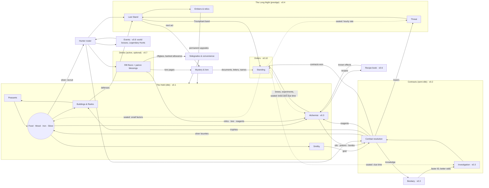

# The Last Hold — Game Design Document

**Status (v1.1 flesh-out 2026-10-22):** Approved through §10 (D26–D29). Revised after the GDD review (D30–D31); edits to approved sections are marked ⚑. v1.1 adds the Hold layout grid (§5.1.5, §9.21), the post-v1.0 roadmap (D498–D508), and accessibility/settings updates (§9.20).
**Markers:** **[JC]** = judgment call; the owner can override any of them. *(vX.Y)* = the milestone that introduces something. The judgment-call lists at the end of each section are a historical record of when each call was added; where a list and a section body disagree, the body (with its revision trail and `decisions.md`) is authoritative.
**Related docs:** `setting-primer.md` (spoiler-free; readable from v0.1), `lore-secrets.md` (the full truth; **kept outside the repo until v0.5**, D36), `technical-design.md`, `implementation-plan.md`, `decisions.md`.

---

## 1. Vision & Pillars

### 1.1 Elevator pitch

You are the warden of Stanholm, a ruined fortress on the edge of the Gloamreach, a frontier swallowed by monsters, cursed ruins, and something older beneath the ground.

You rebuild the hold, recruit monster hunters, and send them on contracts for frightened villages. You learn what the dark is made of, and you push it back.

The dark always returns. Each cycle ends in a Last Stand that you choose when to make. **Then a new warden, whom you name, arrives carrying the ember of the one who fell, and with it what they knew** *(⚑ revision, lore L4)*. Each cycle also uncovers another piece of the betrayal that broke the hold in the first place.

### 1.2 Experience goals

| Moment | The player should feel… |
|---|---|
| Opening the game | "My fortress kept working while I was gone." The game opens on a report, not a chore list. |
| Choosing a contract | Like a hunter studying a case. The decision is *what* to bring and *who* to send, not how fast to tap. |
| Reading a fight log | That the outcome was fair and explainable, and that better preparation would have changed it. |
| Late in a cycle | Rising pressure, plus a real choice: make the stand now, or hold one more day? |
| After the Long Night | Stronger, a little wiser, and hungry for the next piece of the story. |

### 1.3 Pillars

Every feature must serve at least one pillar and must not break any.

1. **Heroic with dark edges.** The dark is real and sometimes cruel, but the hold is a light. Hunters are brave, villagers are grateful, and victories feel earned. Horror is seasoning, not the meal.
   - *Test:* Does this make the player feel like a protector rather than a victim?
2. **Layers interlock.** Every layer produces something another layer needs. No system is a dead end.
   - *Test:* Can you name where this resource comes from and where it goes? (See §4.)
3. **Numbers are visible.** Every formula, chance, and modifier can be inspected in-game, and every fight leaves a readable log. Full transparency is the default (D10).
   - *Test:* Could the player predict this outcome from what the screen shows?
4. **Knowledge is progression.** The bestiary, the recipe book, and the lore make later play faster and better, not just more complete.
   - *Test:* Does learning this make the next contract or brew measurably easier?
5. **Respect my time.** Single-player, no monetization patterns, and no timers designed to frustrate. Offline progress is fair. Nothing important expires while you're away.
   - *Test:* Would missing a day feel like a punishment? If so, redesign it.

Determinism (seeded RNG, reproducible fights) is a technical requirement in support of pillar 3. It is specified in `technical-design.md`.

### 1.4 Non-goals

- Twitch skill, reflex timing, or tap-speed rewards.
- Daily login streaks, limited-time FOMO rewards, or anything that punishes absence.
- Gacha or randomized hunter pulls. Hunters come from recruitment, contracts, and events.
- Multiplayer, leaderboards, monetization. *(Audio was out of scope for v1.0; short sound effects arrive in v1.2, §9.22; music and loops stay out.)*
- A tutorial or onboarding flow (D12: audience is just the owner). In-game help text and inspectable formulas stand in for it.

---

## 2. Setting & Naming Rules

### 2.1 Tone guide (D01: heroic fantasy with dark edges)

- **Light:** Villagers bring gifts after good contracts. Hunters banter in logs. The hold visibly grows from ruin into a fortress.
- **Dark:** Monsters were often people, or were made by people. Cursed ruins carry real tragedies. The central mystery is a betrayal with no clean villain.
- **Humor:** Dry and occasional, mostly in hunter traits and log flavor lines. Never parody.
- **Violence:** Shown through outcomes and logs ("Bjarna is wounded: 3 days to recover"), not gore. Pixel art keeps it stylized.

### 2.2 Folklore blend (D05: Slavic + Nordic)

The Gloamreach sits between forested river country with Slavic flavor (the lowland villages) and cold fells and fjord-cut highlands with Nordic flavor (the northern ruins). Monsters, names, and material culture shift along that gradient. Lowland contracts feel Slavic; highland contracts feel Nordic; the deep places belong to neither.

### 2.3 Originality rules

All content is original. The influences supply *feel*, never names, characters, terminology, designs, or plots.

**Folklore creatures** may be used under their real-world folklore names and standard folklore spellings. Their designs and behavior must come from folklore sources, not from any game's version.

**Avoid list.** These terms and signature elements are off-limits:

| Source | Avoid |
|---|---|
| The Witcher | "witcher"; Signs; mutagens; decoctions; schools of monster hunters; game-specific monster spellings and coinages (leshen, kikimore, striga, noonwraith, nekker, drowner, bruxa); signature plots (e.g., a cursed princess cured by a night in a crypt); named potions or oils from the games |
| Elder Scrolls / Skyrim | Dragonborn; shouts / Thu'um; Daedra; Dwemer; standing stones as skill signs; "jarl" **[JC: a real Norse title, but too strongly Skyrim-coded; use "thane" or "headman"]** |
| Warcraft / WoW | Scourge; Lich King; Horde / Alliance; named classes (paladin, death knight) as hunter classes; WoW faction names |
| Age of Empires | Named civilizations; age names beyond the generic Hamlet → Keep → Citadel → Bastion |
| Warhammer 40K / Tacticus | Primarch; Astartes; Chapter; Heresy; Emperor; Salamanders / Vulkan or any named chapter, legion, or character; "promethium"; **Forgefather; "tithe" for the taking of people; Black Ships** *(⚑ lore L7)* |
| Hades | Boons; Mirror of Night; named gods' roles; "Darkness" as the reset currency |
| **Dark Souls** *(not an influence; ⚑ lore L6)* | Souls feeding a fire that holds back the dark (as named imagery); kindle and kindled; ash, ashen, cinder; hollow and hollowing; a "keep the fire or let it go out" ending pair; bonfires as checkpoints. **Kept on purpose:** "Embers" (the prestige currency). |

**Process rule:** Before any proper noun goes into a content file, it gets a quick web search against those games. Collisions are logged in `decisions.md`. Real historical or generic words (thane, warden, hold, contract, oil, bomb) are allowed.

### 2.4 Approved folklore creature pool (starter)

| Creature | Origin | Folklore basis to design from |
|---|---|---|
| Leshy | Slavic | Forest lord; leads travelers astray; changes size with the trees |
| Kikimora | Slavic | Household or swamp spirit; nighttime mischief that turns malicious |
| Rusalka | Slavic | Drowned maiden; river and field spirit; lures and drowns |
| Vodyanoy | Slavic | Old man of the water; drowns the careless; bound to mills and weirs |
| Poludnitsa (Lady Midday) | Slavic | Field spirit at noon; strikes down workers with heatstroke and madness |
| Upyr | Slavic | Restless dead; drinks blood; risen from improper burial |
| Strzyga | Slavic (Polish) | Person with two souls; after death, one soul hunts the living |
| Bies | Slavic | Malevolent spirit of the wilds |
| Likho | Slavic | One-eyed embodiment of misfortune |
| Mara / Mora | Slavic + Nordic | Nightmare spirit that sits on sleepers' chests |
| Draugr | Nordic | Barrow-dead; swollen, heavy, guarding treasure; can change size |
| Nix / Nøkk | Nordic | Water spirit; shapeshifts (often a horse); music lures victims |
| Huldra | Nordic | Forest woman with a hidden tail; seduces and punishes |
| Troll | Nordic | Stone-hided, sun-averse giants of the fells |
| Lindworm | Nordic | Wingless serpent-dragon |
| Domovoi | Slavic | Friendly household spirit; **not a monster**. A resident of the hold. |

**Original creatures** are encouraged for the cursed ruins and the deep (the Unlit and its spawn). Those live in `lore-secrets.md`.

### 2.5 Naming style

- **Places:** Compounds that mix the two roots: Slavic *-grad, -ov, -no, stan-, vel-* with Nordic *-holm, -fell, -mark, -vik*. Examples: Stanholm, Velkvik, Dubno Ford, Ravenfell.
- **People:** Lowlanders use Slavic-style given names (Dobrava, Milosz, Vesna). Highlanders use Nordic-style names (Yrsa, Halvar, Bjarna). Many hunters carry an epithet earned in the field ("Halvar Two-Smokes").
- **The Emberwrights:** Ranks and titles in plain English: Keeper of the Forge, Hearthblade, Wright, Apprentice *(⚑ lore L7: "Keeper" replaces Forge-Mother)*.
- **Lore names in the outline are working names** (Gloamreach, Stanholm, Emberwrights, Hearthseal, the Unlit, Hearthblade). They get collision-checked before v0.5 *("Firstblade" became "Hearthblade": the old title is an Elder Scrolls lore name; Q10, D142)*. **[JC: the Hearthblade's name changes from the outline's placeholder to "Yrsa Varn" to fit the Nordic naming style; the Keeper is "Dobrava Halsten".]**

---

## 3. Core Loops

### 3.1 Loops by timescale

| Loop | Length | What you do | Key decisions | What you get | From |
|---|---|---|---|---|---|
| **Check-in** | 2–3 min | Read "While you were away"; build and upgrade; reassign peasants; collect contract results; launch new contracts | What to build next; which contract, which party, which preparation | Resources, trophies, reagents, bestiary progress | v0.1 (hold), v0.2 (contracts) |
| **Session** | 15–30 min | Delve runs; alchemy experiments; roster and gear planning; read lore | Blessing picks; ingredient combinations; long-term roster shape | Riftglass, reagents, Ember-echoes, Delve relics; recipes | v0.6 (alchemy), v0.7 (delves) |
| **Events** | Whenever tokens are banked *(⚑ revision G7: was daily)* | A world-boss attempt or a Legendary Hunt attempt, each with a party of up to four, with different hunters each time | Who to spend on which attempt | Hunter XP, boss rewards, hunt points and, in the end, the three legendary hunters | v0.9 |
| **Cycle** | 3–5 days | Rank up the hold; keep Threat in check; pick the moment for the Last Stand | When to make the Last Stand | Embers (permanent currency), relics, the next act of the mystery | v0.4 |
| **Meta** | Weeks | Fill the bestiary and recipe book; raise hunter stars; finish Legendary Hunts; advance Orders | Long-term investment | Permanent power and knowledge; the full story | v0.3–v0.10 |

### 3.2 The check-in, step by step

This is the heart of the game and must stay fast. **Target: a routine check-in in 15 taps or fewer.**

1. **Open.** The "While you were away" sheet summarizes elapsed time (capped at 12 h; D08), resources gained, contracts resolved (success or failure, injuries, loot), and anything new in the bestiary. Tap once to dismiss. Every line can be expanded into its full log.
2. **Spend.** The Hold screen highlights affordable builds and upgrades with a badge. Buy in one tap; long-press for the formula and cost breakdown.
3. **Contracts.** The board shows open contracts. For each one: pick a party (with a suggested party pre-filled), pick preparation, then see the success odds with a full breakdown before launching.
4. **Leave.** Nothing demands attention until the next visit.

### 3.3 Anti-frustration rules for loops

- **The contract board fills up and waits.** New contracts arrive over time, up to a cap. They never expire. **[JC: one new contract every 2 h, board cap of 6 in v0.2.]**
- **Finished contracts apply at completion** *(⚑ revision B9)*. Rewards and returning hunters count the moment the timer ends, even offline. The results wait in a list for you to read (§5.4.3).
- **Unwanted contracts can be declined for free** *(⚑ revision A2)*. A full board never costs anything (G2).
- **Injuries heal on real time,** including while you're offline.
- **No resource is lost to an overflow cap in v0.1** (D24.3, no storage caps). If caps arrive later, the UI warns well before you hit them.
- **Events** (v0.9) never punish absence *(⚑ revision G7)*. Attempts are banked tokens, Legendary Hunts start when you start them, and absence can delay an event reward but never forfeit it.

### 3.4 What exists when

| Milestone | Playable loops |
|---|---|
| v0.1 | Check-in (hold only): build, assign peasants, Rank up to Keep |
| v0.2 | Check-in with contracts (tier 1 from Hamlet, G6), hunters, combat logs |
| v0.3 | Contracts gain investigation, the bestiary, and preparation |
| v0.4 | Cycle loop: Threat, Last Stand, Long Night, Embers, relics, Citadel and Bastion *(⚑ P3: moved ahead of alchemy discovery)* |
| v0.5 | Act I and the story systems: documents, the Archivist, warden naming, the Roll of Wardens, letters, village trust; ruin contracts, Rune damage and the Wright's Blade *(⚑ P2: split from the Long Night; detail §5.14)* |
| v0.6 | Session loop begins (alchemy experiments) |
| v0.7 | Session loop gains Delves |
| v0.8 | Check-ins gain loot and the Stores list; the meta loop gains hunter ranks, stars, talents, use-skills and Legendaries; Act V |
| v0.9–v0.10 | Meta loop deepens: events (v0.9), Orders (v0.10) |
| v0.11 | The Remembering: the end of the story, from the Hold screen's card after Act VI (§5.15) |
| v1.0 | Polish: accessibility, Text size, reduced motion, contrast, tap targets, backup reminder, redrawn art (§9.20) |
| v1.1 | The Hold's Layout: decorative 8 × 8 building placement grid and persistent blueprint (§5.1.5, §9.21) |
| v1.2 | Sounds of the Frontier: seven short sound effects for the big moments, off by default (§9.22) |
| v1.3 | Keep the Vigil: Rising Vigil, an optional On / Off switch on the Last Stand screen that makes stands harder, one step more each time, once the Remembering gate is open (§5.9.10, §9.23) |
| v1.4 | The Descent: the third ending, a three-stage all-hands relay into the Deep using what the hold learned across every cycle, once the Remembering gate is open and the hold reaches Bastion (§5.15.10, §9.24) |

---

## 4. Resource Flow

### 4.1 Resource catalog

"Survives the Long Night" means the item persists through the prestige reset.

| Resource | Kind | Produced by | Consumed by | Survives the Long Night? | From |
|---|---|---|---|---|---|
| **Food** | Basic | Farms, fishery; peasants | Settling peasants; **contract provisions** *(⚑ revision G3)* | No | v0.1 |
| **Wood** | Basic | Woodcutter's camp; peasants | Buildings; bomb casings; arrow shafts | No | v0.1 |
| **Iron** | Basic | Mine; peasants | Buildings; smithy gear | No | v0.1 |
| **Silver** | Basic + currency **[JC: silver is both a material and the bounty currency]** | Silver Seams (capped: at most 2, 0.22/min each, no bonuses; G1, D138, D189); **contract bounties (main source)** | Silvered gear; recruitment; Rank-ups | No | v0.1 |
| **Peasants** | Population | Houses + food surplus | Assigned to gathering jobs | No | v0.1 |
| **Hunters** | Roster | Recruitment (silver); later contracts and events | Contracts, Delves, bosses | **Yes**: the roster (active and reserve) persists; levels partly reset: half the levels above 1 are kept (§5.9.7); **items reset except Legendaries** *(⚑ D306)*; **ranks, stars and talents are kept** *(v0.8)* | v0.2 |
| **Trophies** | Per monster family | Contract kills (Delves give none, D262, D316) | Hunter rank-ups and stars (v0.8; spending never lowers the Trophy Hall count or the Embers conversion, A7); trophy-hall bonuses (v0.2) | Partly: converted into Embers at the Long Night (capped at the v0.4 arrival, G8) | v0.2 |
| **Reagents** | Ingredients | Contracts; herb garden; Delves | Alchemy: oils, potions, bombs | No | v0.3 |
| **Items** *(v0.8; were Gear)* | Items | Smithy (craft and rework, §5.11.1); contract loot; Delve guardians (§5.10.7) | Equipped by hunters (weapon, armor) | No, except **Legendaries** (keepsakes, kept forever, D306) | v0.2 / v0.8 |
| **Oils / Potions / Bombs** | Consumables | Alchemist's hut, from reagents | Contract preparation | No | v0.3 |
| **Knowledge** | Unlocks | Investigating and killing monsters; alchemy experiments **(the recipe book, v0.6, §5.8)** | Never spent; reduces investigation time and raises odds | **Yes** | v0.3 |
| **Warden skills** | Progress | Doing their activity: brewing and experiments, gear work, investigation and reading, winning contracts and holding waves (§5.8.6) | Never spent; small permanent bonuses | **Yes** ("carried in the ember") | v0.6 |
| **Threat** | Pressure meter | Rises with the Rank's base rate and with failed contracts. A full board, old contracts and declined contracts add nothing *(⚑ revision G2)* | Lowered by completed contracts and defenses; sets Last Stand difficulty | Resets to 0 | v0.4 | In v0.10 the hourly Rank rate is × (1 − the Quenchers' step × level) while that Order is seated.
| **Embers** | Prestige currency | The Last Stand (payout curve) plus trophy conversion | Permanent warden upgrades; **hunter stars** (v0.8, D310) | **Yes** | v0.4 |
| **Relics** | Persistent items | Last Stand wave milestones (§5.9.6); Delves (v0.7: six Delve relics, each also with an idle source; their effects work only in Delves, D261) | The hold (v0.4: every relic owned works); hunters (v0.8: as **Legendaries** in a keepsake slot, §5.11.6) | **Yes** | v0.4 / v0.8 *(⚑ v0.4 flesh-out, D111)* |
| **Riftglass** | Delve currency with a **banked allowance**: 1/7 of the weekly cap accrues per day, banking up to 2 weeks *(⚑ revision G7)* | Delve floors | The Riftglass shop: Late hours (offline cap), alternate traits, hold cosmetics, Delve upgrades (§5.10.8) | **Yes** | v0.7 |
| **Lore documents** | Collectibles | Contracts, Delves, Long Night | Mystery progression; some give small hints or bonuses | **Yes** | v0.5 |
| **Hunt points** | Event progress | Legendary Hunts | Unlocking a legendary hunter (counts per hunt, kept through the Long Night) | **Yes** | v0.9 |
| **Standing** | Per Order | Play already done: contracts won, brews, experiments, properties, documents, letters, names, Kozly Hollow contracts, Triumphant stands (no new chores) | Never spent: levels unlock chapters and small perks while the Order is seated | **Yes** | v0.10 |

### 4.2 Flow diagram



*Orders (v0.10) turn play already done into standing; they add no resource, income or bucket. Their perks are named factors on a time, a cost or Threat's hourly rate (§5.13.5).*

### 4.3 Interlock check

Every layer has at least one input from another layer and one output to another layer:

| Layer | Needs from others | Gives to others |
|---|---|---|
| Hold | Silver and trophies (Contracts); Embers (Long Night); sidegrades (Delves) | Gear, consumables, recruits (Contracts); defenses (Last Stand) |
| Contracts | Gear, consumables, recruits (Hold); knowledge (Bestiary) | Silver, trophies, reagents (Hold); Threat reduction (Long Night) |
| Delves | Hunters (roster) | Relics, lore, reagents, riftglass |
| Long Night | Defenses (Hold); hunters; Threat state | Embers, relics, story progression |
| Events | Roster depth | Legendary hunters, event rewards |

**Delve-optional check (D20):** Every resource Delves give either has an idle-path source (reagents, lore, and relics also come from contracts and Last Stands) or is a sidegrade or convenience. Idle-only play reaches all content about 20–30% slower. The balance simulator will verify this from v0.7 on. From v0.7 this is checked two ways: a content test lists every Delve reward with its idle source or its sidegrade / convenience / Delve-only mark, and the Idle-only row (§6.2) compares the `standard` and `delver` players (D269, D271). From v0.8, Delves also give hunter XP, Command skill XP and one guardian item, but only while a run pays Riftglass (D316). Each has an idle source (contract XP and contract loot), and the Idle-only row's "all content" grows with v0.8 (§6.2).

---

## Judgment calls in sections 1–4

1. **Silver is both a material and the bounty currency.** One fewer resource to track; contracts become the main source of silver.
2. **The hunter roster persists through the Long Night,** with rank and gear partly resetting. Details come with v0.4.
3. **Contract board:** one new contract every 2 h, up to 6, never expiring.
4. **Event participation:** event milestones are reachable with about 70% participation. *(Superseded by G7: absence can delay an event reward but never forfeit it.)*
5. **Routine check-in target:** 15 taps or fewer.
6. **Avoid "jarl"** as too Skyrim-coded; use "thane" or "headman" instead.
7. **Character names:** Hearthblade "Yrsa Varn" *(the title was Firstblade until D142)*, Keeper "Dobrava Halsten" *(title renamed in lore L7)*.
8. **Strzyga and Lady Midday are in the creature pool,** with designs drawn from folklore only and no reuse of the games' signature contract plots.
9. **The domovoi is a friendly resident of the hold,** not a monster.
10. **Prestige currency is named Embers; Delve currency is named Riftglass.**

---

## 5. Systems

> **About the numbers in this section.** Every number is a *starting value*. The structure (formulas, rules, what affects what) is the design. The constants are tuned by the balance simulator against the pacing targets in §6. When Claude Code changes a constant, the change goes in the content or config files, never into code. When a constant changes by more than 2×, it gets a line in `decisions.md`.

### 5.0 Cross-cutting rules

These apply to every system.

**Modifier buckets.** Every percentage bonus belongs to one named bucket. Bonuses add within a bucket and multiply across buckets:

```
final = base × (1 + Σ building) × (1 + Σ age) × (1 + Σ trophy) × (1 + Σ knowledge) × (1 + Σ ember) × (1 + Σ relic) × (1 + Σ event)
```

Buckets that don't exist yet in a milestone count as 0. The in-game breakdown shows each bucket and every contributor in it. Order perks are not a bonus bucket: each is a separate named factor applied after the buckets and shown as its own line.

**Combat modifiers** *(⚑ revision B1 [JC])*. Combat uses its own buckets, applied in this fixed order:

```
stat_eff   = (base × levelScale + Σ flat) × (1 + Σ stat%) × (1 + Σ status%)
raw        = Might_eff × variance
typed      = raw × resist[target][damageType]
dealt      = typed × (1 + Σ outgoing%) × (1 + knowledge%) × (crit ? critMult : 1)
afterArmor = max(0, dealt − Armor_eff)                         (direct attacks only)
final      = 0                                                 if resist = 0 (immune)
           = max(1, round(afterArmor × (1 − min(0.75, Σ taken%))))   otherwise
```

| Bucket | What goes in it | Examples |
|---|---|---|
| **flat** | Fixed additions to a stat, applied before any multiplier | Gear (+9 Might), Quick (+3 Speed) |
| **stat%** | Percentage changes to a stat that last the whole fight | Quickfoot Tincture (+20% Speed), Swell (+50% Armor) |
| **status%** | Temporary effects whose duration counts actions | Hamstring (−30% Speed), the Frost Pot slow, Hardwood Tonic, Malice (+5% Might per action) |
| **outgoing%** | Bonuses to damage dealt | Traits vs a family or location (Grave-warden, Fen-born, Fire-touched), oils |
| **knowledge%** | Studied / Mastered bonus vs a species | +5% / +10% |
| **taken%** | Reductions to damage taken. They **add together**, are **capped at 75%**, and apply **after Armor** *(B2)* | Shieldwall −10%, Fire-touched −20% Fire, Emberwright Plate −10% Fire |

- Every bucket is additive inside and multiplicative across buckets.
- `round` rounds half up. Health is always a whole number.
- A status with the same name refreshes rather than stacks, unless the ability says "stacking" (Malice).

**Breakdown everywhere (D10).** Every derived number (a rate, a stat, an odds figure, a cost) can be long-pressed (or hovered, on desktop) to open a breakdown tree: base value, each contributor, and the formula. The breakdown is generated from the same data the engine uses, so it can never disagree with the actual result.

**Time.** The engine runs in seconds. The UI shows rates per minute by default, with a per-hour toggle.

**Randomness.** Every random roll comes from a seeded stream (see `technical-design.md`). Logs show the roll whenever a roll mattered ("rolled 0.83 vs 0.90 to hit").

---

### 5.1 The Hold economy (v0.1)

#### 5.1.1 Resources and peasants

The four basic resources are **food, wood, iron, and silver**. There are no storage caps (D24.3).

**Peasants** are the workforce.
- **Housing** sets the maximum number of peasants. The Hearth Hall provides 3, and each Cottage adds 2.
- **Settling** a new peasant costs food: `settleCost(P) = 20 × 1.15^P`, where P is the current number of peasants.
- **Auto-settle** is on by default. While housing is free and food covers the cost, a new peasant settles automatically, at most one every 30 s. The player can turn auto-settle off to save food for something else. With auto-settle off, a **Settle one** button settles a peasant by hand: the same food cost and housing limit, no 30 s wait, and it doesn't delay the next automatic settle (D63).
- **No food upkeep in v0.1** **[JC]**. Peasants cost food to settle, not to keep. This avoids starvation spirals, which play badly with offline time. From v0.2, food also pays **contract provisions** (§5.4.2, G3), which is the food sink after Keep.

**Jobs.** Each peasant is either idle or assigned to a job. Job slots come from buildings.

| Job | Produces | Base rate per worker | Slots from |
|---|---|---|---|
| Farmer | Food | 6 / min | Farm (3 each) |
| Woodcutter | Wood | 4 / min | Woodcutter's Camp (3 each) |
| Miner | Iron | 2 / min | Mine (2 each) |
| Silver-digger | Silver | 0.25 / min | Silver Seam (1 each; **at most 2 Seams**) |

- **Idle peasants produce nothing.** The Hold screen shows an "idle hands" warning whenever any peasant is idle.
- **New peasants** take the first open slot in a **job priority list** that the player sets. The default order is Farmer → Woodcutter → Miner → Silver-digger.
- **Reassigning** is free and instant, using +/− buttons per job plus a "fill" button.

**Production rate per resource:**

```
rate_R = workers_R × baseRate_R × (bucket multipliers, §5.0)
```

**Silver is capped at the source (G1, D30).** Silver-digger output gets **no building, age, trophy, knowledge or ember bonuses**; only relic and event bonuses apply (none exist before v0.4). With at most 2 Seams, seam income can never exceed 2 × 0.22/min = **about 630 silver per day** (720 at 0.25/min before D138, 690 at 0.24/min before D189). Contract bounties are the main silver source from v0.2 on. *⚑ Revision of approved §5.1.1.*

#### 5.1.2 Buildings

There are two kinds of building:

- **Count buildings** can be bought many times. The next copy costs `base × r^n` with **r = 1.15**, where **n is the number already owned, including free starting buildings** *(⚑ revision A8)*. For example, the first Farm you buy is your 2nd, so it costs 40 × 1.15 = 46 wood.
- **Level buildings** are unique and are upgraded. Level L (starting from 1) costs `base × r^(L−1)` with **r = 1.75**. Each Rank sets a maximum level.

**Bulk buy.** Count buildings support ×1, ×10, and Max.
- Buying k copies costs `base × r^n × (r^k − 1)/(r − 1)` of each resource.
- For Max, the engine computes the affordable k for each resource as `k = floor(log(1 + funds·(r−1)/(base·r^n)) / log r)`, and takes the smallest k across resources.

**All construction is instant** **[JC]**. Pacing comes from costs, not build timers. Waiting on a timer you can't affect is the kind of friction pillar 5 rules out.

**Best payback: one valuation, used everywhere** *(⚑ revision B7 [JC])*. The ● best-buy hint (§9.2) and the simulator's greedy policy (§6.1) call the same function:

```
value(bundle) = Σ_r  w_r × amount_r     w = value.weights: food 1, wood 1.5, iron 3, silver 12
payback(item) = value(cost) ÷ value(Δrate per min)        (lower is better)
```

- The weights are the inverse of each resource's base rate, normalized to food. They live in `balance.ts` so they can be retuned.
- **Δrate** is the change in production the purchase causes right now:
  - Production buildings and levels: the direct rate change.
  - Housing (Cottage): extra peasants × the marginal rate of the best open job slot, or 0 if no slot is free.
  - Slot buildings: 0 unless idle peasants are waiting to fill the new slots.
- Items with Δrate = 0 (for example, the Bell Tower) never get the ●. The simulator buys them only through explicit policy rules.
- Rank-ups are excluded; the policy's saving rule handles them.

**v0.1 buildings** (costs are base values):

| Building | Type | Base cost | Effect | Available |
|---|---|---|---|---|
| Hearth Hall | Unique | — (start) | Houses 3 peasants. The Rank-up happens here. | Start |
| Cottage | Count | 30 wood, 10 food | +2 housing | Hamlet |
| Farm | Count | 40 wood | +3 Farmer slots | Hamlet (start with 1) |
| Woodcutter's Camp | Count | 25 wood, 15 food | +3 Woodcutter slots | Hamlet (start with 1) |
| Mine | Count | 80 wood, 40 food | +2 Miner slots | Hamlet |
| Silver Seam | Count (**max 2**) | 150 wood, 120 iron | +1 Silver-digger slot; never boosted (G1) | Hamlet |
| Mill | Level (max 5 in Hamlet, 10 in Keep, 15 in Citadel, 20 in Bastion) | 120 wood, 40 iron | +25% food per level (building bucket) | Hamlet |
| Sawpit | Level (max 5 / 10 / 15 / 20) | 100 wood, 60 iron | +25% wood per level | Hamlet |
| Smithy | Level (max 3 / 10 / 15 / 20) | 200 wood, 150 iron | +20% iron per level. Unlocks gear tiers (v0.2) | Hamlet |
| Bell Tower | Level (max 3) | 1,500 wood, 800 iron, 150 silver | +1 h offline cap per level | Keep |

#### 5.1.3 Ranks

The Rank-up **Hamlet → Keep** requires:
- **Prerequisites:** 10 peasants, Mill level 3, and a Smithy.
- **Cost:** 12,000 food, 9,000 wood, 4,000 iron, and **250 silver** *(⚑ revision: was 600; lowered to fit capped Seams, G1; then 300 → 250 in the v0.1 tuning pass, D62)*.

**Keep grants:**
- Higher maximum levels (see the table).
- +50% to all production (age bucket).
- The Bell Tower.

From v0.2 onward, Keep also unlocks contract tiers above 1, the Barracks, and the Trophy Hall. The contract board itself opens in Hamlet, when the first Mine is built *(⚑ revision G6)*.

**Each Rank-up restores part of old Stanholm**, with a short inscription *(⚑ revision, lore C7)*. Keep restores the gatehouse and the Roll of Honor (`setting-primer.md` §6.5); Citadel and Bastion are in `lore-secrets.md` §11.

In v0.1–v0.3, the Keep is the end of content. The Rank screen shows the next Rank (Citadel) as "Coming in a later milestone," with no fake progress bar.

**Pacing target:** Keep is reached after **8–14 hours of game time**, under the simulator's **Standard** policy (§6.1). The simulator enforces this band (§6.2). *(⚑ revision A9: the policy is defined only in §6.1.)*

**Citadel and Bastion** *(v0.4; ⚑ v0.4 flesh-out, D106)*. Contract tiers stay 1–5: the new Ranks make contracts pay more instead.

| | Citadel | Bastion |
|---|---|---|
| Requires | 50 peasants, Mill 10, Smithy 8, Barracks 1 | 60 peasants, Mill 12, Smithy 9, Barracks 3, Walls 1 *(T4.15, D138)* |
| Cost | 300,000 food, 150,000 wood, 60,000 iron, 600 silver *(D138)* | 500,000 food, 300,000 wood, 110,000 iron, 1,600 silver *(D138)* |
| All production (age bucket, not silver) | +50% (adds to the Keep's) | +50% more |
| Mill, Sawpit, Smithy level cap | 15 | 20 |
| Hunter level cap | 15 | 20 |
| Bounty multiplier | ×3.5 *(D138)* | ×3 *(D138)* |
| Provisions (`provisions.incomeMinutes`) | 4.4 *(D189)* | 2.5 *(D138)* |
| Active roster | +2 | +2 |
| Highest contract tier | 5 | 5 |
| Unlocks | Walls and Watchtower (§5.9.2) | the Last Stand (§5.9.3) |
| Restores | **the old Forge Hall**: *"The roof is back on the old Forge Hall. Its forges are cold."* From v0.5 (D160): *"Over the great anvil, cut deep: 'The fire for the folk; the folk —'. The rest has been chiseled out."* | **a sealed stair going down**: *"Under the Bastion floor, a stair goes down to a sealed door."* From v0.5 (D160): *"Thirty-nine faded ribbons are tied to its handle."* |

- Every number is a tunable starting value (requirements and costs live with the Ranks in the content, D44), except the roster bonus and the tier cap, which are locked. The simulator tunes the costs to the targets: Citadel on day 2, Bastion on days 3–4 (§6.2, D137).
- The restorations showed no inscription in v0.4. From v0.5 each carries its inscription (D160, `lore-secrets.md` §11), every cycle; a save already past the Rank sees it on arrival.
- A hunter who carries a level above the current Rank's cap (§5.9.7) keeps it; the cap only stops new levels.

#### 5.1.4 Starting state

- The Hearth Hall.
- 1 Farm and 1 Woodcutter's Camp.
- 3 peasants: **1 Farmer and 2 Woodcutters** *(⚑ revision A10 [JC]: was 2 Farmers and 1 Woodcutter)*.
- 80 food and 75 wood *(⚑ v0.1 tuning: wood was 50, D62; v0.2 tuning: food was 50, so the first contract's provisions are affordable soon after the first Mine, D76)*.
- Auto-settle on.

**Opening goal** (measured by the **Opening** policy, §6.1): a Cottage within 1 minute and a Mine within 5 minutes. A hand calculation gives about 4.4 minutes for the Mine (after the first Cottage's 30 wood, wood reaches 80 at about 4.4 min). **If the simulator misses, raise starting wood; don't move the target.** *(⚑ v0.1 tuning, D62: 70 wood gave 5.2 min in the simulator, so the start is 75 wood; the simulator measures 4.5 min.)*

#### 5.1.5 The Hold's layout *(v1.1, D500–D504; red-team M1–M4, S6, S7)*

The Hold sits on an **8 × 8 grid** (`x = 0..7` west to east, `y = 0..7` north to south). Along the north edge (above row `0`) lies **the Fell Breach**, where the dark comes down from the fells in the Last Stand. Along the south edge (below row `7`) lies **the Lowland Gate**, where the road comes up from the villages.

- **Decorative in v1.1, ready for v1.5.** In v1.1, where buildings sit on the grid is purely visual: it changes no production rate, cost, Threat rate or fight calculation (`rulesVersion` stays 5). The 8 × 8 coordinate layout format and piece IDs are saved in a fixed schema (`state.layout`, schema 12) so that **v1.5 ("The Breach")** can give wall, watchtower and building positions a tactical role in the Last Stand without migrating `HoldLayoutState` (stand records will store an optional layout snapshot) (D499, D500).
- **Rank clearings (D500, M1).** Ranking up clears more of old Stanholm's ground inside the 8 × 8 grid; tiles outside the current Rank's clearing show dark pine forest and ruined foundation stones and cannot hold active pieces:
  - **Hamlet (`4 × 4`, 16 tiles):** columns `2–5`, rows `2–5`.
  - **Keep (`6 × 6`, 36 tiles):** columns `1–6`, rows `1–6`.
  - **Citadel (`8 × 6`, 48 tiles):** columns `0–7`, rows `1–6` (uncovers the full 8-tile north curtain line along row `1`, facing row `0`).
  - **Bastion (`8 × 8`, 64 tiles):** columns `0–7`, rows `0–7` (opens row `0` right along the Fell Breach and row `7` along the Lowland Gate).
- **Pieces on the grid (D501).** Exactly **40 pieces (43 tiles)** exist at full Bastion (the 2 × 2 Hearth Hall and 39 one-tile pieces), leaving exactly 21 open tiles of courtyard and roads (Q52, D511, D514):

| Category | Piece ids | Size | When each piece unlocks | Visual tiers on the grid |
|---|---|---|---|---|
| **Hearth Hall** (1) | `hearth-hall` | **2 × 2** (4 tiles) | Start (always owned; top-left anchor restricted to `x = 2..4, y = 2..4`, default `(3, 3)` covering `(3,3)–(4,4)`) | Always 100% inside the clearing at all Ranks; never stranded by the Long Night (M4). Shows Rank look, Carved Hearth Hall door cosmetic if bought, and post-Remembering window lamp (§5.15.6). Cannot be moved to the tray, only moved within `2..4 × 2..4`. |
| **Unique & level buildings** (8) | `mill`, `sawpit`, `smithy`, `bell-tower`, `barracks`, `trophy-hall`, `lodge`, `alchemist` | **1 × 1** | When built (count or level ≥ 1) | Level buildings show 3 visual tiers by level: Tier I (Lv 1–4; Lv 1 for 3-cap; Lv 1–2 for 5-cap), Tier II (Lv 5–10; Lv 2 for 3-cap; Lv 3–4 for 5-cap), Tier III (Lv 11+; Lv 3 for 3-cap; Lv 5 for 5-cap). Unique Trophy Hall has 1 tier. |
| **Count-building plots** (17) | `cottage-1..3`, `farm-1..3`, `woodcutter-1..3`, `mine-1..3`, `herb-garden-1..3`; `silver-seam-1..2` | **1 × 1** | **Plot 1** at `1` owned, **Plot 2** at `5` owned, **Plot 3** at `15` owned (`silver-seam`: Plot 1 at `1`, Plot 2 at `2`) | Each placed plot shows 3 density tiers from total owned: `1–4` single structure, `5–14` pair, `15+` cluster (`silver-seam`: `1` single seam, `2` twin seams). |
| **Watchtowers** (3) | `watchtower-1..3` | **1 × 1** | Tower 1 at Watchtower Lv `1`, Tower 2 at Lv `8`, Tower 3 at Lv `15` | Towers 1 and 2 sit in row `1` (`(2,1)`, `(5,1)`); Tower 3 sits in row `0` (`(3,0)`). Shows Watchtower bell cosmetic if bought (on border header at Hamlet/Keep, on Tower 1 once built). Counts as a wall neighbour for connections. |
| **Wall segments** (11) | `wall-1..11` | **1 × 1** | `4` segments at Walls Lv `1`, then `+1` segment at Lv `3, 5, 7, 9, 11, 13, 15` (11 in all) | Segments 1–6 sit in row `1` (`y = 1`), segments 7–8 in row `2` wings (`(0,2)`, `(7,2)`), segments 9–11 in row `0` (`(2,0)`, `(4,0)`, `(5,0)`). Auto-connects to adjacent Wall or Watchtower tiles (N/E/S/W). Shows Wall lanterns cosmetic if bought. |

- **Piece states and blueprint protection (D502, M2):**
  - `locked`: Not yet unlocked this cycle. If it has a coordinate in `state.layout.placed`, it renders as a faint stone foundation outline when **Blueprint ghosts** is On. It never occupies a tile and cannot be moved or selected.
  - `active`: Unlocked and placed inside the current clearing. Occupies its tile footprint.
  - `dormant-ring`: Unlocked, but its saved blueprint coordinate is in a locked outer ring. It waits peacefully at its saved coordinate (ghost rendered if On) and does **not** trigger the `[Layout ▸]` badge. Its blueprint is **never overwritten automatically**.
  - `tray`: Unlocked, but has no coordinate in `state.layout.placed` (unplaced, cleared to tray, or overflow). Only pieces in `tray` appear in the Tray UI and count toward the `[Layout (n) ▸]` badge.
- **Auto-placement rules (D502, M2, S6):**
  1. A saved blueprint coordinate in `state.layout.placed` is **never overwritten automatically**.
  2. When a piece unlocks, if it already has a saved coordinate in `state.layout.placed`: if that tile is inside the current clearing and free, it becomes `active`; if the coordinate is in a locked outer ring, it becomes `dormant-ring`; if the tile is inside the clearing but occupied by another active piece, it waits in `tray`.
  3. Only if a newly unlocked piece has **no coordinate** in `state.layout.placed` does auto-placement assign it the first free tile in the current clearing (saving that coordinate). If the clearing is full, it waits in `tray`.
  4. Auto-placement ordering (S6): defenses (`wall-*`, `watchtower-*`) prioritize row `1` west to east, then row `2` wings, then row `0`. Other buildings prioritize tiles ordered by Manhattan distance from the center `(3.5, 3.5)`, then `y` ascending, then `x` ascending. Other buildings never take a defense tile (row `1`, the row `2` wings, row `0`) by auto-placement, so those tiles stay free for walls and towers (D510).
  5. On `hold.rankUp`, any `dormant-ring` piece whose tile opened becomes `active`. Any pieces in `tray` auto-place onto newly opened free tiles.
  6. On new game creation (M3), `placed` starts with `hearth-hall: { x: 3, y: 3 }` (no ghosts for unbuilt buildings), and the starting Farm and Woodcutter's Camp are then placed by rules 3 and 4, nearest the middle first, so the tray starts empty. At the start of a new cycle after the Long Night, starting buildings wake up at their saved spots, or are placed by the same rules if they have none; the saved blueprint is otherwise untouched.
- **Canonical Auto-arrange layout (D503, M1):**
  - `hearth-hall` at `(3, 3)–(4, 4)`.
  - Hamlet inner ring (`2..5 × 2..5`): `silver-seam-2 (2,2)`, `smithy (3,2)`, `silver-seam-1 (4,2)`, `mine-1 (5,2)`, `mill (2,3)`, `sawpit (5,3)`, `farm-1 (2,4)`, `woodcutter-1 (5,4)`, `cottage-1 (2,5)`, `cottage-2 (3,5)`, `farm-2 (4,5)`, `woodcutter-2 (5,5)`.
  - Keep ring (`1..6 × 1..6`): `alchemist (1,2)`, `herb-garden-1 (1,3)`, `herb-garden-2 (1,4)`, `herb-garden-3 (1,5)`, `mine-2 (6,2)`, `mine-3 (6,3)`, `lodge (6,4)`, `barracks (6,5)`, `trophy-hall (1,6)`, `bell-tower (2,6)`, `cottage-3 (3,6)`, `farm-3 (4,6)`, `woodcutter-3 (5,6)`.
  - Citadel defense front (`y = 1` and `y = 2`): `wall-1 (0,1)`, `wall-2 (1,1)`, `watchtower-1 (2,1)`, `wall-3 (3,1)`, `wall-4 (4,1)`, `watchtower-2 (5,1)`, `wall-5 (6,1)`, `wall-6 (7,1)`, `wall-7 (0,2)`, `wall-8 (7,2)`.
  - Bastion forward breach defenses (`y = 0`): `wall-9 (2,0)`, `watchtower-3 (3,0)`, `wall-10 (4,0)`, `wall-11 (5,0)`.

---

### 5.2 Offline progress (v0.1)

**Elapsed time on load:**

```
elapsed = clamp(now − lastSeen, 0, offlineCap)
```

- **Offline cap:** a base of 12 h (D08), plus the Bell Tower (up to +3 h), plus later sources (Embers in v0.4: Late Lantern, §8.9; Riftglass in v0.7). **Hard ceiling: 24 h** **[JC]**.
- **Clock moved backward:** if `now < lastSeen`, then `elapsed = 0` and `lastSeen` is reset to `now` (D21). No penalty, no warning.

**Simulation.** Offline time runs through **the same `advance(state, dt)` function** as live play. **`advance` is event-driven** *(⚑ revision A11 [JC])*:
- Inside any `dt`, it finds the next scheduled event (a peasant settle becoming due, a contract finishing, a recovery or brew ending, a board refill), moves resources forward linearly to that moment, applies the event, and repeats until `dt` is used up.
- Rates are constant between events, so every event time is exact. For example, a settle becomes due at `(cost − food) ÷ foodRate`, but no sooner than 30 s after the previous settle.
- **Chunk size therefore never changes the result.** Offline catch-up still runs in 60 s chunks, but only to drive the progress bar.
- **Acceptance test:** 12 h of live play in 1 s ticks and a single 12 h offline catch-up, from the same starting state, must end in the same state (within floating-point tolerance).
- **Offline efficiency is 100%** **[JC]**. Many idle games pay out offline time at a reduced rate. Here the cap is the only limit, because pillar 5 says offline progress should feel fair.

**"While you were away" sheet:**
- Time counted, plus a note if time beyond the cap was not counted: *"14 h 20 m away · 12 h counted (cap)."*
- Resources gained.
- Peasants settled.
- Contracts resolved, each with its outcome and a tap-through to the full log *(v0.2)*.
- Injuries that started or healed *(v0.2)*.
- New bestiary entries *(v0.3)*.

The sheet is dismissed with one tap. The last three sheets are kept under More → Reports.

---

### 5.3 Hunters (v0.2)

#### 5.3.1 Collection model

Every hunter is a **hand-authored named character** **[JC]**. There are no procedurally generated recruits.
- v0.2 ships with 8 hunters; v1.0 targets about 30.
- Each hunter has unlock conditions (Rank, bestiary progress, specific contracts, and later events or Orders). When the conditions are met, the hunter arrives at the hold as a **candidate**. Paying their recruitment silver adds them to the roster.
- This keeps the Tacticus collection feel (every hunter matters) without any gacha.

**Active roster and reserve** *(⚑ revision G5)*:
- **Active roster cap:** 3 in Hamlet (bunks in the Hearth Hall [JC]). In Keep, 3 + Barracks level, up to 8. Citadel adds 2 and Bastion adds 2, for 12 at most [JC].
- **Reserve:** unlimited. Every hunter you own but haven't made active waits in the reserve. Reserve hunters can't take contracts or Delves; from v0.8 they earn **yard XP** like every hunter not on a contract (§5.11.5). They **can** join world bosses and Legendary Hunts (v0.9).
- **Swapping** between active and reserve is free and instant, except for hunters who are on a contract or recovering.
- **Letting a hunter go** means moving them to the reserve. Hunters are never deleted [JC].
- **Barracks** (Keep, level building, max 5, base cost 600 wood, 300 iron, 100 silver) raises the active cap.

**Recruitment cost** is a **fixed silver price per hunter**, set in the hunter's content file (§8.5) *(⚑ revision G5 [JC])*. The old `100 × 1.5^rosterSize` formula would reach absurd prices with a ~30-hunter collection, and moving hunters to the reserve would dodge it. The two starting hunters are free.

#### 5.3.2 Stats and levels

| Stat | Effect |
|---|---|
| Health | Hit points. At 0 the hunter is downed. |
| Might | Damage per hit. For a Mender, Might also sets healing. |
| Armor | Flat reduction to each incoming hit (minimum damage is 1). |
| Speed | How often the combatant acts (turn meter, §5.5). |

- **Level 1–10 in Keep** (later Ranks raise the cap). **Health and Might** scale as `base × (1 + g × (level − 1))`, where g = 0.10 plus 0.01 per **star** (v0.8, §5.11.3). **Armor and Speed don't scale with level** *(⚑ revision [JC]: under the turn meter, Speed growth would compound into extra actions)*.
- **Displayed stats include gear and traits** *(⚑ revision A14)*. The breakdown separates base, level, gear and traits.
- **XP per contract:** 20 × tier on a success, half that on a failure.
- **XP to go from level L to L+1:** `50 × 1.3^(L−1)` *(v0.8 tuning, D354: was 1.5)*.

#### 5.3.3 Roles (D24.2 names)

| Role | Identity | Combat rule |
|---|---|---|
| **Vanguard** | Tank | Monsters target Vanguards with weight 3 (others weight 1). High Health and Armor. |
| **Mender** | Healer | On her action, if any standing hunter (herself included) is below 70% Health, she heals the one with the **lowest % Health** for `1.5 × Might` (ties: party slot order). Downed hunters can't be healed. Otherwise she attacks at 50% Might. *(⚑ revision B6)* |
| **Striker** | Damage | 20% crit chance (others 10%). Crits deal ×1.5. |

#### 5.3.4 Damage types (D24.2 names)

There are six types: **Steel, Silver, Fire, Frost, Rune, Venom**.
- Each hunter has one innate damage type, from their weapon style.
- Each monster has a resistance multiplier per type. 1.0 is neutral; below 1 resists; above 1 is weak. The values are shown once the monster is Identified (§5.6).
- **Rune** damage belongs to the Emberwright lore. From v0.5 it comes from the Wright's Blade's sub-hit (§5.3.6) and from Arvid Netmender (§8.5); it's the Cursed family's common weakness (§8.3).

#### 5.3.5 Traits

Each hunter has **2 traits**, each with an exact numeric effect.

| Trait type | Example |
|---|---|
| Location | *Fen-born:* +15% Might on river and marsh contracts |
| Monster family | *Grave-warden:* +20% Might vs Restless Dead |
| Role | *Shieldwall:* while this Vanguard stands, allies take −10% damage |
| Recovery | *Hard to kill:* recovery times −30% |
| Flavor and economy | *Haggler:* +10% bounty silver on contracts this hunter joins |

The full list goes in §8.

#### 5.3.6 Gear (v0.2)

Until v0.8, gear is **upgraded in place**: each hunter has a weapon slot and an armor slot, and the Smithy upgrades the slot directly. **From v0.8 every piece below is an item** (§5.11.1): the Smithy crafts the first tier and reworks an item one tier up for the same step cost shown here.

| Slot tier | Effect | Cost | Requires |
|---|---|---|---|
| Iron Blade | +4 Might | 60 iron | Smithy 1 |
| Steel Blade | +9 Might | 250 iron, 50 wood | Smithy 3 |
| Silvered Blade | +9 Might. Each hit also deals a separate **Silver sub-hit**: `0.25 × Might_eff × variance × crit` × the target's Silver resistance. Armor doesn't apply, and it's logged as its own line *(⚑ revision B3 [JC])* | 250 iron, 120 silver | Smithy 5 |
| **Wright's Blade** *(v0.5, D159; was "Runed Blade", D170)* | +12 Might. Keeps the Silver sub-hit and adds a **Rune sub-hit** of the same size: `0.25 × Might_eff × variance × crit` × the target's Rune resistance, no Armor, its own log line | 600 iron, 300 silver | Smithy 8 and the Citadel (the Forge Hall) |
| Hide Armor | +2 Armor | 40 wood, 30 food | Smithy 1 |
| Mail | +5 Armor | 300 iron | Smithy 3 |
| Emberwright Plate | +8 Armor, −10% Fire damage taken | 600 iron, 150 silver | Smithy 6 |

The Wright's Blade (v0.5) is the fourth weapon tier, strictly better than the Silvered Blade, so upgrading in place still works. Like all gear it resets at the Long Night (A4).

#### 5.3.7 Injury and death (D07)

| Outcome at the end of a fight | Result |
|---|---|
| Survived with at least 30% Health | Fine |
| Survived with less than 30% Health | **Bruised:** 30 min recovery |
| Downed | **Wounded:** recovery of 2 h × contract tier |
| Downed on a **Reckless** contract | Death roll: **30% chance of death**. Survivors are **Grievously Wounded** (3× the Wounded time). |

- A contract is **Reckless** when its displayed success odds are **below 35%** **[JC]**. The odds already include preparation, so "reckless" and "badly prepared" are the same rule: poor preparation lowers the odds until the contract crosses the line.
- Launching a Reckless contract requires a confirmation dialog that names each hunter and their exact death chance.
- Recovering hunters can't take contracts. Recovery runs on real time, including offline.
- **Story hunters never die** *(⚑ revision, lore C4)*: Sigrun, Ostap, Toma and Arvid can be wounded, but on a Reckless contract their death roll becomes Grievously Wounded instead. They persist through every Long Night and are always available before their act needs them (`lore-secrets.md` §10).
- Dead hunters are gone for the cycle. Their memorial stays in the Hall of the Fallen (More menu). **[JC: a dead named hunter returns as a candidate after the next Long Night, with their lore tracked. Permanently losing a hand-authored character felt too punishing for a collection game.]** Before v0.4, when no Long Night exists yet, a dead hunter returns as a candidate **3 days** after their death *(⚑ revision A12 [JC])*. **From v0.4,** a dead hunter returns as a candidate at the next Long Night, at their usual price, with their levels halved like everyone's (§5.9.7, D110).

---

### 5.4 Contracts (v0.2)

#### 5.4.1 The board

- One new contract arrives every 2 h, up to a cap of 6. Contracts never expire.
- **Decline** *(⚑ revision A2)*: any open contract can be declined for free. It's removed with no penalty and no Threat, and the slot refills on the normal 2 h schedule.
- **The board opens in Hamlet, when the first Mine is built** *(⚑ revision G6 [JC]: was Keep)*. Hamlet contracts are tier 1 only, with a party of at most 2. Keep unlocks higher tiers (below), the Barracks, the Trophy Hall, the Hunter's Lodge and the Alchemist's Hut.
- Each contract is generated from a seed when it arrives, and its content is fixed from then on.

Each contract has:

| Field | Notes |
|---|---|
| Village | The giver. Flavor in v0.2; the Thanes' Moot counts a contract won for any village toward its standing (v0.10). |
| Monster | In v0.2, always a known species (identified for free). Unknown monsters arrive in v0.3. |
| Tier | 1–5 from the Keep on; Citadel and Bastion add no tiers (D106). Each tier above the monster's base tier multiplies Health and Might by 1.35 and Armor by 1.15 (§7). |
| Location tag | Forest, river, field or barrow; **ruin from v0.5** *(⚑ revision D-2; D157)*: old Emberwright sites, posted by Kozly Hollow, Velkvik and Ravenfell from the Keep. **Barrow and ruin contracts start at tier 2** *(⚑ revision A3 [JC])*. Interacts with traits. |
| Party size | Up to 3 hunters at tiers 1–3, up to 4 at tiers 4–5; at most 2 in Hamlet (G6) |
| Duration | 30 min / 1 h / 2 h / 4 h / 8 h by tier |
| Bounty | `91 × 1.6^(tier − 1)` silver × `bounty.ageMult` (Hamlet 1.0, Keep 1.1, Citadel 3.5, Bastion 3; D106, D138). The age production bucket does **not** apply to bounties *(⚑ revisions: base was 40, raised with G1; ageMult defined in A6; 72 → 78 in the Q9 tuning (D82): provisions now grow with food income, so fewer contracts go out and each pays a little more; 78 → 91 in the v0.4 tuning, D138)* |
| Trophies | Equal to the tier, of that monster's family |
| Reagents | *(v0.3)* monster-specific drops |

**Tier unlocks** *(⚑ revision B8 [JC])*: tier t+1 unlocks after **3 successes at tier t**, up to the Rank's cap (Hamlet T1, Keep T5). **Tier mix:** 60% of new contracts at the highest unlocked tier, 40% spread evenly across the lower unlocked tiers (all at the highest while only one is unlocked). **No rubber-banding** **[JC]**: difficulty never scales with roster strength, because hidden scaling would make the numbers lie.

#### 5.4.2 Launching

1. Choose a party. A **Suggested party** button fills it with the highest-odds available combination, found by the two-stage search in §6.5 (it runs in a background worker).
2. *(v0.3)* Choose preparation.
3. Read the odds panel:
   - **Win chance** from 500 simulated fights, shown with a ±margin.
   - **Expected injuries** per hunter.
   - **Death chance** per hunter (Reckless contracts only).
   - **Expected rewards.**
   - **"Why?"** opens the summary math: party damage per 100 ticks vs monster Health, and monster damage per 100 ticks vs the party's effective Health.
4. **Pay provisions** *(⚑ revisions G3; Q9, D81–D82)*: per hunter, the larger of **30 food** or **N minutes of the hold's food capacity** (what its food jobs would make with every farmer slot filled, limited by the number of peasants; Q11, D84, so moving peasants between jobs cannot lower it), × party size × 2.2^(tier − 1), paid at launch. N is `provisions.incomeMinutes`: 0 in the Hamlet, 1 in the Keep (D85), **4.4** in the Citadel (D189) and 2.5 in Bastion (D106, D138; tuned to keep §6.3 #8 in its band). Hamlet contracts therefore stay flat (tier 1 with 2 hunters: 60 food). From the Keep on, provisions grow with the hold, so food stays a real cost (§6.3 #8): a tier-3 party of 3 costs about 15 minutes of food capacity, and a tier-5 party of 4 about 1 h 34 min. The launch sheet's breakdown shows the food capacity used. Failures don't refund provisions; declining is free. If food is short, the launch button shows how long until it's affordable. Nothing launches while you're offline, so food can never go negative. While the Thanes' Moot is seated, the food paid is multiplied by (1 − step × level) (§5.13.5).
5. Launch. The hunters are busy for the contract's duration.

The **actual outcome** uses `seed = hash(contractSeed, party IDs, preparation IDs)`. It is fixed and reproducible, and it's the same fight the log replays. The 500 preview simulations use different derived seeds, so the preview never reveals the real roll.

#### 5.4.3 Results

| Result | Rewards |
|---|---|
| **Success** | Full bounty, trophies, XP, reagents (v0.3); from v0.5, a document when its condition is met, and a Ribbonshade's name (§5.14); from v0.8, a chance of **loot** (§5.11.2) |
| **Failure** (the party is downed, or 400 ticks pass) | Half XP. In v0.3, any clues gathered are kept as bestiary progress. **No bounty.** |
| **Well-prepared success** *(v0.3)* | Bounty × 1.5 and +1 trophy **[JC]** |

**Rewards apply at completion** *(⚑ revision B9 [JC])*. When a contract's timer ends, including in simulated offline time, its rewards, injuries and XP apply and its hunters return to the hold at once. **Collect** only acknowledges results and shows the logs. Offline trophies therefore count toward the Trophy Hall from the moment they're earned.

#### 5.4.4 How contracts feed the Hold

- **Silver bounties** are the main silver source from v0.2 on. Silver Seams are capped at about 690 silver per day for the whole game (G1; 720 before D138), so bounties overtake them as higher tiers unlock.
- **Trophy Hall** (Keep, one level, cost 500 wood, 200 iron): gives **+0.5% to all Hold production per trophy earned this cycle**, in the trophy bucket. The count is the **cumulative trophies earned this cycle; spending trophies (v0.8) never reduces it** *(⚑ revision A7)*. Silver is excluded (G1).
- **Reagents** go to the Alchemist *(v0.3)*.

---

### 5.5 Combat resolution (v0.2)

*⚑ Revised: turn meter (G4), damage rules (B1–B5), exact worked example (A14).*

Combat is an auto-battle on a **turn meter**. The party fights one monster on contracts and in the Last Stand. In Delves it fights groups of 2–3 (§5.10.4); the group rules reduce to these rules exactly when there is one monster.

**Turn meter:**
1. Every combatant starts the fight with an empty meter (0).
2. Each **tick**, every standing combatant's meter rises by its current Speed (`Speed_eff`, §5.0).
3. Every combatant whose meter is now **100 or more** takes **one action**, then loses 100 from its meter. Leftover meter carries over.
4. When several act on the same tick, they go in this order: higher meter first, then higher Speed, then **hunters before the monster**, then party slot order. *[JC] A fixed rule rather than a seeded roll, so ties never consume randomness.*
5. The fight ends at once when the monster reaches 0 Health (**success**) or every hunter is downed (**failure**). If neither has happened by **tick 400**, the party retreats (**failure**).

**Actions:**
- **Hunter:** attack the monster. A Mender heals instead when anyone is below her threshold (§5.3.3).
- **Monster:** make its number of attacks (Atk). Each attack picks a target by weight (Vanguard 3, others 1; downed hunters excluded).
- **Abilities** trigger as written in §8.3. Effects that once said "per round" now happen **on the monster's action**, and durations count **the affected combatant's own actions**. For example, the Frost Pot slows the monster's next 3 actions.

**Attack resolution.** Each direct attack draws rolls from the fight's seeded stream **in this order**:
1. **Target roll** (monster attacks only, when more than one hunter is standing): `roll × total weight`, walking the standing hunters in party slot order.
2. **Hit roll:** hit if `roll < 0.90` (abilities can modify the chance). **On a miss, no further rolls are drawn for that attack.**
3. **Variance roll:** `variance = 0.85 + 0.30 × roll` (Steady: `0.95 + 0.10 × roll`).
4. **Crit roll:** crit if `roll < critChance`.
5. **Ability rolls** (such as Hamstring's 25%), only if the attack hit.

Damage then follows the combat formula in §5.0.

**General damage rules:**
- **Armor applies only to direct attacks** (hunter and monster weapon attacks). Bombs, damage over time, ability damage and Silver sub-hits ignore Armor. Resistances still apply to any typed damage *(⚑ revision B4 [JC])*.
- **Immunity:** a resistance of 0 means **0 damage**, and the log says "immune". The 1-damage floor applies only when the resistance is above 0 *(⚑ revision B5 [JC])*.
- **Hunters have no type resistances.** Their protection is Armor plus the taken% bucket.

**Log format.** One line per action, stamped with its tick. Each line expands to show its rolls. *Illustrative example, not a test case:*

```
t31 · Bjarna (Striker) hits the Draugr — Frost 21 ×0.25 resist −9 armor = 1 (floor) · Draugr 259/260
t33 · Draugr's Barrow-Grip on Halvar — Steel 22 −8 armor = 14 · Halvar 156/170 · Halvar is held (loses his next action)
```

Logs are kept for the last 50 contracts. Any listed contract's log can be regenerated from its seed at any time.

#### 5.5.1 Worked fight: required test case

**This example is exact.** Claude Code must build a test that reproduces it **line for line** *(⚑ revision A14)*. It doesn't depend on the random-number generator: the test feeds in this **roll sequence** directly. A second, seed-based golden test gets recorded once the generator is chosen in v0.2.

**Setup:**
- **Zora Sedlak**, level 1, no gear: Health 100, Might 20, Armor 3, Speed 13 + 3 (Quick) = **16**, crit chance 0.20, Steel damage. A field contract, so Fen-born doesn't apply.
- **Kikimora**, tier 1: Health 110, Might 12, Armor 3, Speed 13, 1 attack per action, crit chance 0.10, Steel resistance 1.0. Spoil has no effect (no potions carried).
- One hunter, so no target rolls are drawn.

**Roll sequence (34 rolls; the bars only separate attacks for reading):**

`0.40 0.50 0.70 | 0.20 0.60 0.95 | 0.95 | 0.10 0.30 0.50 | 0.30 0.90 0.10 | 0.50 0.20 0.80 | 0.60 0.50 0.40 | 0.70 0.80 0.30 | 0.20 0.40 0.60 | 0.10 0.50 0.15 | 0.80 0.60 0.30 | 0.30 0.70 0.90`

| Tick | Actor | Rolls (hit · variance · crit) | Dealt before Armor | Damage | Target Health after |
|---|---|---|---|---|---|
| 7 | Zora | 0.40 · 0.50 → 1.000 · 0.70 | 20.00 | 17 | Kikimora 93 |
| 8 | Kikimora | 0.20 · 0.60 → 1.030 · 0.95 | 12.36 | 9 | Zora 91 |
| 13 | Zora | 0.95 (miss) | — | 0 | Kikimora 93 |
| 16 | Kikimora | 0.10 · 0.30 → 0.940 · 0.50 | 11.28 | 8 | Zora 83 |
| 19 | Zora | 0.30 · 0.90 → 1.120 · 0.10 (**crit**) | 33.60 | 31 | Kikimora 62 |
| 24 | Kikimora | 0.50 · 0.20 → 0.910 · 0.80 | 10.92 | 8 | Zora 75 |
| 25 | Zora | 0.60 · 0.50 → 1.000 · 0.40 | 20.00 | 17 | Kikimora 45 |
| 31 | Kikimora | 0.70 · 0.80 → 1.090 · 0.30 | 13.08 | 10 | Zora 65 |
| 32 | Zora | 0.20 · 0.40 → 0.970 · 0.60 | 19.40 | 16 | Kikimora 29 |
| 38 | Zora | 0.10 · 0.50 → 1.000 · 0.15 (**crit**) | 30.00 | 27 | Kikimora 2 |
| 39 | Kikimora | 0.80 · 0.60 → 1.030 · 0.30 | 12.36 | 9 | Zora 56 |
| 44 | Zora | 0.30 · 0.70 → 1.060 · 0.90 | 21.20 | 18 | Kikimora 0 |

**Result:** success at tick 44. Zora ends at 56/100 Health, above 30%, so no injury.


---

### 5.6 Bestiary & investigation (v0.3)

#### 5.6.1 Monster families

| Family | Example members | Common clue themes |
|---|---|---|
| Beasts & Wilds | wolves, bies, lindworm | tracks, carcasses, broken trees |
| Restless Dead | upyr, draugr, strzyga | disturbed graves, bloodless victims, cold spots |
| Water Spirits | rusalka, vodyanoy, nix | drownings, music at night, wet footprints |
| Field & Forest Spirits | leshy, poludnitsa, huldra, kikimora | lost travelers, heatstroke at noon, livestock trouble |
| Cursed *(ruins, v0.5)* | Gloam-moths, Ribbonshade, Anvil-wight, Rimewrought (originals, §8.3) | ruin sites, old Emberwright marks |
| Deep *(Delve guardians from v0.7, D252)* | Unlit's Breath, the Forgotten, the Dross-Tide (§8.3) | — (never investigated) |

#### 5.6.2 Knowledge levels (per species)

| Level | How you reach it | Effect |
|---|---|---|
| 0 Unknown | — | The species doesn't appear in candidate lists. Its entry is hidden. |
| 1 Sighted | It appears as a possibility on any contract | Shows as "?" in candidate lists. A silhouette entry in the bestiary. |
| 2 Identified | Identify it through investigation, or fight it | Resistances, abilities, and stats become visible. Preparation can target it. |
| 3 Studied | 4 kills | Clues on its contracts take half the time. +5% damage against it (knowledge bucket). |
| 4 Mastered | 10 kills | Its contracts arrive already identified. +10% damage against it. A counter-tip for each of its abilities. |

#### 5.6.3 Investigation

From v0.3, a contract can post an **unknown monster**. The player sees:

- **Symptoms:** a flavor description.
- **Candidate list:** every species from the region pool that fits the location tag, each marked with its knowledge level.
- **3 clue slots**, hidden at first.

**Investigating.** The **Hunter's Lodge** (Keep, level building, max 3) gives one investigation slot per level. Assigning a contract to a slot reveals its clues one at a time, taking **30 min each** (halved if the true species is Studied). While the Bell-Watchers are seated, clue time is multiplied by (1 − step × level) (§5.13.5).

**What a clue does.** Each clue carries tags such as *drowned*, *night*, or *grave*. Each species has tags too. A revealed clue rules out every candidate that lacks its tags.

**What generation guarantees.** All three clues together always narrow the list to exactly one species. One or two clues might, or might not.

**Launching early is allowed.** The odds panel then averages over the remaining candidates, weighted equally, and labels the result: *"Odds assume an unidentified monster: 3 candidates."*

**Investigation takes no hunters** **[JC]**. A clue mechanic that ties up roster slots would compete with contracts for the same scarce resource and make the early game feel slow. The Lodge's slots are the limit instead.

#### 5.6.4 Bestiary screen

- A grid by family. Each entry shows its sprite (silhouette until Identified), a folklore blurb written in-world, revealed stats and resistances, the kill count, the knowledge-level progress bar, and its last 5 encounter logs.
- **The bestiary is never reset by the Long Night** (§4).

---

### 5.7 Preparation (v0.3)

The **Alchemist's Hut** (Keep, level building, max 5) brews consumables from reagents. While the Grey Wives are seated, brew time is multiplied by (1 − step × level), fixed when the brew is queued (§5.13.5).
- The nine v0.3 recipes are known from the start; from v0.6 they are the recipe book's starting recipes, and discovery adds the rest (§5.8).
- Each brew takes 10 min, one at a time per Hut level. Several can be queued.
- Finished consumables go into the hold's stores.

**Preparation slots per contract:**

| Slot | Count | Applies |
|---|---|---|
| Oil | 1 per hunter | Coats the weapon for the whole fight |
| Potion | 1 per hunter | Triggers automatically on its condition |
| Bomb | Up to 2 per party | Thrown at tick 1, or on its trigger |

**v0.3 consumables** *(⚑ durations restated in actions for the turn meter, G4)*:

| Item | Type | Effect | Recipe (category) |
|---|---|---|---|
| Grave Oil | Oil | +35% damage vs Restless Dead | 2 grave dust + 1 juniper |
| Drowned-Bane Oil | Oil | +35% damage vs Water Spirits | 2 river pearl + 1 yarrow |
| Thornbane Oil | Oil | +35% damage vs Field & Forest Spirits | 2 thornwood + 1 mugwort |
| Mending Draught | Potion | Once, below 30% Health: heal 40% of max Health | 2 yarrow + 1 honeycomb |
| Hardwood Tonic | Potion | +30% Armor until the holder's 5th action | 1 thornwood + 2 juniper |
| Quickfoot Tincture | Potion | +20% Speed for the whole fight | 2 mugwort + 1 hare's foot |
| Fire Pot | Bomb | At tick 1: 40 Fire damage, then 10 Fire on each of the monster's next 3 actions | 1 pitch + 1 wood (resource) |
| Frost Pot | Bomb | At tick 1: 30 Frost damage, then −30% Speed for the monster's next 3 actions | 1 rime salt + 1 wood |
| Saltburst | Bomb | Triggers on the monster's first ability: cancels it and blocks abilities for the monster's next 3 actions | 2 rime salt + 1 silver (resource) |

*v0.6 adds six brews (§5.8.5); 15 in all.*

- **Mismatched oils do nothing.** The odds panel shows "Grave Oil: no effect (target is a Water Spirit)." Against an unidentified monster, it shows the oil's effect for each remaining candidate.
- **Well prepared** means the contract succeeded with a matching oil on at least one hunter (any family oil, including the v0.6 oils, §5.8.5), plus at least one bomb whose damage type the monster is weak to *or* a Saltburst that cancelled an ability. A well-prepared success pays bounty × 1.5 and +1 trophy (§5.4.3).
- **Herb Garden** (Keep, count building, cost 300 wood, 100 food): grows common herbs (yarrow, mugwort, juniper) at 1 per 10 min each. Monster reagents come only from contracts.
- The full ingredient list is in §8.

---

### 5.8 Alchemy discovery & skills through use *(v0.6; ⚑ v0.6 flesh-out, D193–D220)*

#### 5.8.1 Properties *(D197)*
- Every ingredient carries **3 hidden properties**. Each property belongs to exactly one brew and is shown under that brew's name ("Grave Oil"). The table is §8.6. It is **the same in every game** (content, not seeded), so every brew can be guaranteed makeable.
- 12 ingredients × 3 = **36 properties**. The book opens with the **15** that the nine v0.3 recipes prove (D200); **21** are hidden at the start, including all three of wolf fang's and noon poppy's.
- *Kept distinct from Skyrim's alchemy on purpose (GDD §2.3):* three properties, not four; pairs only; experiments are kettle tests, never eating an ingredient; property names are our brews, never "Fortify / Restore / Resist / Damage X".

#### 5.8.2 Recipes *(D198)*
- **A recipe is known** when the book shows enough carriers of a brew's property:
  - **Oils and potions:** two different ingredients known to carry it.
  - **Bombs:** one ingredient known to carry it.
- **Recipe shapes** (the v0.3 shapes, kept):

| Brew kind | Shape |
|---|---|
| Oil, potion | 3 units from two different carriers: **2 of one and 1 of the other**, either way round (the player picks the split at Brew) |
| Fire Pot, Frost Pot, Poppy Smoke | 1 unit of a carrier + 1 wood |
| Saltburst | 2 units of carriers (any mix) + 1 silver |

- The nine v0.3 recipes are exactly these shapes, so they are simply the first recipes the book knows. Every other known pair is an **alternate recipe** (e.g. a Fire Pot from thornwood, a Frost Pot from river pearl).
- Brewing is unchanged from v0.3 (§5.7, D91): one brew per kettle (kettles = Hut level), `brew.time` each, paid when queued, cancel refunds in full, queue unlimited.

#### 5.8.3 Experiments *(D199)*
- An **experiment** puts **1 unit each of two different ingredients** in a kettle for `experiment.time` (10 min), queued like a brew (paid when queued, cancel refunds). The Copper Still shortens it like a brew. While the Grey Wives are seated, the time is also multiplied by (1 − step × level), after the Copper Still, fixed when queued (§5.13.5).
- **Result, when it finishes:**
  - If the two share any properties, **every shared property** is revealed on both.
  - If they share none, **the first hidden property of each** (in the §8.6 order) is revealed. An ingredient with nothing hidden reveals nothing.
  - An experiment teaches only: **no brew comes out.**
- A pair already tried, or a pair with nothing left to learn on either side, can't be queued (the picker says why).
- When a reveal makes a brand-new brew's recipe known, the result says so: *"Discovered: Hidebane Oil."* (away sheet, Hut, results).

#### 5.8.4 The recipe book *(D204)*
- Lives in the **Alchemist's Hut** (§9.9): a grid of the 12 ingredients × 3 property slots ("?" while hidden), the pairs already tried, and every brew with its known recipes.
- **Kept forever** (in the story, Ilse keeps a copy in the archive, `lore-secrets.md` §7). Count shown: *"Properties found: 23 of 36."*

#### 5.8.5 The v0.6 brews *(D201; names D203, subject to the T6.2 search)*

| Brew | Kind | Effect (numbers tunable, in content) | Answers |
|---|---|---|---|
| **Hidebane Oil** | Oil | +35% damage vs Beasts & Wilds (`oil.familyBonus`) | Gaunt Wolf, Bies; makes well-prepared possible vs the family |
| **Wright's Oil** | Oil | +35% damage vs the Cursed | All four Cursed; makes well-prepared possible vs the family |
| **Coldwater Draught** | Potion | The holder takes −40% Fire damage for the whole fight (taken%, inside the 75% cap) | Noon Heat, Seal-burn |
| **Owl-Eye Drops** | Potion | The holder's hit chance +10 points for the whole fight | Lightless |
| **Steadfast Draught** | Potion | The first time a monster's ability would cost the holder an action, it doesn't; the ability's other effects still apply | Barrow-Grip, Drowning Song, Enthrall, Lead Astray, Drag Under's grab |
| **Poppy Smoke** | Bomb (1 carrier + 1 wood) | At tick 1, the monster loses its next action | Fast monsters; a breather |

- **Well prepared:** the two new oils are matching oils like the v0.3 ones. Poppy Smoke has no damage type, so it never counts as a bomb the monster is weak to.
- **Herbwise** multiplies Coldwater (−50%) and Owl-Eye (+12.5 points); Steadfast has no number, so Herbwise does nothing for it (shown).
- **Spoil** can ruin a Steadfast Draught that hasn't fired (D92's rule); Coldwater and Owl-Eye are drunk at the start.
- **Saltburst** doesn't cancel the new brews' effects (they are the party's, not the monster's).
- **In the Last Stand:** potions fire once in the whole stand (Coldwater and Owl-Eye last wave 1 only, like Quickfoot, D120); Steadfast fires once in the stand; automatic bombs per wave are: those the wave is weak to, then one Saltburst, then one Poppy Smoke (up to `prep.bombSlots`).
- **Fights:** Steadfast and Poppy Smoke are new fight rules; the other four reuse the oil, taken% and hit-chance rules. Old fights and every golden fight replay unchanged, so `rulesVersion` stays 3; if a golden changes, stop and ask (D218).

#### 5.8.6 Warden skills *(D205–D208)*
- **Four skills: Alchemy, Smithing, Lore, Command.** Each runs **0–10** (`skill.maxLevel`, locked), rises by doing its activity, and is **kept forever** ("carried in the ember", `lore-secrets.md` §7). Level L → L+1 costs `skill.xpBase × skill.xpGrowth^L` XP.

| Skill | XP from (tunable) | Gives, per level |
|---|---|---|
| **Alchemy** | brew finished 1 · experiment 3 · property revealed 10 | Brews **+3% stronger** (to +30%): every number in a brew's effect (oil bonus, heal, Armor, Speed, Coldwater, Owl-Eye, bomb damage and burn). Counts of actions (Saltburst's block, Steadfast, Poppy Smoke, durations) don't change. Multiplies with Herbwise. |
| **Smithing** | gear upgrade: its tier × 2 · Smithy level built 2 | Gear upgrades cost **2.1% less** per level (to −21%; D240), every resource including silver |
| **Lore** | clue revealed 1 · species reaching a knowledge level 5 · document or letter found 5 | Clues take **4% less time** (to −40%), after Studied, Tracker and the Bone Whistle |
| **Command** | contract won: its tier · wave held in the Last Stand 1 | Hunters earn **+4% contract XP** (to +40%), adding with Drill Yard and the Tally Stick |

- **Only Alchemy changes fight numbers** (D206). Its level is **frozen at launch** on the running contract, on the fight record and on the stand record, as knowledge is (D90), so a later level never changes a replay. The odds panel uses the current level.
- **No skill touches silver income** (G1). Smithing lowers silver *costs* of gear only.
- **Breakdowns:** each skill is its own named line ("Lore 4: −16%"). No new bonus bucket in §5.0.
- **Shown** on the Rank screen in the Hearth Hall, beside The Hearth and the Roll of Wardens, under *"What the ember remembers"*: level, progress to the next, the bonus, long-press for the breakdown. A level-up gets one line on the away sheet or results: *"The ember remembers more: Lore 3."* The new-warden sheet lists them: *"The ember remembers: Alchemy 4 · Smithing 2 · Lore 3 · Command 5."*
- **Saves from before v0.6 start every skill at 0** (the save doesn't keep enough history to credit them fairly).
- **Pacing target:** level 10 around cycles 5–6, alongside Acts V–VI (§6.2 rows).
- **Names:** plain English (D208). "Alchemy" and "Smithing" are also Skyrim skill names; they are generic words (§2.3), and the system's shape differs (one set for the hold, kept through the reset).

#### 5.8.7 Hunters don't get use-skills *(D207)*
Hunters grow by level now and by ranks, stars and talents in v0.8 (§5.11). Per-hunter use-skills (e.g. per damage type) are not in v0.6; the idea goes to the v0.8 flesh-out.

### 5.9 The Long Night *(v0.4 mechanics, v0.5 story)*

*⚑ Milestones renumbered (P2, P3): the Long Night's mechanics ship in v0.4, ahead of alchemy discovery (now v0.6), and Act I with its story systems ships in v0.5. Mapping in `decisions.md` D35.*

*⚑ Brought to full detail in the v0.4 flesh-out (D106–D115). Every number is a tunable starting value unless marked locked; §7.6 lists the keys.*

**The cycle in one line:** rank the hold up to Bastion, keep Threat in check, and choose when to make the Last Stand. The Long Night then resets the hold and keeps what you learned, recruited and earned.

#### 5.9.1 Threat *(D108)*

- Threat starts each cycle at **0** and rises every hour by the rate for the hold's Rank: **Hamlet 0, Keep 0.5, Citadel 1, Bastion 1** *(D138)*. Time away counts exactly as it does for production, so the offline cap applies to Threat too. While the Quenchers are seated, the hourly Rank rate is multiplied by (1 − step × level) (§5.13.5); Threat from failed contracts is unchanged.
- **Each failed contract adds 3 × its tier. Each completed contract takes off 0.76 × its tier** *(D138)*. A full board, old contracts and declined contracts add nothing *(G2)*.
- **Defenses slow the hourly rate:** each level of Walls or Watchtower takes off 2%, so at most 60% at the Bastion caps.
- Threat never goes below 0, and it resets to 0 at the Long Night.
- **What Threat does, and nothing else:** every point makes each wave of the Last Stand +0.61% Health and Might, and adds +0.7% to the waves part *(D138)* of the Embers payout (§5.9.4). No forced stand, no damage to buildings, no harder contracts (pillar 5; no rubber-banding, §5.4.1).
- **Shown** as a meter on the Hold screen from the Keep on, with a breakdown: the Rank's rate, what defenses take off, contracts completed and failed (§9.13).

#### 5.9.2 Defenses *(D107)*

From Citadel, two level buildings guard the walls (§8.1). Both also slow Threat (§5.9.1). Bastion requires Walls level 1.

| Building | Level cap | In the Last Stand |
|---|---|---|
| **Walls** | 10 in Citadel, 15 in Bastion | The party takes 2% less damage per level (taken%, so the 75% cap applies) |
| **Watchtower** | 10 / 15 | At tick 1 of each wave, a volley of 20 × level Steel damage that ignores Armor, like a bomb (no oil, trait or knowledge bonus) |

#### 5.9.3 The Last Stand *(D107)*

- **When:** available from Bastion, once per cycle, always voluntary. Starting it is final: the confirmation says the Long Night follows. The preview uses the Threat factor of the Orders seated now and is worked out again when a seat changes (§5.13.5).
- **The waves are monsters you know.** When the hold reaches Bastion, the stand's seed (`${gameSeed}:stand:${cycle}`) fixes the cycle's wave list, and the stand screen shows it. A species not yet Identified shows as "?".
  - Wave 1 is tier 2, and every 2 waves add a tier. Past tier 5, the contract tier scaling keeps going (Health and Might ×1.35, Armor ×1.15 per step).
  - Each wave's species is picked from those whose tier range includes the wave's tier (above tier 5: those that reach tier 5).
  - **From Act VI (D363),** a stand's species pool also includes **the Dross-Tide**, at any tier. Which pool a stand uses is fixed when its wave list is first fixed, at the moment Bastion is reached: `standPool` is `dross` if **Act VI has begun in the save at that moment** (Act VI's own cycle and every cycle after it, including the story-less ones; owner, D386), otherwise `base` (the species of §8.3.1 only). **No wave of the Dross-Tide is guaranteed:** a `dross` stand may roll none. It is saved on the cycle record, so **a stand made earlier, and every golden or recorded stand, keeps its old pool and replays line for line** (`rulesVersion` stays 5). A `dross` stand's wave list **shows the Dross-Tide by name** (it can never be investigated), and its stand kills **count nowhere**: no bestiary entry, no knowledge level, no drop (§5.10.7). Its Health in a stand is the ordinary tier-scaled Health, without the Delve guardian multiplier (D363, D369).
  - Threat makes every wave stronger (§5.9.1).
  - **From v1.3, once the Remembering gate is open (D539),** the player may switch on **Rising Vigil**, which makes every wave stronger by a further step per level (§5.9.10). With the switch Off, nothing here changes.
- **The party:** up to **6** active hunters *(locked)*. A suggested six fills the slots: the highest levels, with at least one Vanguard and one Mender; any can be swapped. Injured hunters can join (recovery timers are ignored). Contracts still running finish on the spot with their real result before the stand begins (§5.9.7).
- **Preparation:** one oil and one potion per hunter for the whole stand, chosen with the contract pickers. Bombs are thrown automatically from the stores, up to 2 per wave (`prep.bombSlots`): bombs the wave's species is weak to first, then one Saltburst, then one Poppy Smoke (v0.6). The stores reset after the Long Night anyway.
- **The fight:** one wave at a time, using the contract fight rules (§5.5), with these differences:
  - Hunters keep their Health between waves. Before each new wave, every standing hunter recovers 20% of max Health. Downed hunters stay down for the rest of the stand.
  - The Watchtower's volley and the bombs land at tick 1; Walls (and the Iron Shutter relic) reduce damage taken.
  - Location traits (Fen-born, Fell-born, Lantern-bearer) don't apply: the hold isn't a contract location. Family traits, oils and Studied or Mastered bonuses do.
  - A potion fires once in the whole stand, on its usual condition.
- **The end:** when every hunter is down, or a wave isn't won within the 400-tick limit, the walls fall. **Waves held** is the number of waves won, and from v0.5 it gives the stand its **band** (Broken, Held or Triumphant, §5.14.8). The stand causes **no injuries and no deaths**.
- **The preview** (in the odds worker): 100 practice stands with their own seeds. It shows expected waves (the median, with a 10th–90th percentile range), the Embers the stand would pay now with their breakdown and per day of the cycle, how much Threat rises by tomorrow, and an estimate of tomorrow's Embers, labeled as an estimate (it assumes today's Threat rate and today's average trophies per day). Budget in §6.5.
- **Logs:** every wave has a fight log, rebuilt on demand from the stand's saved inputs (technical design §5.3).

#### 5.9.4 Embers *(D109)*

```
wavesPart = Σ (n = 1 … waves held)  4 × 1.15^(n − 1)
Embers    = floor( rankMult × wavesPart × (1 + 0.007 × Threat + e × L)  +  1 × trophies earned this cycle )
rankMult  = Hamlet 0.25, Keep 0.5, Citadel 0.75, Bastion 1
```

- In normal play the stand is only open in Bastion, so `rankMult` is 1. The lower values matter only for the arrival (§5.9.8).
- `L` is the stand's Rising Vigil level (§5.9.10): **0** unless the Remembering gate is open and the switch was On when the stand started, so every stand before v1.3, and every stand with the switch Off, pays exactly as before. `e` is `vigil.embersPerLevel` (§7.13).
- The trophies counted are the cycle's cumulative count (A7). At the arrival the trophies part is capped (§5.9.8).
- **The sweet spot.** Early in Bastion, defenses, hunter levels and gear grow faster than Threat, so each day holds more waves. Later, level costs climb (×1.75 per level) while Threat keeps rising, and the waves win. Trophies add a steady amount throughout. Total Embers keeps creeping up if you wait, but **Embers per day of the cycle** rises, peaks and falls. The target is a peak on **days 4–5** (§6.2).
- **How the simulator measures it:** from Bastion on, at every check-in up to day 7, it runs a practice stand on a throwaway copy of the game and records Embers ÷ days so far. The median time of the peak over the 5 seeds must fall on days 4–5.
- Embers are kept forever. The game calls them "what the last warden left in the hearth" (`setting-primer.md` §6.8).

#### 5.9.5 Warden upgrades: The Hearth *(D111)*

- Embers buy **permanent warden upgrades** on **The Hearth**, in the Hearth Hall, open at any time. Unspent Embers carry over.
- A **flat list**: eight upgrades, each with levels and a rising cost (§8.9). No branches, and no re-spending in v0.4.
- Production bonuses go in the **ember** bucket (§5.0); none applies to Silver Seams (G1).
- **Risk, noted at planning:** a cycle's speed is limited mostly by silver and by how many contracts the hunters can run, and the board's pace is locked. That's why the list includes bounty, level, XP and duration upgrades. If the "later cycles" check (§6.2) still fails after tuning, the build stops and asks rather than touching anything locked.
- **From v0.8, Embers also buy hunter stars** (§5.11.3), bought on each hunter's sheet. The Hearth shows one line pointing there.

#### 5.9.6 Relics *(D111)*

- **Found at Last Stand milestones:** the first time any stand holds wave **6, 9, 12, 15, 18 and 21**, you find one relic you don't have yet, picked by the stand's seed. A first stand of about 10 waves finds two.
- **v0.4 relics belong to the hold.** Every relic you own works; there are no relic slots: the six Delve relics of v0.7 work only inside Delves (§5.10.7, D261). Relics for hunters arrive in v0.8 as **Legendaries** (§5.11.6).
- Bonuses go in the **relic** bucket (§5.0). No v0.4 relic touches silver. The six are in §8.10.
- Relics are kept forever.

#### 5.9.7 The Long Night: what resets and what's kept *(D110)*

| Resets (to the §5.1.4 start, plus warden upgrades) | Kept |
|---|---|
| Rank (back to Hamlet), every building, resources, peasants | Every hunter you've hired, and part of their levels |
| The contract board, tier unlocks, unread results | The bestiary: knowledge, kills, Mastered auto-identify; **the recipe book (v0.6)** |
| Stores (consumables and reagents), the brewing queue, Lodge slots | Embers, relics, warden upgrades, **warden skills (v0.6)** |
| Items, except Legendaries (A4, D306), injuries, Threat, trophies this cycle (after conversion) | Candidates you haven't hired yet (unlocks are lifetime) |
| | The Hall of the Fallen, Reports and fight replays, scenes already seen, settings, lifetime stats, the cycle number (+1), the cycle history |
| | Hunter ranks, stars and talents; Legendaries (v0.8) |
| | Orders: standing, which Orders have opened, the third seat, chapters read and the seats they were read with (v0.10) |
| | The Hold's layout blueprint: placed coordinates for every building, plot and defense piece, and the blueprint-ghost setting (v1.1, §5.1.5) |
| | Rising Vigil: the switch as left and the count of stands fought with it On (v1.3, §5.9.10) |
| | The Descent: attempts made, whether The Unlit has been met, unread result flag, and saved records of first victory and latest attempt (v1.4, §5.15.10) |

- **Hunter levels:** each hunter keeps half the levels above 1, rounded down (6 → 3, 5 → 3, 4 → 2); Old Hands raises the share. XP toward the next level goes to 0. A kept level above the current Rank's cap stays; the cap only stops new levels. Ranks, stars and talents are kept (v0.8).
- **Contracts still running** when the stand starts finish on the spot with their real result (the dice were fixed at launch); their rewards apply and their trophies count.
- **Injured hunters** can join the stand; all injuries clear at the Long Night.
- **Dead hunters** return as candidates at the Long Night, at their usual price, with their levels halved like everyone's. Story hunters never die (§5.3.7).
- **The active roster** goes back to the Hamlet cap of 3. You choose which 3 on the new-warden sheet (the three highest levels are pre-chosen); everyone else waits in the reserve.
- **Contract tier unlocks** reset with the hold.
- **The new cycle** starts in Hamlet from the §5.1.4 starting state, plus any warden upgrades (Full Larder, Young Families).
- **What you see, in order:**
  1. The stand's result: waves held, the Embers breakdown, any relic. Pechko: *"The walls fell. The hearth didn't. Someone will come."*
  2. The act's testament while the cycle has an act (§5.14.9). A cycle with no act skips this step (D455).
  3. The Hearth: spend now or later.
  4. The new-warden sheet: *"Seasons pass. Someone new walks up the road, hands warm in the cold."* You choose your 3 active hunters, and, once an Order is open, whether to seat your Orders (§5.13.4).

#### 5.9.8 Arriving at v0.4 *(⚑ revision G8; details D112)*

- When a save from before v0.4 first loads in v0.4 (preview or live, including one imported later from a save code), it faces **the first Long Night**. New games never do.
- **When:** on first load, after the away catch-up. The arrival sheet explains, then the normal stand screen opens: you choose the six and their preparation, see the preview, and start. It can't be put off. Running contracts finish on the spot.
- **The arrival sheet:** title *"The Long Night"*; *"The dark is at the walls tonight. Everyone who can hold a spear goes up."*; and a plain note: *"New in this version: each cycle ends in a Last Stand. Your save faces its first one now. Afterwards the hold starts over; your hunters, your bestiary and anything your Embers buy are kept."*
- **The conditions:** Threat is 0 (it starts counting after the arrival); no defenses (they need the Citadel); the Rank multiplier is the save's Rank (a Keep save pays ×0.5 on the waves part); relic milestones as normal.
- **The cap:** only the trophies part is capped, at **1.2 ×** the median Embers a simulated Standard player earns in cycle 1 (Monday start, 5 seeds). The share is locked; the median is a tunable constant set from the tuned simulator and recorded in a decisions row. The waves part is added on top. Before v0.4 the Trophy Hall bonus is uncapped [JC].
- Then the normal Long Night (§5.9.7).
- **Testing:** a debug action runs the arrival; the owner's real v0.3 save is the fixture.

#### 5.9.9 A new warden each cycle

- **A new warden each cycle** *(⚑ lore L4)*: after each Long Night a new warden arrives; **from v0.5** you name them. The **Roll of Wardens** (L9) carves each warden's name, Ranks reached, Last Stand band and relics into the Hearth Hall. From v0.4 the save keeps one short history entry per cycle for it (technical design §5.2, D113).
- **Story (v0.5):** Acts I and II, documents, names, letters and trust (§5.14). Residents react to how the stand went. **Every act is written (v0.11, D455); a cycle with no act closes with nothing in that step.** *(⚑ P4 [JC], superseded by D455)*

#### 5.9.10 Rising Vigil *(v1.3; ⚑ v1.3 flesh-out, D538–D551)*

An optional switch for a player who has finished the story and wants harder stands. It is the rising difficulty that Keep the Vigil left for later (D453, D477, D499). Nothing here is needed to finish the game, and no stand fought before the gate is open changes.

- **Availability (D539).** The switch is on the Last Stand screen (§9.23) and is shown **only when the Remembering gate is open** (`endingChoosable`, §5.15.1: 40 names found, every contract species Studied, Act VI's stand applied). It stays available after Remember Them. **Keep the Vigil on the ending card still plays R-10 once and changes nothing** (§5.15.3); it does not turn Rising Vigil on. While the gate is closed the stand screen is exactly as before.
- **The level (D539).** A stand's level `L` is the number of stands already fought with the switch On, **plus one** for the stand being started. The first On stand is level 1. A level counts **only when a stand is started with the switch On.** With the switch Off the stand is an ordinary stand (level 0, the old rules to the last digit), and the level is **kept**: the next On stand carries on from where the last On stand left off. The switch stays as the player left it across the Long Night. There is no cap and no end.
- **What a level does to the waves (D540).** One lever only: the Health and Might of every wave.

  ```
  waveFactor = 1 + 0.0061 × Threat + s × L            (Health and Might of every wave; 0.0061 is threat.waveStrengthPerPoint)
  ```

  `s` is `vigil.strengthPerLevel` (§7.13, tunable). **The wave list, the tiers, Armor, the Watchtower, Walls, bombs, the party and the 400-tick limit do not change.** The step is the same at every level (steady, additive). **Target (owner): about one wave fewer held per level, measured on the simulated Vigilant's gate-open stand** (the Standard player never opens the gate, so it cannot be the reference). The value of `s` is 0.32 (D554): measured on the simulator probe (KV.8, KV.9) by the rule in §6.2, the owner answered Q57 (a), additive, and approves the value. The Threat part and the level part add; they do not multiply each other.
- **What a level does to the Embers (D541).**

  ```
  Embers = floor( rankMult × wavesPart × (1 + 0.007 × Threat + e × L)  +  1 × trophies earned this cycle )
  ```

  `e` is `vigil.embersPerLevel` (§7.13, tunable). **Target (owner): at levels 1 to 3 a stand pays about as many total Embers (waves part plus trophies) as a level 0 stand** (the bonus makes up for the wave the level costs). The term multiplies the waves part only, not the trophies. The breakdown of the Embers (§5.0, §5.9.4) gets a "Rising Vigil" line, in additive terms that add up with the Threat line, from the same function that builds the number.
- **When the stand starts (D544).** The command that starts the stand reads the switch. With the gate open and the switch On it fixes `L = stands + 1`, adds 1 to the count of stands fought On, and saves the level with the stand's saved inputs (`vigilLevel`, the same record that holds `standPool`; technical design §21). The stand's saved inputs carry it, so **a wave log rebuilt later uses the same strength, and every earlier stand, golden fight and recorded fight replays line for line** (`rulesVersion` stays 5, D542). The switch can be flipped any time before the stand starts; a flip needs no confirmation, Start is the final step (§5.9.3).
- **The preview (D544).** Expected waves, the Embers now (with the breakdown) and the estimate of tomorrow's Embers are worked out again when the switch flips, with the level the stand would have. The labels for the estimate do not change.
- **The Roll of Wardens (D545).** A warden whose stand was fought at level 1 or more has, beside the stand's band, a small mark drawn in code and the line *"Rising Vigil, level N."* No story text, no new picture file.
- **What it never touches (D539).** Contracts, Delves, events, Threat rates, the band thresholds (Broken ≤ 11, Held 12–14, Triumphant ≥ 15), the relic milestones (`relics.waveMilestones`), Orders standing sources, trust and the Remembering's records. A Triumphant stand at any level counts for trust and Orders standing as a Triumphant stand does today (D549 (7)).
- **Honest limits.** (1) A steady additive step means each new level costs fewer waves than the one before (the waves held fall more slowly as the level climbs, though the strength never stops rising); a compounding step is the alternative (Q57, answered before KV.9). (2) Embers have a finite use: warden upgrades have maximum levels and stars stop at 5, so once those are bought, extra Embers buy nothing. Rising Vigil is a challenge, not a reward track (D541). (3) Fewer waves held means fewer Triumphant stands (15 or more). A Triumphant stand is worth 10 contracts of trust for every village (§5.14.8) and `orders.triumphantChunk` of standing for every Order (§5.13.2), so a player whose trust or Orders are not full is slowed by a high level (D549 (10)). (4) Command skill XP is earned per wave held, so fewer waves means less of it. (5) The vigil term does not grow with Threat, so it matters less the later in the cycle the stand is fought. (6) Fixed-damage sources (the Watchtower's volley, bombs) get relatively weaker, and the Dross-Tide's hit-everyone effect relatively stronger. (7) Each stand fought On adds about 16 bytes to the save, for ever, since there is no cap. (8) If the pinned contract-species list ever changes (D461) the gate could close; the row then hides with the switch still On, which is harmless (level 0).
- **The simulator (D546).** A probe runs a throwaway stand at levels 0 to N; one player, the Vigilant, plays three endless cycles (§6.1, §6.2). Every other player never touches the switch, so their reports do not change.

### 5.10 Delves *(v0.7; ⚑ v0.7 flesh-out, D244–D272)*

Delves are short, active, optional runs into the rift under the Hearth Hall (`lore-secrets.md` §29). They never touch the idle path's pace: everything they give has an idle source, or is a sidegrade, a convenience, or works only inside Delves (D20, §4.3).

#### 5.10.1 Access *(D249, D266)*
- Delves open **for good** the first time any warden reaches the Keep, with the rift scene (Pechko and the crack behind the stove).
- Entry is a **Rift card** on the Hold screen (§9.15). Entering costs nothing (D254).
- **Party:** `delve.partySize` 3 hunters (locked) from the active roster. Hunters on a contract or recovering can't enter; hunters in a run can't be launched on contracts until it ends (D253).

#### 5.10.2 A run *(D248)*
- `delve.floors` 6 floors (locked), then the **guardian**.
- Each floor's fight is worked out **at once** by the contract fight rules (§5.5, with the group rules below), from a seed (`${gameSeed}:delve:${runNumber}`, sub-seeded per floor), and **played back** as a short animation with Skip and Log (§9.15). Every fight replays from its seed.
- Between floors: the doors, then a blessing (§5.10.5).
- The run is **saved at every floor** and **pauses when the app closes**; no progress while away.
- **Leave run** is available between floors: it ends the run and keeps what it earned.
- **Starting the Last Stand ends a paused run** and keeps what it earned (the stand's confirmation says so) (D267).

#### 5.10.3 Depth *(D249)*
- Fixed when the run starts, from the hold's Rank: floors 1–3 at `delve.baseTier` (Keep 3, Citadel 4, Bastion 5); floors 4–6 at that +`delve.upperTierStep` (1); the guardian at +`delve.guardianTierStep` (2).
- Past tier 5, the Last Stand's scaling continues (Health and Might ×1.35, Armor ×1.15 per step, §5.9.3).
- A Rank-up during a run doesn't change it.

#### 5.10.4 Groups and group combat *(D250, D251)*
- **Group size:** `delve.groupSize` 2 on floors 1–3, 3 on floors 4–6.
- **Members:** contract monsters of the floor's tier at `delve.memberHealth` 0.5 × Health and `delve.memberMight` 0.6 × Might (Armor and Speed unchanged).
- **One family per floor**, picked by the run's seed; species drawn from that family's species whose tier range includes the floor's tier (above tier 5: those that reach tier 5), repeats allowed. The Deep family never appears on floors. The family shows on the doors before the floor (§5.10.5).
- **Monsters in Delves are always shown by name** (Q20, D280), with their resistances visible as for an Identified species; there is no investigation in Delves, and seeing a species there doesn't change its bestiary state. Delve kills of folklore and Cursed species **don't** count toward the bestiary (D262).
- A **Ribbonshade in a Delve never carries a name** (`lore-secrets.md` §8); Seal-burn works as usual.
- **Targeting (no new dice):**
  - The Vanguard, and the Mender when she attacks, hit the **front** monster: the first standing in group order.
  - The Striker hits the standing monster with the **lowest Health** (ties: group order).
  - The Mender's heal rule (§5.3.3) and every monster's targeting (weight 3 on Vanguards, §5.5) are unchanged.
- **Same-tick order:** higher meter, then higher Speed, then hunters before monsters, then party slot order, then group order.
- **Passives:** two passives with the same name don't stack (the same-name rule, §5.0). Two Gloam-moth swarms lower hit chance by 10 points, not 20.
- **The fight ends** in success when every monster is at 0 Health, in failure when every hunter is down, and in failure at tick 400.
- **`rulesVersion` 4** *(owner-approved, D251)*: the §5.5.1 fight and every golden fight replay **line for line**; if one changes, the build stops and asks.

#### 5.10.5 Doors and blessings *(D255, D256, D257)*
- **Doors:** each of floors 1–6 is entered through one of `delve.doors` 2 doors (locked). The two show **two different patrons** picked by the run's seed, never the same pair as the floor before, and **the family of the floor ahead** ("Ahead: Restless Dead"). The guardian's room has no doors.
- **Offers:** behind a door, `delve.offers` 3 blessings (locked) from that patron's pool **not yet taken this run**.
  - Each card rolls its rarity by `delve.rarityWeights` (Faint 70, Warm 25, Bright 5). If that rarity has nothing left in the pool, the next lower rarity is used, then the next higher.
  - On floor 6, if no card is Warm or Bright, the last card is raised to Warm (`delve.lastFloorMinRarity`).
- **Blessings** last for the run only, apply to **the whole party** unless they name a role, and go into the existing combat buckets (§5.0; the 75% cap on damage taken holds). No duplicates in a run. The 48 blessings are in §8.8.
- **New rules** (marked ★ in §8.8) work only inside Delves. At most two kinds per patron; the Unlit may use four drawback switches.
- **The Unlit** (after Act V's Last Stand; a debug switch for testing): once unlocked, its door replaces one of the two on `delve.unlitDoorChance` 25% of floors, at most `delve.unlitDoorsPerRun` 1 per run (locked). Its drawbacks show as a red "but…" line on the card and as negative lines in breakdowns.
- **Delve upgrades** (bought with Riftglass, §5.10.8): **Chosen start** (at a run's start, pick a patron and take 1 of 3 Faint blessings from it) and **Re-roll** (once per run, replace an offer's three cards with three new ones).

#### 5.10.6 Health, downing and the end *(D253)*
- Health carries from floor to floor. Before each new floor (and before the guardian), every standing hunter recovers `delve.recovery` 20% of max Health.
- A downed hunter is **out for the rest of the run**.
- If all three are down, the run ends and keeps what it earned so far.
- **Nothing follows hunters home:** no injuries, deaths or recovery timers. **From v0.8, while the run pays Riftglass,** each hunter of the three (downed ones too) earns hunter XP, and Command earns skill XP (§5.10.7, D316).

#### 5.10.7 Rewards *(D258, D261, D262, D263)*

| Reward | When | Notes |
|---|---|---|
| Riftglass | `riftglass.perFloor` 2 per floor cleared; `riftglass.guardian` 4 for the guardian | Drawn from the allowance (§5.10.8). When the allowance is empty, a run pays none ("The rift is quiet tonight") |
| Reagents | `delve.reagentsPerFloor` 1 unit of a drop of the floor's family per floor cleared (the family's drops in §8.3, picked by seed); `delve.guardianReagents` 2 units of the guardian's drop | Same reagents as contracts (idle source exists) |
| Ember-echoes | The first time ever a Faint, a Warm and a Bright blessing is taken from a patron | `lore-secrets.md` §29; the Library's Echoes shelf; never required |
| Delve relics | Their Delve source (§8.10a) | Each also has an idle source; effects only in Delves |
| Deep bestiary | Each Delve guardian defeated counts as a kill of that Deep species. **The Dross-Tide in a Last Stand (Act VI or later) counts as nothing** (D363). | Knowledge levels as §5.6.2; Delve-only, so excluded from the true-ending count |
| Hunter XP *(v0.8)* | `delve.xpPerTier` 10 × tier per floor cleared; `delve.guardianXpPerTier` 20 × tier for the guardian; to each of the three | Only while the run pays Riftglass; rank level caps apply; no yard XP from Delves |
| Command skill XP *(v0.8)* | `skill.xp.command.delveFloor` 1 per floor cleared (the `delveFloor` field of `skill.xp.command`, §7.8) | Only while the run pays Riftglass |
| An item *(v0.8)* | The guardian beaten: one item at the guardian's tier (Silvered Blade or Emberwright Plate) | Rarity by `delve.guardianLootWeights` (Fine 50, Rare 35, Heroic 15); only while the run pays Riftglass; same items as contract loot (idle source) |
| — | No trophies; folklore and Cursed kills don't count toward the bestiary; no Legendaries | D262, D306, D316 |

- The run records Delve kills per family and guardians beaten (D278). The result sheet shows the guardian's item, if any (v0.8).

#### 5.10.8 Riftglass *(D258, D259)*
- **The allowance:** it grows by `riftglass.weeklyCap` ÷ 7 (10) per day, continuously, inside `advance()` (including offline time), and banks up to `riftglass.bankWeeks` × `riftglass.weeklyCap` (140). Riftglass earned in a run is taken from it. Earned Riftglass has no cap and is kept forever (it survives the Long Night).
- **The shop** (Rank screen, beside The Hearth). Every cost is tunable (`riftglass.shop.*`).

| Item | Effect | Cost |
|---|---|---|
| **Late hours** (5 levels) | +1 h offline cap per level, inside the 24 h ceiling (§5.2) | 30 / 45 / 60 / 75 / 90 |
| **Alternate trait** (one per hunter) | Unlocks that hunter's alternate second trait (§8.5a); switch freely while the hunter isn't on a contract or in a run | 40 each |
| **Gatehouse banners**, **Wall lanterns**, **Carved Hearth Hall door**, **Watchtower bell** | Cosmetic only (the hold scene) | 25 each |
| **Chosen start** | §5.10.5 | 60 |
| **Re-roll** | §5.10.5 | 60 |

#### 5.10.9 What the simulator's Delver does *(D270)*
See §6.1.

### 5.11 Hunter depth *(v0.8; ⚑ v0.8 flesh-out, D300–D328)*

Hunters grow in four ways that last: **ranks**, **stars**, **talents** and a personal **use-skill**. Gear becomes **items** with loot, and six **Legendaries** are kept forever. Benched hunters catch up in **the yard**.

#### 5.11.1 Items and the Smithy *(D304)*
- Every weapon and armor piece of §5.3.6 is an **item**. Today's pieces are **Common** items with exactly today's numbers (D308).
- The Smithy **crafts** a Common Iron Blade (60 iron) or Hide Armor (40 wood, 30 food) from scratch.
- The Smithy **reworks** any item one tier up (Iron → Steel → Silvered → Wright's Blade; Hide → Mail → Emberwright Plate) for that tier's cost and Smithy level in §5.3.6. The Wright's Blade still needs the Citadel. The Smithing skill cuts every crafting and rework cost (§5.8.6).
- **A reworked item keeps its bonus lines**, so a lucky early drop can grow with the hunter.
- The Wright's Blade is reached only by rework; it never drops.
- **Equipping** is free whenever the hunter isn't on a contract or in a Delve. Unequipped items wait in **Stores**.

#### 5.11.2 Loot *(D305)*
- **Each contract won** rolls once for an item: chance `loot.chanceBase` 10% + `loot.chancePerTier` 5% × tier (15% at tier 1, 35% at tier 5). Failures never drop items.
- **The base piece:** weapon or armor (half each), then by the contract's tier: tiers 1–2 Iron Blade or Hide Armor; tier 3 Steel Blade or Mail; tier 4 Silvered Blade or Mail; tier 5 Silvered Blade or Emberwright Plate.
- **Rarity** sets the number of **bonus lines**: **Fine** 1, **Rare** 2, **Heroic** 3, weighted 65 / 27 / 8 (`loot.rarityWeights`).
- **The line pool** (each line goes into an existing combat bucket, §5.0; no line twice on one item):

| Line | Bucket | Size |
|---|---|---|
| Might | stat% | +6% |
| Health | stat% | +8% max Health |
| Armor | flat | +2 |
| Speed | flat | +1 |
| Crit | crit chance | +4 points |
| Bane of a family | outgoing% vs one contract family (rolled) | +12% |

- Loot is seeded (`${gameSeed}:loot:${contractId}`), so it is fixed at launch like the fight.
- **Delves:** a beaten guardian drops one item (§5.10.7).

#### 5.11.3 Hunter ranks and stars *(D309, D310)*
- **Ranks:** **Apprentice → Wright → Master-Wright** (the order's titles; the hold's Ranks keep their name).

| Rank | Needs | Gives |
|---|---|---|
| Apprentice | — | 1 talent point |
| **Wright** | Highest level ever ≥ `rank.wrightLevel` 5, and `rank.wrightTrophies` 10 trophies | The use-skill (§5.11.4); 3 talent points in all |
| **Master-Wright** | Highest level ever ≥ `rank.masterLevel` 10, and `rank.masterTrophies` 60 trophies | 5 talent points in all |

- Trophies of **any family** pay for ranks, from the trophies **on hand** this cycle (earned minus spent). Spending never lowers the Trophy Hall bonus or the Embers conversion, which count trophies earned (A7).
- **Stars** (0–`star.max` 5): star *n* costs `star.embersPerStar` 20 × *n* Embers and `star.trophiesPerStar` 10 × *n* trophies.
  - Each star adds `star.growthPerStar` 1 percentage point to the hunter's Health and Might growth per level (§5.3.2), recomputed at once.
  - Stars open **talent tiers**: tier 1 always, tier 2 at 2 stars, tier 3 at 4 stars (`talent.tierStars`).
- **Ranks, stars and talents are kept forever.** Levels still halve at the Long Night (§5.9.7). Ranks read the highest level ever, so a rank is never lost.
- **Breakdowns:** every stat breakdown shows the star line ("2 stars: +2% growth per level"); Rank up and Add a star show their costs.

#### 5.11.4 Use-skills *(D312, D314)*
- Every hunter has **one personal use-skill**, unlocked at Wright. It **fires on its own**, on a fixed trigger:
  - every *N*th of the hunter's own actions;
  - the hunter's first action;
  - once per fight when something happens.
- **No new dice:** an effect that replaces a roll still draws it.
- Use-skills work in contracts, the Last Stand and Delves. The odds and Suggest include them, and each firing gets its own log line.
- The eleven are in §8.5b.
- **The meter knock-back** of the Delves (Toll, §8.8) becomes a general fight rule from v0.8.

#### 5.11.5 Talents and the yard *(D313, D315)*
- **Talents:** each role has 3 branches × 3 tiers (§8.11). Each talent costs 1 point (points from rank, §5.11.3), and a tier is open only with enough stars.
  - **Respec is free** whenever the hunter isn't on a contract or in a Delve.
  - Talents are small bonuses in existing buckets.
- **The yard:** every hunter at the hold who isn't on a given contract earns yard XP when that contract finishes. That means active or reserve, injured or not, but not the dead and not hunters in a Delve.
  - **Amount:** `yard.share` 25% of the XP each hunter on that contract earned (after Drill Yard, the Tally Stick and Command).
  - **Cap:** yard XP never takes a hunter past the level of the hold's **third-highest** hunter (`yard.capRank` 3). It only catches people up.
  - The away sheet gets one line, for example: *"The yard: Arvid reached level 4."*

#### 5.11.6 Legendaries *(D306, D314)*
- **Six Legendaries**, each found once at a fixed milestone and **kept forever**, each with one named effect (§8.12). They are never random and never from Delves.
- They go in a third slot, the **keepsake** (`keepsake.slots` 1), which holds only the named effect, no base stats.
  - Swapping keepsakes is free whenever the hunter isn't on a contract or in a Delve.
  - A keepsake stays with its hunter through the Long Night.
- **In-world**, like the hold's relics (`lore-secrets.md` §7), they are objects that held a warden's warmth.

#### 5.11.7 Stores and Salvage *(D307)*
- **Stores** holds every unequipped item, up to `stores.cap` 40. It is a list under the Hunters tab (§9.16).
- **Salvage** returns `salvage.share` 25% of the iron and silver that went into the item (crafting and reworks; loot counts its base tier's crafting costs), plus `salvage.perLine` 20 silver per bonus line. Salvaging a Legendary isn't allowed.
- Loot that arrives when Stores is full is **salvaged automatically**, and the away sheet says so.
- **At the Long Night**, every item except Legendaries is gone.

#### 5.11.8 What's still for later
- Delve trophies stay off; events (v0.9) decide whether bosses drop items.
- Hunter relic slots beyond the keepsake are not planned.
- Use-skill upgrades at Master-Wright are not planned.

### 5.12 Events *(v0.9; ⚑ v0.9 flesh-out, D357–D387)*

*⚑ Revised (G7): events wait for you.*

Two kinds of event, both spent from **one bank of attempt tokens**: a **world boss**, a Great Beast with one Health pool that every attempt chips away at, and three **Legendary Hunts**, each a set of three fights that unlock a legendary hunter. Both use the shipped systems (ranks, stars, talents, use-skills, items, Legendaries, preparation) and **no parallel reward pipeline** (D361). Events never punish absence: nothing runs while you are away, tokens bank by real time, and a reward can be delayed but never forfeited. Event numbers are named constants in §7.11; the `boss.*` ones are **locked** (plan §0.6).

#### 5.12.1 Opening events *(D366)*
- **Events open for good the first time the Citadel is reached.** A short scene plays once:
  - *Brana comes up from the gate with three notes folded in her fist. "Velkvik, Ravenfell and Mirograd, all in the one week," she says. "A thing in the fjord, a thing under the barrows, a thing in the river. They aren't asking for contracts. They're asking for you."*
  - *She sets a fourth note on the table, the paper gone soft as cloth. "And this is the Ford's grandmothers, asking for the old hunters. They say the stories are true if you tell them in the right order."*
  - *Pechko, from behind the stove, without turning: "Take four. Rest them a day. Big things don't hurry."*
- **Where:** an **Events card on the Hold screen**, under the Rift card (§9.17). There is no new tab.
- **After a Long Night** the Hamlet returns, and events are locked until the Citadel is reached again in the new cycle. Tokens keep banking while locked (a full bank still stops at 6), rests keep running, and boss progress and hunt points wait (§5.12.10). The scene is not shown again.
- **A save from before v0.9** that has already reached the Citadel this cycle gets events on load, with the scene, and an **empty bank** (D369).

#### 5.12.2 Tokens and rest *(D359)*
- **Tokens:** 1 every `boss.tokenInterval` 8 h, banking up to `boss.tokenMax` 6. A boss attempt costs 1 token; a hunt attempt costs 1 token.
  - **The bank starts empty** at the moment events first open, then banks by **real time**, locked or not.
  - It is a **hard cap**: at 6 the bank is full and extra time is lost. The Events card says *"Tokens: 6 of 6, full"*, and **while events are open** a **badge on the Hold tab** shows until a token is spent. **While events are locked there is no badge** (there is nothing to act on).
  - Spending from a full bank restarts the clock from that moment; spending from a part-full bank keeps the progress toward the next token.
- The event clock is also used for the Orders seat cooldown (§5.13.4).
- **Rest:** every hunter who takes part in a boss or hunt attempt **rests `boss.hunterRest` 24 h** before taking part in another. Rest is per hunter, not per player.
  - It blocks **only other event attempts.** A resting hunter can still take contracts and Delves, and a hunter on a contract does not rest from it.
  - The hunter sheet and the party picker show *"Rests for 9 h 20 m"*.
- **Time away.** Both clocks are worked out from stored timestamps against the current time, not from `advance` events, so the offline cap (§5.2) does not apply to them: the bank and every rest are right the moment the game opens, however long you were away.
  - *Example:* back after 30 h away, the bank has gained 3 tokens plus 6 h toward the next, and every rest that began before you left is over.
  - If events are open and the bank filled while you were away, the away sheet says so (*"The attempt bank filled while you were away. Time past a full bank is lost."*). Nothing else about events appears on the away sheet, because nothing happens while away. Riftglass differs on purpose: its allowance grows inside `advance` and respects the offline cap; tokens and rests do not.
- **Clock (D21, D49):** event timers run on a **monotone event clock** that advances only by elapsed time beyond the game's high-water mark. A clock set back changes no remaining time; a clock set back and then forward again gives **no free time** (the forward jump only recovers what the rewind took).
- **Breakdowns:** the token count (interval, time since the last token, next in), the rest remaining.

#### 5.12.3 Who can attend *(D279, D369)*
- **Any owned hunter, active or in the reserve,** can take part.
- A hunter **cannot** if they are on a contract or in a Delve, recovering from an injury, or resting from an earlier event attempt. The picker shows the reason beside the name. **Injured hunters stay out of events** (as Contracts and Delves bar them); the **Last Stand is the exception**, as the all-hands end of a cycle (D110, D386).
- Events cause **no injuries and no deaths and no recovery timers** (D358). The 24 h rest is the whole cost.
- A party is **up to `boss.partySize` 4**; it may be smaller. A hunt track may allow fewer hunters still (§8.14).

#### 5.12.4 World bosses *(D358, D360)*
- **One boss at a time, in a fixed order:** the Lindworm of Velk Fjord, the Barrow-King, the Mother of the River (`boss.order`, §8.13). When a boss falls, the next arrives. After the third, the order begins again **one tier higher** (`boss.passTierStep`), so there is always a boss.
- **A visit** is one boss from first arrival to its fall. Its **tier is fixed by the hold's Rank when the visit's first attempt is made** (`boss.baseTier`: Citadel 4, Bastion 5), plus one for each completed pass through the three. A Rank-up in the middle of a visit changes nothing. Past tier 5 the usual scaling goes on (Health and Might ×1.35, Armor ×1.15 per tier above the base tier, §7.4). The boss sheet shows the tier before the first attempt, and the preview says what the tier would be.
- **The pool** is the boss's Health, shared by every attempt in the visit: `boss.poolBase` at base tier 3, scaled by tier (§7.11). It is sized so that a good party takes about 12 attempts to empty it.
- **An attempt** is worked out at once from its seed and **played back** with Skip and Log, like a Delve floor:
  1. Pick up to 4 eligible hunters (**Suggest** fills four, with the highest expected damage, using the same stage-1 method and the same dice for every party as Suggest on a contract, §6.5) and the preparation: one oil and one potion per hunter, up to 2 bombs (`prep.bombSlots`). Oils, traits and bane lines follow the boss's named family (§8.13); location traits (Fen-born and so on) do not apply, as in the Last Stand. **Suggest** has a budget: it tries parties in a fixed order and stops at the first that clears a damage floor (`events.suggestFloor`, a share of the starting pool) or after `events.suggestTries` parties, taking the best seen (a boss cannot be "won", so the contract shortcut of D74 does not apply), and the preview runs in the odds worker (budgets in §6.5).
  2. Pay 1 token. The attendees rest 24 h from that moment.
  3. The fight is an ordinary fight (§5.0, §5.5): the boss enters with **Health equal to the pool still standing.** It ends when the party is down or at tick 400. **The pool afterwards is the boss's Health at the end,** so everything the party dealt counts, a hunter who went down early still counts what they dealt, and the boss can never end above the pool it started with.
  4. Potions and bombs are spent whether or not the attempt goes well.
- **The preview** (in the odds worker, `boss.previewSamples` 100): 100 practice fights with their own seeds give the **median damage** as a share of the pool still standing, a 10th–90th percentile range, and a **Why?** breakdown. A boss has no win chance, so none is shown, and "Reckless" never appears (nobody is hurt). The preview also shows *"Would bring the next milestone: 50%"* when it would.
- **The kill:** the attempt that takes the pool to 0 kills the boss. The next boss arrives at once. A kill is logged in the Archive (§5.12.8).
- **The fight log** is regenerated on demand from the seed and the inputs (technical design §5.3); a fight whose replay differs from its record shows *"recorded with an older rules version"*.

#### 5.12.5 Boss rewards *(D361)*
- **Milestones** fall at 25%, 50% and 75% of the pool and at the kill (`boss.milestones`). **Each is paid once per visit,** by the attempt that crosses it; an attempt that crosses two pays both.
  - **Silver:** `boss.silverBounties` multiples of one bounty at the visit's tier and the hold's current age (§7.4). Small on purpose, so the silver check (§6.3 #6) still holds. **Boss silver is not bounty silver:** it counts in the total only, so the check's 70%-from-bounties share is measured against a total that includes it.
  - **Reagents** of the boss's one kind (`boss.reagents`; the Barrow-King pays grave dust only).
  - **At the kill, one item,** always (`boss.itemChance` 1), rolled by the loot rules (§5.11.2) with the boss's rarity weights (`boss.itemRarityWeights`). A Silvered Blade or an Emberwright Plate, half each. If Stores is full it is salvaged and the result says so.
  - **No Embers and no trophies** from bosses (they feed prestige and ranks).
- **Hunter XP (D315 answered):** each attendee earns `boss.xpPerTier` × the visit tier in XP for every attempt, win or lose, inside the hold's level cap (`gainXp`). Reserve hunters included, so a late recruit catches up by attending. **Yard XP (§5.11.5) stays contracts-only.**
- **The result sheet** shows damage dealt, the pool left, each milestone with what it paid, XP per hunter, the rest times, and any item, with a breakdown for each number.

#### 5.12.6 Legendary Hunts *(D362)*
- **Three hunts,** each with a **quarry** (§8.14), a **legendary hunter** it unlocks, and **three tracks.** All three are open from the start. You start each attempt yourself from the Events card: there is no board, no timer and nothing running between attempts.
- **A track** restricts who can come, by role, trait or damage type (§8.14), and has a fixed tier (`hunt.trackTiers` 3, 4, 5). The picker lists only legal hunters and gives the reason for the rest.
- **An attempt** is one fight against the quarry at the track's tier: up to 4 legal hunters, preparation as for a contract, **one token**, and the 24 h rest for every attendee.
  - It uses the contract fight rules (§5.5) and is shown with **ordinary win odds** and *"unprepared would be X%"* (§9.5); there is no Reckless line, because nobody is hurt.
  - It is a win if the quarry is down within 400 ticks with a hunter standing; otherwise a loss. **Location traits do not apply** in hunts, as in bosses and the Last Stand.
- **Points (`hunt.trackPoints`):** a win pays the track's win points, a loss pays fewer, so **no attempt is wasted.** Harder tracks pay more. Points add up per hunt. **Points carry over** across attempts, closing the app and the **Long Night.**
- **Unlock:** when a hunt's points reach `hunt.unlockPoints`, its legendary hunter arrives (§5.12.7) and the hunt is unlocked for good. The counter stops at its total.
- **XP:** each attendee earns `hunt.xpPerTier` × the track's tier for a win and `hunt.lossXpShare` of that for a loss, inside the level cap. Yard XP is not paid.
- **Replays (D362):** an unlocked hunt stays open. A replay still costs a token and the rest, and pays hunter XP and, on a win, `hunt.replayReagents` reagent of the quarry's kind. No points, no item.

#### 5.12.7 The legendary hunters *(D362, D368, D369)*
- **They join free.** Active if there is room (the Barracks cap, §5.3), otherwise the reserve. They arrive at the **level of your highest-level hunter at that moment**, within the Rank's level cap (the Arvid rule, §8.5), with no stars and no talents picked. **Rank on arrival (owner, D386):** a **Wright** (use-skill ready, §8.5b) only if that arrival level is **5 or more** (`rank.wrightLevel`); below 5 they arrive as **Apprentices** and follow the normal rank rule. They arrive wearing the first-tier Common pieces for their role, made for them (not taken from Stores).
- They are **new hunters** with a role, two traits, a damage type, a use-skill and a sketch (§8.5). **They have no letters** (§5.14.7), are not on the 40-name roll, and none is Yrsa (lore §14). They cannot buy alternate traits (§8.5a).
- They level, halve at the Long Night and are kept like any hunter. Because each arrives at your highest level, the yard's cap (`yard.capRank`, the third-highest level) can jump when one joins; **that jump is accepted** (D386). They are **excluded from the idle-only "every hunter at Wright" check** (D353): that means the eleven recruitable hunters. **Until unlocked a legendary hunter does not appear in the Hunters tab** (no locked silhouette); the hunt list shows their portrait greyed (§9.17).
- Their arrival is one line on the unlock sheet (§8.14).

#### 5.12.8 The Great Beasts shelf *(D365)*
- The Archive's Bestiary gets an **optional "Great Beasts" shelf.** A boss or quarry — and, from v1.4, **The Unlit** once Stage 3 of The Descent is reached (§5.15.10, §8.3, D560) — is **Identified** the first time it is fought (its stats, resistances and abilities are shown and preparation can target it) and shows its "What it was" line (lore §8, §34.11) from then on. It has **no Studied or Mastered levels** and no kill count that matters.
- It is **optional:** excluded from the true-ending count, never needed for any required set, and it carries no name on the 40-name roll (lore §8, §14).
- **Families (D369):** a Great Beast counts as a named family for **oils, traits and bane lines** only (§8.13, §8.14). It does not count for knowledge, the bestiary count, any Legendary's milestone, the six Delve relics' idle sources or the Forgotten's Nameless count.
- **Empty state:** with nothing fought yet the shelf reads *"Nothing met yet. The Great Beasts are on the Events card."*

#### 5.12.9 The Dross-Tide in the Last Stand *(D363)*
See §5.9.3. In short: in every stand whose wave list is fixed once Act VI has begun, the species pool includes the Dross-Tide (no wave guaranteed); the pool is fixed on the cycle record, so no earlier stand changes; it is shown by name; its stand kills count nowhere. The stand preview is the same code with other seeds, so it uses the same pool.

#### 5.12.10 What the Long Night keeps *(D359, D360, D362)*
- **Kept:** tokens (and their clock), every rest, the boss visit (which boss, its fixed tier, the pool, the milestones already paid), hunt points, unlocked hunts and the legendary hunters themselves.
- **Not kept:** nothing about events is reset. Events are **locked** until the Citadel is reached in the new cycle (§5.12.1); a hunter's level is halved like any hunter's (§5.9.7).
- **No attempt is ever in progress** between actions (each is worked out at once), so there is nothing to abort or bank.

#### 5.12.11 What events do not touch *(D387)*
Boss and hunt wins are **not contract wins.** They do not change threat, act counters ("the nth contract won in Act VI"), contracts-won statistics, tier or hunter unlock conditions, Command XP or Lore XP. A Great Beast is Identified on its first attempt and grants no Lore XP. Event fights appear in the "recent" list (the last `events.recentKeep` 10).

#### 5.12.12 What's still for later
- Events add nothing to Orders in v0.10 (§5.13.2); that may change later.
- No Delve trophies, bestiary kills or Legendaries come from events; no event is the only source of anything required (lore §8).
- More hunts, more bosses, a boss shop and Boss marks are not planned.
- Event-only cosmetics and the legendary hunters' animation are deferred past v1.0 (D490). The Great Beasts' portraits are part of the v1.0 art pass if the owner marks them (D475).

### 5.13 Orders *(v0.10; ⚑ v0.10 flesh-out, D407–D425)*

**What Orders are.** Four groups who stand beside the hold, each with a short questline of four chapters and four levels of **standing** (D408). They are **story first, with a choice that costs something:** the player has a limited number of **seats**, and only seated Orders give their perks and advance their story. They give **no silver, no fight number and no gate** (D418). Your hunters are the refounded Emberwrights (lore L2); surviving Wrights join you rather than forming an Order.

| Order | Who | Opens when | Voice | Number perk (per level) |
|---|---|---|---|---|
| **Thanes' Moot** | The five village heads | The first Keep | Marta Dubska, usually | Contract provisions food −3% |
| **Grey Wives** | Herbwives and midwives | The first Alchemist's Hut | Vesna, Ostap, an unnamed eldest Grey Wife | Brew and experiment time −4% |
| **Bell-Watchers** | Families who ring bells for the ones gone onward | Ilse's arrival | Halina, Dana Lisová, Ilse | Clue time −4% |
| **The Quenchers** | Kozly Hollow's young; they want the stove put out | D5-08 is found | Bohdan Kozel (Věra sympathises, does not join) | The hourly Threat rate −3% |

#### 5.13.1 Opening *(D413, D421, D422)*
- Each Order **opens once, for good,** at its trigger, with a short **opening scene** (OUT-3 Part C). The scene ends with **"Seat it"** if a seat is free (otherwise **"Continue"**) and **"Not now."** No Order ever seats itself.
- **Order of a load:** migrate, catch up the time away, open any Order whose trigger has been passed (including D5-08 found during the catch-up), check the third seat, then show scenes. **Scene order:** act scenes, the events scene, the Orders opening scenes (Moot, Grey Wives, Bell-Watchers, Quenchers), the "Seat your Orders" sheet, then chapters.
- The Moot's opening uses no Sending, Deep or "onward" knowledge, so it is safe at the first Keep of a new game.

#### 5.13.2 Standing and levels *(D410)*
- **Standing** is one number per Order. It **only grows,** is **never lost,** and **is kept forever through the Long Night.** It grows whether or not the Order is seated, **and from the moment v10 exists, even before the Order has opened** (so nothing has to be reconstructed at an opening).
- Sources (counted by the command or event that does the thing, including events inside `advance`, never on a timer):

| Order | What adds standing | Weight (`orders.standing.*`) |
|---|---|---|
| Moot | Each contract won, any village | 1 |
| Grey Wives | Each brew finished · each experiment finished · each property revealed | 1 · 3 · 10 |
| Bell-Watchers | Each document found · each hunter letter found · each name found | 5 · 5 · 10 |
| Quenchers | Each Kozly Hollow contract won · each Delve floor **whose result paid at least 1 Riftglass** (window cap) | 2 · 1 (cap `orders.delveWeeklyCap` per window) |
| Every Order | Each **Triumphant** stand | `orders.triumphantChunk` each |

- **Events add nothing in v0.10.** A **window** starts at the first counted Delve floor and lasts `orders.delveWindow` (7 days) on the event clock; floors after the cap add nothing until a new window starts. A run with Cold Comfort pays no Riftglass and so adds nothing. Delve standing is a Delve reward with an idle source (Kozly Hollow contracts), so the Delve-optional rule (D20, D271) holds.
- **Four levels** per Order at the thresholds in §7.12 (sketches). Level is derived from standing and is never lower than the highest level reached. The level names are **Neighbour, Friend, Ally, Kin** for every Order (different from village trust's Cold, Wary, Hopeful, Trusting, Sworn).
- **A save migrated from v9** gets **one** backfill at the migration: the sources the save holds, capped at `orders.backfillCapLevel` (level 1), shown on the Order sheet as *"Brought from before the Orders: n"*. What the save cannot recover starts at 0 and the load names it. A new game has nothing to backfill.
- **Breakdown.** Every number has a breakdown (§5.0): the Order sheet lists each source with its count, weight and share, then the next threshold.

#### 5.13.3 Seats *(D412)*
- **Two seats at the start.** A **third opens once, for good,** when **two Orders are at level 4 and the Quenchers have opened.** It is checked after every level change, at the Quenchers' opening and on load, so it opens whichever of the two conditions comes last; it is kept forever through the Long Night.
- **The card's seat lines:** third seat closed: *"Seats: 2 of 3 (the third opens when two Orders reach their top level and the Quenchers have come)."* Third seat open: *"Seats: 3 of 3."* Then always a line *"In seats: Thanes' Moot, Grey Wives"* or *"In seats: none."*
- An Order takes **one seat**; there is no partial seating. An open Order that is not seated shows "Not seated" and a line about what seating it would give.
- **Only seated Orders** give perks (§5.13.5) and advance their questline (§5.13.6).

#### 5.13.4 Changing seats *(D412)*
- **At every new warden's arrival** the new-warden sheet has a skippable **"Seat your Orders"** step. The previous seats carry over by default; changes there are free and clear the cooldown. **On load,** the same step appears once as a sheet on the Hold screen, after any opening scenes, and stays reachable from the Orders card until it is used.
- **Mid-cycle**, from an Order sheet: **Seat** (into a free seat), **Unseat**, or **Swap** (one Order for another). Any change starts a **24 h cooldown on the monotone event clock** (`eventNow`, §5.12.2; `orders.swapCooldown`), shown as "Can change in 9 h 20 m". Seating an Order into a free seat when it first opens does not start the cooldown.
- Changing seats loses nothing. Perks apply to what starts afterwards: **a brew or experiment queued after the change** gets the new time (one already queued keeps the time it was queued with), a clue started after it, a contract launched after it, and the Threat factor from the change onward.

#### 5.13.5 Perks *(D411)*
Each level of a **seated** Order gives **one small number and one story or knowledge perk.** The level-4 totals are the ceilings in §7.12. There is **no new bonus bucket:** each number is its own factor, shown as its own line in the breakdown ("Thanes' Moot, Friend: −6%").

| Order | Number | Story or knowledge perk (texts: OUT-3 Part E) |
|---|---|---|
| Moot | Contract provisions food × (1 − 0.03 × level) (§5.4 step 4) | A head's line at the end of that village's notices; a "What the heads say about you" entry on the Villages panel |
| Grey Wives | Brew and experiment time × (1 − 0.04 × level) (§5.7, §5.8.3) | A hint toward a brew in the Book, from "the eldest Grey Wife"; **an elder's note instead once the Book holds that brew** |
| Bell-Watchers | Clue time × (1 − 0.04 × level) (§5.6.3) | A sharper where-to-look sentence for still-missing names in the Names view (a rule, OUT-3 E3), **a remark by Halina or Dana once the group is found;** no new name, source or document |
| Quenchers | The hourly Rank Threat rate × (1 − 0.03 × level) (§5.9.1; Threat from failed contracts is unchanged) | A Kozly Hollow voice (witness Bohdan Kozel) added to the Accounts event "What the hearth leaves" |

- No fight formula changes; `rulesVersion` stays 5. **The Quenchers' perk is a trade:** a lower Threat makes each wave weaker (§5.9.1: −0.61% Health and Might a point) **and lowers the Embers a stand pays** (+0.7% a point, §5.9.4). The Order sheet says so. The stand preview (§5.9.3) uses the seated factor and recomputes at a seat change, so its "tomorrow" estimate never goes stale.

#### 5.13.6 Questlines *(D414, D419)*
- **Four chapters per Order,** each a short scene sheet. A chapter is **playable** when its Order is open and seated, the Order's level is at least the chapter's number, the previous chapter is read, and its condition holds (OUT-3 Part B). Otherwise it **waits.** What is playable is worked out from the state; an unseated Order's waiting chapter never blocks another's. The card and the Order sheet show **"A chapter waits for a seat."**
- Scenes open **one at a time** on the Hold screen; closing a chapter counts as read. Each ends with Close and, if another waits, Next. Chapters are kept on the Library's **Orders** shelf and can be read again.
- **The opposed pair.** The Moot's and the Quenchers' **chapter 4 each have two endings** (OUT-3 D): variant A when the other Order is also seated when the chapter is read, otherwise variant B. **Each chapter 4 waits until the other Order has opened,** and the Order sheet says which way it will read.
- **The seated Orders at each reading are saved** (D419); the ending reads them (v0.11, §5.15.5).
- **No chapter carries a required name, document, bestiary entry or Legendary** (lore §8), and **nobody says, asks for or begins the Sent's names** (D386). Chapter 4 of every Order ends on a threshold.
- The sixteen titles are in D414 and the full texts in OUT-3.

#### 5.13.7 How Orders touch other systems *(D418)*
- **Contracts:** each win adds standing (Moot, and Quenchers for Kozly Hollow). No contract changes.
- **Delves:** floors that paid Riftglass add Quenchers standing within the window cap. No Delve content changes.
- **Events:** nothing adds standing; the seat cooldown reuses the event clock.
- **The Hold:** the Orders card sits after the Events card, or after the last card shown if there is no Events card.
- **The Last Stand:** a Triumphant stand adds standing; the Quenchers' perk slows Threat.
- **The Long Night:** keeps standing, the opened flags, the third seat, the chapters read and the seats. A new warden may change seats freely.

#### 5.13.8 What's still for later
The ending shipped in v0.11 (§5.15, D415, D448); anything that gives Orders a silver or fight effect; more Orders; events adding standing.

### 5.14 The story *(v0.5: Act I and the story systems; ⚑ v0.5 flesh-out, D144–D166)*

*The story's text and every name live in `lore-secrets.md` (§15 and §20–§24). This section is the machinery. Story numbers are tunable starting values (§7.7) unless marked locked.*

#### 5.14.1 Acts

- **One act per cycle.** An act starts when its cycle starts and closes with that cycle's Last Stand. Its documents stay obtainable forever after: a condition met in any later cycle still delivers the document.
- **New games:** Act I starts with cycle 1.
- **Saves from before v0.5** (D149): Act I starts at once, in the current cycle, after any v0.4 arrival. Every document whose condition is already behind the save (a Rank already reached, a species already Mastered) is found on load, in Ilse's arrival scene (§5.14.3). The rest wait for their conditions. This cycle's stand closes Act I.
- **A cycle with no act** (after Act VI): no act documents, and its Long Night shows no closing line (D455). Ruins, Ribbonshade names and hunter letters carry on, because they aren't tied to an act.
- **Act III (v0.6, D214):** a save already in Act I or II reaches Act III normally, the cycle after Act II's stand. A save whose current cycle has no act starts Act III **on load**: Arvid arrives (*"Ilse comes up the road early, with an old man carrying a net-needle and an axe."*), D3-01 plays, and Act III's Rank documents already behind the save this cycle (D3-04, D3-05) are found then.
- **From Act IV on (D246):** an act that ships while a save is in a story-less cycle starts **on load in the current cycle**, with fresh counters: "the 1st Field & Forest Spirits contract won in Act IV" counts from that moment. A Rank document is found on load only if that Rank is already behind the save in this cycle. Counts recorded during story-less cycles are ignored. The on-load line is *"Pechko comes out from behind the stove before you've got your coat off, with something wrapped in oilcloth."* and D4-01 plays. A new game reaches Act IV the cycle after Act III's stand.
- **Act V (v0.8, D301):** a save in a story-less cycle starts Act V on load with fresh counters (D246); the on-load line is *"Pechko calls you over to the crack behind the stove before you've got your coat off."* and D5-01 plays. A save in Act IV's cycle reaches Act V with the next warden. **After Act V's Last Stand the Unlit's door opens** (D257), with one line on the Rift card the first time: *"There's a sixth door in the rift now. It's colder than the others."*
- **Act VI (v0.9, D364):** the cycle after Act V's stand. A save in a story-less cycle starts Act VI **on load** with fresh counters (D246); the on-load line is *"Pechko is sitting by the crack when you come in. The frost on the floor has shapes in it."* and D6-01 plays. A save in Act V's cycle reaches it with the next warden. **After Act VI's Last Stand, the cycles that follow carry no act**, and the Act VI closing line was removed in v0.11 (D415, D455). Act VI carries exactly the three names #1–3, on the Keep, the Citadel and Bastion (`lore-secrets.md` §31).
- **Act counters** start fresh with each act: "the 2nd Mirograd contract won after Act I begins" counts from that act's start, and counts in any later cycle until it's met.

#### 5.14.2 Documents

- **Types** (`lore-secrets.md` §15.1): letter, journal page, ledger page, testament, field note, resident scene, **Ember-echo** (v0.7, belongs to no act, §5.10.7) and **Rime** (v0.9, D364): the Unlit's writing in frost, on its own Library shelf, in a reader of pale text on a dark card. Act VI's testament is a Rime.
- **Fixed conditions, no chance** (D148). Each document has one condition: a contract won (by village, by location, or the nth after its act begins), a Rank reached, a species reaching a knowledge level, a village reaching a trust level, a hunter on the roster at a moment, the act beginning (D4-01), the nth contract won in an act against a family (D4-02, D4-03), the act's Last Stand, or the next warden's arrival. The full list is `lore-secrets.md` §21–§22.
- **Delivery.**
  - A document found during a contract arrives with that contract's result: one line on the away sheet and in the results list, *"A letter came with the bounty: 'My boy writes no letters'."*
  - A Rank document arrives on the Rank-up sheet.
  - A testament arrives on the stand's result sheet, after the waves and Embers.
  - Act V's letters come up through the crack behind Pechko's stove: the away sheet and results say *"Pechko found a letter at the crack: 'The first night'."* (D302).
  - Act VI's Rime documents are the cold writing for itself: the away sheet and results say *"There is new writing in the rime by the crack: 'You came back warm'."* A Rime on a Rank-up arrives on the Rank-up sheet with the same words, and Act VI's testament arrives on the stand's result sheet like the others (D364).
  - A resident scene plays as a scene sheet, like the Rank-up scenes.
  - The Archive tab shows a badge until each new item is opened.
- **Contract results:** a success can bring a document (§5.4.3). Failures never do.
- **Nothing required can be missed** (`lore-secrets.md` §8): every condition can still be met in every later cycle.

#### 5.14.3 Ilse and the Archive

- **Ilse Marrow arrives with the first document** (D151): the first contract won after Act I begins brings D1-01, Marta's letter, and Ilse walks up with it. Then the **Bestiary tab becomes the Archive** (D150). Before that, the tab is the Bestiary as in v0.3.
- **Saves from before v0.5** meet her on load (§5.14.1). Her scene hands over everything already found.
- **Later cycles:** she's back with the new warden. The new-warden sheet says *"Ilse is back from Velkvik with the archive."* When Act III begins, the line reads *"Ilse is back from Velkvik with the archive, and an old man with a net-needle and an axe."* (Arvid, §8.5, D211). When Act IV begins, the line reads *"Ilse is back from Velkvik with the archive. Pechko is waiting at the stove with something wrapped in oilcloth."* When Act V begins, the line reads *"Ilse is back from Velkvik with the archive. Pechko is kneeling at the crack behind the stove, and he isn't sweeping."* When Act VI begins, the line reads *"Ilse is back from Velkvik with the archive. Pechko is sitting by the crack behind the stove, and the frost on the floor has shapes in it."*
- **The Archive tab** has four sections:
  - **Bestiary:** the v0.3 screen, unchanged.
  - **Library:** every document found, grouped by act, then by type, newest first. Each opens in a reader, with any note of Ilse's under it. Letters from hunters (§5.14.7) have their own shelf. From v0.7 the Library has an **Echoes** shelf (Ember-echoes from Delves). From v0.9 it has a **Rime** shelf (the Unlit's writing, D364). From v0.10 it has an **Orders** shelf: one entry per chapter read, with a 'read with …' line (§5.13.6).
  - **Accounts:** for each key event (Act I: the Night of the Fall, the apprentices; Act II adds the bell; Act III adds **Yrsa's choice**; Act IV adds **The light in the window**; Act V adds **What the hearth leaves**; Act VI adds **What the cold wants**), every account found, side by side, each labeled with its witness. Nothing is marked true.
  - **Names:** *"Names found: 12 of 40."* A row for each of the 40, in order. A found name shows its village and year (*"Eirik Varn — Velkvik — onward, year 272 of the order."*); a missing one shows *"— a name not yet found —"* and its hint (`lore-secrets.md` §20).

#### 5.14.4 Names

- **40 names, each from exactly one source** (`lore-secrets.md` §8, §20): act documents 28, Ribbonshades 6, hunter letters 5, Sigrun's confession 1.
- While the Bell-Watchers are seated, a still-missing name's hint gets one more sentence from the rule in §5.13.5. It adds no name and no source.
- **A name is found** when the document, defeat or letter that carries it is found. Found names are kept forever.
- **Ribbonshades** (§8.3): each Ribbonshade defeated carries the next of the six Ribbonshade names in a fixed order, the first being Jaro's (roll #39), until all six are found. After that, a Ribbonshade carries a ribbon with no name. The scene line comes with the contract result. **Until all six names are found, three in four of the ruin contracts that can hold a Ribbonshade (tiers 2–4) are one** (`ruin.ribbonshadeShare`, Q17, D190; 0.5 until the v0.8 tuning, D354); the other ruin creatures still appear, and once the six are found the ordinary mix returns.

#### 5.14.5 Wardens

- **Naming** (D152): the new-warden sheet asks for a name: free text up to 24 characters, with **Suggest**, which offers a name from a short list of Slavic and Nordic given names (collision-checked, `src/content/`). A new game names its first warden in the opening scene. A save from before v0.5 names its earlier wardens once, on arrival; a blank one is carved as *"the warden before"*. Names can be changed later from the Roll.
- **The Roll of Wardens** (D153) is in the Hearth Hall, on the Rank screen beside The Hearth. Each warden has one line: the name; the years they kept the hearth (cycle n covers years `300 + 3(n − 1)` to `300 + 3n` of the order); the Ranks they reached; the stand's band and waves held; and the relics found. The current warden's line reads *"…keeping the hearth"*. **From v1.3,** a warden whose stand was fought with Rising Vigil at level 1 or more also has a small mark drawn in code and the line *"Rising Vigil, level N."* (§5.9.10, §9.23, D545). **From v1.4,** the warden in office when The Descent is first won also has a small mark drawn in code and the line *"Led the Descent."* (§5.15.10, §9.24, D563).
- **Above the first warden** is a worn line: *"A first line, worn smooth. Pechko dusts it every morning."* It becomes legible in Act IV.

#### 5.14.6 Village trust

- **Levels:** Cold → Wary → Hopeful → Trusting → Sworn. Each village keeps its v0.2 starting level (`setting-primer.md` §3).
- **Rising** (D146): each contract won for a village counts toward its next step: 8 to leave Cold, then 15, 20 and 25 (`trust.stepContracts`; the first was 10 until D237). **Each Triumphant stand counts as `trust.triumphantContracts` (10) contracts toward every village's next step** (D195; was a whole step, D146). Progress carries over; a Sworn village stops counting. Trust **never drops**, and a Long Night keeps it.
- **What it does** (D147): words only. It sets the tone of that village's notices (from v0.2; from v0.5, once a village trusts the hold more than it did at the start, its notices close with that level's line, D180) and of resident lines, and some documents wait for a village's trust (Act I: D1-02, Kozly Hollow at Wary). Trust changes no number; the Thanes' Moot (v0.10) adds the heads' lines, not rewards (§5.13.5).
- **Shown** on the Contracts board's **Villages** panel (§9.14): each village's level, its one-line description, and its progress, with a breakdown on long-press (contracts won toward each step, Triumphant stands). A step up gets one line on the away sheet or the result sheet: *"Mirograd trusts the hold a little more: Hopeful."*

#### 5.14.7 Hunter letters

- **Every hunter has two letters** (D156), except the three legendary hunters (D368), at **levels 5 and 8** (D155; `letters.levels`), counting the **highest level the hunter has ever reached**, so the Long Night's halving never takes one away.
- Letters are written to the warden, at Ilse's asking. They appear on the hunter's detail sheet and on the Library's letters shelf.
- **Five carry names** (`lore-secrets.md` §20, §23): Ostap at levels 5 and 8, and Toma, Sigrun and Arvid at level 5. All are story hunters, who can't die.

#### 5.14.8 The stand's band and the residents

- **Every stand gets a band** from the waves it held (D145): **Broken** at 11 or fewer, **Held** at 12–14, **Triumphant** at 15 or more (`band.heldFrom` 12, `band.triumphantFrom` 15; D194, were 9 and 12; both still relic milestones). **A stand keeps the band it earned:** stands made before v0.6 keep the band they were given then (the v6 migration records it). The arrival stand uses the same thresholds.
- **The stand screen** shows the thresholds next to the preview: *"Held from 12 waves · Triumphant from 15"*.
- **The result sheet** shows the band, then one line each from Pechko and Brana for that band (`lore-secrets.md` §24), picked by the stand seed. Any trust steps follow, then the act's testament. Pechko's closing line (*"The walls fell. The hearth didn't. Someone will come."*) stays.
- The band is carved on the Roll of Wardens.

#### 5.14.9 What the Long Night shows, from v0.5

1. The stand's result: waves held, the band, the Embers breakdown, any relic, the residents' lines, any trust steps.
2. The act's testament (Act I: D1-06; Act II: D2-09; Act III: D3-06; Act IV: D4-06; Act V: D5-06, followed by Yrsa's Thole's line; **Act VI: D6-06, a Rime**); a cycle with no act shows nothing in this step.
3. The Hearth.
4. The new-warden sheet: the warden's name, any resident scene of the act's close (Act I: D1-07 *"Welcome back"*; Act II: D2-10; Act III: D3-07; Act IV: D4-07; Act V: D5-07), Ilse's return (with Arvid when Act III begins, then D3-01), and the choice of 3 active hunters.
5. The new-warden sheet's 'Seat your Orders' step appears once an Order is open (§5.13.4).

### 5.15 The Remembering *(v0.11; ⚑ v0.11 flesh-out, D446–D460)*

**What it is.** The end of the story. After Act VI the player can **Remember Them** (read the Sent's 40 names aloud in the Hearth Hall), **Keep the Vigil** (not yet; from v1.3 the stand screen also has the optional Rising Vigil switch, §5.9.10), or, from v1.4, embark on **The Descent** down into the Deep (§5.15.10, D558). The Orders are **not** a gate and **never change which ending is open** (D447).

**5.15.1 The gate (D449).** Remember Them is open when:
1. **all 40 names are found** (§5.14.4), and
2. **every contract species is at Studied or better.** The gate reads the **stored knowledge level** (Studied is 4 kills, `knowledge.studiedKills`, locked; §5.6.2), not raw kills. "Contract species" are the 16 species that appear in contracts; the base Last Stand pool is exactly those species (§5.9.3, §8.3.1), so there is no stand-only species. A content test pins the list, and changing it needs a decisions row (D461). **Not counted:** the Great Beasts, hunt quarries, Delve-only species and the Dross-Tide (lore §8, D363, D365).

The gate is **worked out from the state each time and never stored.** Names found and Studied knowledge never go down, so the gate does not close again in play. The card forms after a choice do **not** depend on the gate (D461).

**5.15.2 When it appears (D450).**
- **Pechko's scene.** Once, on the first visit to the Hold screen after Act VI's Last Stand result has been applied: R-01 if the gate is not open, R-02 if it is (lore §34.1). Sets `remembering.nearSeen`.
- **The card** (Hold screen, after the Orders card; title "The Remembering"). Not shown before `nearSeen`. Three forms (lore §34.2):
  - *Gate not open:* "Names found: n of 40." and "Creatures known well: s of t.", then (v1.0, D493) one line "Not yet known well: …" naming the contract species the warden has met (Identified or better) but not yet Studied, in the Bestiary's order, absent when there is none to name, plus **Names** and **Bestiary** buttons. **No bar, no countdown, no percentage.**
  - *Gate open, nothing chosen:* **Remember Them**, **The Descent** *(from v1.4, §5.15.10)*, and **Keep the Vigil**.
  - *Vigil chosen (Remember Them & Descent unchosen):* **Remember Them** and **The Descent**.
  - *Remember Them chosen (Descent not won):* warm-hearth text (lore §34.2) with **The Descent** below.
  - *Descent won (Remember Them unchosen):* *"The Unlit was scattered in the Deep."* and **Fight the Descent again**, alongside **Remember Them** (and **Keep the Vigil** if unchosen).
  - *Both Remember Them and Descent won:* warm-hearth text, *"The Unlit was scattered in the Deep."*, points to Library shelf "The Remembering", and offers **Fight the Descent again** (§9.24, D563).
- **No Hold tab badge** for the card. The first time the gate opens after Pechko's scene, the next away sheet or result sheet carries one line (lore §34.2, D466), once; this needs the flag `readyNoted`.
- **Close rule:** the scene counts as seen (`nearSeen`) when it is closed with Continue; closing with the ✕ leaves it waiting (D432 (4), D461).

**5.15.3 The choice (D453, D459).**
- **When it can be chosen:** Act VI's stand result has been applied **and** the gate is open. The command is refused otherwise (D461).
- **Remember Them** plays the whole sequence: R-03, the reading, R-04, R-04b (only if Sigrun is on the roster), the Order cards, R-09, R-11 (5.15.5, 5.15.6). It is recorded **once,** the moment it is chosen. The Library entry replays the **whole sequence,** so an interrupted ending loses nothing (D461).
- **Keep the Vigil** is offered only when the gate is open (D459 (1)). It plays R-10 once, is recorded once, and **changes nothing in the game.** It adds **no** difficulty by itself. From v1.3 the stand screen has a separate optional switch, **Rising Vigil** (§5.9.10, D539): it is available once the gate is open, whichever ending has been chosen, and Keep the Vigil does not turn it on. After it, the card shows **Remember Them** and **The Descent** (from v1.4, D558).
- Nothing locks. Both can be re-read from the Library shelf "The Remembering" (§9.19).
- The reading never starts by itself: only a tap on the card starts it (D459 (3)).

**5.15.4 The reading (D456).** One name at a time, in year order, each with its village and year in the format of lore §20 ("Name · Village · onward, year N of the order."). Automatic, about 2 s a name; a tap shows the next at once; **Skip** jumps to the end. After the fortieth name the Unlit answers with one line in rime. The 40 names come from the same table as the Names view.

**5.15.5 Orders in the ending (D451, D454).** After the aftermath card, one card for each Order whose **chapter 4 was read,** in the fixed order Thanes' Moot, Grey Wives, Bell-Watchers, Quenchers:

| Order | Which card | Chosen by |
|---|---|---|
| Thanes' Moot | R-05 A or R-05 B | `readWith[moot][3]` contains the Quenchers → A, else B |
| Grey Wives | R-06 | chapter 4 read |
| Bell-Watchers | R-07 | chapter 4 read |
| Quenchers | R-08 A or R-08 B; or Věra's fallback if chapter 4 was never read | `readWith[quenchers][3]` contains the Moot → A, else B |

**Current seats and levels play no part.** An Order that was never finished is silent. The Quenchers' card (or Věra's fallback) shows **only if the Quenchers have opened;** they open when D5-08 is found, which the gate does not need, so a save may reach the ending without them (D466).

**5.15.6 After Remember Them (D457).**
- *Text:* the Rime R-11 is the last card of the sequence (it is derived from the saved ending, **not a found document,** and fires no standing, skill XP or Archive hooks, D463); Pechko, Brana and Ilse get the added resident lines (lore §34.7); Pechko's R-09 plays at the end of the ending; the Roll of Wardens entry of the warden in office gets a small lamp and the line "Read the roll aloud."
- *Look:* in the Hearth Hall scene the frost is gone and a lamp sits in the window (drawn in code, approved by the owner).
- **No number changes anywhere.** Not Threat, not rates, not waves, not Embers. `rulesVersion` stays 5.

**5.15.7 What it never does.**
- Remember Them and Keep the Vigil add no combat, no random stream, no new resource, and no gate on any other system. (The Descent runs on its own isolated fight path with dedicated random streams; §5.15.10, D561).
- No required content is Order-only, Delve-only, event-only or missable (lore §8). Each of the 40 names and each contract species has a source that is not an Order, a Delve or an event; a content test proves it (D458).
- It does not use the avoid-list words, and it offers no "keep the fire or let it go out" choice (§2.3): Keep the Vigil is "not yet," not a rival ending.

**5.15.8 Save (D452, D466).** One small block, `remembering`: `nearSeen`, `readyNoted` and a list of endings reached with time and cycle (order = array order; time is information only). Technical design §5.2 and §9.4 (schema 11).

**5.15.9 After the ending the game carries on (D463).** The Long Night, stands, Pechko's stand line, the new-warden sheet and the Dross-Tide waves are unchanged. The hearth keeping itself is a story fact (R-09), not a rule change.

**5.15.10 The Descent *(v1.4; ⚑ v1.4 flesh-out, D557–D568)*.**

The third ending (`lore-secrets.md` §6, §34.11, D448, D477, D499): taking the fight down into the Deep for one final all-hands relay battle using everything learned across every cycle. A costly, heroic victory: the Unlit is scattered, not ended.

- **Availability and Bastion rank gating (D558).** Opens at the same gate as Remember Them and Keep the Vigil (`endingChoosable`, §5.15.1: all 40 names found, every contract species Studied, and Act VI's stand applied) and requires **Hold Rank Bastion in the current cycle** (D-01/D-07 and §5.1.3: the door at the foot of the Bastion stair is restored only at Bastion, preventing post-reset balance swings and lore mismatches). Can be embarked upon before or after Remember Them or Keep the Vigil. Nothing locks after any ending (D453): a save can record `'remember'`, `'vigil'` and `'descent'` in any order. Remember Them, Keep the Vigil and Rising Vigil (§5.9.10) behave exactly as before; Rising Vigil never scales the Descent, and the Descent never changes `state.vigil`.
- **All-hands relay and reserve replacement (D558, D567 (2)).** The player brings every available owned hunter (active and reserve, up to 14 hunters including unlocked legendary hunters, §8.5, §5.12.7) in a chosen **marching order**: up to **6** start in the **front line** (`laststand.partyMax`, locked) and up to **8** wait in the **reserve line**. Injured or event-resting hunters may join (as in the Last Stand, D110); hunters currently away on a running contract or in a paused Delve are marked unavailable with reason in the picker until their contract is collected or the Delve ends, so starting the Descent never aborts a contract or a Delve (D567 (1)).
- **Reserve step-in rules (D558, D567 (2)):**
  1. *Between stages:* standing hunters keep their Health and recover `laststand.recoverBetween` (20% of max Health, or 30% with the **Rift Lantern**) before Stage 2 and before Stage 3. Downed hunters stay down for the rest of the attempt. Any downed front-line slot is filled in slot order by the next waiting hunter from the reserve line at full Health.
  2. *Mid-stage:* if all currently standing front-line hunters are downed *during* a stage while reserve hunters still wait, the next waiting reserve hunters (up to 6) immediately step into the front line in that stage at base turn meter 0 (with start-of-fight meter traits such as *Up Before the Wolves* setting meter to 100/full and *Yrsa's Thole* to 50 applied to that base as they enter). Stepped-in hunters fill slots starting from slot 0 in queue order. Start-of-fight potions and buffs apply from entry and last for the remainder of that stage. Bombs are *not* re-thrown. The stage continues against the monsters' current Health, meters and statuses within the 400-tick limit.
- **The three stages (D558, D560).**
  1. **Stage 1 — The Crack:** a 2-monster group (**Unlit's Breath** + **the Forgotten**, §8.3, D252) at tier `descent.stageTiers[0]` (§7.14). While the gate is open, all 16 contract species are Studied, so The Forgotten's *Nameless* bonus is +0%.
  2. **Stage 2 — The Sealed Stair:** a 3-monster group (**The Dross-Tide** + **Anvil-wight** + **Rimewrought**, §8.3, D158, D252) at tier `descent.stageTiers[1]`.
  3. **Stage 3 — Below the Seal:** **The Unlit** alone (`unlit`, §8.3, D560) at tier `descent.stageTiers[2]`. Marked `descentOnly: true` (excluded from Delve guardian pools, Deep bestiary `state.delve.deep`, contract species list, and The Forgotten's count).
  - Group targeting in Stages 1 and 2 uses the v0.7 group combat rules (§5.10.4, D251). The Deep guardians in Stages 1 and 2 use full base stats scaled by the stage's tier (§7.4, without `delve.memberHealth`, `delve.memberMight` or `delve.guardianHealth`).
- **"Everything learned across every cycle": modifier buckets (D559, §5.0, §7.14).** In the Descent only, the party receives an inspectable **What the Hold Learned** bonus built in one function together with its `Breakdown` tree:
  1. **Hunter Might (`stat%`):** applied to `Might_eff`, scaling standard attacks, Mender heals (`1.5 × Might_eff`), and Silver/Rune sub-hits (`Might_eff`).
  2. **Hunter max Health (`stat%`):** applied to hunter max Health.
  - Might and Health receive the identical sum:
    - *Mastered species:* `+1%` per Mastered contract species (`descent.learned.perMasteredSpecies`, up to `+16%` at 16/16).
    - *Recipe book:* `+0.25%` per revealed property (`descent.learned.perProperty`, up to `+9%` at 36/36).
    - *Warden skills:* `+0.5%` per total warden skill level across Alchemy, Smithing, Lore and Command (`descent.learned.perSkillLevel`, up to `+20%` at 40/40).
    - *Orders chapters read:* `+0.5%` per Order chapter read across the four Orders (`descent.learned.perOrderChapter`, up to `+8%` at 16/16).
    - Total up to **+53%** in `stat%`.
  3. **Damage taken (`taken%`):** `−1%` damage taken (`descent.learned.takenPerRelic`, inside the 75% cap) per owned Hold or Delve relic (up to `−12%` at 12/12).
- **Existing effects that apply vs do not apply (D559, D567):**
  - *Apply:* combat Delve relics owned (**Spindle Whorl** `+5%` Might in `stat%`, **Cold Iron Nail** `−5%` damage taken in `taken%`, **Rift Lantern** `+10` points recovery between stages, **Salt Ring** `−10%` max Health on Deep monsters: Unlit's Breath, Forgotten, Dross-Tide, The Unlit; §8.10a, D261); Deep bestiary Studied/Mastered damage bonuses (`knowledge%`) vs Unlit's Breath, Forgotten and Dross-Tide; contract bestiary Studied/Mastered damage bonuses (`knowledge%`) vs Anvil-wight and Rimewrought; hunter gear, traits, talents, keepsakes and use-skills.
  - *Do NOT apply:* Walls (Hold only), Watchtower volley (Hold only), Iron Shutter (Last Stand only), Delve blessings (Delves only), and location traits (D115, D254).
- **Preparation and scopes (D559, D567):**
  - Each hunter in the marching order may carry 1 oil and 1 potion for the whole Descent (spent at launch; potions fire once across the 3 stages as in Last Stand, D120). Wright's Oil matches Cursed members in Stage 2.
  - Up to `prep.bombSlots` (2) bombs per stage are thrown automatically at tick 1 from stores (weak-to front monster in content order, then next monsters, then one Saltburst, then one Poppy Smoke, §5.8.5, §5.9.3). Mid-stage step-in does not re-throw bombs.
  - "Once per fight" and "first action/attack/hit in a fight" effects (*Hold the Stair*, *Sit the Vigil*, *Ferryman's Coin*, *The Barley Knot*, *The Other Hand*, *Stopping Root*, *Rattle the Pots*) are **once per Descent per hunter**.
- **Win and loss (D558, D563).** Winning Stage 3 wins the Descent: `'descent'` is recorded once in `remembering.endings`, the warden in office when it is first won gets a Roll of Wardens mark and line (*"Led the Descent."*), and the ending sequence and all 3 stage fight logs are saved for replay on the Library shelf **"The Remembering"**. Winning or losing causes **no hunter deaths, no injuries, no recovery timers, no event rest and no Long Night reset**. On a loss (all hunters downed or 400-tick stage limit), spent consumables are lost from stores and the player can retry immediately whenever ready (retries are free and instant); after winning, the player can replay the sequence from the Library or fight the Descent again from the card. Winning does not remove Hearth Hall frost or light the window lamp (that look belongs to Remember Them, D457, D567 (5)).
- **What the Descent does NOT give or count (D558, D567):**
  - No hunter XP or yard XP.
  - No Command, Lore, Smithing or Alchemy skill XP.
  - No bestiary kills or Deep knowledge (Stage 1–2 kills give 0 bestiary kills and do not advance levels).
  - No Delve relic first-defeat triggers (does not award Bell Clapper, Salt Ring or Horn Spoon).
  - No trophies, no Riftglass.
  - No Orders standing or village trust.
  - No Threat change, no act counters, and no contracts-won stats.
  - Adds nothing to the event "recent" list.
- **Story texts (D560; word for word, approved by the owner; single canonical source is `lore-secrets.md §34.11`):**
  - **D-01 (Before the march):** Pechko at the Bastion stair with the thirty-nine faded ribbons.
  - **D-02 (Stage 1 card — The Crack):** The air smelling of wet iron and old snow.
  - **D-03 (Stage 2 card — The Sealed Stair):** The steps in the old order's measure.
  - **D-04 (Stage 3 card — Below the Seal):** Dry, still floor; rime on the wall writing *YOU BROUGHT THEM ALL.*
  - **D-05 (Victory card — when Stage 3 falls):** The cold breaking apart like thin ice, scattered small.
  - **D-06 (Aftermath card — Hearth Hall):** Brana counting hunters at the door, Pechko's kettle line.
  - **D-07 (Defeat card — all hunters downed):** The Bastion door shutting, Pechko with blankets and hot water.
  - **Post-Descent resident lines:** Pechko (*"The crack behind the stove is quiet today..."*), Brana (*"Everyone who went down that stair gets the first cut of the roast..."*), Ilse (*"I wrote down who went down the stair..."*). When both Remember Them and Descent are won, resident lines rotate across ordinary, post-Remember-Them and post-Descent pools.

---

## Judgment calls in §5

1. **No food upkeep in v0.1.** Peasants cost food to settle, not to maintain, which avoids starvation spirals during offline time. Revisit at v0.4.
2. **All construction is instant.** Pacing comes from costs, not build timers.
3. **Offline progress runs at 100% efficiency** up to the cap, with a hard ceiling of 24 h on cap extensions.
4. **Hunters are all hand-authored named characters,** unlocked by conditions and recruited with silver. No random recruits.
5. **Gear is upgraded in place** (weapon and armor slots) until loot arrives in v0.8.
6. **Reckless means displayed odds below 35%.** That line covers "badly prepared" too, and death has a 30% chance per downed hunter.
7. **A dead named hunter returns as a candidate after the next Long Night,** instead of being lost forever.
8. **No difficulty rubber-banding.** Contract tiers are fixed per Rank and unlocked by progress.
9. **Investigation uses Hunter's Lodge slots, not hunters.**
10. **A well-prepared success pays bounty × 1.5 and +1 trophy.**
11. **The Trophy Hall bonus counts cumulative trophies earned this cycle,** unaffected by spending. *(Reworded in revision A7.)*
12. **Odds come from 500 simulated fights.** The real outcome uses a separate seed derived from the party and preparation, so it's reproducible but can't be read in advance.
13. **Warden skills (v0.6) survive the Long Night.**
14. **Rune damage and runed gear are held back until v0.5,** when the Emberwright lore arrives.

---

## 6. Progression & Pacing Targets

### 6.1 Player model

The balance simulator plays the game with scripted **policies**. Pacing targets are defined against these policies, not against real players.

| Policy | Check-ins (local time) | Sessions | Used for |
|---|---|---|---|
| **Standard** (`standard`, D16) | Weekdays: 07:00, 10:00, 12:30, 16:00, 21:00. Weekends: 09:00, 13:00, 17:00, 21:00 | **None: never Delves** (D269) | All main targets; the Idle-only row's baseline |
| **Delver** (`delver`, *from v0.7*, D269) | Same as Standard | One 20-min session at 15:00 on weekends, plus Wednesday at 19:00: Delves | The v0.7 Delve rows only; the Idle-only row's comparison |
| **Eventer** (`eventer`, *from v0.9*, D367) | Same as Standard | None. At each check-in, it spends banked tokens (below) | The v0.9 event rows only. **Monday seeds only.** |
| **Orderer** (`orderer`, *from v0.10*, D417) | Same as Standard | One 20-min Delve session at 15:00 on weekends, plus Wednesday at 19:00, once Delves are open | The v0.10 Orders rows only. **Monday seeds only.** |
| **Vigilant** (`vigilant`, *from v1.3*, D546) | Same as Standard | None. After Act VI's stand it opens the gate with `debug.remembering.openGate()` (a declared shortcut: Standard never opens the gate, Q45) and switches Rising Vigil On | The v1.3 Rising Vigil rows only. **Monday seeds only.** |
| **Light** | 07:00, 12:30, 21:00 every day | None | "Still works for a busy week" checks |
| **Heavy** | Every 2 h from 07:00 to 23:00 | One per day *(no Delves)* | "Can't be rushed too fast" checks |
| **Opening** *(⚑ revision A10)* | Acts every 10 s for the first 15 min of a fresh game, using the default job priority and greedy best-payback buys; then switches to Standard | — | Opening targets (first Cottage, first Mine) |

- **Start time:** runs start Monday at 07:00. A second run starts Saturday at 09:00 to catch weekend-start problems **[JC]**. **The Delver runs the Monday seeds only** (D272).
- **The overnight gap** (21:00 → 07:00) is 10 h, inside the 12 h cap. Standard play never loses time to the cap.

**What the policy does at each check-in:**
- **Spending:** greedy by **payback time**, using the valuation in §5.1.2 (the same function as the ● hint). It saves for the next Rank-up once it's affordable within 2 check-ins.
- **Contracts:** launches the highest expected-value contract with the suggested party.
- **Preparation:** brews and equips matching consumables for identified monsters.
- **Investigation:** keeps every Lodge slot busy.
- **Never** launches Reckless contracts.
- **Rank-ups** *(v0.4, D114)*: works toward Citadel and Bastion as it does toward the Keep: requirements first, then saving once the Rank-up is affordable within 2 check-ins.
- **v0.3 buildings first** *(v0.4)*: in the Keep, the Hunter's Lodge, the Alchemist's Hut and one Herb Garden come before any recruit or gear upgrade, as soon as each is affordable with the Rank-up reserve kept.
- **Tracker** *(v0.4)*: leaves a Tracker out of a party when a party without her is within 5 points of the best odds and a Lodge slot is busy.
- **Defenses** *(v0.4)*: from Citadel, raises Walls and the Watchtower in turn (lower one first) whenever a level is affordable with the Rank-up reserve kept.
- **The stand** *(v0.4)*: from Bastion, runs a quick preview (20 practice stands) at every check-in and stands at the first check-in where Embers per day of the cycle is lower than at the one before. It takes the suggested six; each hunter carries the oil for the family most common in the first 12 waves; Mending Draughts for as many hunters as it has; bombs are automatic. Light and Heavy use the same rule.
- **Embers** *(v0.4)*: buys the cheapest affordable warden upgrade (ties by list order), and keeps the default three active hunters in each new cycle.
- **The roster** *(v0.5, D167)*: whenever the active roster has room, it fills it from the reserve, highest levels first.
- **The Wright's Blade** *(v0.5, D167)*: bought like any gear upgrade. Ruin contracts are ordinary contracts to it; story items are never a goal.
- **Experiments** *(v0.6)*: each kettle runs one experiment behind its usual brews (D235): the untried pair with the most hidden properties left, herbs and gifts before monster drops, from what its brews leave in the stores (D239).
- **The v0.6 brews** *(v0.6)*: Hidebane Oil vs Beasts & Wilds and Wright's Oil vs the Cursed, like the other oils; Coldwater vs the Poludnitsa and the Ribbonshade, Owl-Eye vs Gloam-moths, Steadfast vs any species with an ability that costs an action: the counter-potion on the Vanguard, the Mending Draught on the next hunter. Bombs: weak-to first, then a Saltburst, then Poppy Smoke.
- **Skills** need no decisions. **Arvid** joins at the start of Act III; the roster rule (D167) uses him.
- **Delves** *(Delver only, v0.7, D270)*: in each session, it runs Delves until the allowance is empty, up to 3 runs, with the suggested three (Vanguard, Striker, Mender if it has them, highest levels). **Door:** the patron it has taken most this run (ties: Hearth-Crone, Pale Smith, Wolf Beneath the Hill, Weaver, Drowned Bell). **Blessing:** highest rarity, then list order. It never leaves a run early. **Riftglass:** Chosen start and Re-roll first, then Late hours; never traits or cosmetics. Outside sessions it plays exactly like Standard.
- **Items** *(v0.8, D321)*: rework the weakest slot first, as gear upgrades worked (same affordability rule and Rank-up reserve). Equip loot that scores higher on a fixed **item score** (Might, Armor and bonus lines with fixed policy weights). Salvage the lowest-scoring items once Stores holds more than 30.
- **Ranks** *(v0.8)*: rank up as soon as a hunter qualifies and the trophies are on hand.
- **Embers** *(v0.8)*: Hearth upgrades first, cheapest first (as v0.4); then the cheapest star, ties going to the highest-level hunter.
- **Talents** *(v0.8)*: a fixed pick order per role. **Legendaries:** a fixed table of who wears which.
- **Yard XP and Delve rewards** need no decisions.
- **The Delver's Re-roll** *(v0.8, D321)*: used once a run, on the first offer where every card is Faint.
- **Events** *(Eventer only, v0.9, D367)*: at each check-in, while a token is banked and **four eligible hunters are free** (not on a contract, not resting, not injured), it makes one attempt.
  - **Boss or hunt** *(Q31, D396)*: they alternate. After each boss attempt, the next goes to the hunt not yet unlocked with the most points (ties in list order), on its best legal track; otherwise the boss.
  - **Locked check-ins** (events not open) do not count toward any Eventer row; the Eventer **runs until all content**, like the Monday Standard runs (owner, D386).
  - **Party:** the four fresh hunters with the highest levels, with at least one Vanguard and one Mender (a hunt track's restriction applies; if fewer than four legal hunters are free, it waits). **Preparation:** the usual kit, as for a contract against the same family.
  - **Track:** the highest-paying track it has a legal full party for.
  - It never replays an unlocked hunt, never spends a token it cannot use, and never leaves an attempt half made.
  - **Standard, Light, Heavy, Opening and the Delver never touch events.** The Eventer's contract decisions are Standard's, so it leaves hunters on contracts when Standard would.

- **Orders** *(Orderer only, v0.10, D417)*: plays like Standard on the Monday seeds only, **and runs Delves as the Delver does once they are open,** and is the only player that seats an Order. It taps 'Seat it' at an opening when a seat is free. At each new warden it seats the Orders ranked by chapters playable now, then chapters unread, then list order (Moot, Grey Wives, Bell-Watchers, Quenchers). It takes the third seat the moment it opens, never uses the mid-cycle swap, reads every chapter when it is playable, and plays until every chapter has played, up to the 42-day cap. Every other player never seats an Order, so their baselines do not change (D417).

- **Vigil** *(Vigilant only, v1.3, D546; v1.4 Descent probe, D564)*: plays like Standard on the Monday seeds only until Act VI's stand has been applied, then calls `debug.remembering.openGate()` once (which marks `debugUsed`; the report says so), switches Rising Vigil On with `vigil.set` before each stand, and plays **3 endless cycles** (levels 1, 2 and 3). It is the only player that issues `vigil.set`; every other player's baseline does not change. Its shard is `vigil` (technical design §13). **From v1.4 (D564),** the `vigil` shard also runs the **Descent probe** (100 practice runs per Monday seed on a clone of the gate-open state with a prepared endgame roster) without changing any player's run or baseline; on-demand parameter sweeps run via `npm run sim:descent -- ...` (S8).

### 6.2 Targets

Times are elapsed real time from a fresh start under the Standard policy unless noted.

| Moment | Target | Enforced from |
|---|---|---|
| First Cottage bought | ≤ 1 min (Opening policy) | v0.1 |
| First Mine bought | ≤ 5 min (Opening policy) | v0.1 |
| Mill reaches level 3 | 2–5 h | v0.1 |
| 10 peasants | 3–6 h | v0.1 |
| **Keep reached** | **8–14 h** (Standard); ≤ 24 h (Light); ≥ 6 h (Heavy) | v0.1 |
| First contract launched | Within 15 min of the first Mine (Hamlet; ⚑ revision G6) | v0.2 |
| Roster of 4 hunters | By the end of day 2 | v0.2 |
| First tier-3 success | Day 2 | v0.2 |
| First species Identified through investigation | ≤ 2 h after the Hunter's Lodge is built | v0.3 |
| First species Studied (4 kills) | Days 2–3 | v0.3 |
| Citadel reached | Day 2 | v0.4 |
| Bastion reached; Last Stand available | Days 3–4 *(D137: was day 3)* | v0.4 |
| Best Last Stand timing (peak Embers per day of cycle) | Days 4–5 | v0.4 |
| **First Long Night** | **Days 3–5** (Standard); ≤ 7 days (Light); ≥ 2.5 days (Heavy) | v0.4 |
| Later cycles | Each ≥ 15% faster than the first, with a floor of 2 days **[JC]** *(D134: was "than the one before"; after cycle 2, cycles settle at about 3 days)*. Acts I–VI therefore take about **2–3 weeks** of play (14–21 days) and about 15 in-world years *(⚑ revisions A15, lore L5)* | v0.4 |
| Act I lands in its cycle *(D168)* | Every Act I document with a contract, Rank or stand condition found by the end of cycle 1; D1-07 at the next warden (D1-02 and D1-05 reported only) | v0.5 |
| Act II lands in its cycle *(D168, Q17)* | D2-01, D2-02, D2-07 and D2-09 found in cycle 2; the 2nd to 5th ruin documents (D2-03 to D2-06) by the end of cycle 4; D2-10 with the next warden (D2-08 reported only) | v0.5 |
| First ruin contract won *(D168)* | ≤ 24 h after the Keep | v0.5 |
| All six Ribbonshade names *(D168, Q18)* | By the end of cycle 4 | v0.5 |
| A village's trust rises *(D168)* | In cycle 1 | v0.5 |
| First new brew discovered | ≤ 24 h after the Alchemist's Hut is built | v0.6 |
| Recipe book complete (36 of 36 properties) | By the end of cycle 3 | v0.6 |
| Skills start moving | Every warden skill at level ≥ 1 by the end of cycle 1 | v0.6 |
| Skills pace | At the end of cycle 3, every warden skill is between level 4 and 8 | v0.6 |
| Act III lands in its cycle | D3-01 to D3-06 by the end of cycle 3; D3-07 with the next warden; D3-08 reported only | v0.6 |
| Arvid's level-5 letter (Leif, #34) | By the end of cycle 4 | v0.6 |
| Trust keeps an arc | No village reaches Sworn before the end of cycle 4 | v0.6 |
| Act IV lands in its cycle *(D271)* | D4-01 to D4-06 and D4-08 by the end of cycle 4; D4-07 with the next warden (Standard) | v0.7 |
| First guardian beaten *(D271)* | By the end of cycle 2 (Delver) | v0.7 |
| Act V lands in its cycle *(D322)* | D5-01 to D5-06 and D5-08 by the end of cycle 5; D5-07 with the next warden (Standard) | v0.8 |
| Late recruits catch up *(D322)* | All five name letters (Ostap at levels 5 and 8; Toma, Sigrun and Arvid at 5) by the end of cycle 5 (Standard) | v0.8 |
| First Wright *(D322)* | By the end of cycle 1 (Standard) | v0.8 |
| Idle-only vs Delver *(D20, D271, D322)* | Standard reaches the last of "all content" no more than 1.3× later than the Delver (median of the Monday seeds). "All content" for v0.8: every judged document of Acts I–V, the recipe book at 36 of 36, all six Ribbonshade names, every warden skill at level 4, the five letter names, and every hunter at Wright | v0.7 / v0.8 |
| First boss attempt *(D367)* | ≤ 24 h after the Citadel opens events (Eventer, **median of the Monday seeds**) | v0.9 |
| First boss defeated *(D367, D404)* | By the end of the **7th** cycle from the one events open in (Eventer, median of the Monday seeds; the opening cycle is cycle 1). *(D404, owner: was the second cycle; measured median 6)* | v0.9 |
| First legendary hunter unlocked *(D367, D404)* | By the end of the **6th** cycle from the one events open in (Eventer, median of the Monday seeds; the opening cycle is cycle 1). *(D404, owner: was the third cycle; measured median 5)* | v0.9 |
| Tokens not wasted *(D367, D404)* | A full bank at no more than **35%** of the Eventer's **unlocked** check-ins (median of the Monday seeds). *(D404, owner: was 15%; measured median about 29%)* | v0.9 |
| Act VI lands in its cycle *(D383, proposed)* | D6-01 to D6-06 found by the end of cycle 6; D6-07 with the next warden (Standard); D6-08 to D6-10 reported only | v0.9 |
| Dross-Tide stand probe *(D383, proposed)* | In Act VI-era cycles, Standard's stand reaches the Held band (12 or more waves) at the median of the Monday seeds, and the preview's range still agrees with the real result | v0.9 |
| *Proposed:* First chapter in time *(D417, D440)* | Chapter 1 of each Order **the Orderer seats at its opening** plays within 24 h of that Order opening (Orderer, median of the 5 Monday seeds); an Order left without a seat waits for the next new warden by design and is reported, not judged | v0.10 |
| *Proposed:* Every Order reaches level 4 *(D417)* | By the end of cycle 6 (Orderer, median of the 5 Monday seeds) | v0.10 |
| *Proposed:* All 16 chapters have played *(D417)* | By the end of cycle 8 (Orderer, median of the 5 Monday seeds) | v0.10 |
| *Proposed:* Silver check #6 with Orders *(D417)* | At least 70% of silver from bounties (Orderer, median of the 5 Monday seeds) | v0.10 |
| *Proposed:* Provisions share with the Moot perk *(D417)* | Stays in 20–40% (Orderer, median of the 5 Monday seeds) | v0.10 |
| *Proposed:* Stand rows with the Quenchers perk *(D417)* | 'Best Last Stand timing' (days 4–5), 'First Long Night' (days 3–5), 'Act VI lands in its cycle' and the Dross-Tide stand probe still pass; Embers per stand with and without the perk are reported (Orderer, median of the 5 Monday seeds) | v0.10 |
| The Remembering is reachable *(D458, D464, D469)* | All 40 names are found and Act VI's stand is applied by the end of cycle **6** (Standard, median of the 5 Monday seeds; measured 6, 6, 6, 6, 7, approved by the owner). A seed that never gets there counts as later than any N. The species half of the gate (every contract species Studied) is proved by the content test, not by this row, because the Standard player does not look for species it lacks (Q45). Judged only in `sim.yml`, not in the fast set. | v0.11 |
| The vigil level rises by exactly 1 per On stand *(D546 A)* | Over the Vigilant's 3 real endless cycles the saved levels are 1, 2, 3 and `stands` is 3 (Vigilant, every Monday seed) | v1.3 |
| More vigil never holds more waves *(D546 B)* | On the probe, per Monday seed, the median waves held over the preview's 100 practice stands (`laststand.previewSamples`, the same seeds at every level) at level L+1 are never more than at level L, for L from 0 to 10. The probe state is a clone of the Vigilant at the check-in where it would start its first endless stand (Bastion, Standard's stand-timing rule). Judged only in `sim.yml` unless CI `npm run check` stays at 90 s or less on 3 runs with it in | v1.3 |
| Embers at levels 1 to 3 stay level with level 0 *(D546 C, D554)* | On the probe, at the stand's own Threat, the median total Embers (waves part plus trophies) at each of levels 1 to 3 are within **5%** of level 0 (median of the 5 Monday seeds; measured 1.5%, 0.3% and 2.1% off at the chosen values; fixed before the final judging run). Twice that Threat is reported, not judged (9.8% off at its worst). | v1.3 |
| *Proposed:* The Descent is winnable and costly at the gate *(D564 A)* | On the Descent probe (inside the `vigil` shard, `sim.yml` only; a clone of the gate-open state with a full endgame roster, 100 practice runs per Monday seed), the win rate is between **50% and 85%** (median of the 5 Monday seeds), and the median hunters downed across the 3 stages is between **2 and 8** (inclusive, *"a costly, heroic victory"*) | v1.4 |
| *Proposed:* What the hold learned matters in the Descent *(D564 B)* | On the Descent probe (same 100 practice seeds per Monday seed), the party with its `What the Hold Learned` bonus achieves a win rate **≥ 25 percentage points higher** (or ≥ 2 fewer hunters downed) than the identical party with the learned bonus zeroed, and an unprepared Hamlet starter party loses in Stage 1 | v1.4 |

*A fourth idea, "a stand with the switch Off equals a level 0 stand", is true by construction and is a unit test (technical design §21.8), not a row (D546 (5)).*

Reported only: the stand band per cycle (with waves), skill levels per cycle, properties found per cycle (v0.6); Riftglass per week, floors reached per run, Delve relics found (v0.7, Delver); stars per cycle, items by rarity per cycle, Legendaries found, Delve XP (v0.8).

*Judging (v0.9):* every v0.9 row is judged on the **median of the Monday seeds** (Saturday reported only). Standard, Light, Heavy, Opening and the Delver issue no event commands, so their reports before Act VI's content equal the v0.8 baseline; from cycle 6, Act VI's documents and the Dross-Tide stands change what they see, so their baselines are re-recorded once (T9.12).

*Reported only (v0.9):* boss attempts per cycle, damage per attempt, milestones paid, silver from bosses, hunt points per cycle, tokens spent and wasted, and rest-blocked check-ins (Eventer).

**Content test (v0.11, D458):** every one of the 40 names and every contract species has a source that is not an Order, a Delve or an event (it extends the existing required-content tests); the contract-species list is pinned; the Remembering texts equal lore §34; the 40 names equal lore §20.

**Content test (v0.10, D417):** no required content is Order-only (lore §8), and the Orders texts equal `lore-secrets.md` §33. The six *Proposed* rows above are held in their own commit until the owner approves them.

**Content test (v0.9, D367):** no required name, document or bestiary entry has an event as its only source (lore §8); the Great Beasts, the quarries and the Dross-Tide in a stand are optional and counted nowhere.

**Content test (v0.7, D271):** every Delve reward is listed with its idle source or marked sidegrade, convenience or Delve-only; a reward with neither fails the test.

*Trust rises in cycle 1* (v0.5) and *no Sworn before the end of cycle 4* pull in opposite directions; both are met by tunables (`band.*`, `trust.stepContracts`, `trust.triumphantContracts`). If no reasonable values pass, stop and ask.

### 6.3 Engagement checks (simulator)

These catch dead zones and walls that pure time targets miss.

1. **Something to do:** at least 90% of Standard check-ins include a meaningful action (a purchase, a contract launch, or collecting a result).
2. **No dry spells:** never 2 consecutive check-ins with nothing to do.
3. **No walls:** no single purchase takes more than 3 check-ins of saving, except Rank-ups, which may take up to 5.
4. **Preparation matters** *(v0.3)*: on identified contracts at equal tier, matched preparation raises the odds by at least 15 percentage points over no preparation.
5. **Odds are honest** *(v0.2)*: across 2,000 simulated contracts, the actual success rate in each 10-point odds bucket lands within ±5 points of the displayed odds.
6. **Contracts own silver** *(v0.2)*: **cumulatively over the Keep phase** of each simulated run (at least 14 days; from v0.4, cycle 1's stretches from the Keep onward, D114, D135; later cycles restart at tier 1 and are reported only), at least 70% of silver earned comes from bounties. *⚑ Revision (G1): measured cumulatively, not per day. Early Keep is seam-heavy by design (about 40% from seams on day 2), and a per-day check would fail without making the game better.* *(v0.9: the Eventer's silver from bosses counts in the total, not as bounty silver; the check still has to pass.)*
7. **No overflow:** every number stays below 1e300 through 3 simulated cycles *(from v0.4)*. Through v0.3, the same check runs over 14 simulated days.
8. **Provisions matter** *(v0.2; ⚑ revisions G3, Q9)*: cumulatively over the Keep phase of each simulated Standard run (at least 14 days; from v0.4, cycle 1's stretches from the Keep onward, D114, D135; later cycles are reported only), contract provisions take 20–40% of food income. Because provisions scale with food capacity from the Keep on (§5.4.2), the share is set mainly by `provisions.incomeMinutes`; the check keeps it honest as later milestones add contracts and costs.
9. **Orders** *(v0.10)*: #6 (silver share ≥ 70%) and #8 (provisions share 20–40%) are also run on the Orderer's report, with the Moot perk counted.

**Which check-ins checks 1–3 watch** *(v0.4, D114)*: every check-in of cycle 1 up to the Last Stand (through v0.3: up to the Keep). Rank-ups, Citadel and Bastion included, may take up to 5 check-ins of saving.

**The stand preview is honest** *(v0.4, D114)*: checked by a test, not a simulator check. The preview runs the same stand code with other seeds; across many real stands, the waves held must land inside the preview's range about as often as the range says.

### 6.4 Playtest-only checks

The simulator can't measure these. The owner checks them at the end of each milestone, using a short checklist in the implementation plan:
- A routine check-in takes 15 taps or fewer (§3.2).
- Fight logs are readable at a glance, and the "Why?" panel makes sense.
- Nothing feels like a chore or a punishment for being away.
- Overall: is it fun? Does the next goal always feel visible?

### 6.5 Performance budgets *(⚑ revision C6 [JC])*

| What | Budget | How |
|---|---|---|
| **Suggested party** | ≤ 300 ms on a mid-range phone | Runs in a Web Worker. Stage 1 ranks every legal party with **50 samples**, using the **same seeds for every party** so comparisons are fair. Stage 2 compares the **top 3 at 200 samples each**, and only the winner is rerun at the full 500 samples for the odds panel *(D73: was the top 5 at 500, too slow for a phone)*. Against an unidentified monster, stage 1 uses **20 samples per candidate**. |
| **Live odds panel (identified monster)** | ≤ 120 ms per update | 500 samples in the odds worker (warn > 120 ms, fail at 240 ms; D505, M6) |
| **Live odds panel (unidentified monster, 3 candidates)** *(v1.1, D505)* | ≤ 150 ms per update | 500 samples per candidate in the odds worker (warn > 150 ms, fail at 300 ms; D505, M6) |
| **Last Stand preview** *(v0.4, D114)* | ≤ 1 s on a mid-range phone | 100 practice stands (`laststand.previewSamples`), in the same worker |
| **Boss preview** *(v0.9, D406)* | ≤ 150 ms on a mid-range phone | 100 practice fights, in the odds worker |
| **Suggested party for a boss** *(v0.9, D406)* | ≤ 800 ms on a mid-range phone | Tries at most `events.suggestTries` parties, up to 14 hunters, in the worker |
| **Hunt odds panel** *(v0.9, D406)* | ≤ 1.5 s on a mid-range phone | The prepared and the unprepared fights (the "unprepared would be X%" line), in the worker; the screen shows a working state |
| **Suggested party for a hunt** *(v0.9, D406)* | ≤ 2.5 s on a mid-range phone | Tries at most `events.suggestTries` parties, up to 14 hunters, in the worker; the screen shows a working state |
| **Orders card render** *(v0.10, D445)* | ≤ 16 ms (one frame) | The Hold tab's card, from the view built in `core` |
| **Order sheet open** *(v0.10, D445)* | ≤ 50 ms | Any of the four sheets, with its breakdown |
| **Orders standing recompute** *(v0.10, D445)* | ≤ 5 ms | All four Orders, after a command |
| **v9 → v10 migration** *(v0.10, D445)* | ≤ 100 ms | The owner's save, on the load path |
| **Orders save growth** *(v0.10, D445)* | ≤ 2 KB | The whole Orders block, all four opened, every chapter read (checked by a unit test, not the throttled benchmark) |
| **Reading start** *(v0.11, D469)* | ≤ 50 ms | Tap on R-03's Continue to the first name painted, on the throttled profile (`tests/e2e/remembering-layout.spec.ts`) |
| **v10 → v11 migration** *(v0.11, D469)* | ≤ 100 ms | A played v10 save, on the load path (the throttled benchmark) |
| **Remembering save growth** *(v0.11, D469)* | ≤ 0.5 KB | The whole `remembering` block, everything recorded (checked by a unit test, not the throttled benchmark) |
| **Hold grid render** *(v1.1, D506)* | ≤ 16 ms (one frame) | The Hold screen's 8 × 8 grid header, from the view built in `core` (memoized) |
| **Arrange Hold sheet open** *(v1.1, D506)* | ≤ 50 ms | Opening the 8 × 8 placement sheet with its tray |
| **v11 → v12 migration** *(v1.1, D506)* | ≤ 100 ms | A played v11 save, on the load path (the throttled benchmark) |
| **Hold layout save growth** *(v1.1, D506, M5)* | ≤ 1.5 KB | The whole `layout` block with all 40 pieces placed (checked by a unit test, not the throttled benchmark; measured ~1.1 KB) |
| **Sound files, total** *(v1.2, D523)* | ≤ 30 KB (target about 24 KB) | All shipped sound files together (1 KB = 1,024 bytes). Checked by a unit test on the files, not the throttled benchmark. **The download row below is the binding limit:** the sound code also counts, so the room for sound is what is left of 600 KB after the code is built |
| **v12 → v13 migration** *(v1.3, D547)* | ≤ 100 ms | A played v12 save, on the load path (the throttled benchmark) |
| **Vigil save growth** *(v1.3, D547)* | ≤ 0.5 KB | The whole `vigil` block plus 20 recorded `vigilLevel` values (checked by a unit test, not the throttled benchmark). Each stand fought On adds about 16 bytes for ever; there is no cap |
| **Descent preview** *(v1.4, D565)* | ≤ 1.5 s on a mid-range phone | 100 three-stage practice runs (`descent.previewSamples`), in the odds worker |
| **v13 → v14 migration** *(v1.4, D565)* | ≤ 100 ms | A played v13 save, on the load path (the throttled benchmark) |
| **Descent save growth** *(v1.4, D565, D576)* | ≤ 14 KB raw (about 1.5 KB compressed) | The whole `descent` block with full 14-hunter `firstWin` and `last` populated (checked by a unit test, not the throttled benchmark; measured in TD.4b: about 6.0 KB per record, about 12.1 KB for two) |
| **Download size** *(v1.0, D494)* | ≤ 600 KB | The production build, every file compressed with gzip (v0.11: 500 KB; v1.0: 506 KB; v1.1: 568 KB, measured as 582,081 bytes; **v1.2 (D523): the row stays; the sounds are capped at 30 KB and the whole build must still measure 600 KB or less; measured 610,508 bytes**; **v1.3 (D547): the row stays; 3,892 bytes are left for the vigil code (a rough guess of 2–4 KB gzipped, not measured); if the build is over 614,400 bytes, stop and ask, never change the row**; **D553: the build packs every picture as an indexed PNG without changing a pixel — leaving `icons/` unpacked so `sw.js` never lists duplicate hashes — and the live build no longer carries the contact sheet, measuring 449,810 bytes in the container after the icon fix (room about 164 KB); v1.4 (D565): the 600 KB row stays, and v1.4's code, texts and 5 packed PNGs fit well inside it**). Measured at the milestone end; not a test in `npm run check` |
| **Simulator: the Orderer shard** *(v0.10, D445)* | ≤ 5 min per CI job *(D320)* | The `orders` shard, Monday seeds only |
| **Simulator: the Vigilant shard** *(v1.3, D546)* | ≤ 5 min per CI job *(D320)*; stop and ask if it would pass 4 min | The `vigil` shard, Monday seeds only |
| **Simulator: one 3-cycle run** | ≤ 60 s in CI | Headless, in Node |
| **Simulator: full suite** | **≤ 5 min per CI job** *(D320)* | All policies and checks; the runs play in parallel, one per core (D169), split across parallel CI jobs whose results a final job combines and judges. Never trimmed: same runs, seeds and rows |

A benchmark test checks every row above except the simulator rows and the download size on a CPU-throttled profile (4× slowdown), as a stand-in for a mid-range phone: it warns at the budget and fails only at 2× (plan review A10, technical design §11.2).

---

## 7. Economy & Balance Formula Reference

Every constant lives in **one data file**, `src/content/balance.ts`, under the key shown. The engine reads from it, and the in-game breakdown shows the key names. This is the master list. §5 explains the intent behind each formula.

### 7.1 Hold

| Formula | Expression | Constants (key = starting value) | § |
|---|---|---|---|
| Modifier buckets | `base × Π_b (1 + Σ bonuses in b)` | Bucket order: building, age, trophy, knowledge, ember, relic, event | 5.0 |
| Count-building cost | `base × r^n` | `costGrowth.count` = 1.15 | 5.1.2 |
| Level-building cost | `base × r^(L−1)` | `costGrowth.level` = 1.75 | 5.1.2 |
| Bulk cost (k copies) | `base × r^n × (r^k − 1)/(r − 1)` | — | 5.1.2 |
| Max affordable | `min over resources of floor(log(1 + f(r−1)/(base·r^n)) / log r)` | — | 5.1.2 |
| Settle cost | `a × g^P` | `peasant.settleBase` = 20, `peasant.settleGrowth` = 1.15, `peasant.settleMinInterval` = 30 s | 5.1.1 |
| Production | `workers × baseRate × buckets` | `rate.food` = 6/min, `rate.wood` = 4/min, `rate.iron` = 2/min, `rate.silver` = 0.22/min *(D138, D189)* | 5.1.1 |
| Silver cap | Silver Seams limited; silver-digger output takes only relic and event buckets | `silverSeam.max` = 2 | 5.1.1 |
| Building bonuses | per level | `mill.perLevel` = 0.25, `sawpit.perLevel` = 0.25, `smithy.ironPerLevel` = 0.20 | 5.1.2 |
| Rank multiplier | Each Rank from the Keep adds to the age bucket (not silver, G1) | `age.keep.allProduction` = 0.50, `age.citadel.allProduction` = 0.50, `age.bastion.allProduction` = 0.50 *(D106)* | 5.1.3 |
| Best payback | `value(cost) ÷ value(Δrate)`, `value = Σ w_r × amount_r` | `value.weights` = { food 1, wood 1.5, iron 3, silver 12 } | 5.1.2 |
| Trophy Hall | `+x per trophy earned this cycle` | `trophyHall.perTrophy` = 0.005 | 5.4.4 |
| Herb Garden | per garden | `herbGarden.interval` = 10 min per herb type | 5.7 |

### 7.2 Offline

| Formula | Expression | Constants | § |
|---|---|---|---|
| Elapsed | `clamp(now − lastSeen, 0, cap)`; if `now < lastSeen`, then 0 | — | 5.2 |
| Cap | `base + Σ extensions`, capped at the ceiling | `offline.baseCap` = 12 h, `offline.ceiling` = 24 h, `bellTower.perLevel` = 1 h | 5.2 |
| Simulation chunk | Drives the progress bar only; results don't depend on it (event-driven `advance`) | `offline.chunk` = 60 s | 5.2 |

### 7.3 Hunters

| Formula | Expression | Constants | § |
|---|---|---|---|
| Level scaling | Health and Might: `stat × (1 + s × (L − 1))`; Armor and Speed don't scale | `hunter.levelStatGrowth` = 0.10, `hunter.levelCap` = { keep 10, citadel 15, bastion 20 } (Hamlet uses the Keep's cap, D72; D106) | 5.3.2 |
| XP to next level | `x × g^(L−1)` | `xp.base` = 50, `xp.growth` = 1.3 | 5.3.2 |
| XP per contract | `per × tier` (half on failure) | `xp.perTier` = 20 | 5.3.2 |
| Recruitment cost | Fixed price per hunter (G5) | `hunter.recruitPrice`, in each hunter's content entry (§8.5) | 5.3.1 |
| Active roster cap | Hamlet 3; Keep `3 + barracksLevel`; +2 at Citadel, +2 at Bastion; reserve unlimited (G5) | `barracks.maxLevel` = 5, `roster.hamletCap` = 3, `roster.ageBonus` = { citadel 2, bastion 2 } | 5.3.1 |
| Recovery | Bruised: fixed; Wounded: `per × tier`; Grievous: ×3 | `injury.bruised` = 30 min, `injury.woundedPerTier` = 2 h, `injury.grievousMult` = 3, `injury.bruisedBelow` = 0.30 | 5.3.7 |
| Reckless line | odds < threshold | `contract.recklessBelow` = 0.35 | 5.3.7 |
| Death roll | per downed hunter on a Reckless contract | `injury.deathChance` = 0.30 | 5.3.7 |
| Dead hunter returns | Before v0.4: after N days; from v0.4: at the next Long Night, at their usual price, levels halved (D110) | `death.returnDaysBeforeLongNight` = 3 | 5.3.7 |

### 7.4 Contracts & combat

*Order perks and standing: §7.12.*

| Formula | Expression | Constants | § |
|---|---|---|---|
| Board refill | 1 per interval, up to the cap; declining is free | `board.interval` = 2 h, `board.cap` = 6 | 3.3 |
| Board opens | when the first Mine is built (G6) | — | 5.4.1 |
| Tier unlocks | tier t+1 after k successes at tier t, up to the Rank cap | `contract.unlockSuccesses` = 3, `contract.ageTierCap` = { hamlet 1, keep 5, citadel 5, bastion 5 } *(locked; new entries D106)* | 5.4.1 |
| Provisions | `max(p, m × food capacity/min) × partySize × g^(tier−1)` food at launch (Q9, D81, Q11, D84; m is `provisions.incomeMinutes` for the hold's Rank) | `provisions.base` = 30, `provisions.growth` = 2.2, `provisions.incomeMinutes` = { hamlet 0, keep 1, citadel 4.4, bastion 2.5 } *(D82, D85, D106, D138, D189)* | 5.4.2 |
| Monster tier scaling | Health and Might `× 1.35^(t − t₀)`; Armor `× 1.15^(t − t₀)`, where t₀ is the base tier | `monster.statGrowth` = 1.35, `monster.armorGrowth` = 1.15 | 5.4.1 |
| Bounty | `b × g^(tier−1) × ageMult` (age bucket doesn't apply) | `bounty.base` = 91 *(⚑ v0.2 tuning: 60 → 72, D76; 72 → 78, D82; v0.4: 78 → 91, D138)*, `bounty.growth` = 1.6, `bounty.ageMult` = { hamlet 1.0, keep 1.1, citadel 3.5, bastion 3 } *(D106, D138)* | 5.4.1 |
| Trophies | `tier` (+1 if well prepared) | — | 5.4.1 |
| Duration | by tier | `contract.duration` = [30 min, 1 h, 2 h, 4 h, 8 h] | 5.4.1 |
| Party size | by tier | `contract.partySize` = [3, 3, 3, 4, 4], `contract.hamletPartyMax` = 2 | 5.4.1 |
| Hit | `roll < hitChance` | `combat.hitChance` = 0.90 | 5.5 |
| Damage | Combat formula in §5.0 (bucket order, Armor on direct attacks only, taken% after Armor, immunity) | `combat.varianceLo` = 0.85, `combat.varianceHi` = 1.15, `combat.minDamage` = 1, `combat.takenCap` = 0.75 | 5.0, 5.5 |
| Silvered sub-hit | `f × Might_eff × variance × crit × resist[Silver]`, no Armor | `gear.silveredFraction` = 0.25 | 5.3.6 |
| Crit | `roll < critChance → ×critMult` | `combat.critChance` = 0.10, `striker.critChance` = 0.20, `combat.critMult` = 1.5 | 5.3.3 |
| Healing | Mender: `m × Might` on the lowest-% standing hunter (herself included) if any is below the threshold | `mender.healMult` = 1.5, `mender.healBelow` = 0.70, `mender.attackMult` = 0.50 | 5.3.3 |
| Targeting | weight by role | `target.vanguardWeight` = 3, `target.otherWeight` = 1 | 5.3.3 |
| Turn meter | meter += Speed each tick; act at the threshold; fail at the tick limit | `combat.meterThreshold` = 100, `combat.maxTicks` = 400 | 5.5 |
| Odds preview | `n` simulated fights; margin `±1.96 × √(p(1−p)/n)` | `odds.samples` = 500 **[JC: raised from 200; keeps the margin within ±4.4 points]** | 5.4.2 |
| Well prepared | bounty multiplier | `prep.wellPreparedBounty` = 1.5 | 5.4.3 |
| Preparation limits | bombs per party; the resistance from which a species is weak to a damage type (§8.3 bold) | `prep.bombSlots` = 2, `prep.weakAt` = 1.25 | 5.7 |
| Suggested party | Stage 1: k samples per party (same seeds); stage 2: top N at `stage2Samples`, then the winner at full samples | `suggest.stage1Samples` = 50, `suggest.stage1PerCandidate` = 20, `suggest.finalists` = 3, `suggest.stage2Samples` = 200 *(D73)* | 6.5 |
| World-boss tokens *(v0.9)* | See §7.11: tokens, rest, pool, tiers and rewards are all there | `boss.*` (**locked**) | 5.12 |

### 7.5 Bestiary & preparation

| Formula | Expression | Constants | § |
|---|---|---|---|
| Knowledge thresholds | kills to reach Studied / Mastered | `knowledge.studiedKills` = 4, `knowledge.masteredKills` = 10 | 5.6.2 |
| Knowledge damage | knowledge bucket | `knowledge.studiedDamage` = 0.05, `knowledge.masteredDamage` = 0.10 | 5.6.2 |
| Clue time | per clue; × multiplier if Studied | `clue.time` = 30 min, `clue.studiedMult` = 0.5 | 5.6.3 |
| Lodge slots | 1 per level | `lodge.maxLevel` = 3 | 5.6.3 |
| Oil bonus | vs the matching family | `oil.familyBonus` = 0.35 | 5.7 |
| Brew time | per item, one per Hut level at a time | `brew.time` = 10 min, `hut.maxLevel` = 5 | 5.7 |

### 7.6 The Long Night *(v0.4, D106–D114)*

Every constant here is tunable unless marked locked.

| Formula | Expression | Constants | § |
|---|---|---|---|
| Threat rate | per hour by Rank, × (1 − slow); slow = 2% per level of Walls or Watchtower | `threat.ratePerHour` = { hamlet 0, keep 0.5, citadel 1, bastion 1 } *(D138)*, `threat.defenseSlowPerLevel` = 0.02 | 5.9.1 |
| Threat from contracts | +f × tier on a failure; −c × tier on a success; never below 0 | `threat.failedPerTier` = 3, `threat.completedPerTier` = 0.76 *(D138)* | 5.9.1 |
| Wave strength from Threat (and, from v1.3, Rising Vigil) | Health and Might × (1 + w × Threat + s × L), L = the stand's Rising Vigil level (0 unless the switch was On, §5.9.10, §7.13) | `threat.waveStrengthPerPoint` = 0.0061 *(D138)* | 5.9.3 |
| Walls | party taken% −x per level in the stand (75% cap, `combat.takenCap`) | `walls.takenPerLevel` = 0.02 | 5.9.2 |
| Watchtower | at tick 1 of each wave, v × level Steel damage, ignores Armor | `watchtower.volleyPerLevel` = 20 | 5.9.2 |
| Defense costs | level building, `base × 1.75^(L−1)` | Walls 20,000 wood + 10,000 iron; Watchtower 15,000 wood + 8,000 iron + 100 silver (content, D44) | 5.9.2 |
| Waves | wave n at tier `t₁ + floor((n − 1) / k)`; past tier 5 the §7.4 tier scaling continues | `laststand.firstTier` = 2, `laststand.wavesPerTier` = 2 | 5.9.3 |
| Stand party | up to N active hunters | `laststand.partyMax` = 6 **(locked)** | 5.9.3 |
| Between waves | standing hunters recover a share of max Health | `laststand.recoverBetween` = 0.20 | 5.9.3 |
| Stand preview | practice stands; range = 10th–90th percentile | `laststand.previewSamples` = 100, `laststand.policySamples` = 20 | 5.9.3, 6.5 |
| Embers | `floor(rankMult × Σ_(n ≤ waves) p × g^(n−1) × (1 + b × Threat + e × L) + q × trophies)` | `embers.perWave` = 4, `embers.waveGrowth` = 1.15, `embers.threatBonus` = 0.007 *(D138)*, `embers.perTrophy` = 1, `embers.rankMult` = { hamlet 0.25, keep 0.5, citadel 0.75, bastion 1 } | 5.9.4 |
| Relic milestones | the first stand ever to hold each wave count | `relics.waveMilestones` = [6, 9, 12, 15, 18, 21] | 5.9.6 |
| Levels kept | `1 + floor((L − 1) × k)`, k = base + Old Hands | `longNight.levelsKept` = 0.5 | 5.9.7 |
| Warden upgrades | level L costs `c × g^(L−1)` Embers | per upgrade, in the content (§8.9) | 5.9.5 |
| v0.4 arrival cap | trophies part ≤ share × the cycle-1 median | `longNightArrival.emberCapShare` = 1.2 **(locked)**, `longNightArrival.cycle1MedianEmbers` = 193 (set from the tuned simulator: the median of cycle 1's stand, Standard, Monday, 5 seeds; D112, D138) | 5.9.8 |

### 7.7 The story *(v0.5, D144–D166)*

Every constant here is tunable (D166).

| Formula | Expression | Constants | § |
|---|---|---|---|
| Stand band | Broken below `heldFrom`; Held below `triumphantFrom`; Triumphant from it | `band.heldFrom` = 12, `band.triumphantFrom` = 15 (waves) *(D194; were 9 and 12)* | 5.14.8 |
| Trust steps | contracts won for a village to rise from each level (Cold, Wary, Hopeful, Trusting); a Triumphant stand counts as `trust.triumphantContracts` contracts for every village | `trust.stepContracts` = [8, 15, 20, 25] *(D237; first was 10)*, `trust.triumphantContracts` = 10 *(D195)* | 5.14.6 |
| Hunter letters | at the highest level ever reached | `letters.levels` = [5, 8] | 5.14.7 |
| Runed sub-hit | `f × Might_eff × variance × crit × resist[Rune]`, no Armor | `gear.runedFraction` = 0.25 | 5.3.6 |
| Ribbonshade share | the share of ruin contracts (tiers 2–4) that is a Ribbonshade while a Ribbonshade name is still missing | `ruin.ribbonshadeShare` = 0.75 | 5.14.4 |

Trait and ability numbers (Shield-companion, Old Wright, and the Cursed creatures' abilities) live with their content, like every earlier trait and ability (§8.3, §8.5). The Wright's Blade's Might and cost live with the gear content (§5.3.6).

### 7.8 Alchemy discovery & skills *(v0.6, D193–D220)*

Every constant here is tunable unless marked locked.

| Formula | Expression | Constants | § |
|---|---|---|---|
| Experiment | 1 unit of each of two ingredients; takes the time (× Copper Still) | `experiment.time` = 10 min, `experiment.units` = 1 | 5.8.3 |
| Skill level | level L → L+1 costs `b × g^L` XP; 0–10 | `skill.maxLevel` = 10 **(locked)**, `skill.xpBase` = 20, `skill.xpGrowth` = 1.6 | 5.8.6 |
| Skill XP | per activity | `skill.xp.alchemy` = { brew 1, experiment 3, property 10 }, `skill.xp.smithing` = { gearPerTier 2, smithyLevel 2 }, `skill.xp.lore` = { clue 1, knowledgeLevel 5, document 5 }, `skill.xp.command` = { contractPerTier 2, wave 1, delveFloor 1 } *(D237; was 1; `delveFloor` v0.8, D316, D345)* | 5.8.6 |
| Skill bonuses | per level | `skill.alchemyPotency` = 0.03, `skill.smithingCost` = 0.021 *(D240; was 0.04, D228, D237)*, `skill.loreClueTime` = 0.04, `skill.commandXp` = 0.04 | 5.8.6 |

Brew numbers live with their content, like every consumable (§5.8.5): Coldwater 0.40 Fire taken; Owl-Eye 0.10 hit chance; Steadfast 1 use; Poppy Smoke 1 lost action; the new oils use `oil.familyBonus`. The properties table is content (§8.6).


### 7.9 Delves *(v0.7, D244–D272)*

Every constant here is tunable unless marked **locked** (D268).

| Formula | Expression | Constants | § |
|---|---|---|---|
| Party, floors, doors, offers | fixed shape of a run | `delve.partySize` = 3 **(locked)**, `delve.floors` = 6 **(locked)**, `delve.doors` = 2 **(locked)**, `delve.offers` = 3 **(locked)** | 5.10.2, 5.10.5 |
| Depth | floors 1–3 at base; 4–6 at base + step; guardian at base + guardian step | `delve.baseTier` = { keep: 3, citadel: 4, bastion: 5 }, `delve.upperTierStep` = 1, `delve.guardianTierStep` = 2 | 5.10.3 |
| Group | members per floor; each a contract monster of the tier × these | `delve.groupSize` = { floors1to3: 2, floors4to6: 3 }, `delve.memberHealth` = 0.5, `delve.memberMight` = 0.6 | 5.10.4 |
| Guardian | Deep species of the tier × this Health | `delve.guardianHealth` = 2 | 5.10.4, 8.3 |
| Recovery | standing hunters recover this share of max Health before each floor | `delve.recovery` = 0.2 | 5.10.6 |
| Rarity | weights per offered card; floor 6's minimum | `delve.rarityWeights` = { faint: 70, warm: 25, bright: 5 }, `delve.lastFloorMinRarity` = 'warm' | 5.10.5 |
| The Unlit's door | chance per floor once unlocked; at most per run | `delve.unlitDoorChance` = 0.25, `delve.unlitDoorsPerRun` = 1 **(locked)** | 5.10.5 |
| Reagents | per floor cleared; from the guardian | `delve.reagentsPerFloor` = 1, `delve.guardianReagents` = 2 | 5.10.7 |
| Riftglass pay | per floor cleared; for the guardian | `riftglass.perFloor` = 2, `riftglass.guardian` = 4 | 5.10.7 |
| Allowance | grows `weeklyCap ÷ 7` a day; banks up to `bankWeeks × weeklyCap` | `riftglass.weeklyCap` = 70 **(locked)**, `riftglass.bankWeeks` = 2 **(locked, existing)** | 5.10.8 |
| Shop | costs | `riftglass.shop.lateHours` = [30, 45, 60, 75, 90], `riftglass.shop.trait` = 40, `riftglass.shop.cosmetic` = 25, `riftglass.shop.chosenStart` = 60, `riftglass.shop.reroll` = 60 | 5.10.8 |

Blessing numbers live with their content (§8.8), the guardians' with the monsters (§8.3), the Delve relics' with the relics (§8.10a), the alternate traits' with the traits (§8.5a), as every earlier ability, trait and brew does.

### 7.10 Hunter depth *(v0.8, D300–D328)*

Every constant here is tunable unless marked **locked** (D325).

| Formula | Expression | Constants (key = starting value) | § |
|---|---|---|---|
| Loot chance | per contract won | `loot.chanceBase` = 0.10, `loot.chancePerTier` = 0.05 | 5.11.2 |
| Loot rarity | weights per item | `loot.rarityWeights` = { fine: 65, rare: 27, heroic: 8 } | 5.11.2 |
| Bonus lines | sizes | `loot.lines` = { might: 0.06, health: 0.08, armor: 2, speed: 1, crit: 0.04, bane: 0.12 } | 5.11.2 |
| Stores | cap | `stores.cap` = 40 **(locked)** | 5.11.7 |
| Salvage | share of iron and silver put in; silver per line | `salvage.share` = 0.25, `salvage.perLine` = 20 | 5.11.7 |
| Ranks | highest level ever needed; trophies | `rank.wrightLevel` = 5 **(locked)**, `rank.masterLevel` = 10 **(locked)**, `rank.wrightTrophies` = 10, `rank.masterTrophies` = 60 | 5.11.3 |
| Talent points | by rank | `talent.points` = { apprentice: 1, wright: 3, masterWright: 5 } **(locked)** | 5.11.3 |
| Talent tiers | stars to open tiers 1–3 | `talent.tierStars` = [0, 2, 4] **(locked)** | 5.11.3 |
| Stars | star n costs n × these; growth per star | `star.max` = 5 **(locked)**, `star.embersPerStar` = 20, `star.trophiesPerStar` = 10, `star.growthPerStar` = 0.01 | 5.11.3 |
| Keepsake | slots per hunter | `keepsake.slots` = 1 **(locked)** | 5.11.6 |
| Yard XP | share of a contract's XP; cap at the nth-highest level | `yard.share` = 0.25, `yard.capRank` = 3 **(locked)** | 5.11.5 |
| Delve XP | per floor cleared × tier; guardian × tier | `delve.xpPerTier` = 10, `delve.guardianXpPerTier` = 20 | 5.10.7 |
| Guardian loot | rarity weights | `delve.guardianLootWeights` = { fine: 50, rare: 35, heroic: 15 } | 5.10.7 |

Command XP per Delve floor is the `delveFloor` field of `skill.xp.command` (§7.8; Q26 (a), D345). Use-skill, talent and Legendary numbers live with their content (§8.5b, §8.11, §8.12), as every earlier trait, ability and blessing does.

### 7.11 Events *(v0.9, D357–D387)*

**Every `boss.*` constant is `locked`** (plan §0.6): it changes only through a decisions row the owner approves. Every `hunt.*` constant, `events.recentKeep`, `events.suggestFloor` and `events.suggestTries` are tunable. Starting values marked *sketch* are first estimates for the simulator to calibrate in T9.13; a changed locked value comes back to the owner as a new row, never silently.

| Formula | Expression | Constants (key = starting value) | § |
|---|---|---|---|
| Party size | up to this many hunters per boss or hunt attempt | `boss.partySize` = 4 **(locked)** | 5.12.3 |
| Tokens | 1 per interval, banked by real time up to the max; hard cap; the bank starts empty when events first open | `boss.tokenInterval` = 8 h **(locked)**, `boss.tokenMax` = 6 **(locked)** | 5.12.2 |
| Rest | per hunter after a boss or hunt attempt; blocks only other event attempts | `boss.hunterRest` = 24 h **(locked)** | 5.12.2 |
| Opening | the age at which events open (for good, once) | `boss.openAge` = citadel **(locked)** | 5.12.1 |
| Order | the fixed order of bosses; the order repeats a tier higher | `boss.order` = [lindworm, barrow-king, mother-of-the-river] **(locked)** | 5.12.4 |
| Pool | `poolBase × 1.35^(tier − 3)` (the §7.4 Health growth per tier above the stat tier 3) | `boss.poolBase` = 21,000 **(locked; measured in T9.13, D400)** | 5.12.4 |
| Visit tier | the Rank's base tier when the visit's first attempt is made, plus the pass step per completed pass | `boss.baseTier` = { citadel 4, bastion 5 } **(locked)**, `boss.passTierStep` = 1 **(locked)** | 5.12.4 |
| Milestones | shares of the pool, each paid once per visit | `boss.milestones` = [0.25, 0.5, 0.75, 1.0] **(locked)** | 5.12.5 |
| Milestone silver | multiples of one bounty at the visit's tier and the current age (§7.4); **not bounty silver** for the §6.3 #6 share (it counts in the total only) | `boss.silverBounties` = { milestone: 1, kill: 3 } **(locked)** | 5.12.5 |
| Milestone reagents | units of the boss's one kind (the Barrow-King pays grave dust only) | `boss.reagents` = { milestone: 3, kill: 6 } **(locked)** | 5.12.5 |
| Kill item | chance, and rarity weights (the §5.11.2 loot rules otherwise) | `boss.itemChance` = 1 **(locked)**, `boss.itemRarityWeights` = { fine: 40, rare: 40, heroic: 20 } **(locked)** | 5.12.5 |
| Boss XP | per attendee per attempt, win or lose: `xpPerTier × visit tier` (inside the level cap) | `boss.xpPerTier` = 15 **(locked)** | 5.12.5 |
| Boss preview | practice fights for the expected-damage preview | `boss.previewSamples` = 100 **(locked)** | 5.12.4 |
| Hunt unlock | points a hunt needs to unlock its legendary hunter | `hunt.unlockPoints` = 100 | 5.12.6 |
| Hunt points | per track: points for a win and for a loss | `hunt.trackPoints` = { I: { win: 10, loss: 4 }, II: { win: 15, loss: 6 }, III: { win: 22, loss: 8 } } | 5.12.6 |
| Hunt tiers | the tier of tracks I, II and III | `hunt.trackTiers` = [3, 4, 5] | 5.12.6 |
| Hunt XP | per attendee: `xpPerTier × track tier` for a win; the loss share of that for a loss | `hunt.xpPerTier` = 15, `hunt.lossXpShare` = 0.5 | 5.12.6 |
| Hunt replay | reagents of the quarry's kind on a replay win | `hunt.replayReagents` = 1 | 5.12.6 |
| Recent list | event fights kept for the "recent" list | `events.recentKeep` = 10 | 9.17 |
| Boss Suggest floor | boss Suggest stops at the first party whose typical attempt (median of the shared stage-1 fights) takes off at least this share of the visit's starting pool (D391) | `events.suggestFloor` = 0.08 | 5.12.4 |
| Boss Suggest tries | boss Suggest also stops after this many parties, in its fixed order, and takes the best seen (D391) | `events.suggestTries` = 10 | 5.12.4 |

**Notes**
- The 8 h, 6 and 24 h values are the same numbers as the old §7.4 row (D31, G7) and are re-proposed as D371.
- **Not constants but saved state:** the token count and its timestamp, each hunter's rest-until time, the boss visit, the hunt points and `standPool` (technical design §5.2).
- **Tunable content values** (not in §7.11): every Great Beast and quarry stat (§8.13, §8.14), the legendary hunters' stats and traits (§8.5), their use-skills (§8.5b).
- **Calibration (T9.13):** `boss.poolBase` is the only locked number that is a sketch. T9.13 measures the median damage of the Eventer's party at tiers 4 and 5, proposes the pool that makes a visit about 12 attempts, and returns it as a new decisions row. If the other locked numbers fail a check, the build stops and asks (plan §0.6).

### 7.12 Orders *(v0.10, D407–D425)*

**`locked`** keys change only through a decisions row the owner approves (plan §0.6). Everything else here is **tunable**, and every number marked *sketch* is a first estimate that the Orderer (GDD §6.1) measures in T10.17 and T10.18. A tunable moved by more than 2× gets a Proposed row (§0.6). **There is no new bonus bucket (§5.0):** every perk below is its **own named factor** on one time, cost or rate, applied after the existing buckets and shown as its own line in the breakdown.

| Formula | Expression | Constants (key = starting value) | § |
|---|---|---|---|
| Seats at the start | seats a save has until the third opens | `orders.seatsStart` = 2 **(locked)** | 5.13.3 |
| Seats, most | the most seats there ever are | `orders.seatsMax` = 3 **(locked)** | 5.13.3 |
| Third seat | opens once, kept for good, when this many Orders are at level 4 **and** the Quenchers have opened (checked after every level change, at the Quenchers' opening, and on load) | `orders.thirdSeatTopOrders` = 2 **(locked)** | 5.13.3 |
| Levels | levels per Order; one chapter per level | `orders.levels` = 4 **(locked)** | 5.13.2 |
| The opposed pair | the two Orders whose last chapters differ by whether the other is seated, and each waits until the other has opened | `orders.opposed` = [moot, quenchers] **(locked)** | 5.13.6 |
| Perk ceiling | no Order's number perk may exceed this at level 4; a test checks `step × 4 ≤ ceiling` | `orders.perkCeiling` = 0.20 **(locked)** | 5.13.5 |
| Moot standing | per contract won, any village | `orders.standing.moot` = { contract: 1 } | 5.13.2 |
| Grey Wives standing | per brew finished, per experiment finished, per property revealed | `orders.standing.greyWives` = { brew: 1, experiment: 3, property: 10 } | 5.13.2 |
| Bell-Watchers standing | per document found, per hunter letter found, per name found | `orders.standing.bellWatchers` = { document: 5, letter: 5, name: 10 } | 5.13.2 |
| Quenchers standing | per Kozly Hollow contract won; per Delve floor whose result paid Riftglass | `orders.standing.quenchers` = { kozlyContract: 2, delveFloor: 1 } | 5.13.2 |
| Delve window | a window starts at the first counted floor and lasts this long on the event clock | `orders.delveWindow` = 7 days | 5.13.2 |
| Delve weekly cap | the most standing Delve floors add in one window | `orders.delveWeeklyCap` = 20 *(sketch)* | 5.13.2 |
| Triumphant stand | standing added to **every Order** (open or not) by each Triumphant stand | `orders.triumphantChunk` = 25 *(sketch)* | 5.13.2 |
| Level thresholds | standing needed for levels 1 to 4 | `orders.levelThresholds` = { moot: [5, 40, 100, 200], greyWives: [10, 70, 180, 330], bellWatchers: [5, 50, 120, 250], quenchers: [10, 40, 100, 180] } *(measured at T10.18, D441)* | 5.13.2 |
| Migration cap | a save migrated from v9 starts each Order **no higher than** this level (its backfilled standing is capped at that level's threshold) | `orders.backfillCapLevel` = 1 | 5.13.2 |
| Swap cooldown | after a seat change mid-cycle, the next change waits this long on the event clock (`eventNow`); a new warden's arrival clears it | `orders.swapCooldown` = 24 h | 5.13.4 |
| Moot perk | contract provisions food × (1 − step × level) | `orders.perk.moot.foodStep` = 0.03 (level 4: −12%) | 5.13.5 |
| Grey Wives perk | brew and experiment time × (1 − step × level), fixed when queued | `orders.perk.greyWives.timeStep` = 0.04 (level 4: −16%) | 5.13.5 |
| Bell-Watchers perk | clue time × (1 − step × level), fixed when the clue starts | `orders.perk.bellWatchers.clueStep` = 0.04 (level 4: −16%) | 5.13.5 |
| Quenchers perk | the hourly Rank Threat rate × (1 − step × level) | `orders.perk.quenchers.threatStep` = 0.03 (level 4: −12%) | 5.13.5 |

**Level names (text, not constants):** Neighbour, Friend, Ally, Kin (levels 1 to 4), the same for every Order. They are different words from village trust (Cold, Wary, Hopeful, Trusting, Sworn) so the Villages panel never shows one word for two things.

**Notes**
- **Not constants but saved state:** each Order's `opened` flag, the per-source counts, `start` (the migration's capped backfill), the high-water level, the seats, whether the third seat has opened, the time of the last seat change (event clock), chapters read, and for each chapter the Orders that were seated when it was read (D419). Standing and level are **derived**.
- **Counting starts at v10 for all four Orders, opened or not** (D410). A save migrated from v9 gets one backfill at the migration, capped at `orders.backfillCapLevel`; nothing is ever backfilled again.
- **Where each perk bites:**
  - *Moot:* the food paid as **contract provisions** at launch (§5.4 step 4; the per-hunter food, after the existing rules such as Toma's Thrifty). A contract already launched keeps what it paid.
  - *Grey Wives:* brew time (§5.7) and experiment time (§5.8.3, after the Copper Still), **fixed at the moment the brew or experiment is queued;** one already in the kettle queue keeps the time it was queued with.
  - *Bell-Watchers:* the clue timer on an investigation (§5.6.3), fixed when the clue starts.
  - *Quenchers:* the **hourly Rank rate** of Threat (§5.9.1: Keep 0.5, Citadel 1, Bastion 1 per hour). Threat from failed contracts and every other source is unchanged. No fight number changes; `rulesVersion` stays 5. **A lower Threat also lowers the Embers a stand pays** (Threat adds 0.7% per point to the payout, §5.9.4): easier waves, a smaller payout. This is the Quenchers' cost and the Order sheet says so.
- **A Delve floor counts when that floor's result paid at least 1 Riftglass.** It is decided floor by floor from the result, so a run that runs out of allowance mid-run counts only the floors that paid. Delve standing is a Delve reward with an idle source (Kozly Hollow contracts), so the D20 / D271 "Delve-optional" content test passes.
- **Standing per command, not per tick:** each source adds standing in the command or event that does the thing (including events inside `advance` such as a contract resolving), so nothing is added on a timer.
- **No randomness:** Orders use no random streams (technical design §7.2).
- **Tunable content values (not constants):** the chapter, opening-scene and perk texts (OUT-3), which are word for word and change only through the owner.

### 7.13 Rising Vigil *(v1.3, D538–D551)*

Every constant here is **tunable**. Both were measured in KV.9 on the Vigilant's probe (D554) and are the owner's to approve.

| Formula | Expression | Constants | § |
|---|---|---|---|
| Wave strength per vigil level | Health and Might × (1 + w × Threat + s × L), w = `threat.waveStrengthPerPoint` (§7.6) | `vigil.strengthPerLevel` = 0.32 *(D554; about 3 waves fewer held by level 3 on the Vigilant's gate-open stand)* | 5.9.10 |
| Embers per vigil level | the Embers multiplier (1 + b × Threat + e × L), b = `embers.threatBonus` (§7.6) | `vigil.embersPerLevel` = 0.22 *(D554; Embers at levels 1 to 3 within about 1% of level 0 at the stand's own Threat)* | 5.9.10 |
| The level | L = stands already fought with the switch On + 1, for an On stand; 0 for an Off stand | — (no cap) | 5.9.10 |

### 7.14 The Descent *(v1.4, D557–D568)*

`descent.previewSamples` is **locked** (plan §0.6). Every other constant here is **tunable**. `descent.stageTiers` and `descent.unlitBaseHealth` start as clearly marked placeholders and are calibrated in the v1.4 calibration on the Descent probe and approved by the owner in their own commit (D564).

| Formula | Expression | Constants | § |
|---|---|---|---|
| Learned Might bonus | `+perMastered × masteredContractSpecies + perProperty × revealedProperties + perSkill × totalSkillLevels + perChapter × orderChaptersRead` (in `stat%` applied to `Might_eff`, scaling attacks, Mender heals and Silver/Rune sub-hits, in the Descent only) | `descent.learned.perMasteredSpecies` = 0.01, `descent.learned.perProperty` = 0.0025, `descent.learned.perSkillLevel` = 0.005, `descent.learned.perOrderChapter` = 0.005 | 5.0, 5.15.10 |
| Learned max Health bonus | same sum as Might (`stat%`, in the Descent only) | shares the constants above | 5.0, 5.15.10 |
| Learned damage-taken cut | `−takenPerRelic × ownedHoldAndDelveRelics` (in `taken%`, inside the 75% cap, in the Descent only) | `descent.learned.takenPerRelic` = 0.01 | 5.0, 5.15.10 |
| Stage tiers | tiers of Stages 1, 2 and 3 (scaled from each monster's base tier as §7.4) | `descent.stageTiers` = [5, 6, 7] *(calibrated in TD.9)* | 5.15.10 |
| The Unlit's base Health | base Health at base tier 5 before tier scaling (and × 0.90 when the Salt Ring is owned; sits in `balance.ts`, read by `monsters.ts`) | `descent.unlitBaseHealth` = 4500 *(calibrated in TD.9)* | 5.15.10, 8.3 |
| Between stages | standing hunters recover `laststand.recoverBetween` (0.20) of max Health (+ 0.10 with Rift Lantern) | — (reuses `laststand.recoverBetween`, §7.6) | 5.15.10 |
| Descent preview | 100 three-stage practice runs in the odds worker | `descent.previewSamples` = 100 **(locked)** | 5.15.10, 6.5 |


---

## 8. Starter Content

Content for v0.1–v0.4. Each table maps one-to-one to a content file in `src/content/` (see `technical-design.md`). Later milestones add rows, not new formats.

**[JC]** Every proper noun below still needs the collision search from §2.3 before it ships. That's a task in the implementation plan.

### 8.1 Buildings

The v0.1 buildings are in the table in §5.1.2. Added in v0.2–v0.4 (Keep unless noted):

| Building | Type | Base cost | Effect | From |
|---|---|---|---|---|
| Barracks | Level (max 5) | 600 wood, 300 iron, 100 silver | Active roster cap = 3 + level (G5) | v0.2 |
| Trophy Hall | Unique | 500 wood, 200 iron | +0.5% all production (except silver) per trophy earned this cycle (cumulative) | v0.2 |
| Hunter's Lodge | Level (max 3) | 800 wood, 400 iron, 200 silver | 1 investigation slot per level | v0.3 |
| Alchemist's Hut | Level (max 5) | 700 wood, 300 iron, 150 silver | Brews consumables; 1 brew at a time per level | v0.3 |
| Herb Garden | Count | 300 wood, 100 food | +1 yarrow, mugwort and juniper every 10 min | v0.3 |
| Walls | Level (max 10 in Citadel, 15 in Bastion) | 20,000 wood, 10,000 iron | In the Last Stand, the party takes 2% less damage per level; each level slows Threat by 2% | v0.4 (Citadel) |
| Watchtower | Level (max 10 / 15) | 15,000 wood, 8,000 iron, 100 silver | At the start of each wave, a volley of 20 × level Steel damage that ignores Armor; each level slows Threat by 2% | v0.4 (Citadel) |

### 8.2 Villages (contract givers)

| Village | Region | Location tags | Gift reagents |
|---|---|---|---|
| Dubno Ford | Lowland river crossing | river, field | honeycomb, hare's foot |
| Kozly Hollow | Lowland goatherd village in the old wood | forest, field, ruin *(v0.5)* | honeycomb, pitch |
| Mirograd | Lowland market town (the largest) | field, river | hare's foot, pitch |
| Velkvik | Highland fjord village | river, barrow, ruin *(v0.5)* | rime salt, pitch, noon poppy *(D239)* |
| Ravenfell | Highland hamlet among the barrow-hills | barrow, forest, ruin *(v0.5)* | rime salt |

A contract's location tag comes from its village. **Each success also gives one gift reagent** from that village (v0.3+). **Ruin** (v0.5, D157) joins three villages' tags; like barrows, ruins are never generated in the Hamlet or at tier 1, so a village whose only possible tags are ruled out picks from the rest.

### 8.3 Monsters

**How to read this table:**
- Stats are at the monster's **base tier** (the first tier in its range).
- Each tier above that multiplies Health and Might by 1.35 and Armor by 1.15 (§7.4).
- Speed doesn't scale.
- "Atk" is attacks per action (turn meter, §5.5).

| Monster | Family | Locations | Tiers | Health | Might | Armor | Speed | Atk |
|---|---|---|---|---|---|---|---|---|
| Gaunt Wolf | Beasts & Wilds | forest, field, river, barrow | 1–2 | 120 | 10 | 2 | 14 | 2 |
| Kikimora | Field & Forest Spirits | forest, field, river | 1–2 | 110 | 12 | 3 | 13 | 1 |
| Upyr | Restless Dead | field, barrow | 2–3 | 170 | 16 | 4 | 10 | 1 |
| Rusalka | Water Spirits | river | 2–3 | 150 | 14 | 2 | 12 | 1 |
| Poludnitsa | Field & Forest Spirits | field | 2–4 | 160 | 15 | 3 | 11 | 1 |
| Vodyanoy | Water Spirits | river | 3–5 | 230 | 20 | 7 | 7 | 1 |
| Draugr | Restless Dead | barrow | 3–5 | 260 | 22 | 9 | 6 | 1 |
| Bies | Beasts & Wilds | forest, field | 3–5 | 220 | 18 | 5 | 12 | 1 |
| Leshy | Field & Forest Spirits | forest | 4–5 | 320 | 20 | 8 | 8 | 1 |
| Strzyga | Restless Dead | barrow, field | 4–5 | 240 | 24 | 5 | 13 | 1 |
| Huldra *(⚑ added, A3)* | Field & Forest Spirits | forest, field | 2–4 | 150 | 15 | 3 | 12 | 1 |
| Nix *(⚑ added, A3)* | Water Spirits | river | 3–5 | 210 | 19 | 4 | 13 | 1 |
| Gloam-moths *(v0.5)* | Cursed | ruin | 2–3 | 120 | 6 | 0 | 15 | 3 |
| Ribbonshade *(v0.5)* | Cursed | ruin | 2–4 | 140 | 14 | 2 | 11 | 1 |
| Anvil-wight *(v0.5)* | Cursed | ruin | 3–5 | 250 | 21 | 11 | 6 | 1 |
| Rimewrought *(v0.5)* | Cursed | ruin | 4–5 | 360 | 24 | 14 | 5 | 1 |
| Unlit's Breath *(v0.7)* | Deep | Delve guardian | 2+ (any) | 260 | 14 | 2 | 12 | 1 |
| The Forgotten *(v0.7)* | Deep | Delve guardian | 2+ (any) | 240 | 18 | 5 | 10 | 1 |
| The Dross-Tide *(v0.7)* | Deep | Delve guardian | 2+ (any) | 320 | 16 | 10 | 6 | 1 |
| The Unlit *(v1.4)* | Deep | The Descent (Stage 3, `descentOnly`) | 5+ (base 5) | `descent.unlitBaseHealth` (4,500) | 42 | 12 | 10 | 1 |

**Stats** (Deep guardians; base tier 2; Delve-only; ×`delve.guardianHealth` Health on top of tier scaling):

**Resistances** (multiplier on incoming damage of each type; **bold** = weakness, ≥ 1.25):

| Monster | Steel | Silver | Fire | Frost | Rune | Venom |
|---|---|---|---|---|---|---|
| Gaunt Wolf | 1.0 | 1.0 | **1.25** | 1.0 | 1.0 | **1.25** |
| Kikimora | 1.0 | **1.25** | **1.5** | 0.75 | 1.0 | 0.5 |
| Upyr | 0.75 | **1.5** | **1.25** | 0.75 | **1.25** | 0 |
| Rusalka | 1.0 | **1.5** | 0.75 | **1.25** | 1.0 | 0.5 |
| Poludnitsa | 1.0 | **1.25** | 0.25 | **1.75** | 1.0 | 0.75 |
| Vodyanoy | 0.75 | **1.25** | 0.5 | **1.5** | 1.0 | 1.0 |
| Draugr | 0.75 | **1.5** | **1.5** | 0.25 | **1.25** | 0 |
| Bies | 1.0 | 1.0 | **1.25** | 1.0 | **1.5** | 0.75 |
| Leshy | 0.75 | 1.0 | **1.75** | 0.75 | **1.25** | 0.5 |
| Strzyga | 0.75 | **1.5** | 1.0 | 1.0 | **1.5** | 0.5 |
| Huldra | 1.0 | **1.25** | **1.25** | 1.0 | 1.0 | 0.75 |
| Nix | 1.0 | **1.25** | 0.75 | **1.5** | 1.0 | 0.5 |
| Gloam-moths | 0.75 | 1.0 | **1.75** | 1.0 | 1.0 | **1.25** |
| Ribbonshade | 1.0 | **1.25** | 0 | **1.75** | 0.75 | 0 |
| Anvil-wight | 0.5 | 1.0 | 0.5 | 1.0 | **1.75** | 0 |
| Rimewrought | 0.75 | 0.75 | **1.5** | 0 | **1.5** | 0 |
| Unlit's Breath | 1.0 | 1.0 | **1.5** | 0 | **1.25** | 0 |
| The Forgotten | 1.0 | **1.25** | 1.0 | 1.0 | **1.5** | 0 |
| The Dross-Tide | 0.75 | 1.0 | 0.5 | **1.25** | **1.5** | 0 |
| The Unlit | 0.75 | **1.25** | **1.5** | 0 | **1.5** | 0 |

**Abilities, clue tags, and drops:**

| Monster | Ability (exact effect) | Clue tags | Drop (v0.3) | Folklore basis |
|---|---|---|---|---|
| Gaunt Wolf | *Hamstring:* each hit has a 25% chance to cut the target's Speed by 30% for the target's next 3 actions | tracks, livestock, night | wolf fang | Wolves grown wrong in the Gloam: grey, gaunt, too quiet |
| Kikimora | *Spoil:* its first hit on each hunter ruins that hunter's unused potion | house, livestock, swamp | thornwood | Household/swamp spirit whose mischief turns to malice |
| Upyr | *Bloodfeast:* heals 50% of the damage it deals | grave, bloodless, night | grave dust | Restless dead risen from an improper burial |
| Rusalka | *Drowning Song:* on its 1st, 5th, 9th… action, instead of attacking, it charms the lowest-Armor hunter, who loses their next action | drowned, song, night | river pearl | Drowned maiden of rivers and fields |
| Poludnitsa | *Noon Heat:* on each of its actions, every hunter loses 3% of max Health (Fire; ignores Armor). A Frost Pot suppresses it for the monster's next 3 actions | noon, fields, madness | noon poppy | Lady Midday, who strikes field workers at noon |
| Vodyanoy | *Drag Under:* every 3rd action, its attack grabs the target: they lose their next action and take ×2 from the next hit | drowned, mill, swamp | river pearl | Old man of the water, lord of mill-ponds and weirs |
| Draugr | *Barrow-Grip:* every 3rd action, its attack holds the target (they lose their next action). *Swell:* below 50% Health, Armor +50% (stat%) | grave, cold, treasure | grave dust, rime salt | Barrow-dead, swollen and heavy, guarding grave goods |
| Bies | *Malice:* +5% Might after each of its actions, stacking (status%) | madness, livestock, tracks | thornwood | Malevolent spirit of the wild places |
| Leshy | *Lead Astray:* on each of its actions, 15% chance one random hunter loses their next action. *Root-Wall:* regenerates 5% of max Health on each of its actions | lost, forest-shift, tracks | thornwood | Lord of the forest who misleads travelers and changes size with the trees |
| Strzyga | *Second Soul:* the first time it reaches 0 Health, it rises at 40% (once per fight) | grave, bloodless, strange-birth | grave dust | A person born with two souls; after death, one hunts the living |
| Huldra | *Enthrall:* on its 1st action and every 4th after, the hunter with the highest Might is enthralled: they lose their next action, and the Huldra heals 10% of max Health | stranger, lost, livestock | thornwood | Forest woman with a hidden tail who lures and punishes; keeper of cattle in the deep woods |
| Nix | *Riverhorse:* on its 1st action, it carries off the lowest-Health hunter, who can't act or be targeted until 3 of the Nix's actions have passed, then returns having lost 20% of max Health. A Saltburst cancels it | drowned, song, horse | river pearl | Shape-shifting water spirit, often a white horse that carries riders into the river |
| Gloam-moths | *Lightless* (passive): while the swarm stands, every hunter's hit chance is 10 points lower | lightless, swarm, night | thornwood | Original: a swarm that eats light and warmth |
| Ribbonshade | *Seal-burn* (passive): a hunter who hits it with a direct attack takes 10% of the damage dealt back as Fire, ignoring Armor. Each one carries a name until all six are found (§5.14.4) | ribbon, singed, forge | grave dust | Original: a pitiable shape in an old forge, still wearing an apprentice's ribbon |
| Anvil-wight | *Re-forge:* every 3rd action, instead of attacking, it restores 10% of max Health. A Saltburst cancels it | hammering, forge, cold | grave dust | Original: a dead Wright, still hammering at a cold anvil |
| Rimewrought | *Unthawed:* the first Fire hit it takes in a fight strips 30% of its Armor for the rest of the fight (stat%) | cold, iron-tread, forge | rime salt | Original: an old war-construct of the order, frozen by a cold from below |
| Unlit's Breath | *Chill:* a hunter it hits receives 50% less healing for their next 3 actions (status%, refreshes). *Drain:* on each of its actions, every standing hunter loses 2% of max Health as Frost damage, ignoring Armor | — | rime salt | Original: a drifting cold (lore §12.2) |
| The Forgotten | *Nameless* (passive): +3% Might and +3% Health (stat%) for each of the 16 contract species not yet Studied (up to +48%); its breakdown lists them | — | noon poppy | Original: shapes no one remembers |
| The Dross-Tide | *Settling:* every 3rd action, its attack hits every standing hunter (each hit rolled and resolved as a direct attack; Armor applies) | — | river pearl | Original: dross given a shape |
| The Unlit | *First Cold:* on each of its actions, every standing hunter loses 3% of max Health as Frost damage (ignoring Armor; `taken%` applies; halved for Halvar's `Smoke-Lunged`) and has their turn meter knocked back 15. *Heavy Dark:* every 3rd action, its attack hits every standing hunter (each hit rolled and resolved as a direct attack; Armor applies) and inflicts `Chill` (cuts healing received by 50% for their next 2 actions, `status%`, refreshes; cleared by Herdis's `Shepherd's Crook`). Saltburst cancels the first trigger of either and blocks abilities for 3 actions | — | — | Original: the cold beneath the seal (`lore-secrets.md` §6, §12, §34.11). Once Stage 3 is reached, it appears on the Bestiary's Great Beasts shelf (§5.12.8) with *"What it was"*: *"What was under the hill before the first fire was lit. It has no name of its own; the order named it for what it lacked."* and *"Hunter's notebook"*: *"Drains everyone's warmth and pace on every turn, and every third blow sweeps the whole line. Bring fire, rune-work, and every hunter you have."* Flagged `descentOnly: true` (excluded from Delve guardian pools, `state.delve.deep`, contract species list and Nameless) |

*Coverage (§8.3.1) is unchanged for contracts. The Deep family never appears on contracts. From Act VI on, the Dross-Tide can join the Last Stand's waves (§5.9.3, D363).*

**Saltburst** cancels the first trigger of any ability marked above and blocks abilities for the monster's next 3 actions (§5.7).

*⚑ Abilities restated for the turn meter (G4).*

#### 8.3.1 Coverage: location × tier → candidates *(⚑ added, revision A3)*

Barrow and ruin contracts start at tier 2; ruin contracts arrive in v0.5 (D157, D158).

| Location | T1 | T2 | T3 | T4 | T5 |
|---|---|---|---|---|---|
| Forest | Wolf, Kikimora | Wolf, Kikimora, Huldra | Bies, Huldra | Bies, Leshy, Huldra | Bies, Leshy |
| Field | Wolf, Kikimora | Wolf, Kikimora, Upyr, Poludnitsa, Huldra | Upyr, Poludnitsa, Bies, Huldra | Poludnitsa, Bies, Strzyga, Huldra | Bies, Strzyga |
| River | Wolf, Kikimora | Wolf, Kikimora, Rusalka | Rusalka, Vodyanoy, Nix | Vodyanoy, Nix | Vodyanoy, Nix |
| Barrow | *(not generated)* | Wolf, Upyr | Upyr, Draugr | Draugr, Strzyga | Draugr, Strzyga |
| Ruin *(v0.5)* | *(not generated)* | Moths, Ribbonshade | Moths, Ribbonshade, Anvil-wight | Ribbonshade, Anvil-wight, Rimewrought | Anvil-wight, Rimewrought |

**Required content-validation test.** For every location × tier cell any village can generate, it checks that:
1. at least 1 species qualifies;
2. at least 2 qualify wherever investigation applies, or else contracts in that cell arrive pre-identified;
3. every pair of species in a cell has different clue-tag sets, so 3 clues always identify exactly one.

The test runs on every content change.

**Stand pool (v0.9, D363).** A stand's wave list picks from the species whose tier range fits each wave. `standPool: base` is the contract species of the table above (exactly as before v0.9); `standPool: dross` (any stand whose wave list was fixed once Act VI had begun) adds the Dross-Tide (tier 2+, any); no wave of it is guaranteed. The content test also checks that **every `base` pool is unchanged**, that a `dross` pool differs only by the Dross-Tide, and that the pool of every recorded stand replays.

### 8.4 Clue library (v0.3)

Each clue tag has several in-world texts. A contract draws one text per revealed tag, picked by seed. One example per tag:

| Tag | Example clue text |
|---|---|
| tracks | "Prints in the mud, too wide for any dog, sunk deep at the heel." |
| livestock | "Three goats dead in the pen. The gate was latched from the inside." |
| night | "It only comes after the last lamp is out." |
| house | "Pots broken in the night, wool tangled into knots no one tied." |
| swamp | "The reeds by the old peat-cut have gone black and stinking." |
| grave | "The new grave's soil was turned over, from below." |
| bloodless | "The body was pale as tallow, and there was no blood on the bed." |
| cold | "Frost on the barrow stones in midsummer." |
| treasure | "The tomb-robbers came back raving about gold, and only one came back." |
| drowned | "Two drowned at the ford this month, both strong swimmers." |
| song | "The fishermen hear a woman singing where no woman should be." |
| mill | "The mill-wheel stops at night, as if something holds it." |
| noon | "The reapers who fell sick all fell at midday." |
| fields | "The barley is flattened in a ring, and nothing walked in." |
| madness | "He came home talking to someone who wasn't there." |
| lost | "Woodcutters walk for hours and come out where they started." |
| forest-shift | "The old path is gone. The trees stand where it used to run." |
| strange-birth | "The woman's son was born with two teeth, and he died last winter." |
| stranger *(⚑ added)* | "A woman no one knew danced at the harvest feast. Three men followed her into the wood." |
| horse *(⚑ added)* | "A white horse stood by the ford at dusk. The miller's boy climbed on, and it walked into the river." |
| lightless *(v0.5)* | "Lanterns go out in the old yard, one after another, though there's no wind." |
| swarm *(v0.5)* | "Something rose off the rafters like smoke, and it was wings." |
| ribbon *(v0.5)* | "A herd-boy saw a shape at the forge door with a blue ribbon on its sleeve." |
| singed *(v0.5)* | "The goat that wandered in came out with its coat scorched in the shape of a hand." |
| forge *(v0.5)* | "The marks on the lintel are the old order's: an anvil with a flame on it." |
| hammering *(v0.5)* | "You can hear hammering from the ruin at night. Nobody's lit that forge in twenty years." |
| iron-tread *(v0.5)* | "Footprints in the frost, each one as big as a shield and pressed an inch into rock." |

**Generator rules:**
1. A contract's candidate list is every species whose locations include the contract's tag and whose tier range covers the contract tier.
2. Its 3 clues must, taken together, narrow that list to exactly the true species. When the tag pool can't do that, the generator picks another species.

### 8.5 Hunters (v0.2)

**Role baselines at level 1:**

| Role | Health | Might | Armor | Speed |
|---|---|---|---|---|
| Vanguard | 160 | 12 | 8 | 8 |
| Striker | 100 | 20 | 3 | 12 |
| Mender | 110 | 10 | 4 | 10 |

Individual hunters vary from the role baseline by up to ±10% or 1 point per stat, whichever is larger (so Armor and Speed may move by 1).

| Hunter | Role | Damage | Origin | Traits | Unlock | Stats (H/M/A/S) | Sketch |
|---|---|---|---|---|---|---|---|
| **Halvar Two-Smokes** | Vanguard | Steel | Highland | Shieldwall, Steady | Start (free) | 170/12/8/7 | Former charcoal-burner. Calm, enormous, smells permanently of smoke. |
| **Zora Sedlak, the Ferrywoman** | Striker | Steel | Lowland | Fen-born, Quick | Start (free) | 100/20/3/13 | Ran the Dubno ferry until the river turned deadly. Fights with a boathook. |
| **Old Ostap** | Mender | Steel | Lowland | Bonesetter, Hard to kill | First successful contract | 115/10/4/9 | Village bonesetter, 58. Has buried two masters and a wife, and isn't done yet. *(From cycle 3, when it becomes true: "has outlived three wardens.")* |
| **Bjarna Ice-Hand** | Striker | Frost | Highland | Cold-blooded, Fell-born | 3 successful contracts | 95/21/3/12 | Velkvik fisherwoman. Her rime-dipped spear never quite thaws. |
| **Vesna of the Weir** | Mender | Venom | Lowland | Herbwise *(v0.3)*, Fen-born | Complete a river contract | 105/11/4/11 | Herbwife who knows which roots heal and which ones stop hearts. |
| **Radek the Gravedigger** | Vanguard | Silver | Lowland | Grave-warden, Hard to kill | Defeat an Upyr | 165/11/9/7 | Has buried half of Mirograd. Lately his shovel has been silver-shod. |
| **Sigrun Halfhand** | Striker | Fire | Highland | Fire-touched, Lantern-bearer | Smithy level 5 | 100/22/4/11 | Exiled Emberwright apprentice who won't say why she left. *(lore hook)* |
| **Toma Kettle** | Vanguard | Steel | Wanderer | Haggler, Quick | Earn 2,000 silver in bounties | 150/12/7/8 | Tinker and talker. Has opinions about every price at the hold. |
| **Stanko Sleepless** *(v0.3)* | Striker | Venom | Lowland | Wolf-friend, Quick | The Gaunt Wolf reaches Studied | 95/21/3/12 | Sits up nights with a knife dipped in something he keeps in a goat's horn. Nobody in the Hollow has seen him sleep. |
| **Herdis Strayfinder** *(v0.3)* | Mender | Frost | Highland | Tracker, Hard to kill | Build the Hunter's Lodge | 120/9/4/10 | Can follow a week-old track across bare rock. The iron heel of her crook is rime-salted, an old Ravenfell habit against things that walk at night. |

**Recruitment prices** *(⚑ revision G5)*: Halvar, Zora and Arvid *(v0.5)* free; Ostap 150; Herdis 300 *(v0.3)*; Vesna 350; Bjarna 400; Stanko 450 *(v0.3)*; Radek 500; Toma 600; Sigrun 1,200 silver.

**Traits:**

| Trait | Exact effect | Active from |
|---|---|---|
| Shieldwall | While this Vanguard is standing, allies take −10% damage | v0.2 |
| Steady | Damage variance narrowed to 0.95–1.05 | v0.2 |
| Fen-born | +15% Might on river contracts | v0.2 |
| Fell-born | +15% Might on barrow contracts | v0.2 |
| Quick | +3 Speed | v0.2 |
| Bonesetter | +25% healing done | v0.2 |
| Hard to kill | Recovery times −30% | v0.2 |
| Cold-blooded | Crits deal ×1.75 instead of ×1.5 | v0.2 |
| Grave-warden | +20% Might vs Restless Dead | v0.2 |
| Fire-touched | +20% Fire damage dealt; −20% Fire damage taken | v0.2 |
| Lantern-bearer | Party hit chance +5% on barrow contracts | v0.2 |
| Haggler | +10% bounty silver on contracts this hunter joins | v0.2 |
| Herbwise | Potions carried by this hunter are 25% stronger | v0.3 |
| Wolf-friend | +20% Might vs Beasts & Wilds | v0.3 *(Stanko)* |
| Tracker | While this hunter is idle at the hold, one Lodge slot reveals clues 25% faster | v0.3 *(Herdis)* |
| Shield-companion | While this Vanguard is standing, the party member with the lowest % Health takes −15% damage (taken%; ties by party slot) | v0.5 *(Arvid)* |
| Old Wright | +20% Might vs the Cursed family | v0.5 *(Arvid)* |
| Eye-Taker | +10 points crit chance | v0.9 *(Ragnhild)* |
| Tall Torch | While this Vanguard is standing, party hit chance +3 points | v0.9 *(Gest)* |
| Night-Sitter | +20% Might vs Field & Forest Spirits | v0.9 *(Radmila)* |

#### 8.5a Alternate traits *(v0.7, D260)*

Bought once per hunter with Riftglass (§5.10.8); the hunter then switches freely between the two second traits while not on a contract or in a run. The first trait never changes. Simulated players never switch.

| Hunter | Second trait | Alternative | Exact effect |
|---|---|---|---|
| Halvar | Steady | **Smoke-Lunged** | Damage he takes from monster abilities (not direct attacks) is halved, after resistances, rounded half up (min 1) |
| Zora | Quick | **Long Hook** | +10 points crit chance |
| Ostap | Hard to kill | **Splint and Sling** | Recovery times −15% for the other hunters of any contract he joins |
| Bjarna | Fell-born | **Fjord-born** | +15% Might on river contracts |
| Vesna | Fen-born | **Field-born** | +15% Might on field contracts |
| Radek | Hard to kill | **Broad Back** | +10% max Health (stat%) |
| Sigrun | Lantern-bearer | **Forge-Eyed** | Party hit chance +5 points on ruin contracts |
| Toma | Quick | **Thrifty** | Provisions for contracts he joins −15% |
| Stanko | Quick | **Dipped Knife** | +15% Venom damage dealt (outgoing%) |
| Herdis | Hard to kill | **Rock-Footed** | +2 Armor (flat) |
| Arvid | Old Wright | **Fjord Axe** | +20% Might vs Water Spirits |

**v0.5 adds Arvid Netmender** *(⚑ lore C4; D154: "Stonebrow" is a Warcraft surname)*, a story hunter **who arrives in play from v0.6 (Act III)**:

| Hunter | Role | Damage | Origin | Traits | Unlock | Stats (H/M/A/S) | Sketch |
|---|---|---|---|---|---|---|---|
| **Arvid Netmender** *(v0.5)* | Vanguard | Rune | Highland | Shield-companion, Old Wright | **Arrives with Ilse when Act III begins** (v0.6, D211): he joins the roster directly (active if there's room, otherwise the reserve), at **the level of your highest-level hunter at that moment** (after any Long Night halving), within the Rank's level cap | 175/12/9/7 | Velkvik net-mender, 51, who keeps a runed axe he won't talk about. Says he's too old for this. Hasn't missed a fight. |

Portrait: a grey beard in two braids, a fisherman's knit cap, a scarred leather collar, a faint rune-mark on the axe haft. Every hunter has two letters from v0.5 (§5.14.7).

**v0.9 adds three legendary hunters** *(D362, D368, D381)*, each from Gloamreach folk-history, none central to the mystery and none Yrsa. They **arrive free** when their hunt is unlocked (§5.12.7), at your highest level; a Wright if that level is 5 or more, else an Apprentice (D386). **They have no letters, no recruitment price and no alternate trait.**

| Hunter | Role | Damage | Origin | Traits | Unlock | Stats (H/M/A/S) | Sketch |
|---|---|---|---|---|---|---|---|
| **Gest Tall-Torch** | Vanguard | Fire | Highland | Fire-touched, Tall Torch | The Stoneback hunt: 100 points | 172/12/8/7 | Kept a pine torch burning at the head of the Stoneback pass, winter after winter, so no one would walk into the troll's hands in the dark. Never learned not to fear the dark; learned to be careful of it. |
| **Ragnhild the Eye-Taker** | Striker | Frost | Highland | Cold-blooded, Eye-Taker | The Likho hunt: 100 points | 98/21/3/12 | A fell-woman from the high pastures, said to have taken an eye from every bad thing that crossed her flock. She keeps the count on a knotted cord and won't say how many knots it has. Likho is one-eyed because of her; Likho remembers. |
| **Radmila of the Reeds** | Mender | Silver | Lowland | Bonesetter, Night-Sitter | The Mara hunt: 100 points | 112/10/4/10 | Marsh-wife who sat up at every sickbed below Dubno Ford, with a silver spoon under every pillow. Says the worst thing she ever cured was loneliness, and that it came back. |

Portraits (art task): Gest, a big man in a fur cap with a pine torch on his shoulder and singed knuckles; Ragnhild, a lean woman in a sheepskin with a bone needle through her cap and a cord at her belt; Radmila, a stout woman in marsh-green wool with a silver spoon in her apron pocket.

**The roster** becomes at most 14 hunters (the eleven of §8.5 and the three). The Barracks cap still limits the active roster (§5.3).

**v0.3 adds 2 hunters:** Stanko Sleepless (a Wolf-friend Striker with Venom damage) and Herdis Strayfinder (a Tracker Mender), defined by the owner (Q12, D101). That brings the roster to 10. The Barracks cap of 8 makes roster choice matter.

#### 8.5b Use-skills *(v0.8, D312, D314)*

Unlocked at Wright. "Every 3rd action" counts the hunter's own actions in that fight (3rd, 6th, 9th…). "Knocks the meter back N" lowers a monster's turn meter by N. Where an effect replaces a roll, the roll is still drawn. Numbers are tunable, in content.

| Hunter | Use-skill | Trigger | Effect |
|---|---|---|---|
| Halvar Two-Smokes | **Banked Smoke** | Every 3rd action, instead of attacking | Until his next action, every hunter takes −20% damage (taken%, inside the 75% cap) |
| Zora Sedlak | **Boathook** | Every 3rd action | If the hit lands, it knocks the target's meter back 30 |
| Old Ostap | **Bonesetter's Hands** | Every 4th action | If he heals on that action, the heal is doubled |
| Bjarna Ice-Hand | **Rime-Dipped** | Every 3rd action | If the hit lands, the target is −25% Speed for its next 2 actions (status%) |
| Vesna of the Weir | **Stopping Root** | Her first attack in a fight | The target takes Venom damage equal to her Might at the start of each of its next 3 actions (ignores Armor; uses its Venom resistance) |
| Radek the Gravedigger | **Shovelful** | Every 3rd action | That attack ignores Armor |
| Sigrun Halfhand | **The Other Hand** | Her first hit in a fight | It is a crit |
| Toma Kettle | **Rattle the Pots** | His first action, instead of attacking | Every monster's meter is knocked back 40 |
| Stanko Sleepless | **Up Before the Wolves** | Start of each fight | His meter starts full, so he acts at tick 1 |
| Herdis Strayfinder | **Shepherd's Crook** | Every 3rd action | If she heals on that action, she also clears the healed hunter's ability effects: slowed (Hamstring), held, charmed, Chill |
| Arvid Netmender | **Hold the Stair** | Once per fight, when another hunter would be downed while Arvid stands | Arvid takes that hit instead, after his own Armor and taken% (it can down him) |
| Gest Tall-Torch | **Torch Held High** | Every 3rd action, instead of attacking | Until his next action, every hunter deals +15% damage (outgoing%) |
| Ragnhild the Eye-Taker | **Take the Eye** | Her first hit in a fight | If the hit lands, the target's Might is −15% for the rest of the fight (status%) |
| Radmila of the Reeds | **Sit the Vigil** | Once per fight, when another hunter would be downed while Radmila stands | That hit leaves the hunter at 1 Health instead of downing them (after Armor and taken%). *New in v0.9: it can appear only in fights that include her, so no existing fight, golden or recorded stand changes (D369). **Order:** if Hold the Stair and Sit the Vigil both trigger on one hit, Arvid's moved hit resolves first and Radmila's save applies to what is left.* |

### 8.6 Ingredients (v0.3; properties v0.6, D202)

Each ingredient carries **3 hidden properties** (§5.8.1). **Bold** = proved by a v0.3 recipe and known from the start (15); the rest are found by experiment (21). Each property is named by the brew it makes.

| Ingredient | Source | Properties |
|---|---|---|
| Yarrow | Herb Garden | **Drowned-Bane Oil** · **Mending Draught** · Hardwood Tonic |
| Mugwort | Herb Garden | **Thornbane Oil** · **Quickfoot Tincture** · Steadfast Draught |
| Juniper | Herb Garden | **Grave Oil** · **Hardwood Tonic** · Steadfast Draught |
| Honeycomb | Gift: Dubno Ford, Kozly Hollow | **Mending Draught** · Owl-Eye Drops · Poppy Smoke |
| Hare's foot | Gift: Dubno Ford, Mirograd | **Quickfoot Tincture** · Hidebane Oil · Owl-Eye Drops |
| Pitch | Gift: Kozly Hollow, Mirograd, Velkvik | **Fire Pot** · Wright's Oil · Drowned-Bane Oil |
| Rime salt | Gift: Velkvik, Ravenfell; drop: Draugr, Rimewrought *(v0.5)* | **Frost Pot** · **Saltburst** · Grave Oil |
| Grave dust | Drop: Upyr, Draugr, Strzyga, Ribbonshade, Anvil-wight *(v0.5)* | **Grave Oil** · Wright's Oil · Saltburst |
| River pearl | Drop: Rusalka, Vodyanoy, Nix | **Drowned-Bane Oil** · Coldwater Draught · Frost Pot |
| Thornwood | Drop: Kikimora, Bies, Leshy, Huldra, Gloam-moths *(v0.5)* | **Thornbane Oil** · **Hardwood Tonic** · Fire Pot |
| Wolf fang | Drop: Gaunt Wolf | Hidebane Oil · Owl-Eye Drops · Steadfast Draught |
| Noon poppy | Gift: Velkvik *(Q19, D239)*; drop: Poludnitsa | Coldwater Draught · Poppy Smoke · Mending Draught |

Carriers per brew (2–3 each): Grave Oil 3, Drowned-Bane 3, Thornbane 2, Mending 3, Hardwood 3, Quickfoot 2, Fire Pot 2, Frost Pot 2, Saltburst 2, Hidebane 2, Wright's Oil 2, Coldwater 2, Owl-Eye 3, Steadfast 3, Poppy Smoke 2 = 36. No two ingredients have the same three. **Content test (T6.1):** every brew has ≥ 2 carriers (≥ 1 for bombs), each ingredient exactly 3 distinct properties, and the 15 bold ones are exactly the v0.3 recipes'.

**Drop rate:** each success yields `tier` units of that monster's drop, plus 1 gift reagent from the village.

### 8.7 Consumables

See the table in §5.7 (9 items in v0.3) and §5.8.5 (6 more in v0.6): 15 in all.

### 8.8 Patrons and blessings *(v0.7; ⚑ v0.7 flesh-out, D255–D257)*

Who the patrons are is in `lore-secrets.md` §13 and §29: this world's dead, never gods; they give **blessings**, never "boons". Each has 8 blessings: 4 **Faint**, 3 **Warm**, 1 **Bright**. Effects apply to the whole party unless a role is named; they last for the run. ★ marks a new rule (Delves only). Numbers live in content and are tunable.

**Reading the effects:** "Might %" is stat%; "damage dealt" is outgoing%; "damage taken" is taken% (capped at 75% together); "Speed" and "Armor" with no % are flat; weapon tiers are Iron 1, Steel 2, Silvered 3, Wright's 4; armor tiers Hide 1, Mail 2, Plate 3. "Knocks the meter back N" lowers a monster's turn meter by N; it may go below 0.

**The Pale Smith** *(Askel Vel; craft, the old forge)*

| Rarity | Blessing | Exact effect |
|---|---|---|
| Faint | True Hammer | +2 Might per weapon tier |
| Faint | Rivet and Ring | +1 Armor per armor tier |
| Faint | Good Steel | +8% Might |
| Faint | Cooled Iron | −10% Fire and Frost damage taken |
| Warm | The Smith's Mark ★ | Every direct hit adds a Rune sub-hit: 0.15 × Might_eff × variance × crit × resist[Rune], no Armor, its own log line. Stacks with the Wright's Blade's sub-hits |
| Warm | Proud Plate | +3 Armor and −5% damage taken |
| Warm | Well-Hafted | +10% damage dealt by hunters with a weapon of tier 2 or more |
| Bright | Forge-Welded ★ | A hunter's Armor_eff also reduces damage from monster abilities and burns (Noon Heat, Seal-burn, Drain …), to a minimum of 1 |

**The Weaver** *(Zlata Vel; kinship, weaving)*

| Rarity | Blessing | Exact effect |
|---|---|---|
| Faint | Close Weave | +4% Might per different role in the party |
| Faint | Many Colours | +4% damage dealt per different damage type in the party |
| Faint | Shared Bread | The Mender's heals +15% |
| Faint | Shoulder to Shoulder | −4% damage taken per different role in the party |
| Warm | One Thread ★ | When the Mender heals, every other standing hunter also recovers 25% of the amount healed (rounded half up) |
| Warm | The Pattern Holds | +1 Speed per different role in the party |
| Warm | Warp and Weft | While a Vanguard stands, the other hunters take −8% damage |
| Bright | Mended Cloth ★ | Once per floor, the first hunter downed on that floor gets up at 30% of max Health on the Mender's next action, if she is standing (that action is spent on it) |

**The Wolf Beneath the Hill** *(Yrsa Varn; hunger, fury)*

| Rarity | Blessing | Exact effect |
|---|---|---|
| Faint | Long Teeth | +5 points crit chance |
| Faint | Lean and Grey | +8% Might |
| Faint | Hungry | +10% damage dealt, −1 Armor |
| Faint | Heavy Jaw | Crits deal ×1.75 instead of ×1.5 (with Cold-blooded, the higher applies) |
| Warm | The Pack Grows ★ | +3% Might (status%, stacking) for every monster the party has killed this run, up to +45% |
| Warm | Blood in the Snow | Hunters below 50% Health get +20% Might |
| Warm | Bare Throat | +15% damage dealt, −2 Armor |
| Bright | The Wolf's Share ★ | When a hunter's crit brings a monster to 0 Health and it stays down, that hunter takes one extra action at once (at most one extra action per action) |

**The Hearth-Crone** *(Dobrava Halsten; warmth, mending)*

| Rarity | Blessing | Exact effect |
|---|---|---|
| Faint | Broth on the Hob | Recovery between floors rises from 20% to 35% of max Health |
| Faint | Goose-Grease | The Mender's heals +20% |
| Faint | Wool Against the Skin | +10% max Health |
| Faint | Close the Door | −6% damage taken |
| Warm | A Price Paid ★ | At the start of each floor, every standing hunter loses 10% of their current Health (rounded down; never below 1) and gains +20% Might for that floor |
| Warm | Up Again | Hunters standing at the end of a floor recover to at least 50% of max Health (applied after the floor's recovery) |
| Warm | Sit Up With Them | The Mender heals anyone below 85% Health (instead of 70%) |
| Bright | The Long Vigil ★ | Once per run, when the last standing hunter is downed, every downed hunter gets up at once at 25% of max Health |

**The Drowned Bell** *(the Sent; stillness, depth)*

| Rarity | Blessing | Exact effect |
|---|---|---|
| Faint | Toll ★ | Each hunter's first hit on each monster in a fight knocks that monster's meter back 20 |
| Faint | Cold Water | Monsters −8% Speed |
| Faint | Muffled | Monsters −8% Might |
| Faint | Low Tide | Monsters' hit chance −5 points |
| Warm | Struck Bronze ★ | A crit makes its target lose its next action |
| Warm | Undertow | Every monster starts each floor with its meter at −30 |
| Warm | Slack Water | Monsters −15% Speed |
| Bright | Rung for the Sent | Every 4th action taken by the party in a fight knocks every standing monster's meter back 50 |

**The Unlit** *(the thing beneath; cold, forgetting — locked until Act V's Last Stand; debug switch)*

| Rarity | Blessing | Exact effect |
|---|---|---|
| Faint | Cold Hands | +20% Might, **but** −20% max Health |
| Faint | Unremembering | +25% damage dealt, **but** Studied and Mastered bonuses don't apply ★ |
| Faint | Still Blood | −15% damage taken, **but** no recovery between floors |
| Faint | Grey Eyes | +10 points crit chance, **but** −10 points hit chance |
| Warm | No Name | +35% Might, **but** the Mender never heals; she only attacks ★ |
| Warm | Drawn Thin | +4 Speed, **but** each hunter loses 3% of max Health on each of their own actions ★ |
| Warm | Cold Comfort | −30% damage taken, **but** this run pays no Riftglass (the allowance isn't drawn) ★ |
| Bright | What Was Burned | +50% damage dealt, **but** nothing restores Health this run: no healing, no recovery between floors, no getting up again |

### 8.9 Warden upgrades (v0.4, D111; names D116)

Bought with Embers on The Hearth (§5.9.5). Level L costs `cost × growth^(L−1)` Embers. Every value is tunable.

| Upgrade | Effect per level | Max | Cost | Growth |
|---|---|---|---|---|
| Kept Coals | +10% all production except silver (ember bucket) | 10 | 15 | 1.5 |
| Full Larder | Each cycle starts with +200 food and +200 wood | 5 | 10 | 1.6 |
| Young Families | Each cycle starts with +1 Cottage and +2 peasants | 5 | 20 | 1.6 |
| Old Hands | Hunters keep 10 more percentage points of their levels at the Long Night (50% → 100%) | 5 | 30 | 1.8 |
| Drill Yard | +10% contract XP | 5 | 15 | 1.6 |
| Village Goodwill | +5% bounty silver (bounties only; seams untouched, G1) | 5 | 25 | 1.7 |
| Swift Roads | Contracts take 10% less time | 3 | 25 | 1.8 |
| Late Lantern | +1 h offline cap (still within the 24 h ceiling) | 4 | 20 | 2 |

### 8.10 Relics (v0.4, D111)

Found at Last Stand wave milestones (§5.9.6). Bonuses go in the relic bucket; none touches silver. Every value is tunable.

| Relic | Effect |
|---|---|
| Plough-Share | +10% food |
| Mason's Plumb | +10% wood and iron |
| Tally Stick | +15% contract XP |
| Bone Whistle | Clues take 15% less time |
| Copper Still | Brewing takes 20% less time |
| Iron Shutter | In the Last Stand, the party takes 5% less damage (counts toward the 75% cap) |

#### 8.10a Delve relics *(v0.7, D261)*

Kept forever; shown on the Roll of Wardens. **Their effects work only inside Delves**, so they never touch contracts, the Last Stand or the hold. Each is found by **whichever of its two sources comes first**. No relic slots.

| Relic | Effect (in Delves) | Delve source | Idle source |
|---|---|---|---|
| **Spindle Whorl** | +5% Might | First guardian beaten in the Keep | Every Field & Forest species Studied |
| **Cold Iron Nail** | −5% damage taken | First guardian beaten in the Citadel | Every Restless Dead species Studied |
| **Rift Lantern** | +10 points of recovery between floors | First guardian beaten in Bastion | Every Water Spirit species Studied |
| **Bell Clapper** | The first offer of each run shows 4 blessings instead of 3 | First Unlit's Breath defeated | Every Beasts & Wilds species Studied |
| **Salt Ring** | Guardians have 10% less Health | First Forgotten defeated | Every Cursed species Studied |
| **Horn Spoon** | Guardians drop 1 more unit | First Dross-Tide defeated | The recipe book complete (36 of 36) |

### 8.11 Talents *(v0.8, D313, D314)*

1 point each. Tier 2 opens at 2 stars, tier 3 at 4 stars. Respec is free while the hunter isn't on a contract or in a Delve. Numbers are tunable, in content.

**Vanguard**
| Tier | Wall | Retort | Warden |
|---|---|---|---|
| 1 | +1 Armor | +5% Might | While he stands, the other hunters take −3% damage |
| 2 | +8% max Health | +3 points crit chance | Monsters target him with weight 4 instead of 3 |
| 3 | −8% damage taken | +10% damage dealt | While he stands, the other hunters take −5% more damage (−8% in all with tier 1) |

**Striker**
| Tier | Edge | Hunt | Pace |
|---|---|---|---|
| 1 | +3 points crit chance | +3% damage vs a Studied or Mastered species (knowledge bucket) | +1 Speed |
| 2 | Crits deal ×1.6 instead of ×1.5 (a higher multiplier from a trait or blessing wins) | +5% Might | +1 Speed |
| 3 | +5 points crit chance | +10% damage dealt | +4 points hit chance |

**Mender**
| Tier | Herbs | Hands | Watch |
|---|---|---|---|
| 1 | Potions she carries are 10% stronger | +8% healing done | +1 Armor |
| 2 | Potions she carries are 10% stronger more (+20% in all) | +8% healing done more (+16%) | +8% max Health |
| 3 | Her Mending Draught fires below 40% Health instead of 30% | She heals anyone below 80% Health (instead of 70%) | Her attacks deal 75% of her Might instead of 50% |

The Herbs branch does nothing in Delves (no potions there, D254); the talent sheet says so.

### 8.12 Legendaries *(v0.8, D306, D314)*

Kept forever, worn in the keepsake slot, one of a kind. Numbers are tunable, in content.

| Legendary | Found when… | Effect |
|---|---|---|
| **The Barley Knot** | Every Field & Forest species Mastered | Once per fight, the first time a monster's ability would cost the holder an action, it doesn't (Steadfast's rule) |
| **Wolf-Tooth String** | Every Beasts & Wilds species Mastered | +3% Might (status%, stacking) for each monster downed this fight, up to +15% |
| **Coffin Silver** | Every Restless Dead species Mastered | Each of the holder's direct hits adds a Silver sub-hit of 0.15 × Might (no Armor, its own log line; stacks with the blade's) |
| **Ferryman's Coin** | Every Water Spirit species Mastered | Once per fight, the first time the holder drops below 25% Health and is still standing, they recover 30% of max Health |
| **Rune Nail** | Every Cursed species Mastered | The holder's direct attacks ignore 25% of the target's Armor |
| **Yrsa's Thole** | Act V's Last Stand (with D5-06) | The holder's meter starts each fight at 50, and +2 Speed |

On the Act V stand's result sheet, after D5-06: *"Wrapped in the same oilcloth: a thole pin of black oak, worn smooth by a rower's hand."*

### 8.13 Great Beasts *(v0.9, D358–D361, D365, D381)*

Optional entries on the Archive's **Great Beasts** shelf (§5.12.8). Each is a **world boss**: it has a **pool** (shared Health across attempts) in place of a Health figure. Stats are at **base tier 3**; each tier above multiplies the pool and Might by 1.35 and Armor by 1.15 (§7.4). Speed doesn't scale. All numbers are **tunable content** (§8 header) except `boss.poolBase` (**locked**, D372), and are first sketches for the simulator to calibrate (T9.13). "Family" is the family a Great Beast counts as for oils, traits and bane lines (D369).

| Great Beast | Family (for oils and traits) | Pool (base tier) | Might | Armor | Speed | Atk |
|---|---|---|---|---|---|---|
| **The Lindworm of Velk Fjord** | Beasts & Wilds | `boss.poolBase` | 38 | 10 | 9 | 2 |
| **The Barrow-King** | Restless Dead | `boss.poolBase` | 55 | 12 | 6 | 1 |
| **The Mother of the River** | Water Spirits | `boss.poolBase` | 45 | 14 | 11 | 2 |

**Resistances** (bold = weakness, ≥ 1.25):

| Great Beast | Steel | Silver | Fire | Frost | Rune | Venom |
|---|---|---|---|---|---|---|
| The Lindworm of Velk Fjord | 0.75 | 1.0 | **1.5** | 0.5 | 1.0 | **1.25** |
| The Barrow-King | 0.75 | **1.5** | **1.25** | 0.5 | **1.25** | 0.25 |
| The Mother of the River | 1.0 | **1.25** | 0.5 | **1.5** | 1.0 | 0.25 |

**Abilities, drops and what it was:**

| Great Beast | Ability (exact effect) | Reagent (milestones, kill) | What it was |
|---|---|---|---|
| The Lindworm of Velk Fjord | *Coil:* every 3rd action, its attack holds the target (they lose their next action). *Fjord Roar:* on its 1st action and every 5th after, instead of attacking, every hunter's meter is knocked back 20 | wolf fang | A long grey worm that lay in the fjord mouth until the herring ran thin. Velkvik says it was always there; Velkvik's grandmothers say it wasn't. |
| The Barrow-King | *Barrow-Grip:* every 3rd action, its attack holds the target (they lose their next action). *Grave Chill:* on each of its actions, every standing hunter loses 1.5% of max Health as Frost damage, ignoring Armor | grave dust | A chieftain buried with his hall around him. The barrow doors were sealed with iron, and the iron didn't hold. |
| The Mother of the River | *Drowning Song:* on its 1st, 5th, 9th… action, instead of attacking, it charms the lowest-Armor hunter, who loses their next action. *Weir-Pull:* every 4th action, instead of attacking, every hunter's meter is knocked back 25 | river pearl | The river's eldest drowned, who kept the others in order. The mills below her pools stopped grinding the year she woke. |

**Hunter's notebook** (the Great Beasts shelf, under "What it was"; the voice of the setting primer §6.4):
- **The Lindworm of Velk Fjord:** *"It holds you still, then roars, and everyone's footing goes. Bring fire, and someone who can cover the lost turns. Expect to be back tomorrow."*
- **The Barrow-King:** *"The cold gets in whether he hits you or not. Steel does little; silver and rune work do the damage. Rest your Mender, because she'll need it."*
- **The Mother of the River:** *"Sings the one with the thinnest armour to sleep, and shoves everyone's pace back. Frost and silver. She finds the weak one, so there's no point hiding them."*

- **Saltburst** cancels the first trigger of any ability above and blocks abilities for the boss's next 3 actions, as for any monster (§5.7).
- **No boss heals itself,** so the pool can only go down (the rule of §5.12.4 caps it anyway).
- Folklore bases: a fjord worm in the Norse-Germanic manner; a barrow-lord in the manner of the Nordic grave-mound dead; the drowned-queen of river folklore. **Original names and rows** (§2.3): no creature from any influence.

### 8.14 Legendary Hunts: quarries, tracks, points *(v0.9, D362, D380, D381)*

Each hunt has one **quarry**, three **tracks** and one **legendary hunter**. Quarry stats are at **base tier 3**; a track's tier is `hunt.trackTiers` (3, 4, 5), scaled as §7.4. Numbers are tunable content.

| Quarry | Family (oils, traits) | Hunt unlocks | Health | Might | Armor | Speed | Atk |
|---|---|---|---|---|---|---|---|
| **Stoneback the Fell Troll** | Beasts & Wilds | Gest Tall-Torch | 1,100 | 30 | 12 | 6 | 1 |
| **The Mara of Kettle Barrow** | Field & Forest Spirits | Radmila of the Reeds | 700 | 22 | 3 | 14 | 2 |
| **Likho the One-Eyed** | Cursed | Ragnhild the Eye-Taker | 900 | 26 | 6 | 12 | 1 |

| Quarry | Steel | Silver | Fire | Frost | Rune | Venom |
|---|---|---|---|---|---|---|
| Stoneback the Fell Troll | 0.75 | 1.0 | **1.5** | 0.75 | **1.25** | 0.5 |
| The Mara of Kettle Barrow | 1.0 | **1.5** | 1.0 | 1.0 | **1.25** | 0.5 |
| Likho the One-Eyed | 1.0 | **1.25** | 0.75 | **1.5** | 1.0 | 0.75 |

| Quarry | Ability (exact effect) | Reagent (on a replay win) | What it was |
|---|---|---|---|
| Stoneback the Fell Troll | *Boulder Toss:* every 4th action, instead of attacking, its throw hits every standing hunter (each hit rolled and resolved as a direct attack; Armor applies). *Moss-Mend:* regenerates 3% of max Health on each of its actions | wolf fang | A hill-troll half turned to rock by a dawn he took for a friend. He still guards the pass; he has forgotten what from. |
| The Mara of Kettle Barrow | *Night-Weight:* on its 1st action and every 4th after, the hunter with the highest Might loses their next action. *Quick Dark:* its first hit on each hunter ruins that hunter's unused potion | thornwood | The weight on a sleeper's chest, grown a body. She has sat on one sleeper a night, for more nights than the barrow has stones. |
| Likho the One-Eyed | *Ill Luck* (passive): every hunter's crit chance is 10 points lower while Likho stands. *Misfortune:* on each of its actions, 15% chance one random hunter loses their next action | rime salt | Misfortune given one eye and a long coat. It follows whoever laughs last, and it has not yet been out-waited. |

**Hunter's notebook** (the Great Beasts shelf, under "What it was"):
- **Stoneback the Fell Troll:** *"Throws boulders at all of you at once, and mends between throws. Fire and rune hurt him. Out-damage the mending or don't bother."*
- **The Mara of Kettle Barrow:** *"Sits on whoever hits hardest, and spoils the first potion she touches. Silver bites. Keep a second plan."*
- **Likho the One-Eyed:** *"Everything goes slightly wrong around him: a missed blow, a lost turn. Frost and silver. Take the steady ones and expect a few lost turns."*

**Tracks** (each restricts who can come; a hunter must meet it, and the party is up to 4, or fewer):

| Hunt | Track | Name | Who may come | Tier |
|---|---|---|---|---|
| Stoneback | I | The Toll Road | Vanguards and Strikers only | 3 |
| Stoneback | II | Cold Iron | Steel or Rune damage only | 4 |
| Stoneback | III | The Old Hands | Hunters with the Quick or Hard to kill trait | 5 |
| Mara of Kettle Barrow | I | The Waking | Strikers and Menders only | 3 |
| Mara of Kettle Barrow | II | Candle and Salt | Fire, Frost or Silver damage only | 4 |
| Mara of Kettle Barrow | III | Sitting Up | Hunters with the Hard to kill, Lantern-bearer, Tracker or Bonesetter trait | 5 |
| Likho | I | One Eye Open | Menders and Vanguards only | 3 |
| Likho | II | A Cold Reckoning | Venom, Frost or Silver damage only | 4 |
| Likho | III | The Counting | Hunters with the Grave-warden, Wolf-friend, Old Wright, Fen-born or Fell-born trait | 5 |

With the eleven starting hunters, each track has at least four legal hunters (counting the damage types and traits of §8.5); once the three legendary hunters arrive, more. The content test checks that **every track has at least four legal hunters among the starting eleven** and that no track needs a hunter that only an event gives.

**Points** (`hunt.trackPoints`, §7.11): track I pays 10 for a win and 4 for a loss; II pays 15 and 6; III pays 22 and 8. A hunt unlocks at `hunt.unlockPoints` 100 (about six to eight attempts).

**Unlock lines** (shown on the unlock sheet):
- Gest: *"Gest Tall-Torch has come down from the pass with a pine torch over his shoulder. 'The road's clear,' he says. 'I thought I'd see who cleared it.'"*
- Ragnhild: *"Ragnhild the Eye-Taker has come in from the fells with a cord at her belt. She doesn't say how many knots it has. 'Likho's the one-eyed one now,' she says. 'You're welcome.'"*
- Radmila: *"Radmila of the Reeds has put a silver spoon under every pillow in the barracks before anyone could ask. 'Sleep,' she says. 'I'll sit.'"*

---

## Judgment calls in §6–8

1. **Simulated players start runs on Monday at 07:00,** with a second run starting Saturday at 09:00.
2. **Later cycles must each be at least 15% faster than the first,** with a floor of 2 days *(D134)*.
3. **Odds preview raised from 200 to 500 simulated fights.** This keeps the displayed margin within ±4.4 points. *(Small edit to approved §5.4.2.)*
4. **Monster tier scaling is relative to each monster's base tier,** and Armor scales more slowly (1.15 per tier) than Health and Might (1.35). *(Small edit to approved §5.4.1.)*
5. **"Leshy bark" renamed to "thornwood"** and dropped by three monsters, so the forest oil is available from tier 1. *(Small edit to approved §5.7.)*
6. **Village gifts:** each success also gives a village-specific reagent. This is how honeycomb, hare's foot, pitch, and rime salt enter the game; from v0.6 Velkvik also gifts noon poppy (Q19, D239).
7. **Preparation-matters check:** matched preparation must raise the odds by at least 15 points. This is the main simulator guard on the Witcher influence.
8. **Silver check:** at least 70% of silver income must come from bounties once contracts unlock.
9. **The hunter roster and stats in §8.5,** including Sigrun Halfhand as an Emberwright lore hook.
10. **v0.3 brings 2 more hunters (10 total) against a Barracks cap of 8,** so roster choice matters.
11. **The Pale Smith patron points toward the Emberwrights** in the lore.
12. **Every proper noun still needs a collision search** before it ships; that's a task in the implementation plan.

---

## 9. UI Screens (phone-first)

### 9.1 Layout and interaction rules

**All mocks in §9 are illustrative.** Their numbers follow the formulas, but they aren't test cases; the only exact example is §5.5.1 *(⚑ revision A14)*.

**Target size.** The layout is designed for a 360–430 px wide portrait phone and scales up (D02). **From v1.0 every screen must also work at 320 px wide** (D480, §9.20).
- **≥ 900 px wide:** two columns. Navigation becomes a left sidebar, the main screen sits in the middle, and the detail panel (breakdowns, logs, hunter details) opens on the right instead of as a sheet.
- **≥ 1300 px wide:** the right column stays open.

**Shell.** Every screen shares the same frame:

```
┌──────────────────────────────────┐
│ 🌾1.2K  🪵860  ⛏️310  ⚪42   ⚠️ │  ← resource bar (tap: rates)
├──────────────────────────────────┤
│                                  │
│          (screen content)        │
│                                  │
├──────────────────────────────────┤
│ Hold  Hunters Contracts Bestiary ⋯│ ← tab bar (badges show
└──────────────────────────────────┘    "something to do")
```

- **Resource bar.** Always visible. Tapping it opens a sheet with per-minute rates and each rate's breakdown. A ⚠️ appears for idle peasants or finished contracts.
- **Tabs.** Hold · Hunters · Contracts · Bestiary · More. **A tab appears only when its system unlocks** **[JC]**. v0.1 shows only Hold and More. Hidden tabs are better than greyed-out promises (pillar 5, and the "no fake progress bar" rule in §5.1.3).
- **Breakdowns.** Long-press any number (or hover, on desktop) to open its breakdown sheet (§5.0). A small ⓘ next to key numbers shows that a breakdown exists, for anyone who forgets the gesture.
- **Sheets, not pages.** Details open as bottom sheets that swipe down to close. The tab under them keeps its scroll position.
- **Touch targets:** at least 44 × 44 px. Primary actions sit in the lower half of the screen, within thumb reach.
- **Number formatting:** 3 significant digits plus a suffix (K, M, B, T, Qa, Qi), then scientific notation above 1e21. Exact values appear in breakdowns.
- **Theme** **[JC]**: dark by default, a warm candlelit palette in keeping with "heroic with dark edges". A light theme is in Settings.
  - Pixel font for headings and numbers in the resource bar only. Body text uses a readable system font, because pixel fonts are hard to read at body size on phones.
  - Respects the system "reduce motion" setting; the existing Settings switch adds to it (motion is reduced if either says so). Settings adds a three-step in-app **Text size**; whether the phone's own text-size setting reaches the page depends on the browser (§9.20).
  - **Contrast** (v1.0, D480, D488): normal text reaches 4.5:1 and large text and UI glyph icons 3:1 against their background, in both themes (§9.20).
- **Art placement:** sprites appear in building rows, hunter cards, monster entries, and the hold header. Every image comes from the asset manifest with a placeholder fallback, so a missing sprite never breaks a screen.

### 9.2 Hold (v0.1)

```
┌──────────────────────────────────┐
│  [pixel hold scene · Hamlet]     │
│  Stanholm — Hamlet    Rank ▸     │
├──────────────────────────────────┤
│ PEASANTS 7 · 9 beds  idle 1 ⚠️   │
│ [Settle one]   Auto ✔            │
│ Farmer      4/6   [−] [+] [fill]  │
│ Woodcutter  2/3   [−] [+] [fill]  │
│ Miner       0/2   [−] [+] [fill]  │
├──────────────────────────────────┤
│ BUILD                 ×1 ×10 Max  │
│ ▣ Cottage ×3   +2 housing        │
│   🪵46 🌾15          [Buy] ●     │
│ ▣ Farm ×2      +3 farmer slots   │
│   🪵53               [Buy]       │
│ ▣ Mill  Lv2/5  +25% food         │
│   🪵367 ⛏️122         [Upgrade]   │
│ ...                              │
└──────────────────────────────────┘
```

- The Peasants heading shows the peasant count and the beds (housing); a line under the Settle button says why settling is blocked (no free beds, or not enough food) (D63).
- ● marks the best payback among affordable options. It's a hint only, and it can be turned off in Settings.
- Buildings group into **Housing · Gathering · Crafting · Hold**. In v0.1 there are few enough buildings to show them as one list.
- **Rank ▸** opens the Rank screen: the part of old Stanholm the next Rank restores, its requirements as a checklist, its costs, and what it unlocks. Unbuilt future content shows as "Coming in a later milestone" (§5.1.3).
- Unaffordable rows show their cost in a muted color, plus a "ready in ~1 h 20 m" estimate at current rates.
- **Events card** (from the first Citadel, D366): sits under the Rift card; see §9.17.
- **Hold grid header** (v1.1, D503): replaces the static Hold scene by default (Settings switches between **Grid** and **Classic scene**), with a **Layout ▸** button that opens the Arrange Hold sheet (§9.21).

### 9.3 "While you were away" sheet (v0.1)

```
┌──────────────────────────────────┐
│ While you were away              │
│ 14h 20m away · 12h counted (cap) │
├──────────────────────────────────┤
│ +18.4K 🌾  +11.2K 🪵  +3.1K ⛏️    │
│ +3 peasants settled              │
│ ✔ Drowned at Dubno Ford — won ▸  │
│ ✖ Barrow at Ravenfell — lost ▸   │
│   Halvar wounded · 4h left       │
│ 📖 Rusalka: Identified           │
├──────────────────────────────────┤
│            [ Onward ]            │
└──────────────────────────────────┘
```

- Lines marked ▸ open the full log.
- Once an Order is open, the sheet adds Orders lines: *"The Thanes' Moot: Friend."* (a level up), *"A chapter waits for a seat."*, *"A third seat has opened."* (§5.13)
- Contract, injury, and bestiary lines appear only once those systems exist.
- **Backup reminder** *(v1.0, D481, D486)*: when due, one line with **[Back up now]** and **[Not now]** sits below the summary lines and above **[Onward]** (§9.20). It never blocks [Onward].

### 9.4 Contracts board (v0.2)

```
┌──────────────────────────────────┐
│ BOARD 4/6     next in 1h 12m     │
├──────────────────────────────────┤
│ ⏱ Running                         │
│  Gaunt Wolf · T1 · 12m left      │
├──────────────────────────────────┤
│ ✔ Ready to collect (1)  [Collect]│
├──────────────────────────────────┤
│ Open                             │
│ ▸ Dubno Ford · river · T2        │
│   "Two drowned at the ford…"     │
│   ? 3 candidates · 🔍 2/3 clues  │
│   ⚪96 · 🏆2 · 1h                 │
│ ▸ Ravenfell · barrow · T3        │
│   Draugr (Studied) · ⚪154 · 2h   │
└──────────────────────────────────┘
```

- The 🔍 clue progress shows only for unknown monsters (v0.3).
- **Collect** gathers every finished contract at once and shows a summary like the away sheet.

### 9.5 Contract launch sheet (v0.2–v0.3)

```
┌──────────────────────────────────┐
│ Ravenfell · Draugr · T3 · 2h     │
│ weak: Silver ×1.5, Fire ×1.5     │
│ resists: Frost ×0.25, Venom ×0   │
├──────────────────────────────────┤
│ PARTY (3)        [Suggest best]  │
│ [Halvar ▾] [Radek ▾] [Zora ▾]    │
├──────────────────────────────────┤
│ PREPARE                (v0.3)    │
│ Oil    Grave Oil ×3 ✔ matched    │
│ Potion Mending · Hardwood · —    │
│ Bombs  Fire Pot ✔ weak · —       │
├──────────────────────────────────┤
│ ODDS  78% ±4                Why▸ │
│ unprepared would be 52%          │
│ Halvar: 18% wounded              │
│ Zora:    9% wounded              │
│ Provisions 🌾436 (paid at launch) │
├──────────────────────────────────┤
│        [ Send the hunters ]      │
└──────────────────────────────────┘
```

- The odds update live as the party and preparation change. The "unprepared would be" line keeps the value of preparation visible.
- **Why ▸** opens the odds breakdown: party damage per 100 ticks against the monster's effective Health, the monster's damage per 100 ticks against the party's effective Health, expected ticks, and every contributing modifier.
- **Reckless contracts** (below 35%): the launch button turns red and reads "Send them anyway". It opens a confirmation listing each hunter's exact death chance (§5.3.7).
- **Unknown monster:** the resistance lines read "? 3 candidates", and the odds show "assumes unidentified" (§5.6.3).

### 9.6 Fight log (v0.2)

```
┌──────────────────────────────────┐
│ ✔ Draugr slain · tick 182        │
│ ⚪230 (×1.5 well prepared) 🏆4    │
│ grave dust ×3 · rime salt ×1     │
├──────────────────────────────────┤
│ t1 Fire Pot → Draugr 60 · 200/260│
│ t7 Zora hits Draugr 19 · 181/260 │
│ t17 Draugr hits Halvar 14 ·156/170│
│ t50 Barrow-Grip! Halvar is held  │
│ ...                              │
│ [Ticks ▾] [Show rolls ☐] [Seed]  │
└──────────────────────────────────┘
```

- **Show rolls** expands every line to its full roll detail (§5.5).
- **Seed** shows the fight seed and offers "replay fight", which re-runs it to confirm the log matches. This is mostly a debugging aid, kept visible on purpose (D10).
- Logs can be collapsed to one line per 50 ticks.

### 9.7 Hunters (v0.2)

```
Active 6/8 · Reserve 2                      Hunter detail (sheet)
┌──────────────────────────────┐ ┌──────────────────────────────┐
│ [spr] Halvar Two-Smokes      │ │ [sprite]  Zora Sedlak        │
│ Vanguard · Steel · Lv4       │ │ the Ferrywoman               │
│ ● Ready                      │ │ Striker · Steel · Lv5 ▓▓░ XP  │
│ [spr] Zora Sedlak            │ │ H 140  M 37  A 8  S 16 ⓘ      │
│ Striker · Steel · Lv5        │ │ Fen-born: +15% Might (river)  │
│ ⏱ On contract · 40m          │ │ Quick: +3 Speed               │
│ [spr] Radek                  │ │ Weapon  Steel Blade [Upgrade] │
│ Vanguard · Silver · Lv3      │ │ Armor   Mail                  │
│ ✚ Wounded · 3h 10m           │ │ Record  14 won · 2 lost       │
│ — Candidates —               │ │ Bio ▸                         │
│ Bjarna Ice-Hand  ⚪400  [Hire]│ └──────────────────────────────┘
└──────────────────────────────┘
```

- **Filters:** role, damage type, status.
- **Reserve** *(⚑ revision G5)*: reserve hunters are listed below the active roster. Swapping a hunter in or out is one tap.
- **Locked hunters:** they appear at the bottom as silhouettes, with their unlock condition shown ("Defeat an Upyr"). Knowing what to chase is part of the collection feel.

### 9.8 Bestiary (v0.3)

```
Grid (by family)                 Entry (sheet)
┌──────────────────────────────┐ ┌──────────────────────────────┐
│ RESTLESS DEAD          2/3   │ │ [sprite]   DRAUGR            │
│ [Upyr] [Draugr] [?]          │ │ Restless Dead · Studied ▓▓▓░  │
│ WATER SPIRITS          1/2   │ │ 4 kills · Mastered at 10      │
│ [Rusalka] [·]                │ │ "Barrow-dead, swollen and     │
│ FIELD & FOREST         2/4   │ │  heavy, who guard what was    │
│ [Kikimora][Poludn.][·][·]    │ │  buried with them…"           │
│ BEASTS & WILDS         1/2   │ │ Resistances  Steel ×0.75 …    │
│ [Gaunt Wolf] [·]             │ │ Barrow-Grip · Swell ⓘ         │
└──────────────────────────────┘ │ +5% damage (Studied)          │
  [?] = Sighted · [·] = Unknown  │ Encounters ▸ (last 5 logs)   │
                                 └──────────────────────────────┘
```

### 9.9 Alchemist's Hut (v0.3)

The Hut opens from its building row on the Hold screen.

```
┌──────────────────────────────────┐
│ ALCHEMIST'S HUT Lv2 · 2 kettles  │
│ ⏱ Grave Oil 4m · ⏱ Fire Pot 9m   │
├──────────────────────────────────┤
│ STORES  Grave Oil 3 · Fire Pot 1 │
│ REAGENTS yarrow 12 · grave dust 5│
├──────────────────────────────────┤
│ Grave Oil   2 grave dust 1 juniper│
│ +35% vs Restless Dead   [Brew ×1]│
│ Saltburst   2 rime salt · 1 ⚪    │
│ needs rime salt (have 1)  muted  │
└──────────────────────────────────┘
```

**From v0.6:**
- Three sections: **Brew** (as in v0.3, every known recipe of each brew, the 2:1 split picker), **Experiment** (two ingredient pickers, the cost "1 each · 10m", what's still hidden on each, "already tried" or "nothing left to learn" when refused), **Book** (the 12 × 3 grid with "?" for hidden properties, the count "Properties found: N of 36", each brew with its known recipes).
- A discovery shows as *"Discovered: Hidebane Oil."* on the Hut, the away sheet and results.

### 9.10 More menu

| Item | Contents | From |
|---|---|---|
| Reports | The last 3 away sheets; the last 50 fight logs | v0.1 / v0.2 |
| Hall of the Fallen | Memorials to dead hunters (§5.3.7) | v0.2 |
| Save & Data | See below | v0.1 |
| Settings | Theme, best-buy hint on/off, rates per min/hour, reduce motion | v0.1 |
| Settings *(v1.0, D480, D481; v1.1, D503; v1.2, D521)* | + Text size (Match phone, Large, Largest); Backup reminder (On, Off); Hold view (Grid, Classic scene, v1.1); Sound (On, Off, default Off, v1.2). These live in a settings key outside the save (§9.20, §9.21, §9.22) | v1.0 / v1.1 / v1.2 |
| Debug | Only in dev builds or with `?debug` (see below) | v0.1 |
| About & Credits | Version, `credits.md` contents (CC0 sources) | v0.1 |

**Save & Data:**

```
┌──────────────────────────────────┐
│ Last saved 12s ago (auto)        │
│ [Save now]                       │
│ [Copy save code]  [Paste code]   │
│ [Download save file] [Load file] │
│ Backup slot: 6m ago  [Restore]   │
│ Last exported: 9d ago  [Export…] │
│ ─────────────────────────────    │
│ [Reset everything…] (2 confirms) │
└──────────────────────────────────┘
```

**Debug panel** (D17, v0.1):
- Time skip: +1 m, +1 h, +12 h, or a custom amount. It runs the same offline code path.
- Add resources.
- Set the RNG seed.
- Unlock a Rank.
- Show raw state as JSON.
- Run the simulator's Standard policy for N hours.
- Force a contract outcome *(v0.2)*.
- `debug.remembering.openGate()` and `debug.remembering.finishActVI()` *(v0.11, D462)*: open the ending's gate, and apply Act VI's stand result.
- **Set last export age** *(v1.0, D486)*: pretend the last export was n days ago, so the backup reminder can be tested. It is a **UI-only action in the debug panel, not a core command:** it writes only the settings key, does not touch the save and does not set `debugUsed` (a recorded exception to technical design §15; v1.2 adds a second one, **Play sound**, below).
- **Play sound** *(v1.2, D522)*: one button per sound (Build, Launch, Place, Win, Lose, Fanfare, Nightfall) so the owner can hear each one without reaching its moment. It works only while Sound is On in Settings. It is a **UI-only action in the debug panel, not a core command:** it writes nothing, does not touch the save and does not set `debugUsed`.

### 9.11 What exists when

| Milestone | Screens |
|---|---|
| v0.1 | Shell, Hold, Rank screen, away sheet, rates sheet, breakdown sheets, More (Reports, Save & Data, Settings, Debug, About) |
| v0.2 | + Hunters (roster, detail, candidates), Contracts (board, launch sheet, fight log), Hall of the Fallen, gear upgrades |
| v0.3 | + Bestiary (grid, entries), investigation on the board and launch sheet, preparation on the launch sheet, Alchemist's Hut |
| v0.4 | + Threat meter, Citadel and Bastion on the Rank screen, defenses, The Hearth (upgrades and relics), the Last Stand screen, the Long Night sheets, the arrival sheet (§9.13) |
| v0.5 | + the Archive tab (Bestiary, Library, Accounts, Names), the document reader, story scenes, the Villages panel, letters on the hunter sheet, warden naming, the Roll of Wardens, bands on the stand screens (§9.14) |
| v0.6 | + the Hut's Experiment and Book sections; "What the ember remembers" (warden skills) on the Rank screen; skill lines on the away sheet and new-warden sheet; Arvid's arrival; Act III's documents and scenes |
| v0.7 | + the Rift card on the Hold screen; the Delve sheets (entry, floor playback and log, doors, blessings, Your blessings, guardian, result); the Riftglass shop on the Rank screen; alternate traits on the hunter sheet; battle sprites; the Echoes shelf; Act IV's documents and scenes (§9.15) |
| v0.8 | + rank, stars, talents, use-skill and three slots on the hunter sheet; the slot picker; Stores with Salvage; Rank up and Add a star; loot, Legendary, rank-up and yard lines on the away sheet and results; Act V's documents and scenes; the Rift card's sixth-door line (§9.16) |
| v0.9 | Events: the Events card, world bosses (three Great Beasts), Legendary Hunts (three hunters, nine tracks), the Great Beasts shelf, the Rime shelf, Act VI and the Dross-Tide in the Last Stand (§5.12, §8.13, §8.14, §9.17, §7.11) |
| v0.10 | Orders: the Orders card, the Order sheets, the "Seat your Orders" step, chapter and opening scenes, the Library's Orders shelf, the Villages panel's "What the heads say about you" entry (§5.13, §7.12, §9.18) |
| v0.11 | The Remembering: the card (from the first Hold-screen visit after Act VI's Last Stand result), Pechko's near-scene, the reading, the ending cards, the Library shelf "The Remembering" (from the first ending reached), the Hearth Hall look after Remember Them (§9.19) |
| v1.0 | Polish: no new game screen. The Archive tabs fit (two rows when needed); Text size and Backup reminder in Settings; the backup line on the away sheet; reduced motion, contrast and tap-size fixes everywhere; redrawn art and the app icon (§9.12, §9.20) |
| v1.1 | The Hold's Layout: the live 8 × 8 grid header on the Hold screen, the Arrange Hold sheet (44 px tile buttons, tray, Auto-arrange, Clear, Blueprint ghosts toggle), and the Hold view setting (Grid / Classic scene) (§5.1.5, §9.12, §9.20, §9.21) |
| v1.2 | Sounds of the Frontier: no new screen. One Sound row (On / Off, default Off) in Settings; seven short sounds for 15 moments; a Play sound row in the debug panel (§9.22) |
| v1.3 | Keep the Vigil: no new screen. One Rising Vigil row (On / Off) on the Last Stand screen once the Remembering gate is open, two extra lines in the stand preview, one in the confirmation and one in the result, and a mark and a line on the Roll of Wardens (§5.9.10, §9.23) |
| v1.4 | The Descent: The Descent button on The Remembering card once the gate is open and the hold reaches Bastion, the Descent sheet (marching order for up to 14 hunters, What the Hold Learned breakdown, preparation, 3-stage preview), 3-stage playback and story cards D-01 to D-07, result sheet, Roll of Wardens mark, and "The Descent" on the Library's Remembering shelf (§5.15.10, §9.24) |

**Honest scope note.** Claude Code builds these layouts reliably. What it does less well without human eyes is visual polish: spacing, contrast, how pixel art and UI chrome feel together.
- Each milestone's playtest checklist includes a short "looks wrong on my phone" pass, where you send screenshots.
- The art and UX pass is v1.0 (§9.12, §9.20).


### 9.12 Art direction *(⚑ revision C7 [JC])*

The full pipeline (manifest, generators, credits) belongs in `technical-design.md`. This is the look it has to produce.

- **One palette:** a single limited palette of 32 colors, chosen in v0.1 from a palette published for free use and recorded in `credits.md`. Every asset, from a pack or generated, is recolored to it. That's what makes mixed sources look like one game.
- **Sizes:** 16 px icons (resources, statuses, traits); 32 px buildings, items and battle sprites; 64 px hunter and monster portraits. Integer scaling only (2×, 3×, 4×), nearest-neighbor.
- **Source plan:**

| Asset | Source |
|---|---|
| Terrain, hold-scene tiles, UI frames | CC0 packs, recolored to the palette |
| Resource and item icons | CC0 packs where they fit; code-generated for the rest |
| **Hunter portraits** | **Code-generated** by a modular portrait generator: face, hair, beard, headgear, armor collar and weapon silhouette, each a layer, palette-swapped per hunter from a seed in their content entry |
| **Monster portraits and battle sprites** | **Code-generated** from part templates (body shape, head, limbs, features), one template set per family |
| Buildings | CC0 packs where they fit; otherwise generated from simple modular parts |

- **Battle sprites (v0.7, D265):** 32 px, code-generated from part templates per family, for the 16 contract species, the 3 Deep guardians and the 11 hunters (from their portrait parts). Animation: a 2-frame idle, a lunge when attacking, a white flash when hit, a downed pose; reduce-motion shows still frames. A contact sheet goes to the owner one session before the Delve screens; a rejected sprite falls back to the 64 px portrait shrunk to 32 px.
- Also v0.7: patron sigils (6, 16 px), rarity frames (Faint, Warm, Bright), icons for Riftglass and the six Delve relics, and the four hold cosmetics in the hold scene.
- **v0.8 (D324):** 16 px icons for the 7 base pieces; 4 item rarity frames (Common, Fine, Rare, Heroic), distinct from the Delve frames; 6 keepsake icons; a star icon; 3 rank badges; icons for the nine older brews. A contact sheet for the owner's review in the playtest.

- **v1.0 (D475, D482, D489):** a **contact sheet** of every picture drawn in code (the manifest rows whose source is `generated`; 156 at v0.11) is made first, by extending the existing `tools/contact-sheet.ts`: a few composite images per kind (portraits, monster and hunter sprites, icons, frames, scenes), the number printed under each picture, 16 px icons at 4×, on both theme backgrounds, scene overlays shown over their base hold scene. Two or three **app-icon candidates** are on it. The owner marks each picture **Keep** or **Redraw**; the marks are recorded in `docs/flesh-out/v1.0/art-marks.md`. At most about 40 pictures are redrawn, at most 12 per session; the rest go on the deferred list. A redraw uses a **per-id override**, so a picture marked Keep is byte-identical to its v0.11 PNG (a test checks it). Redraws keep the id, the size (16, 32 or 64 px) and the 32-colour palette and go in through the manifest. The old picture is kept in git and `art-src/previous/` for a one-step revert. Each batch is shown before and after and the owner approves it. Free-pack art (`pack` rows, 49) is not redrawn. The app icon is drawn in code or CC0 in the home-screen sizes (192, 512, maskable 512, apple-touch-icon 180, favicon) and recorded in the manifest (and `credits.md` if CC0).

- **v1.1 (D504):** 32 px grid tiles and sprites (and 64 px for the 2 × 2 Hearth Hall), code-generated in the 32-colour palette and registered in the manifest: clearing ground tiles, locked forest and ruined-wall border tiles, the Fell Breach (north) and Lowland Gate (south) border strips, connected Wall segments (straight, corner, T, cross, end), Watchtower, 3 visual level tiers for level buildings, 3 visual density tiers for count-building plots, dormant blueprint foundation ghosts, and grid versions of the four Riftglass cosmetics and the Act VI frost / post-Remembering lamp. A numbered contact sheet goes to the owner first; any redraws ship in batches of at most 12 after the owner approves before/after sheets (the v1.0 rule, D475).
- **v1.4 (D565):** 5 code-generated pictures in the 32-colour palette, registered in the manifest: `portrait.monster.unlit` (64 × 64 px), `sprite.monster.unlit` (32 × 32 px frames, 160 × 32 px 5-frame battle sprite strip), and three 160 × 64 px Deep stage banners (`scene.descent.stage-1` *The Crack*, `scene.descent.stage-2` *The Sealed Stair*, `scene.descent.stage-3` *Below the Seal*). The Roll of Wardens mark for *"Led the Descent."* is drawn in code as an inline SVG (no PNG file). All 5 PNGs go on a numbered v1.4 contact sheet (1–5) shown to the owner in the conversation first; existing v1.0 and v1.1 PNG hashes stay byte-identical; approved hashes frozen in `art-src/v1.4-hashes.json`.

**Honest note:** the generated monsters (especially the poludnitsa, vodyanoy, huldra and nix) will be the weakest art in the game. CC0 packs almost never include folklore creatures like these. The asset manifest lets you swap in better art later without touching code.

### 9.13 Long Night screens *(v0.4, D107–D112, D115)*

- **Threat meter** (Hold screen, from the Keep): the value and "+X per hour now". Long-press for the breakdown: the Rank's rate, what defenses take off, contracts completed and failed.
- **Rank screen** (Hearth Hall): Citadel and Bastion Rank-ups with requirements and costs; the restoration sheet without an inscription (v0.5 adds them); **The Hearth** (Embers on hand, the warden upgrades, the relics you own); from Bastion, **Make the Last Stand**; from v0.6, **What the ember remembers**: the four warden skills (§5.8.6).
- **Last Stand screen:** the wave list (the first 12; "?" for species not yet Identified); six slots with the suggested six; one oil and one potion per hunter; bombs shown as "thrown automatically from stores"; the preview (expected waves with a range; Embers now with the breakdown and per day of the cycle; Threat by tomorrow; Embers tomorrow, labeled as an estimate); **Start**, with a confirmation that says the Long Night follows. **From v1.3,** once the Remembering gate is open, a **Rising Vigil** row sits above Start (§9.23).
- **The Long Night sheets**, in order (§5.9.7): the stand's result, with a link to each wave's log; the closing line; The Hearth; the new-warden sheet with the choice of 3 active hunters.
- **Arrival sheet** (old saves only, §5.9.8).

### 9.14 Story screens *(v0.5, D144–D166)*

- **Archive tab** (replaces the Bestiary tab once Ilse arrives; §5.14.3): four sections in a segmented control: **Bestiary** (the v0.3 screen), **Library**, **Accounts**, **Names**. A badge counts unopened items.
- **Library:** grouped by act, then type; a letters shelf for hunter letters. Each row: title, witness, where it was found. Tapping opens the **reader**: the text in the body font on a parchment-toned card, any Ilse note under it in italics, and "Found: [condition], [cycle]".
- **Accounts:** one card per event; tapping shows each account's excerpt side by side (stacked on a phone), each labeled with its witness and a link to the full document.
- **Names:** *"Names found: N of 40"*, then the 40 rows in order: found rows show name, village and year; missing rows show the hint. No progress bar beyond the count.
- **Scene sheets** (Ilse's arrival, Sigrun at the door, a Ribbonshade's ribbon, Pechko's closing scenes): the same sheet as Rank-up scenes, one tap to dismiss, kept in the Library.
- **Villages panel** (Contracts board, above the open contracts, collapsible): one row per village with its trust level, its one-line description and "6 of 10 contracts toward Wary"; long-press for the breakdown.
- **Hunter detail:** a **Letters** row (levels 5 and 8, locked rows show "at level 5"); a new letter shows a badge.
- **Warden naming:** a text field (24 characters) with **Suggest**, on the new-warden sheet and, for an old save, on its arrival scene (one field per earlier warden).
- **Roll of Wardens** (Rank screen, Hearth Hall, below The Hearth): the worn first line, then one line per warden (§5.14.5); tapping a warden's line shows that cycle's stand result.
- **Stand screen:** the band thresholds next to the preview; **result sheet:** the band, the residents' lines, trust steps and the testament (§5.14.8–§5.14.9).

### 9.15 Delve screens *(v0.7, D264)*

- **Rift card** (Hold screen, under the hold header, from the first Keep): *"Riftglass: 40 waiting, banks up to 140"* (long-press: the allowance's breakdown), and **Delve** or **Continue (floor 3)**. The Hold tab shows a badge when a run is paused or the allowance is full. No new tab.
- **Entry sheet:** three slots with a suggested three (Vanguard, Striker, Mender if available, highest levels); unavailable hunters greyed with the reason ("on a contract", "recovering"); the depth ("Keep: floors tier 3–4, guardian tier 5"); the allowance; Chosen start, if bought; **Start**.
- **Floor:** the group and the party as battle sprites; the fight plays back in about 10–20 s; **Skip** and **Log** (the fight log of §9.6, with group targets named: "Zora hits the second Upyr"). Health bars carry over.
- **Doors:** two large cards, each with the patron's name and sigil and *"Ahead: Restless Dead"*.
- **Blessing:** three cards: rarity frame, name, one-line effect; the Unlit's red *"but…"* line; Re-roll, if bought. **Your blessings** (always available between floors): every blessing taken, with breakdowns.
- **Guardian:** one line, then the fight.
- **Result:** floors cleared; Riftglass earned and the allowance left (or *"The rift is quiet tonight"*); reagents; any Ember-echo (opens in the reader) or relic; a Pechko line. **Leave run** between floors, with a confirmation.
- **Away sheet:** *"A Delve is waiting on floor 3."* and *"Riftglass waiting: 40 of 140."*
- **Rank screen:** **The Riftglass shop** beside The Hearth (§5.10.8). **Hunter sheet:** the alternate trait switch, once bought.
- **The Last Stand's confirmation** adds, when a run is paused: *"Your Delve ends here; you keep what it earned."*

### 9.16 Hunter depth screens *(v0.8, D326)*

- **Hunter sheet:**
  - The rank badge and title ("Wright"), the stars, and the use-skill (name, trigger, effect, "unlocks at Wright" while locked).
  - **Three slots:** weapon, armor and keepsake.
  - **Talents:** three branch columns, locked tiers showing "needs 2 stars", free respec, a badge while points are unspent.
  - **Rank up** and **Add a star**, each with its cost and a breakdown; disabled with the reason when not possible ("needs highest level 5", "needs 40 Embers").
  - Every stat breakdown shows the star and talent lines.
- **Slot picker:** opens from a slot.
  - Items that fit, best first, each with its rarity frame, bonus lines and the difference against what's worn ("+3 Might, −1 Armor").
  - **Craft** (Iron Blade or Hide Armor) and **Rework** (the worn item one tier up) with costs, disabled with the reason.
- **Stores** (Hunters tab): every unequipped item ("23 of 40"), sortable by slot and rarity, with **Salvage** showing exactly what it returns.
- **Away sheet and results:** one line each for loot (*"Loot: a Rare Steel Blade."*), auto-salvage, a Legendary found, a rank-up, and yard catch-up.
- **The Hearth:** one line, *"Stars are bought on each hunter's sheet."*
- **Rift card:** the sixth-door line once Act V's stand has opened the Unlit's door.

### 9.17 Events screens *(v0.9, D366)*

- **Events card (Hold screen):** under the Rift card.
  - *"Events · Tokens 4 of 6 · next in 3 h 12 m"*, the boss line (*"The Lindworm of Velk Fjord · tier 4 · 71% left"*) and *"Legendary Hunts: 2 of 3 to unlock"*.
  - **A full bank** shows *"Tokens: 6 of 6, full"*, and **only while events are open** puts a **badge on the Hold tab** until a token is spent. If the Rift's badge and the events badge both apply, the tab shows one badge, and each card carries its own mark.
  - Before the Citadel is reached in a cycle the card reads *"Events wait for the Citadel."* with the tokens and rests still counting.
- **Boss sheet:** the Great Beast's portrait and name, the tier and its breakdown, the **pool bar** with the three milestone marks and what each pays, tokens, and **Send a party.** The last result is below it.
- **Party picker** (boss and hunt):
  - Up to 4 hunters, active and reserve, each row with its rank badge, level, role, damage and the **reason** if unavailable (*"On a contract"*, *"Rests for 9 h 20 m"*, *"Recovering"*, and for a hunt *"Track needs a Mender"*).
  - **Suggest** fills the best legal four.
  - Preparation pickers as the contract launch sheet (§9.5): oil, potion, bombs, with the Great Beast's resistances and weaknesses shown beside them.
- **Boss preview panel:** *"Expected damage: 4.8K, 15% of what is left. Likely 3.9K to 5.7K."*, with **Why?** and a *"Would bring the next milestone"* line. No win chance and no Reckless line.
- **Empty states:** with every hunter resting, the boss sheet reads *"Everyone is resting. The next is ready in 3 h 40 m."* and Send is disabled. The Great Beasts shelf and the Rime shelf (before Act VI) read *"Nothing here yet."* (§5.12.8).
- **The last result** stays at the top of the boss sheet and the hunt list until the next attempt, and survives closing the app (the newest of the `events.recentKeep` 10 recent fights).
- **Hunt list:** the three hunts, each with its quarry, its legendary hunter's portrait (greyed until unlocked), points *"46 of 100"* with a breakdown, and the three tracks with their restrictions and tiers. An unlocked hunt reads *"Unlocked. Replay for XP and a reagent."*
- **Hunt sheet (track):** the §9.5 odds panel (win odds, the 10th–90th range, *"unprepared would be X%"*, no Reckless line), the legal party picker and preparation.
- **Playback and results:** the attempt plays back like a Delve floor with **Skip** and **Log** (the log is regenerated from the seed). The result sheet shows, for a boss, damage dealt, the pool left, each milestone and its pay, XP per hunter, rest times and any item; for a hunt, the win or loss, points, XP and any unlock. Every number has a breakdown.
- **Unlock sheet:** the legendary hunter's portrait and line (§8.14), with *"Joins the active roster"* or *"Joins the reserve (the barracks are full)"*.
- **Hunter sheet:** one line, *"Rests for 9 h 20 m"* while resting, and the legendary hunters show *"No letters."* Legendary hunters not yet unlocked do not appear in the Hunters tab (§5.12.7). Nothing else changes.
- **The Archive:** a **Great Beasts** shelf in the Bestiary (an entry per boss and quarry, Identified on first fight, no levels) and a **Rime** shelf in the Library (pale text on a dark card, §5.14.3).
- **Away sheet:** only the full-bank line, while events are open (§5.12.2). Nothing about events happens while away.
- **Events scene:** the one-time scene of §5.12.1 as a scene sheet, like the Rank-up scenes.

### 9.18 Orders screens *(v0.10, D416)*
- **The Orders card** (Hold screen, after the Events card when it is shown, otherwise after the last card shown). Title "Orders". The two seat lines (§5.13.3). One row per open Order: name, level word and count ("Friend · 62"), "Seated" or "Not seated", and "A chapter waits for a seat." when a chapter waits. A closed Order is not listed. Before any Order has opened the card is hidden. A **"Seat your Orders"** button shows while the load step is pending.
- **The Hold tab badge:** one badge, shown while a chapter can be read now or an Order with a due chapter is not seated. It is worked out from the state and clears when neither is true.
- **An Order sheet** (tap a row). Top: name, level word, standing and the next threshold. Then: **Breakdown** (each source with count × weight, the "Brought from before the Orders" line; long-press for the formula), the four levels with their perks (the current level's number shown as the real number, e.g. "−8% provisions food"; the Quenchers' line says "easier waves, smaller Embers"), chapters (read, playable, waiting and why), and **Seat / Unseat / Swap** with the cooldown line. Unseating shows "You keep your standing and chapters."
- **"Seat your Orders"** (new-warden sheet, after the existing lines; and as a sheet on load): a short list of open Orders with a toggle each, limited by the seats. "Skip" keeps the previous seats.
- **Chapter and opening scenes** use the existing scene sheet; an opening ends with **Seat it / Continue and Not now**.
- **The Library's Orders shelf** (the Rime pattern): one entry per chapter read, titled and re-readable, with a "read with …" line from D419. Not shown until the first chapter is read.
- **The Villages panel** gains **What the heads say about you** (Moot perk, seated only).
- **Layout checks (Playwright, phone and the 900/1300 px breakpoints):** no sideways scroll (`scrollWidth ≤ innerWidth`) with every Orders surface open; every button reachable without overlap.

### 9.19 The Remembering screens *(v0.11)*
- **The card** (§5.15.2, lore §34.2). Phone-first; plain text lines; two buttons when open.
- **Pechko's scene** uses the existing scene sheet.
- **The reading screen:** full-screen dark card; name large, village and year small; Skip at the bottom; **reduced-motion:** names change without fading; speed unchanged. Tap anywhere shows the next name.
- **The ending cards** (aftermath, Orders, R-09) use the existing scene sheet one after another, each with Continue.
- **The Library shelf "The Remembering"** (the Rime pattern): "The reading" (replays the whole sequence, 5.15.3; Skip on the reading only), "Later" (R-10), and, from v1.4 once The Descent is won, "The Descent" (replays D-01 to D-06 and opens the 3 stage fight logs, §9.24). R-11 also sits on the Rime shelf under "After the ending."
- **The Hearth Hall look** after Remember Them (frost gone, lamp in the window), drawn in code.
- **Layout checks (Playwright, phone and 900/1300 px):** no sideways scroll with the card, the reading screen and every ending card open; **all 40 names with their village lines** fit without clipping at the narrowest width.

### 9.20 Polish: accessibility, backup reminder and art *(v1.0, D473–D490)*

v1.0 changes **no game number, formula or save field.** Everything below is presentation and settings.

**Where settings live.** The existing settings (theme, best-buy hint, rates per min/hour, reduce motion) are part of the save and **stay there, unchanged.** v1.0 adds one **settings key outside the save**, namespaced by channel, holding only: `textSize`, `backupReminder`, `holdView` (added in v1.1, D503), `sound` (added in v1.2, D521), `lastExportAt`, `snoozeUntil`, `firstSeenAt` (set once, on the first run of v1.0). **Reset everything…** clears the three timestamps and keeps `textSize`, `backupReminder`, `holdView` and `sound`. **Paste code, Load file and Restore do not touch it.** No schema change (D486, D503).

- **Archive section tabs.** The four tabs (Bestiary, Library, Accounts, Names) are always fully visible from 320 px up, with no sideways scroll. When they do not fit on one row at the current Text size they **wrap to two rows**. The bottom tab bar and the resource bar are **exempt from Text size** (short labels, always one row). If a screen cannot fit at Largest after this, stop and ask.
- **Text size** (Settings): **Match phone** (default), **Large** (115% of the base body size), **Largest** (130%), applied once at the root. It scales **body-font text only.** The pixel font (headings and resource-bar numbers) and every sprite and icon never scale (integer scaling only, §9.12). "Match phone" means the app adds no scaling of its own; whether the phone's own text-size setting reaches the page depends on the browser (Android Chrome follows it; iPhone home-screen apps generally do not), and the tests cover only the three in-app steps. Every screen on the screen list fits at **320 px at Largest** with no clipped text and no sideways scroll; **all 40 names of the reading fit at Largest.** Buttons stay at least 44 × 44 px **at every Text size.**
- **Reduced motion.** Motion is reduced if the phone says so **or** the existing Settings switch is on (the switch stays a plain on/off). Then nothing fades, slides, bobs or flashes: battle sprites show still frames, sheets appear at once, and **fight playback, Delve playback and the reading keep the same timeline and pace with still frames** (as the reading already does, D456). The Hold scene is still. A script over the CSS allows `animation` and `transition` only under the reduced-motion gate, JS-driven motion goes through one registry, and a Playwright check reads `document.getAnimations()`.
- **Contrast.** In both themes, normal text reaches **4.5:1** and large text (18 pt, or 14 pt bold, at its rendered size) and UI glyph icons **3:1**, measured by Playwright from the computed colours on the screen list. The styled cards (the Rime reader's pale-on-dark card, the document reader's parchment card and Ilse's italic note, the reading screen's dark card, the scene sheets) meet the same ratios in both themes; a fix may brighten them, and **if a fix would visibly change an approved look, show before and after and ask.** Fixes use the existing theme tokens; **if no token pair passes, stop and ask.** Multi-colour pixel art and text drawn over the pixel hold scene are not measured; they are looked at in the playtest.
- **Tap targets.** Everything tappable on the screen list is at least 44 × 44 px at 320 and 360 px and at every Text size. Exceptions (as WCAG 2.5.5): inline text links in prose, the debug panel, and numbers that only respond to a long press. The ⓘ icons are not exempt: they keep their look and get a 44 px hit area.
- **Backup reminder** (D481, D486). One line on the away sheet, **below the summary lines and above [Onward]**, never blocking [Onward] or the Contracts "Collect".
  - Shown when the **Backup reminder** setting is On, **14 or more whole days** have passed since the later of `lastExportAt` and `firstSeenAt`, and it is not snoozed. If the clock was set backward (now earlier than that time) nothing shows.
  - Text (word for word; `{n}` is the number of whole days):
    - *You haven't saved a copy of your game outside this browser in the last {n} days. A copy keeps your hold safe if the browser clears its storage.*
  - Buttons: **Back up now** (opens Save & Data and snoozes for 1 day) and **Not now** (snoozes for 7 days).
  - Only **Copy save code** (when the copy succeeds) and **Download save file** (when the download starts) count as an export and set `lastExportAt`. Copy diagnostics, Paste code, Load file, Restore and a cancelled download do not.
  - Settings: **Backup reminder** On / Off. Save & Data shows **Last exported: 9d ago** or **Last exported: not recorded** (E3).
- **Art.** See §9.12 (v1.0). Redrawn pictures change no layout; every size stays.
- **The screen list** (used by the tap sweep, the Text size, contrast and layout checks): Hold (at Hamlet, Keep, Citadel and Bastion); the away sheet (with the reminder); the rates and breakdown sheets; the Rank screen (the Hearth, the Roll of Wardens, the Riftglass shop, "What the ember remembers"); Hunters (roster, candidates); the hunter sheet (talents, slots, alternate traits, letters), the slot picker, Stores and Salvage; Contracts (board, launch sheet, fight log); Bestiary and an entry; the Alchemist's Hut (the 12 × 3 Book grid, Experiment); the Archive (all four tabs, the document reader, the Names view, the Villages panel); the Last Stand screen, the Long Night sheets and the arrival sheet; a Delve (entry, floor playback, doors, blessing, guardian, result); Events (boss sheet and playback, hunt sheet and playback, the Great Beasts shelf, the Rime shelf); the Orders (card, sheets, the seat step, chapter and opening scenes); the Remembering (card in its four forms, Pechko's scene, the reading, the ending cards, the Library shelf); More (Reports, Hall of the Fallen, Save & Data, Settings, About & Credits, Diagnostics). The debug panel is excluded. In v1.1, Hold in Grid view and the Arrange Hold sheet (with a piece selected and with items in the Tray) are added to this list (D507). Claude Code records in the progress entry which fixture or debug command reaches each screen.
- **Layout checks (Playwright, 320, 360, 900, 1300 px):** each of the above, at Match phone and at Largest, in both themes.

### 9.21 The Hold's Layout screens *(v1.1, D500–D504; red-team M8, S5, S7, S8)*

- **Hold screen header (Grid view, default):**
  - Shows the **8 × 8 grid** (`256 × 256 px` native = `32 px` per tile, scaled smoothly to the card width, shrinking on a `320 px` screen just like the Classic scene in §9.20; D503, S5).
  - Top border strip reads **▲ The Fell Breach**; bottom border strip reads **▼ Lowland Gate** (with the Gatehouse banners cosmetic if bought).
  - The grid header is **purely visual and non-interactive** (no sub-44 px tap targets on header tiles). Only **[Layout ▸]** and **[Rank ▸]** are tappable buttons (both ≥ 44 × 44 px).
  - Tiles outside the current Rank's clearing (§5.1.5) show dark pines and ruined wall stones.
  - Active unlocked pieces render their current visual tier or density (§5.1.5), with the `2 × 2` Hearth Hall covering four tiles (showing the Carved Hearth Hall door cosmetic if bought, and the Act VI frost or post-Remembering window lamp). Dormant saved pieces render as faint stone foundation outlines when **Blueprint ghosts** is On.
  - Cosmetic rendering across Ranks (S7): Carved Hearth Hall door and Gatehouse banners show at all Ranks; Watchtower bell and Wall lanterns show on border pillars at Hamlet/Keep, and on placed tower/wall segments once built.
  - Below the grid: `Stanholm — [Rank]`, **[Layout ▸]** (at least `44 × 44 px`; shows badge `Layout (2) ▸` only if unlocked pieces are unplaced in the Tray; dormant-ring pieces never trigger badge), and **[Rank ▸]**.
  - **Settings (`More ▸ Settings`):** **Hold view** (`Grid` / `Classic scene`, default `Grid`), stored in the external settings key (`lasthold:settings`, §9.20). Switching to `Classic scene` shows the v1.0 pixel hold scene with `[Layout ▸]` still available beside `[Rank ▸]`.
- **Arrange Hold sheet** (opens from **[Layout ▸]**):

```
┌──────────────────────────────────┐
│ Arrange Hold                 [✕] │
│ Bastion · 8×8 open · 24/40 placed│
│ ▲ The Fell Breach                │
│ ┌───┬───┬───┬───┬───┬───┬───┬───┐│
│ │   │   │🧱 │🗼 │🧱 │   │   │   ││
│ ├───┼───┼───┼───┼───┼───┼───┼───┤│
│ │🧱 │🧱 │🗼 │🧱 │🧱 │🗼 │🧱 │🧱 ││
│ ├───┼───┼───┼───┼───┼───┼───┼───┤│
│ │🧱 │   │⚒️ │🏰 │🏰 │   │   │🧱 ││
│ ├───┼───┼───┼───┼───┼───┼───┼───┤│
│ │   │   │⚗️ │🏰 │🏰 │   │🏹 │   ││
│ └───┴───┴───┴───┴───┴───┴───┴───┘│
│ ▼ Lowland Gate                   │
├──────────────────────────────────┤
│ Selected: Smithy Lv9 (Tier II)   │
│ Tap an open tile to move or swap │
│ [Move to tray]                   │
├──────────────────────────────────┤
│ TRAY (unplaced: 2)               │
│ [🏡 Cottage Plot 2 (Pair)] [🌿]  │
├──────────────────────────────────┤
│ [Auto-arrange] [Clear to tray…]  │
│ Blueprint ghosts: [On] [Off]     │
└──────────────────────────────────┘
```

- **Player-facing strings table (S8):**
  | String | Where it shows | Purpose |
  |---|---|---|
  | `Arrange Hold` | Sheet title | Header |
  | `{Rank} · {w}×{h} open · {placed}/{total} placed` | Subtitle | Grid summary (`total` = 40, `placed` counts active pieces only) |
  | `▲ The Fell Breach` / `▼ Lowland Gate` | Border strips | Spatial orientation |
  | `Tap an open tile to move or swap` | Info bar | Instruction when piece selected |
  | `Tap an active piece or tray item to select` | Info bar | Default instruction when nothing selected |
  | `Clears at {Rank}` | Info bar | Tapping a locked outer-ring tile |
  | `Selected: {Name} (Tier {N})` | Info bar | Selected building details |
  | `[Move to tray]` | Info bar button | Moves selected 1 × 1 piece to tray |
  | `TRAY (unplaced: {n})` | Tray header | Tray count (`n` = pieces in tray only) |
  | `[Auto-arrange]` | Footer button | Applies canonical fortress layout |
  | `[Clear to tray…]` | Footer button | Opens confirmation dialog |
  | `Move all placed buildings except the Hearth Hall to the tray? Dormant blueprint outlines will be cleared.` | Confirmation dialog | Warning before clearing grid |
  | `Blueprint ghosts: [On] [Off]` | Footer toggle | Toggles foundation ghost outlines |

- **Interaction rules (tap-only, no drag required):**
  - Every grid cell in the Arrange Hold sheet and every item in the Tray is a button of **at least `44 × 44 px` at every Text size**.
  - Selected tiles show a high-contrast highlight border (N9).
  - **Tap an active piece** on the grid (or an item in the **Tray**) to select it. The info bar shows its name, level or count, visual tier, and (for `1 × 1` pieces on the grid) **[Move to tray]**.
  - **Tap any tile inside the current Rank's clearing** while a piece is selected:
    - If the target tile is empty, the piece moves there.
    - If the target tile holds another `1 × 1` piece, the two pieces **swap** places (if the selected piece came from the Tray, the displaced piece goes to the Tray).
    - If the `2 × 2` **Hearth Hall** is selected (`x = 2..4, y = 2..4`, M4), tapping the new top-left tile moves the Hearth Hall there and moves any `1 × 1` pieces in that `2 × 2` footprint into the vacated Hearth Hall tiles (or to the Tray if they overlapped).
  - Tapping a **locked outer-ring tile** shows *"Clears at Keep / Citadel / Bastion"* in the info bar and does not place the piece.
  - **Auto-arrange** applies the canonical fortress layout (§5.1.5) in one tap.
  - **Clear to tray…** asks for confirmation, then clears all `1 × 1` pieces to the Tray and clears dormant coordinates so the warden can lay out the hold from scratch.
  - **Blueprint ghosts (On / Off)** toggles `state.layout.showGhosts` (§5.1.5).
- **320 px and Text size fit:**
  - In the Arrange Hold sheet, when container width is `< 352 px` (such as the `320 px` check width, N3), the tile grid sits inside a self-contained horizontal scroll container (`data-internal-scroll="true"`, M7), so the page itself never scrolls horizontally (`scrollWidth ≤ innerWidth`) and every tile stays a full `44 × 44 px` tap target. On `≥ 352 px` containers, all 8 columns fit without scrolling.
  - Under reduced motion (§9.20), the grid header and the Arrange Hold sheet show still frames with no transitions or bobbing.

### 9.22 Sounds of the Frontier *(v1.2, D519–D528)*

v1.2 changes **no game number, formula, rule or save field** (`rulesVersion` stays 5, save schema stays 12). Sound is a **UI-only layer**: the UI watches what the game already shows and plays a short cue. The core does not know it exists. **Sound is never the only signal:** every moment below already shows on screen.

- **The setting (D521).** More ▸ Settings gets one row, **Sound**, with **[On] [Off]**. Default **Off**. It is stored as `sound` in the settings key outside the save (§9.20). **Reset everything…** keeps it; Paste code, Load file and Restore never touch it. There is no volume control and no categories. Sound is independent of Reduce motion. **The phone's silent switch is respected and never worked around.**
- **Player-facing strings (word for word; no others):**

  | String | Where it shows | Purpose |
  |---|---|---|
  | `Sound` | Settings row label | Names the setting |
  | `[On] [Off]` | Settings row buttons | The switch |
  | `Short sounds for wins, rank-ups and the Long Night. Your phone's silent switch still mutes them.` | Help line under the row | Says what it does and that the silent switch wins |
  | Debug-panel labels (Play sound; Build, Launch, Place, Win, Lose, Fanfare, Nightfall) and the preview-only audition page's labels | Debug panel and preview build only | Not shown to players of the live app; exempt from the string rule |

- **The seven sounds and their 15 moments (D520).** **Anything not listed here is silent.** The sound plays at the trigger named in the last column.

  | Sound (internal id) | Moments | Trigger (the moment the sound plays) |
  |---|---|---|
  | Build (`build`) | Buying a building level or plot; building a new building (Hold screen) | The buy command succeeds (live tap) |
  | Launch (`launch`) | A contract launched | The launch command succeeds |
  | Place (`place`) | A piece placed in Arrange Hold on a completed move or swap | The place command succeeds |
  | Win (`win`) | A contract won; a Delve floor cleared | A contract: it finishes in the live tick while the app is open and visible (not in a catch-up), on any tab. A floor: the first time its result is shown in playback |
  | Lose (`lose`) | A contract lost; a Delve run lost | Same triggers as Win |
  | Fanfare (`fanfare`) | The Hold's own Rank-up; a hunter's rank-up; a Great Beast milestone; a Great Beast kill; a Legendary hunter unlocked; a Delve guardian beaten | A Rank-up: the command succeeds. An event attempt: the first time its result is shown (at the end of playback, or at once if it is skipped or closed early); one sound per attempt. The guardian: the first time its result is shown |
  | Nightfall (`nightfall`) | The Long Night arrives | The first time the Long Night's sheet appears in live play while the app is open and visible (not from a catch-up) |

- **Silent on purpose:** taps and tab changes; the away sheet and anything that happened while the app was hidden or closed or was caught up on return (including a debug time skip); the Remembering and the endings; Auto-arrange, Clear to tray and Move to tray; any other kind of buying (recruiting, Stores); the Last Stand's start and result (the Long Night's arrival excepted); a boss or hunt attempt that earns no milestone, kill or unlock; Leave run.
- **When a sound plays (D520 (5), D522):**
  - One sound per player command (a bulk buy plays once).
  - Each sound is held 150 ms; if several are due within that time, only the strongest plays: Fanfare, Nightfall, Win, Lose, Build, Launch, Place (D522 (10)).
  - Result sounds play when the result is shown on screen while the app is open (a contract result arriving; a Delve floor or run end when playback reaches it), not at Collect.
  - Nothing plays while the app is hidden. What happened while hidden, and what a returning player catches up on, is silent. A sound due while audio is not ready is **skipped, never queued and never replayed.**
  - A result is sounded only the first time it appears: reopening a result sheet or replaying a fight or Delve from a log or the Library plays nothing, and a playback that is skipped or closed early plays at most the one sound for its result (D522 (9)).
  - With Sound Off, no audio is loaded or started.
- **On an iPhone, sound needs a tap.** Tapping the Sound switch starts audio. If Sound is already On when the app opens, the first tap anywhere starts it. After a call, a lock or returning from another app, the next tap resumes it. If a sound file cannot load, nothing plays and nothing is shown.
- **The files (D522, D523, D524).** Seven short mono MP3 files (about 48 kbps), **no loops.** All together at most **30 KB**, aiming at about 24 KB (about 3.8 s). CC0 only, from the Kenney packs Interface Sounds, Impact Sounds, RPG Audio and Music Jingles, or one separately approved CC0 clip; each has a manifest row with its pack, URL, licence and credit, and `docs/credits.md` is generated from them. The owner picks each sound by ear from an audition sheet in the preview build.
- **Layout and checks.** No tap, sheet, confirmation or animation is added to any routine flow (the Sound row adds two buttons in Settings only); a routine check-in stays at 15 taps or fewer. The Sound row is a tappable thing of at least 44 × 44 px at 320 and 360 px and at every Text size, and meets the contrast ratios of §9.20 in both themes.
- **Deferred, not cut (with reasons).** An ambience loop and music (they do not fit the 600 KB row; they would need a new measured row); volume and categories (one On/Off is enough); cues for the Remembering and the endings (silence is deliberate there); sound on taps (too noisy for a check-in game); sound for other kinds of buying and for Auto-arrange.

### 9.23 Rising Vigil *(v1.3, D538–D551)*

v1.3 adds **no new screen**. It adds one row to the Last Stand screen (§9.13) and a few lines to sheets that already exist. Rising Vigil changes **no number for a player who leaves it Off** (§5.9.10).

- **The row.** Label **Rising Vigil**, then **[On] [Off]**, then a help line, then one status line. It sits above **Start** and is **shown only when the Remembering gate is open** (§5.15.1); while the gate is closed there is no row and no hint of one. The default is Off. The state is saved in the game (technical design §21), not in the settings key.
- **Status line.** When On: *"This stand: vigil level {n}"*. When Off and at least one On stand has been fought: *"Next level when on: {n}"* (n = stands fought On + 1). Otherwise nothing. The level is a count, not a number with a formula.
- **In the preview.** Expected waves, Embers now and Embers tomorrow are worked out again as soon as the switch flips. The wave strength has no breakdown sheet on this screen today (§9.13), and v1.3 adds none; it shows through the expected waves. The existing Embers breakdown sheet (long-press, §5.0) gets one line, *"Rising Vigil: +{y}% on the waves part"*, in additive terms with the Threat line so the lines add up to the multiplier (`y` = `e × L` as a whole percent of the base 1, rounded down; built by the same function that builds the number).
- **In the confirmation and the result.** The confirmation that says the Long Night follows adds *"Rising Vigil is on at level {n}."* when On. The stand's result sheet adds *"Fought with Rising Vigil at level {n}."*
- **On the Roll of Wardens.** For a warden whose stand was fought at level 1 or more, a small mark drawn in code and *"Rising Vigil, level {n}."*
- **Player-facing strings (nine, word for word, approved by the owner at D551; no others):**

  | String | Where it shows |
  |---|---|
  | `Rising Vigil` | Row label |
  | `On` / `Off` | Row buttons |
  | `On: every wave is stronger, one step more for each stand you make with it on, and the Embers rise to make up for it. Off: an ordinary stand. Your level is kept.` | Help line under the row |
  | `This stand: vigil level {n}` | Status line, when On |
  | `Next level when on: {n}` | Status line, when Off and stands > 0 |
  | `Rising Vigil: +{y}% on the waves part` | Embers breakdown line |
  | `Rising Vigil is on at level {n}.` | Confirmation, when On |
  | `Fought with Rising Vigil at level {n}.` | Result sheet, when the stand was fought On |
  | `Rising Vigil, level {n}.` | Roll of Wardens line |

- **Layout and checks.** No new tap, sheet, confirmation or animation in any routine flow; **a routine check-in stays at 15 taps or fewer.** The two buttons are tappable things of at least 44 × 44 px at 320 and 360 px and at every Text size; the help line wraps with no sideways scroll at 320 px at Largest; the row meets the contrast ratios of §9.20 in both themes. The stand screen with the row (On and Off) and the Roll of Wardens are added to the screen list the sweeps read (D548).
- **Debug.** `debug.vigil.setStands(n)` (a core command, marks `debugUsed`) reaches a high level without playing; the switch itself is the real command (technical design §15, §21).
- **Deferred, not cut (with reasons).** A cap or ceiling (owner chose none); a second lever such as an extra tier or Armor (harder to read and balance); in-world Roll lines (needs lore; the owner chose a plain tally); new art (the owner chose none); a sound for the vigil (the endings are silent); a new Embers sink (a new feature).

### 9.24 The Descent *(v1.4, D557–D568)*

- **On The Remembering card (Hold screen, §9.19):**
  - While the gate is closed or the hold is below Bastion rank, The Descent button does not appear.
  - Card forms for every ending combination (S3):
    1. *Gate open, nothing chosen:* **Remember Them**, **The Descent**, and **Keep the Vigil**.
    2. *Vigil chosen:* **Remember Them** and **The Descent**.
    3. *Remember Them chosen (Descent not won):* warm-hearth text with **The Descent** below.
    4. *Descent won (Remember Them unchosen):* *"The Unlit was scattered in the Deep."* and **Fight the Descent again**, alongside **Remember Them** (and **Keep the Vigil** if unchosen).
    5. *Both Remember Them and Descent won:* warm-hearth text, *"The Unlit was scattered in the Deep."*, points to Library shelf "The Remembering", and offers **Fight the Descent again**.
- **The Descent sheet** (opens from **The Descent** / **Fight the Descent again**):
  - **Header & stages:** title `The Descent`, subtitle `Three stages in the Deep · all hands`, and the three stages with their banners (`scene.descent.stage-1..3`), names and monsters: `Stage 1: The Crack — Unlit's Breath & The Forgotten`, `Stage 2: The Sealed Stair — The Dross-Tide, Anvil-wight & Rimewrought`, `Stage 3: Below the Seal — The Unlit`.
  - **What the Hold Learned:** summary line `What the hold learned: +{m}% Might and Health · −{t}% damage taken` with an ⓘ / long-press breakdown sheet listing the five contributors (Mastered species, recipe book properties, warden skills, Orders chapters read, relics owned) and the active Delve relics (§5.15.10).
  - **Marching order:** two rows of slots for all available owned hunters (up to 14): `Front line (up to 6)` and `Reserve line (steps in as hunters fall)`. **Suggest** orders all available owned hunters with at least one Vanguard and one Mender in the front 6 (highest levels first, ties in roster order). Tapping two slots swaps their positions in the marching order.
  - **Unavailable hunters:** heading `Unavailable hunters` listing hunters currently away on a contract or in a paused Delve with their reason (*"On a contract"*, *"In a Delve"*).
  - **Preparation:** one oil and one potion per hunter in the marching order; bombs shown as `Thrown automatically from stores (up to 2 per stage)`.
  - **Preview** (100 practice runs in the odds worker): `Win chance: {p}% ±{m}%`, `Expected stage reached: Stage {s} · {d} hunters downed (likely {d1} to {d2})` (or `Expected outcome: Victory (Stage 3 cleared) · {d} hunters downed (likely {d1} to {d2})` when median clears Stage 3), and **Why?** summary (`Why: based on 100 practice runs with your marching order and preparation.`).
  - **Start the Descent:** launches `descent.start` (no Reckless warning and no Long Night warning, because nobody dies and the cycle does not reset).
- **Playback and result:**
  - Plays **D-01** (scene sheet, Continue) → **D-02** and Stage 1 fight playback (32 px battle sprites over `scene.descent.stage-1`, with **Skip** and **Log**, showing reserve step-ins in the log) → if won, **D-03** and Stage 2 playback → if won, **D-04** and Stage 3 playback (against The Unlit) → on victory **D-05** and **D-06** (or on defeat **D-07**) → the **result sheet** (`Victory — The Unlit is scattered.` or `Driven back at Stage {s}.`, summary `Hunters standing: {a} · Fallen on the stair: {d}`, and per-stage fight log buttons: `Stage 1 log`, `Stage 2 log`, `Stage 3 log`).
  - Sound cues (when Sound is On, §9.22, D567 (6)): clearing Stage 1 or 2 plays `win`, beating Stage 3 plays `fanfare`, and losing plays `lose`; story cards D-01 to D-07 are silent.
  - Closing mid-playback preserves `descent.last` and sets `unreadResult: true`, offering "View Descent result" upon returning (S9).
- **Roll of Wardens and Library:**
  - For the warden in office when The Descent is first won (`descent.firstWin.cycle`), the Roll of Wardens shows a small mark drawn in code (inline SVG) and *"Led the Descent."*
  - The Library shelf **"The Remembering"** gains **"The Descent"**, which replays D-01 to D-06 and opens the 3 stage fight logs rebuilt from `descent.firstWin`.
- **Player-facing strings (word for word, approved by the owner at D568; story texts D-01 to D-07 and the 3 resident lines are in `lore-secrets.md §34.11`):**

  | String | Where it shows |
  |---|---|
  | `The Descent` | Button on The Remembering card (before first win), sheet title, and Library shelf entry |
  | `Fight the Descent again` | Button on The Remembering card (after first win) |
  | `The Unlit was scattered in the Deep.` | Line on The Remembering card once `'descent'` is recorded |
  | `Three stages in the Deep · all hands` | Descent sheet subtitle |
  | `Stage 1: The Crack` / `Stage 2: The Sealed Stair` / `Stage 3: Below the Seal` | Stage headings on the sheet, playback and logs |
  | `What the hold learned: +{m}% Might and Health · −{t}% damage taken` | Summary line on the Descent sheet |
  | `Mastered species (+{p}%): +{m}%` | Line in What the Hold Learned breakdown sheet |
  | `Recipe book properties (+{p}%): +{m}%` | Line in What the Hold Learned breakdown sheet |
  | `Warden skill levels (+{p}%): +{m}%` | Line in What the Hold Learned breakdown sheet |
  | `Order chapters read (+{p}%): +{m}%` | Line in What the Hold Learned breakdown sheet |
  | `Owned relics (−{p}% taken): −{t}%` | Line in What the Hold Learned breakdown sheet |
  | `Active Delve relics:` | Section heading in What the Hold Learned breakdown sheet |
  | `Front line (up to 6)` / `Reserve line (steps in as hunters fall)` | Marching-order section labels |
  | `Unavailable hunters` | Heading for hunters away on a contract or in a Delve |
  | `On a contract` / `In a Delve` | Availability status text in marching-order picker |
  | `Thrown automatically from stores (up to 2 per stage)` | Bombs note on the Descent sheet |
  | `Win chance: {p}% ±{m}%` | Preview win-probability line |
  | `Expected stage reached: Stage {s} · {d} hunters downed (likely {d1} to {d2})` | Preview line when median outcome does not clear Stage 3 |
  | `Expected outcome: Victory (Stage 3 cleared) · {d} hunters downed (likely {d1} to {d2})` | Preview line when median outcome wins |
  | `Why: based on 100 practice runs with your marching order and preparation.` | Preview explanation line under Why? |
  | `Start the Descent` | Launch button on the Descent sheet |
  | `Stage 1 log` / `Stage 2 log` / `Stage 3 log` | Per-stage fight log buttons on the result sheet |
  | `Victory — The Unlit is scattered.` | Result sheet heading on a win |
  | `Driven back at Stage {s}.` | Result sheet heading on a loss |
  | `Hunters standing: {a} · Fallen on the stair: {d}` | Result sheet summary line |
  | `Led the Descent.` | Roll of Wardens line for the warden of the first victory |

- **Layout and checks.** No new tap, sheet or animation in any routine flow; **a routine check-in stays at 15 taps or fewer.** Every button and slot in the Descent sheet is at least 44 × 44 px at 320 and 360 px and at every Text size; no sideways scroll at 320 px at Largest; contrast passes in both themes. The Remembering card (with The Descent button), the Descent sheet and the Roll of Wardens are in `polish-screens.ts` (D566).
- **Debug.** `debug.prepareEndgameRoster()` builds a strong endgame state (14 hunters at level 10 with gear, recipes 36/36, skills 40/40, chapters 16/16, relics, consumables). `debug.descent.win()` (a core command, marks `debugUsed`) opens the gate, prepares the endgame roster if needed, and runs real attempts until an honest victory occurs so the post-Descent state, Roll mark and Library replay can be inspected and rebuilt line for line.

---

## 10. Out of Scope

**Out for this project (listed in the brief):**
- Multiplayer of any kind.
- Leaderboards.
- Monetization and its patterns: ads, shops, premium currency, energy systems.
- Gacha or randomized hunter pulls.
- Audio: **short sound effects are in v1.2 (§9.22); ambience loops, music, volume and categories stay out.** **[Decided D476, D499, D520–D524: milestone v1.2 "Sounds of the Frontier": CC0 sounds only, off by default with a switch in Settings, no new runtime dependency. The manifest's `audio` section was never created; v1.2 adds a separate audio list (technical design §20.2). Music and loops need a new measured size row and wait for a later milestone.]**

**Out because of the platform or audience (judgment calls):**

| Item | Why it's out | Instead |
|---|---|---|
| Push notifications ("contract finished") | Web push needs a server; the game has none | An app-icon badge where the browser supports it (set while the app is open), and the "Ready to collect" list on open |
| Cloud saves and sync | Needs a server | Save code and save file export/import (§9.10) |
| Accounts and login | No server, single player | — |
| Multiple save slots | Unneeded for one player | One save plus an automatic backup slot |
| Tutorial and onboarding | D12: audience is just the owner | Help text, inspectable formulas, unlock hints |
| Localization | English only | Text lives in content files, so translation stays possible later |
| Anti-cheat and save validation beyond schema checks | D21 | The debug panel is a feature, not a cheat |
| Mod support or a content editor | Content files are already plain TypeScript data | Edit content files directly |
| Achievements | Not in the brief; the owner decided against them (D474) | The in-world records: the Names, the Bestiary, the Library and the Roll of Wardens |
| Records screen; CSV/JSON export of history and logs | Declined in the GDD review (G9) | Reports keeps recent logs; the Roll of Wardens (v0.5) keeps per-cycle history in-world |
| The Descent (a third ending) | Deferred (D448, D477); scheduled as v1.4 (D499); **fleshed out 2026-10-25 as a three-stage all-hands relay in the Deep (D557–D568, §5.15.10, §9.24)** | Milestone v1.4 "The Descent" |
| Rising difficulty for Keep the Vigil (an endless mode) | Deferred (D453, D477); scheduled as v1.3 (D499); **fleshed out 2026-10-24 as Rising Vigil, an optional switch on the stand screen (D538–D551, §5.9.10, §9.23)** | Milestone v1.3 "Keep the Vigil" |
| Tactical building placement in the Last Stand ("The Breach") | Split from decorative placement (D499, D500) | Milestone v1.5 "The Breach", reusing v1.1's saved 8 × 8 layout format without another save migration, with its own flesh-out |
| Screen-reader labels and keyboard focus | Considered for v1.0 and left out (D489) | Not planned; a later accessibility pass if wanted |
| Orders giving silver or fight bonuses; events adding standing; a seat cost; a fifth Order | Not planned (D418) | — |

**Deferred, not cut.** Anything listed at outline level in §5.8–5.13 is in scope for its milestone and gets full detail just before that milestone starts.

---

## Judgment calls in §9–10

1. **Tabs appear only when their system unlocks.** v0.1 shows just Hold and More.
2. **Dark candlelit theme by default,** with a light theme in Settings. The pixel font is used only for headings and resource-bar numbers.
3. **A ● best-payback hint on the Hold screen,** which can be turned off.
4. **The launch sheet always shows "unprepared would be X%"** next to the real odds.
5. **The fight log shows the seed and offers "replay fight"** to anyone, not just in debug.
6. **Locked hunters show as silhouettes with their unlock condition.**
7. **Two-column desktop layout at 900 px and wider,** three columns at 1300 px.
8. **A screenshot-based "looks wrong on my phone" pass** in every milestone's playtest checklist.
9. **No push notifications** (they need a server). An app-icon badge stands in where supported; support on iPhone home-screen apps is limited.
10. **Audio comes after v1.0, as its own small milestone** (v1.2, short sound effects only, off by default). The "reserved slot" in the asset manifest did not exist; v1.2 adds a separate audio list. (D476, D520, D522)
11. **No achievements.** The in-world records do that job. (D474)
12. **v1.0 is one polish milestone with no game-rule change;** the Descent and rising difficulty come after it. (D473, D477)

---

## Judgment calls added in the GDD review revision (D30–D31)

Each one is also marked **[JC]** where it appears.

1. **Start with 1 Farmer + 2 Woodcutters.** If the Mine misses 5 minutes, raise starting wood to 70 rather than moving the target. (§5.1.4)
2. **`advance()` is event-driven,** so offline chunk size never changes results. (§5.2)
3. **Best-payback weights:** food 1, wood 1.5, iron 3, silver 12. (§5.1.2)
4. **Bounty base 60, and the silver-share check is cumulative over the Keep phase.** (§5.4.1, §6.3)
5. **Combat bucket order;** taken% adds, is capped at 75%, and applies after Armor. (§5.0)
6. **Silver sub-hits ignore Armor;** Armor applies only to direct attacks; resistance 0 means 0 damage. (§5.3.6, §5.5)
7. **Turn-meter ties go to hunters before the monster** (no roll); the fight limit is 400 ticks. (§5.5)
8. **Armor and Speed don't scale with level.** (§5.3.2)
9. **A tier unlocks after 3 successes at the tier below;** the mix is 60% at the highest unlocked tier. (§5.4.1)
10. **Contract rewards apply at completion,** not at collection. (§5.4.3)
11. **Barrow contracts start at tier 2;** Huldra and Nix added to fill coverage gaps. (§8.3)
12. **Hamlet active roster cap of 3; Citadel and Bastion each add 2;** hunters are never deleted. (§5.3.1)
13. **Fixed recruitment prices per hunter.** (§5.3.1, §8.5)
14. **The board opens when the first Mine is built.** (§5.4.1)
15. **Before v0.4, dead hunters return after 3 days.** (§5.3.7)
16. **World-boss hunters rest for 24 h after an attempt.** (§5.12)
17. **The v0.4 Embers cap is 120% of the simulated cycle-1 median;** the Trophy Hall is uncapped before v0.4. (§5.9)
18. **Two patron doors per floor.** (§5.10)
19. **Performance budgets and the two-stage Suggest search.** (§6.5)
20. **Art direction:** one 32-color palette, 16/32/64 px sizes, generated portraits. (§9.12)

## Judgment calls added from the lore revision (D32)

1. **"Keeper" replaces Forge-Mother,** and **Gaunt Wolf** replaces Hollow Wolf (the first draft said Gloam Wolf; D71 changed it, applied here by D483). (§2.5, §8.3)
2. **Story hunters never die;** Arvid joins in v0.5. (§5.3.7, §8.5)
3. **Four Orders, including the Quenchers;** the remnant Wrights join your order. (§5.13)
4. **Six patrons;** the Unlit appears only after Act V. (§8.8)
5. **Each Rank-up restores part of old Stanholm.** (§5.1.3)
6. **Ostap's bio changes in cycle 3.** (§8.5)

## Judgment calls added in the v0.5 flesh-out (D144–D166)

1. **The stand stays a "reach Bastion, go" moment in v0.5;** the timing is looked at again in the v1.0 balance pass. (§5.9.3, D144)
2. **Bands from fixed wave thresholds:** Broken ≤ 8, Held 9–11, Triumphant ≥ 12. (§5.14.8)
3. **Trust rises from contracts and Triumphant stands, never drops, and changes no numbers in v0.5.** (§5.14.6)
4. **Documents arrive on fixed conditions, never by chance,** spread across the Ranks. (§5.14.2)
5. **Old saves start Act I at once;** Ilse brings what's already behind them. (§5.14.1)
6. **The Bestiary tab becomes the Archive** when Ilse arrives with the first document. (§5.14.3)
7. **Wardens are named, with Suggest;** the Roll starts with a worn line, legible in Act IV. (§5.14.5)
8. **Letters at levels 5 and 8 (was 10), from the highest level ever reached;** every hunter has two. (§5.14.7)
9. **Ruins from the Keep at tier 2+,** from Kozly Hollow, Velkvik and Ravenfell; four Cursed creatures. (§5.4.1, §8.3)
10. **The Wright's Blade** is the fourth weapon tier and keeps the Silver sub-hit. (§5.3.6)
11. **Arvid Netmender** (was Stonebrow): a Rune Vanguard, free, from Act III. (§8.5)
12. **The Deep family waits** for the acts that explain it. (§5.6.1)

## Judgment calls added in the v0.6 flesh-out (D193–D220)

1. **Bands 12 / 15, and a Triumphant stand is worth 10 contracts of trust** for every village; stands keep the band they earned. (§5.14.6, §5.14.8)
2. **Three properties per ingredient, fixed in content, pairs only;** experiments teach and never brew. (§5.8.1–5.8.3)
3. **The nine v0.3 recipes stay known;** the book opens with 15 of 36 properties. (§5.8.1)
4. **Six new brews,** each answering a named gap; two are new fight rules (Steadfast, Poppy Smoke). (§5.8.5)
5. **Four warden skills, 0–10, kept forever; only Alchemy touches fights** and is frozen at launch. (§5.8.6)
6. **No hunter use-skills** before v0.8. (§5.8.7)
7. **Arvid arrives with Ilse when Act III begins,** at your highest hunter's level. (§8.5)
8. **Act III reveals the vow's second half** in Arvid's testament. (`lore-secrets.md` §26)

## Judgment calls added in the v0.7 flesh-out (D244–D279)

1. **The existing checks judge the player who never Delves;** the Delver is judged only on the new rows (D269).
2. **No relic slots;** the Delve relics work only in Delves (D261).
3. **No trophies, bestiary kills or XP from Delves in v0.7;** v0.8 decides (D262, D278, Q21).
4. **Group targeting by role, no new dice** (D251).
5. **The Deep family debuts as Delve guardians** (D252).
6. **The Rift lives on the Hold screen, not a sixth tab** (D264).
7. **Rarities are Faint, Warm and Bright,** to stay clear of v0.8's loot rarities.
8. **Acts from Act IV on start on load with fresh counters** (D246).

## Judgment calls added in the v0.8 flesh-out (D300–D328)

1. **Gear climbs by rework,** keeping bonus lines and today's costs (D304).
2. **Legendaries are milestone rewards, kept forever, in a keepsake slot;** never random, never from Delves (D306).
3. **Stars cost Embers and trophies,** which gives Embers a use again (D310).
4. **Ranks read the highest level ever,** so a Long Night never takes one away (D309).
5. **Yard XP goes to every hunter not on the contract,** capped at the third-highest level (D315).
6. **Delve XP and loot only while a run pays Riftglass,** so nothing can be farmed (D316).
7. **Act V's letters come up through the crack,** on ordinary conditions; Delves still carry no plot (D302).
8. **The simulator splits into parallel CI jobs,** each under 5 minutes (D320).

## Judgment calls added in the v0.10 flesh-out (D407–D425)

1. **Orders are story first, with a choice that costs something:** limited seats, small perks, no silver, fight number or gate. **[JC]** (D408, D418)
2. **Orders are not exclusive in what you earn, only in what is active.** **[JC]** (D409)
3. **Standing comes from play already done, is counted for all four Orders from v10, never drops and is kept through the Long Night;** a migrated save gets one backfill capped at level 1. **[JC]** (D410)
4. **Weights, thresholds, the Triumphant chunk, the Delve window and cap, the perk steps and the backfill cap are sketches** the Orderer measures. **[JC]** (D411, D417)
5. **Two seats, a third once two Orders are at level 4 and the Quenchers have come; a 24 h event-clock cooldown mid-cycle.** **[JC]** (D412)
6. **The readings in D420** (the unnamed eldest Grey Wife, the level-1 backfill cap, the Quenchers' trade, the four level names and the rest). **[JC]**
7. **The final act moves to v0.11 "The Remembering".** **[JC]** (D415)

## Judgment calls added in the v0.11 flesh-out (D446–D460)

1. Untested Orders are read gently, never gate the ending (D447).
2. Two endings; The Descent waits (D448).
3. The gate is derived, never stored (D449).
4. A quiet card, no bar, no countdown (D450).
5. Recorded history, not current seats, decides what the Orders say (D451).
6. One small save block (D452).
7. Nothing locks; Keep the Vigil changes nothing (D453).
8. The Quenchers answer in the ending, not by a button (D454).
9. No replacement for the removed closing line (D455).
10. The reading is automatic and skippable (D456).
11. One look change and no number changes after Remember Them (D457).
12. One reachability row and a content test (D458).
13. Long Night carries on, R-11 is not a document, Sigrun's line stays as the roll has it (D463, D466).
14. Readings in D459 (Keep the Vigil only when open; once, ever; the reading starts by tap; "Act VI has ended" = its stand result applied).

## Judgment calls added in the v1.1 flesh-out (D498–D508; revised after red-team review)

1. **Post-v1.0 roadmap order:** v1.1 The Hold's Layout (decorative grid), v1.2 Sounds of the Frontier (audio), v1.3 Keep the Vigil (endless mode), v1.4 The Descent (third ending), v1.5 The Breach (tactical layout in the Last Stand) (D499).
2. **An 8 × 8 coordinate grid with the Fell Breach on the north edge and Rank clearings (4×4 → 6×6 → 8×6 → 8×8),** with Citadel defenses along row 1 and wings, and Bastion defenses along row 0, so coordinates never shift and defenses are never locked out in Citadel (D500, M1).
3. **The Hearth Hall is a 2 × 2 centerpiece anchored inside 2..4 × 2..4 at all Ranks,** guaranteeing it is never stranded outside the clearing across the Long Night (D501, M4). Count buildings unlock up to 3 plots (`1, 5, 15`; `1, 2` for Silver Seams); Watchtower unlocks 3 towers (`Lv 1, 8, 15`); Walls unlock 11 auto-connecting segments (`4` at Lv 1, `+1` every 2 levels) (D501).
4. **The layout is a saved blueprint ("The stones remember") with four mutually exclusive piece states (locked, active, dormant-ring, tray)** that persists through the Long Night, never overwrites saved coordinates automatically, and repopulates as Ranks and buildings return (D502, M2, M3).
5. **The Hold screen shows the live grid by default** (with a Settings switch to the Classic scene, stored outside the save) and opens the tap-only Arrange Hold sheet from `[Layout ▸]`. The grid header scales smoothly and is non-interactive; player-facing strings are strictly gated (D503, S5, S8).
6. **Live odds benchmark budgets are set to 120 ms (identified) and 150 ms (3 candidates, 500 samples/candidate)** to provide clean headroom on throttled CI runners without failing on CPU noise (D505, M6).

## Judgment calls added in the v1.2 flesh-out (D519–D528)

1. **Sound is UI-only and short effects only:** seven sounds, 15 moments, no loops, no music, no volume (D520, D521).
2. **Off by default, one switch, and the phone's silent switch wins** (never worked around) (D521).
3. **A sound that cannot play now is skipped, never queued or replayed;** nothing plays while hidden; what was missed while away is silent (D520, D522).
4. **One sound per command; the strongest of several within 150 ms; result sounds at the moment the result is shown** (D520 (5)).
5. **Web Audio only, mono MP3, precached for offline play** (D522).
6. **The 600 KB row stays; the sounds are capped at 30 KB; the whole build is the binding limit** because the new code also counts (D523).
7. **The owner picks each sound by ear from an audition sheet in the preview build;** Claude cannot hear (D524).
8. **A Play sound row in the debug panel** is the second UI-only debug exception (D522 (6)).

## Judgment calls added in the v1.3 flesh-out (D538–D551)

1. **Rising Vigil is a switch, not a mode or a forced step:** On or Off before each stand, once the gate is open; Keep the Vigil on the ending card still changes nothing (D539).
2. **One lever, steady additive steps, no ceiling:** wave Health and Might only (D540).
3. **A small Embers bonus per level, so levels 1 to 3 pay about the same as level 0;** Embers have a finite use, which is said plainly (D541).
4. **The level-0 path is bit for bit the old one; `rulesVersion` stays 5** because the level is saved on the stand's record (D542, the D363 precedent).
5. **Save schema 13:** a small `vigil` block and an optional `vigilLevel` on cycle records, kept through the Long Night (D543).
6. **The row is shown only when the gate is open, and flipping it needs no confirmation** (D544, D549).
7. **A plain Roll tally, a drawn mark and no new art or story text** (D545).
8. **The Vigilant opens the gate with a declared debug shortcut, in its own shard; the probe is judged in `sim.yml` only** (D546, D549).
9. **The download row stays at 600 KB; the vigil code must fit in what is left (3,892 bytes at v1.2), or the milestone stops and asks** (D547).

## Judgment calls added in the v1.4 flesh-out (D557–D568)

1. **The Descent opens at the Remembering gate (`endingChoosable`) and is gated at Hold Rank Bastion in the current cycle, coexisting with Remember Them, Keep the Vigil and Rising Vigil** (D558).
2. **A three-stage all-hands relay in the Deep:** up to 6 hunters in the front line and up to 8 waiting in the reserve line, stepping in as hunters fall (between stages and mid-stage); Stages 1 and 2 use the v0.7 group combat rules with the Deep guardians and Cursed smiths, and Stage 3 is The Unlit alone (`unlit`, flagged `descentOnly`, D558, D560).
3. **"Everything learned across every cycle" is an inspectable `What the Hold Learned` bonus:** hunter Might in `stat%` (scaling attacks, heals and sub-hits), hunter max Health in `stat%`, and relic damage reduction in `taken%`, plus combat Delve relics and Deep knowledge active in the Deep (D559).
4. **No hunter deaths, injuries, skill/bestiary/relic progress or Long Night reset on a win or a loss:** defeat allows immediate free retry with consumables spent; victory records `'descent'`, marks the Roll of Wardens (*"Led the Descent."*), and saves the story sequence and all 3 stage fight logs on the Library shelf (D558, D563).
5. **Isolated Descent fight path so `rulesVersion` stays 5**, and **save schema 14** with a migration, real-save fixture, frozen bestiary knowledge on `DescentRecord`, and round-trip test (D561, D562).
6. **Five generated pixel-art pictures gated by a numbered contact sheet,** fitting inside the existing 600 KB (614,400-byte) download row and protected by `art-src/v1.4-hashes.json` (D565).
7. **Hard rule on failing tests:** no failing test may ever be called a container or runner problem unless first shown to fail on `main` before the branch's changes, plus a milestone-end production offline-reload and `sw.js` duplicate-hash check (D557).
