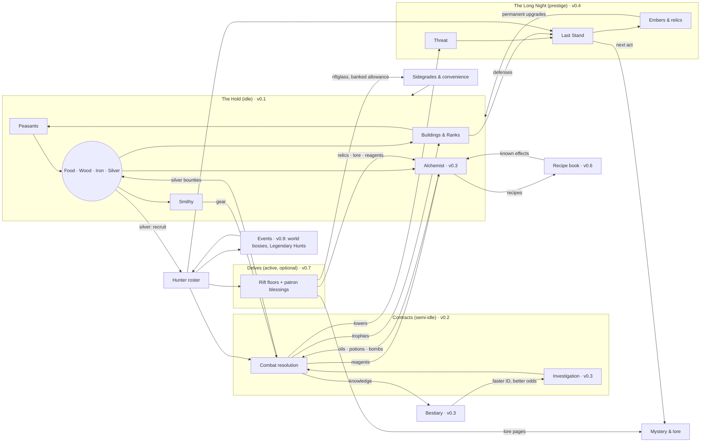

# The Last Hold — Game Design Document

**Status:** Approved through §10 (D26–D29). Revised after the GDD review (D30–D31); edits to approved sections are marked ⚑.
**Markers:** **[JC]** = judgment call; the owner can override any of them. *(vX.Y)* = the milestone that introduces something.
**Related docs:** `setting-primer.md` (spoiler-free; readable from v0.1), `lore-secrets.md` (the full truth; **kept outside the repo until v0.5**, D36), `technical-design.md`, `implementation-plan.md`, `decisions.md`.

---

## 1. Vision & Pillars

### 1.1 Elevator pitch

You are the warden of Stanholm, a ruined fortress on the edge of the Gloamreach, a frontier swallowed by monsters, cursed ruins, and something older beneath the ground.

You rebuild the hold, recruit monster hunters, and send them on contracts for frightened villages. You learn what the dark is made of, and you push it back.

The dark always returns. Each cycle ends in a Last Stand that you choose when to make. **Then a new warden, whom you name, arrives carrying the ember of the one who fell, and with it what they knew** *(⚑ revision, lore L4)*. Each cycle also uncovers another piece of the betrayal that broke the hold in the first place.

### 1.2 Experience goals

| Moment | The player should feel… |
|---|---|
| Opening the game | "My fortress kept working while I was gone." The game opens on a report, not a chore list. |
| Choosing a contract | Like a hunter studying a case. The decision is *what* to bring and *who* to send, not how fast to tap. |
| Reading a fight log | That the outcome was fair and explainable, and that better preparation would have changed it. |
| Late in a cycle | Rising pressure, plus a real choice: make the stand now, or hold one more day? |
| After the Long Night | Stronger, a little wiser, and hungry for the next piece of the story. |

### 1.3 Pillars

Every feature must serve at least one pillar and must not break any.

1. **Heroic with dark edges.** The dark is real and sometimes cruel, but the hold is a light. Hunters are brave, villagers are grateful, and victories feel earned. Horror is seasoning, not the meal.
   - *Test:* Does this make the player feel like a protector rather than a victim?
2. **Layers interlock.** Every layer produces something another layer needs. No system is a dead end.
   - *Test:* Can you name where this resource comes from and where it goes? (See §4.)
3. **Numbers are visible.** Every formula, chance, and modifier can be inspected in-game, and every fight leaves a readable log. Full transparency is the default (D10).
   - *Test:* Could the player predict this outcome from what the screen shows?
4. **Knowledge is progression.** The bestiary, the recipe book, and the lore make later play faster and better, not just more complete.
   - *Test:* Does learning this make the next contract or brew measurably easier?
5. **Respect my time.** Single-player, no monetization patterns, and no timers designed to frustrate. Offline progress is fair. Nothing important expires while you're away.
   - *Test:* Would missing a day feel like a punishment? If so, redesign it.

Determinism (seeded RNG, reproducible fights) is a technical requirement in support of pillar 3. It is specified in `technical-design.md`.

### 1.4 Non-goals

- Twitch skill, reflex timing, or tap-speed rewards.
- Daily login streaks, limited-time FOMO rewards, or anything that punishes absence.
- Gacha or randomized hunter pulls. Hunters come from recruitment, contracts, and events.
- Multiplayer, leaderboards, monetization, audio (out of scope for now).
- A tutorial or onboarding flow (D12: audience is just the owner). In-game help text and inspectable formulas stand in for it.

---

## 2. Setting & Naming Rules

### 2.1 Tone guide (D01: heroic fantasy with dark edges)

- **Light:** Villagers bring gifts after good contracts. Hunters banter in logs. The hold visibly grows from ruin into a fortress.
- **Dark:** Monsters were often people, or were made by people. Cursed ruins carry real tragedies. The central mystery is a betrayal with no clean villain.
- **Humor:** Dry and occasional, mostly in hunter traits and log flavor lines. Never parody.
- **Violence:** Shown through outcomes and logs ("Bjarna is wounded: 3 days to recover"), not gore. Pixel art keeps it stylized.

### 2.2 Folklore blend (D05: Slavic + Nordic)

The Gloamreach sits between forested river country with Slavic flavor (the lowland villages) and cold fells and fjord-cut highlands with Nordic flavor (the northern ruins). Monsters, names, and material culture shift along that gradient. Lowland contracts feel Slavic; highland contracts feel Nordic; the deep places belong to neither.

### 2.3 Originality rules

All content is original. The influences supply *feel*, never names, characters, terminology, designs, or plots.

**Folklore creatures** may be used under their real-world folklore names and standard folklore spellings. Their designs and behavior must come from folklore sources, not from any game's version.

**Avoid list.** These terms and signature elements are off-limits:

| Source | Avoid |
|---|---|
| The Witcher | "witcher"; Signs; mutagens; decoctions; schools of monster hunters; game-specific monster spellings and coinages (leshen, kikimore, striga, noonwraith, nekker, drowner, bruxa); signature plots (e.g., a cursed princess cured by a night in a crypt); named potions or oils from the games |
| Elder Scrolls / Skyrim | Dragonborn; shouts / Thu'um; Daedra; Dwemer; standing stones as skill signs; "jarl" **[JC: a real Norse title, but too strongly Skyrim-coded; use "thane" or "headman"]** |
| Warcraft / WoW | Scourge; Lich King; Horde / Alliance; named classes (paladin, death knight) as hunter classes; WoW faction names |
| Age of Empires | Named civilizations; age names beyond the generic Hamlet → Keep → Citadel → Bastion |
| Warhammer 40K / Tacticus | Primarch; Astartes; Chapter; Heresy; Emperor; Salamanders / Vulkan or any named chapter, legion, or character; "promethium"; **Forgefather; "tithe" for the taking of people; Black Ships** *(⚑ lore L7)* |
| Hades | Boons; Mirror of Night; named gods' roles; "Darkness" as the reset currency |
| **Dark Souls** *(not an influence; ⚑ lore L6)* | Souls feeding a fire that holds back the dark (as named imagery); kindle and kindled; ash, ashen, cinder; hollow and hollowing; a "keep the fire or let it go out" ending pair; bonfires as checkpoints. **Kept on purpose:** "Embers" (the prestige currency). |

**Process rule:** Before any proper noun goes into a content file, it gets a quick web search against those games. Collisions are logged in `decisions.md`. Real historical or generic words (thane, warden, hold, contract, oil, bomb) are allowed.

### 2.4 Approved folklore creature pool (starter)

| Creature | Origin | Folklore basis to design from |
|---|---|---|
| Leshy | Slavic | Forest lord; leads travelers astray; changes size with the trees |
| Kikimora | Slavic | Household or swamp spirit; nighttime mischief that turns malicious |
| Rusalka | Slavic | Drowned maiden; river and field spirit; lures and drowns |
| Vodyanoy | Slavic | Old man of the water; drowns the careless; bound to mills and weirs |
| Poludnitsa (Lady Midday) | Slavic | Field spirit at noon; strikes down workers with heatstroke and madness |
| Upyr | Slavic | Restless dead; drinks blood; risen from improper burial |
| Strzyga | Slavic (Polish) | Person with two souls; after death, one soul hunts the living |
| Bies | Slavic | Malevolent spirit of the wilds |
| Likho | Slavic | One-eyed embodiment of misfortune |
| Mara / Mora | Slavic + Nordic | Nightmare spirit that sits on sleepers' chests |
| Draugr | Nordic | Barrow-dead; swollen, heavy, guarding treasure; can change size |
| Nix / Nøkk | Nordic | Water spirit; shapeshifts (often a horse); music lures victims |
| Huldra | Nordic | Forest woman with a hidden tail; seduces and punishes |
| Troll | Nordic | Stone-hided, sun-averse giants of the fells |
| Lindworm | Nordic | Wingless serpent-dragon |
| Domovoi | Slavic | Friendly household spirit; **not a monster**. A resident of the hold. |

**Original creatures** are encouraged for the cursed ruins and the deep (the Unlit and its spawn). Those live in `lore-secrets.md`.

### 2.5 Naming style

- **Places:** Compounds that mix the two roots: Slavic *-grad, -ov, -no, stan-, vel-* with Nordic *-holm, -fell, -mark, -vik*. Examples: Stanholm, Velkvik, Dubno Ford, Ravenfell.
- **People:** Lowlanders use Slavic-style given names (Dobrava, Milosz, Vesna). Highlanders use Nordic-style names (Yrsa, Halvar, Bjarna). Many hunters carry an epithet earned in the field ("Halvar Two-Smokes").
- **The Emberwrights:** Ranks and titles in plain English: Keeper of the Forge, Hearthblade, Wright, Apprentice *(⚑ lore L7: "Keeper" replaces Forge-Mother)*.
- **Lore names in the outline are working names** (Gloamreach, Stanholm, Emberwrights, Hearthseal, the Unlit, Hearthblade). They get collision-checked before v0.5 *("Firstblade" became "Hearthblade": the old title is an Elder Scrolls lore name; Q10, D142)*. **[JC: the Hearthblade's name changes from the outline's placeholder to "Yrsa Varn" to fit the Nordic naming style; the Keeper is "Dobrava Halsten".]**

---

## 3. Core Loops

### 3.1 Loops by timescale

| Loop | Length | What you do | Key decisions | What you get | From |
|---|---|---|---|---|---|
| **Check-in** | 2–3 min | Read "While you were away"; build and upgrade; reassign peasants; collect contract results; launch new contracts | What to build next; which contract, which party, which preparation | Resources, trophies, reagents, bestiary progress | v0.1 (hold), v0.2 (contracts) |
| **Session** | 15–30 min | Delve runs; alchemy experiments; roster and gear planning; read lore | Blessing picks; ingredient combinations; long-term roster shape | Relics, rift currency, recipes, lore | v0.6 (alchemy), v0.7 (delves) |
| **Events** | Whenever tokens are banked *(⚑ revision G7: was daily)* | World-boss attempts and Legendary Hunt runs, with different hunters each time | Who to spend on which attempt | Boss rewards, event points | v0.9 |
| **Cycle** | 3–5 days | Rank up the hold; keep Threat in check; pick the moment for the Last Stand | When to make the Last Stand | Embers (permanent currency), relics, the next act of the mystery | v0.4 |
| **Meta** | Weeks | Fill the bestiary and recipe book; raise hunter stars; finish Legendary Hunts; advance Orders | Long-term investment | Permanent power and knowledge; the full story | v0.3–v0.10 |

### 3.2 The check-in, step by step

This is the heart of the game and must stay fast. **Target: a routine check-in in 15 taps or fewer.**

1. **Open.** The "While you were away" sheet summarizes elapsed time (capped at 12 h; D08), resources gained, contracts resolved (success or failure, injuries, loot), and anything new in the bestiary. Tap once to dismiss. Every line can be expanded into its full log.
2. **Spend.** The Hold screen highlights affordable builds and upgrades with a badge. Buy in one tap; long-press for the formula and cost breakdown.
3. **Contracts.** The board shows open contracts. For each one: pick a party (with a suggested party pre-filled), pick preparation, then see the success odds with a full breakdown before launching.
4. **Leave.** Nothing demands attention until the next visit.

### 3.3 Anti-frustration rules for loops

- **The contract board fills up and waits.** New contracts arrive over time, up to a cap. They never expire. **[JC: one new contract every 2 h, board cap of 6 in v0.2.]**
- **Finished contracts apply at completion** *(⚑ revision B9)*. Rewards and returning hunters count the moment the timer ends, even offline. The results wait in a list for you to read (§5.4.3).
- **Unwanted contracts can be declined for free** *(⚑ revision A2)*. A full board never costs anything (G2).
- **Injuries heal on real time,** including while you're offline.
- **No resource is lost to an overflow cap in v0.1** (D24.3, no storage caps). If caps arrive later, the UI warns well before you hit them.
- **Events** (v0.9) never punish absence *(⚑ revision G7)*. Attempts are banked tokens, Legendary Hunts start when you start them, and absence can delay an event reward but never forfeit it.

### 3.4 What exists when

| Milestone | Playable loops |
|---|---|
| v0.1 | Check-in (hold only): build, assign peasants, Rank up to Keep |
| v0.2 | Check-in with contracts (tier 1 from Hamlet, G6), hunters, combat logs |
| v0.3 | Contracts gain investigation, the bestiary, and preparation |
| v0.4 | Cycle loop: Threat, Last Stand, Long Night, Embers, relics, Citadel and Bastion *(⚑ P3: moved ahead of alchemy discovery)* |
| v0.5 | Act I and the story systems: documents, the Archivist, warden naming, the Roll of Wardens, letters, village trust; ruin contracts, Rune damage and the Wright's Blade *(⚑ P2: split from the Long Night; detail §5.14)* |
| v0.6 | Session loop begins (alchemy experiments) |
| v0.7 | Session loop gains Delves |
| v0.8–v0.10 | Meta loop deepens: stars and talents (v0.8), events (v0.9), Orders (v0.10) |

---

## 4. Resource Flow

### 4.1 Resource catalog

"Survives the Long Night" means the item persists through the prestige reset.

| Resource | Kind | Produced by | Consumed by | Survives the Long Night? | From |
|---|---|---|---|---|---|
| **Food** | Basic | Farms, fishery; peasants | Settling peasants; **contract provisions** *(⚑ revision G3)* | No | v0.1 |
| **Wood** | Basic | Woodcutter's camp; peasants | Buildings; bomb casings; arrow shafts | No | v0.1 |
| **Iron** | Basic | Mine; peasants | Buildings; smithy gear | No | v0.1 |
| **Silver** | Basic + currency **[JC: silver is both a material and the bounty currency]** | Silver Seams (capped: at most 2, 0.22/min each, no bonuses; G1, D138, D189); **contract bounties (main source)** | Silvered gear; recruitment; Rank-ups | No | v0.1 |
| **Peasants** | Population | Houses + food surplus | Assigned to gathering jobs | No | v0.1 |
| **Hunters** | Roster | Recruitment (silver); later contracts and events | Contracts, Delves, bosses | **Yes**: the roster (active and reserve) persists; levels partly reset: half the levels above 1 are kept (§5.9.7); **gear resets** *(⚑ revision A4)* | v0.2 |
| **Trophies** | Per monster family | Contract and Delve kills | Hunter rank-ups (v0.8); trophy-hall bonuses (v0.2) | Partly: converted into Embers at the Long Night (capped at the v0.4 arrival, G8) | v0.2 |
| **Reagents** | Ingredients | Contracts; herb garden; Delves | Alchemy: oils, potions, bombs | No | v0.3 |
| **Gear** | Items | Smithy (iron + silver + wood) | Equipped by hunters | No (relics are the persistent gear) | v0.2 |
| **Oils / Potions / Bombs** | Consumables | Alchemist's hut, from reagents | Contract preparation | No | v0.3 |
| **Knowledge** | Unlocks | Investigating and killing monsters; alchemy experiments | Never spent; reduces investigation time and raises odds | **Yes** | v0.3 |
| **Threat** | Pressure meter | Rises with the Rank's base rate and with failed contracts. A full board, old contracts and declined contracts add nothing *(⚑ revision G2)* | Lowered by completed contracts and defenses; sets Last Stand difficulty | Resets to 0 | v0.4 |
| **Embers** | Prestige currency | The Last Stand (payout curve) plus trophy conversion | Permanent warden upgrades | **Yes** | v0.4 |
| **Relics** | Persistent items | Last Stand wave milestones (§5.9.6); Delves (v0.7) | The hold (v0.4: every relic owned works); hunters (v0.8) | **Yes** | v0.4 / v0.8 *(⚑ v0.4 flesh-out, D111)* |
| **Riftglass** | Delve currency with a **banked allowance**: 1/7 of the weekly cap accrues per day, banking up to 2 weeks *(⚑ revision G7)* | Delve floors | Sidegrades, convenience upgrades (e.g., +1 h offline cap), cosmetic hold improvements | **Yes** | v0.7 |
| **Lore documents** | Collectibles | Contracts, Delves, Long Night | Mystery progression; some give small hints or bonuses | **Yes** | v0.5 |
| **Boss marks / Hunt points** | Event currencies | World bosses; Legendary Hunts | Event rewards; unlocking a legendary hunter | **Yes** | v0.9 |
| **Reputation** | Per Order | Order questlines and aligned contracts | Order rewards and unlocks | **Yes** | v0.10 |

### 4.2 Flow diagram



### 4.3 Interlock check

Every layer has at least one input from another layer and one output to another layer:

| Layer | Needs from others | Gives to others |
|---|---|---|
| Hold | Silver and trophies (Contracts); Embers (Long Night); sidegrades (Delves) | Gear, consumables, recruits (Contracts); defenses (Last Stand) |
| Contracts | Gear, consumables, recruits (Hold); knowledge (Bestiary) | Silver, trophies, reagents (Hold); Threat reduction (Long Night) |
| Delves | Hunters (roster) | Relics, lore, reagents, riftglass |
| Long Night | Defenses (Hold); hunters; Threat state | Embers, relics, story progression |
| Events | Roster depth | Legendary hunters, event rewards |

**Delve-optional check (D20):** Every resource Delves give either has an idle-path source (reagents, lore, and relics also come from contracts and Last Stands) or is a sidegrade or convenience. Idle-only play reaches all content about 20–30% slower. The balance simulator will verify this from v0.7 on.

---

## Judgment calls in sections 1–4

1. **Silver is both a material and the bounty currency.** One fewer resource to track; contracts become the main source of silver.
2. **The hunter roster persists through the Long Night,** with rank and gear partly resetting. Details come with v0.4.
3. **Contract board:** one new contract every 2 h, up to 6, never expiring.
4. **Event participation:** event milestones are reachable with about 70% participation. *(Superseded by G7: absence can delay an event reward but never forfeit it.)*
5. **Routine check-in target:** 15 taps or fewer.
6. **Avoid "jarl"** as too Skyrim-coded; use "thane" or "headman" instead.
7. **Character names:** Hearthblade "Yrsa Varn" *(the title was Firstblade until D142)*, Keeper "Dobrava Halsten" *(title renamed in lore L7)*.
8. **Strzyga and Lady Midday are in the creature pool,** with designs drawn from folklore only and no reuse of the games' signature contract plots.
9. **The domovoi is a friendly resident of the hold,** not a monster.
10. **Prestige currency is named Embers; Delve currency is named Riftglass.**

---

## 5. Systems

> **About the numbers in this section.** Every number is a *starting value*. The structure (formulas, rules, what affects what) is the design. The constants are tuned by the balance simulator against the pacing targets in §6. When Claude Code changes a constant, the change goes in the content or config files, never into code. When a constant changes by more than 2×, it gets a line in `decisions.md`.

### 5.0 Cross-cutting rules

These apply to every system.

**Modifier buckets.** Every percentage bonus belongs to one named bucket. Bonuses add within a bucket and multiply across buckets:

```
final = base × (1 + Σ building) × (1 + Σ age) × (1 + Σ trophy) × (1 + Σ knowledge) × (1 + Σ ember) × (1 + Σ relic) × (1 + Σ event)
```

Buckets that don't exist yet in a milestone count as 0. The in-game breakdown shows each bucket and every contributor in it.

**Combat modifiers** *(⚑ revision B1 [JC])*. Combat uses its own buckets, applied in this fixed order:

```
stat_eff   = (base × levelScale + Σ flat) × (1 + Σ stat%) × (1 + Σ status%)
raw        = Might_eff × variance
typed      = raw × resist[target][damageType]
dealt      = typed × (1 + Σ outgoing%) × (1 + knowledge%) × (crit ? critMult : 1)
afterArmor = max(0, dealt − Armor_eff)                         (direct attacks only)
final      = 0                                                 if resist = 0 (immune)
           = max(1, round(afterArmor × (1 − min(0.75, Σ taken%))))   otherwise
```

| Bucket | What goes in it | Examples |
|---|---|---|
| **flat** | Fixed additions to a stat, applied before any multiplier | Gear (+9 Might), Quick (+3 Speed) |
| **stat%** | Percentage changes to a stat that last the whole fight | Quickfoot Tincture (+20% Speed), Swell (+50% Armor) |
| **status%** | Temporary effects whose duration counts actions | Hamstring (−30% Speed), the Frost Pot slow, Hardwood Tonic, Malice (+5% Might per action) |
| **outgoing%** | Bonuses to damage dealt | Traits vs a family or location (Grave-warden, Fen-born, Fire-touched), oils |
| **knowledge%** | Studied / Mastered bonus vs a species | +5% / +10% |
| **taken%** | Reductions to damage taken. They **add together**, are **capped at 75%**, and apply **after Armor** *(B2)* | Shieldwall −10%, Fire-touched −20% Fire, Emberwright Plate −10% Fire |

- Every bucket is additive inside and multiplicative across buckets.
- `round` rounds half up. Health is always a whole number.
- A status with the same name refreshes rather than stacks, unless the ability says "stacking" (Malice).

**Breakdown everywhere (D10).** Every derived number (a rate, a stat, an odds figure, a cost) can be long-pressed (or hovered, on desktop) to open a breakdown tree: base value, each contributor, and the formula. The breakdown is generated from the same data the engine uses, so it can never disagree with the actual result.

**Time.** The engine runs in seconds. The UI shows rates per minute by default, with a per-hour toggle.

**Randomness.** Every random roll comes from a seeded stream (see `technical-design.md`). Logs show the roll whenever a roll mattered ("rolled 0.83 vs 0.90 to hit").

---

### 5.1 The Hold economy (v0.1)

#### 5.1.1 Resources and peasants

The four basic resources are **food, wood, iron, and silver**. There are no storage caps (D24.3).

**Peasants** are the workforce.
- **Housing** sets the maximum number of peasants. The Hearth Hall provides 3, and each Cottage adds 2.
- **Settling** a new peasant costs food: `settleCost(P) = 20 × 1.15^P`, where P is the current number of peasants.
- **Auto-settle** is on by default. While housing is free and food covers the cost, a new peasant settles automatically, at most one every 30 s. The player can turn auto-settle off to save food for something else. With auto-settle off, a **Settle one** button settles a peasant by hand: the same food cost and housing limit, no 30 s wait, and it doesn't delay the next automatic settle (D63).
- **No food upkeep in v0.1** **[JC]**. Peasants cost food to settle, not to keep. This avoids starvation spirals, which play badly with offline time. From v0.2, food also pays **contract provisions** (§5.4.2, G3), which is the food sink after Keep.

**Jobs.** Each peasant is either idle or assigned to a job. Job slots come from buildings.

| Job | Produces | Base rate per worker | Slots from |
|---|---|---|---|
| Farmer | Food | 6 / min | Farm (3 each) |
| Woodcutter | Wood | 4 / min | Woodcutter's Camp (3 each) |
| Miner | Iron | 2 / min | Mine (2 each) |
| Silver-digger | Silver | 0.25 / min | Silver Seam (1 each; **at most 2 Seams**) |

- **Idle peasants produce nothing.** The Hold screen shows an "idle hands" warning whenever any peasant is idle.
- **New peasants** take the first open slot in a **job priority list** that the player sets. The default order is Farmer → Woodcutter → Miner → Silver-digger.
- **Reassigning** is free and instant, using +/− buttons per job plus a "fill" button.

**Production rate per resource:**

```
rate_R = workers_R × baseRate_R × (bucket multipliers, §5.0)
```

**Silver is capped at the source (G1, D30).** Silver-digger output gets **no building, age, trophy, knowledge or ember bonuses**; only relic and event bonuses apply (none exist before v0.4). With at most 2 Seams, seam income can never exceed 2 × 0.22/min = **about 630 silver per day** (720 at 0.25/min before D138, 690 at 0.24/min before D189). Contract bounties are the main silver source from v0.2 on. *⚑ Revision of approved §5.1.1.*

#### 5.1.2 Buildings

There are two kinds of building:

- **Count buildings** can be bought many times. The next copy costs `base × r^n` with **r = 1.15**, where **n is the number already owned, including free starting buildings** *(⚑ revision A8)*. For example, the first Farm you buy is your 2nd, so it costs 40 × 1.15 = 46 wood.
- **Level buildings** are unique and are upgraded. Level L (starting from 1) costs `base × r^(L−1)` with **r = 1.75**. Each Rank sets a maximum level.

**Bulk buy.** Count buildings support ×1, ×10, and Max.
- Buying k copies costs `base × r^n × (r^k − 1)/(r − 1)` of each resource.
- For Max, the engine computes the affordable k for each resource as `k = floor(log(1 + funds·(r−1)/(base·r^n)) / log r)`, and takes the smallest k across resources.

**All construction is instant** **[JC]**. Pacing comes from costs, not build timers. Waiting on a timer you can't affect is the kind of friction pillar 5 rules out.

**Best payback: one valuation, used everywhere** *(⚑ revision B7 [JC])*. The ● best-buy hint (§9.2) and the simulator's greedy policy (§6.1) call the same function:

```
value(bundle) = Σ_r  w_r × amount_r     w = value.weights: food 1, wood 1.5, iron 3, silver 12
payback(item) = value(cost) ÷ value(Δrate per min)        (lower is better)
```

- The weights are the inverse of each resource's base rate, normalized to food. They live in `balance.ts` so they can be retuned.
- **Δrate** is the change in production the purchase causes right now:
  - Production buildings and levels: the direct rate change.
  - Housing (Cottage): extra peasants × the marginal rate of the best open job slot, or 0 if no slot is free.
  - Slot buildings: 0 unless idle peasants are waiting to fill the new slots.
- Items with Δrate = 0 (for example, the Bell Tower) never get the ●. The simulator buys them only through explicit policy rules.
- Rank-ups are excluded; the policy's saving rule handles them.

**v0.1 buildings** (costs are base values):

| Building | Type | Base cost | Effect | Available |
|---|---|---|---|---|
| Hearth Hall | Unique | — (start) | Houses 3 peasants. The Rank-up happens here. | Start |
| Cottage | Count | 30 wood, 10 food | +2 housing | Hamlet |
| Farm | Count | 40 wood | +3 Farmer slots | Hamlet (start with 1) |
| Woodcutter's Camp | Count | 25 wood, 15 food | +3 Woodcutter slots | Hamlet (start with 1) |
| Mine | Count | 80 wood, 40 food | +2 Miner slots | Hamlet |
| Silver Seam | Count (**max 2**) | 150 wood, 120 iron | +1 Silver-digger slot; never boosted (G1) | Hamlet |
| Mill | Level (max 5 in Hamlet, 10 in Keep, 15 in Citadel, 20 in Bastion) | 120 wood, 40 iron | +25% food per level (building bucket) | Hamlet |
| Sawpit | Level (max 5 / 10 / 15 / 20) | 100 wood, 60 iron | +25% wood per level | Hamlet |
| Smithy | Level (max 3 / 10 / 15 / 20) | 200 wood, 150 iron | +20% iron per level. Unlocks gear tiers (v0.2) | Hamlet |
| Bell Tower | Level (max 3) | 1,500 wood, 800 iron, 150 silver | +1 h offline cap per level | Keep |

#### 5.1.3 Ranks

The Rank-up **Hamlet → Keep** requires:
- **Prerequisites:** 10 peasants, Mill level 3, and a Smithy.
- **Cost:** 12,000 food, 9,000 wood, 4,000 iron, and **250 silver** *(⚑ revision: was 600; lowered to fit capped Seams, G1; then 300 → 250 in the v0.1 tuning pass, D62)*.

**Keep grants:**
- Higher maximum levels (see the table).
- +50% to all production (age bucket).
- The Bell Tower.

From v0.2 onward, Keep also unlocks contract tiers above 1, the Barracks, and the Trophy Hall. The contract board itself opens in Hamlet, when the first Mine is built *(⚑ revision G6)*.

**Each Rank-up restores part of old Stanholm**, with a short inscription *(⚑ revision, lore C7)*. Keep restores the gatehouse and the Roll of Honor (`setting-primer.md` §6.5); Citadel and Bastion are in `lore-secrets.md` §11.

In v0.1–v0.3, the Keep is the end of content. The Rank screen shows the next Rank (Citadel) as "Coming in a later milestone," with no fake progress bar.

**Pacing target:** Keep is reached after **8–14 hours of game time**, under the simulator's **Standard** policy (§6.1). The simulator enforces this band (§6.2). *(⚑ revision A9: the policy is defined only in §6.1.)*

**Citadel and Bastion** *(v0.4; ⚑ v0.4 flesh-out, D106)*. Contract tiers stay 1–5: the new Ranks make contracts pay more instead.

| | Citadel | Bastion |
|---|---|---|
| Requires | 50 peasants, Mill 10, Smithy 8, Barracks 1 | 60 peasants, Mill 12, Smithy 9, Barracks 3, Walls 1 *(T4.15, D138)* |
| Cost | 300,000 food, 150,000 wood, 60,000 iron, 600 silver *(D138)* | 500,000 food, 300,000 wood, 110,000 iron, 1,600 silver *(D138)* |
| All production (age bucket, not silver) | +50% (adds to the Keep's) | +50% more |
| Mill, Sawpit, Smithy level cap | 15 | 20 |
| Hunter level cap | 15 | 20 |
| Bounty multiplier | ×3.5 *(D138)* | ×3 *(D138)* |
| Provisions (`provisions.incomeMinutes`) | 4.1 *(D138)* | 2.5 *(D138)* |
| Active roster | +2 | +2 |
| Highest contract tier | 5 | 5 |
| Unlocks | Walls and Watchtower (§5.9.2) | the Last Stand (§5.9.3) |
| Restores | **the old Forge Hall**: *"The roof is back on the old Forge Hall. Its forges are cold."* From v0.5 (D160): *"Over the great anvil, cut deep: 'The fire for the folk; the folk —'. The rest has been chiseled out."* | **a sealed stair going down**: *"Under the Bastion floor, a stair goes down to a sealed door."* From v0.5 (D160): *"Thirty-nine faded ribbons are tied to its handle."* |

- Every number is a tunable starting value (requirements and costs live with the Ranks in the content, D44), except the roster bonus and the tier cap, which are locked. The simulator tunes the costs to the targets: Citadel on day 2, Bastion on days 3–4 (§6.2, D137).
- The restorations showed no inscription in v0.4. From v0.5 each carries its inscription (D160, `lore-secrets.md` §11), every cycle; a save already past the Rank sees it on arrival.
- A hunter who carries a level above the current Rank's cap (§5.9.7) keeps it; the cap only stops new levels.

#### 5.1.4 Starting state

- The Hearth Hall.
- 1 Farm and 1 Woodcutter's Camp.
- 3 peasants: **1 Farmer and 2 Woodcutters** *(⚑ revision A10 [JC]: was 2 Farmers and 1 Woodcutter)*.
- 80 food and 75 wood *(⚑ v0.1 tuning: wood was 50, D62; v0.2 tuning: food was 50, so the first contract's provisions are affordable soon after the first Mine, D76)*.
- Auto-settle on.

**Opening goal** (measured by the **Opening** policy, §6.1): a Cottage within 1 minute and a Mine within 5 minutes. A hand calculation gives about 4.4 minutes for the Mine (after the first Cottage's 30 wood, wood reaches 80 at about 4.4 min). **If the simulator misses, raise starting wood; don't move the target.** *(⚑ v0.1 tuning, D62: 70 wood gave 5.2 min in the simulator, so the start is 75 wood; the simulator measures 4.5 min.)*

---

### 5.2 Offline progress (v0.1)

**Elapsed time on load:**

```
elapsed = clamp(now − lastSeen, 0, offlineCap)
```

- **Offline cap:** a base of 12 h (D08), plus the Bell Tower (up to +3 h), plus later sources (Embers in v0.4: Late Lantern, §8.9; Riftglass in v0.7). **Hard ceiling: 24 h** **[JC]**.
- **Clock moved backward:** if `now < lastSeen`, then `elapsed = 0` and `lastSeen` is reset to `now` (D21). No penalty, no warning.

**Simulation.** Offline time runs through **the same `advance(state, dt)` function** as live play. **`advance` is event-driven** *(⚑ revision A11 [JC])*:
- Inside any `dt`, it finds the next scheduled event (a peasant settle becoming due, a contract finishing, a recovery or brew ending, a board refill), moves resources forward linearly to that moment, applies the event, and repeats until `dt` is used up.
- Rates are constant between events, so every event time is exact. For example, a settle becomes due at `(cost − food) ÷ foodRate`, but no sooner than 30 s after the previous settle.
- **Chunk size therefore never changes the result.** Offline catch-up still runs in 60 s chunks, but only to drive the progress bar.
- **Acceptance test:** 12 h of live play in 1 s ticks and a single 12 h offline catch-up, from the same starting state, must end in the same state (within floating-point tolerance).
- **Offline efficiency is 100%** **[JC]**. Many idle games pay out offline time at a reduced rate. Here the cap is the only limit, because pillar 5 says offline progress should feel fair.

**"While you were away" sheet:**
- Time counted, plus a note if time beyond the cap was not counted: *"14 h 20 m away · 12 h counted (cap)."*
- Resources gained.
- Peasants settled.
- Contracts resolved, each with its outcome and a tap-through to the full log *(v0.2)*.
- Injuries that started or healed *(v0.2)*.
- New bestiary entries *(v0.3)*.

The sheet is dismissed with one tap. The last three sheets are kept under More → Reports.

---

### 5.3 Hunters (v0.2)

#### 5.3.1 Collection model

Every hunter is a **hand-authored named character** **[JC]**. There are no procedurally generated recruits.
- v0.2 ships with 8 hunters; v1.0 targets about 30.
- Each hunter has unlock conditions (Rank, bestiary progress, specific contracts, and later events or Orders). When the conditions are met, the hunter arrives at the hold as a **candidate**. Paying their recruitment silver adds them to the roster.
- This keeps the Tacticus collection feel (every hunter matters) without any gacha.

**Active roster and reserve** *(⚑ revision G5)*:
- **Active roster cap:** 3 in Hamlet (bunks in the Hearth Hall [JC]). In Keep, 3 + Barracks level, up to 8. Citadel adds 2 and Bastion adds 2, for 12 at most [JC].
- **Reserve:** unlimited. Every hunter you own but haven't made active waits in the reserve. Reserve hunters can't take contracts or Delves and don't earn contract XP. They **can** join world bosses and Legendary Hunts (v0.9).
- **Swapping** between active and reserve is free and instant, except for hunters who are on a contract or recovering.
- **Letting a hunter go** means moving them to the reserve. Hunters are never deleted [JC].
- **Barracks** (Keep, level building, max 5, base cost 600 wood, 300 iron, 100 silver) raises the active cap.

**Recruitment cost** is a **fixed silver price per hunter**, set in the hunter's content file (§8.5) *(⚑ revision G5 [JC])*. The old `100 × 1.5^rosterSize` formula would reach absurd prices with a ~30-hunter collection, and moving hunters to the reserve would dodge it. The two starting hunters are free.

#### 5.3.2 Stats and levels

| Stat | Effect |
|---|---|
| Health | Hit points. At 0 the hunter is downed. |
| Might | Damage per hit. For a Mender, Might also sets healing. |
| Armor | Flat reduction to each incoming hit (minimum damage is 1). |
| Speed | How often the combatant acts (turn meter, §5.5). |

- **Level 1–10 in Keep** (later Ranks raise the cap). **Health and Might** scale as `base × (1 + 0.10 × (level − 1))`. **Armor and Speed don't scale with level** *(⚑ revision [JC]: under the turn meter, Speed growth would compound into extra actions)*.
- **Displayed stats include gear and traits** *(⚑ revision A14)*. The breakdown separates base, level, gear and traits.
- **XP per contract:** 20 × tier on a success, half that on a failure.
- **XP to go from level L to L+1:** `50 × 1.5^(L−1)`.

#### 5.3.3 Roles (D24.2 names)

| Role | Identity | Combat rule |
|---|---|---|
| **Vanguard** | Tank | Monsters target Vanguards with weight 3 (others weight 1). High Health and Armor. |
| **Mender** | Healer | On her action, if any standing hunter (herself included) is below 70% Health, she heals the one with the **lowest % Health** for `1.5 × Might` (ties: party slot order). Downed hunters can't be healed. Otherwise she attacks at 50% Might. *(⚑ revision B6)* |
| **Striker** | Damage | 20% crit chance (others 10%). Crits deal ×1.5. |

#### 5.3.4 Damage types (D24.2 names)

There are six types: **Steel, Silver, Fire, Frost, Rune, Venom**.
- Each hunter has one innate damage type, from their weapon style.
- Each monster has a resistance multiplier per type. 1.0 is neutral; below 1 resists; above 1 is weak. The values are shown once the monster is Identified (§5.6).
- **Rune** damage belongs to the Emberwright lore. From v0.5 it comes from the Wright's Blade's sub-hit (§5.3.6) and from Arvid Netmender (§8.5); it's the Cursed family's common weakness (§8.3).

#### 5.3.5 Traits

Each hunter has **2 traits**, each with an exact numeric effect.

| Trait type | Example |
|---|---|
| Location | *Fen-born:* +15% Might on river and marsh contracts |
| Monster family | *Grave-warden:* +20% Might vs Restless Dead |
| Role | *Shieldwall:* while this Vanguard stands, allies take −10% damage |
| Recovery | *Hard to kill:* recovery times −30% |
| Flavor and economy | *Haggler:* +10% bounty silver on contracts this hunter joins |

The full list goes in §8.

#### 5.3.6 Gear (v0.2)

Gear is **upgraded in place** **[JC]**. Each hunter has a weapon slot and an armor slot, and the Smithy upgrades the slot directly. There is no item inventory until loot arrives in v0.8.

| Slot tier | Effect | Cost | Requires |
|---|---|---|---|
| Iron Blade | +4 Might | 60 iron | Smithy 1 |
| Steel Blade | +9 Might | 250 iron, 50 wood | Smithy 3 |
| Silvered Blade | +9 Might. Each hit also deals a separate **Silver sub-hit**: `0.25 × Might_eff × variance × crit` × the target's Silver resistance. Armor doesn't apply, and it's logged as its own line *(⚑ revision B3 [JC])* | 250 iron, 120 silver | Smithy 5 |
| **Wright's Blade** *(v0.5, D159; was "Runed Blade", D170)* | +12 Might. Keeps the Silver sub-hit and adds a **Rune sub-hit** of the same size: `0.25 × Might_eff × variance × crit` × the target's Rune resistance, no Armor, its own log line | 600 iron, 300 silver | Smithy 8 and the Citadel (the Forge Hall) |
| Hide Armor | +2 Armor | 40 wood, 30 food | Smithy 1 |
| Mail | +5 Armor | 300 iron | Smithy 3 |
| Emberwright Plate | +8 Armor, −10% Fire damage taken | 600 iron, 150 silver | Smithy 6 |

The Wright's Blade (v0.5) is the fourth weapon tier, strictly better than the Silvered Blade, so upgrading in place still works. Like all gear it resets at the Long Night (A4).

#### 5.3.7 Injury and death (D07)

| Outcome at the end of a fight | Result |
|---|---|
| Survived with at least 30% Health | Fine |
| Survived with less than 30% Health | **Bruised:** 30 min recovery |
| Downed | **Wounded:** recovery of 2 h × contract tier |
| Downed on a **Reckless** contract | Death roll: **30% chance of death**. Survivors are **Grievously Wounded** (3× the Wounded time). |

- A contract is **Reckless** when its displayed success odds are **below 35%** **[JC]**. The odds already include preparation, so "reckless" and "badly prepared" are the same rule: poor preparation lowers the odds until the contract crosses the line.
- Launching a Reckless contract requires a confirmation dialog that names each hunter and their exact death chance.
- Recovering hunters can't take contracts. Recovery runs on real time, including offline.
- **Story hunters never die** *(⚑ revision, lore C4)*: Sigrun, Ostap, Toma and Arvid can be wounded, but on a Reckless contract their death roll becomes Grievously Wounded instead. They persist through every Long Night and are always available before their act needs them (`lore-secrets.md` §10).
- Dead hunters are gone for the cycle. Their memorial stays in the Hall of the Fallen (More menu). **[JC: a dead named hunter returns as a candidate after the next Long Night, with their lore tracked. Permanently losing a hand-authored character felt too punishing for a collection game.]** Before v0.4, when no Long Night exists yet, a dead hunter returns as a candidate **3 days** after their death *(⚑ revision A12 [JC])*. **From v0.4,** a dead hunter returns as a candidate at the next Long Night, at their usual price, with their levels halved like everyone's (§5.9.7, D110).

---

### 5.4 Contracts (v0.2)

#### 5.4.1 The board

- One new contract arrives every 2 h, up to a cap of 6. Contracts never expire.
- **Decline** *(⚑ revision A2)*: any open contract can be declined for free. It's removed with no penalty and no Threat, and the slot refills on the normal 2 h schedule.
- **The board opens in Hamlet, when the first Mine is built** *(⚑ revision G6 [JC]: was Keep)*. Hamlet contracts are tier 1 only, with a party of at most 2. Keep unlocks higher tiers (below), the Barracks, the Trophy Hall, the Hunter's Lodge and the Alchemist's Hut.
- Each contract is generated from a seed when it arrives, and its content is fixed from then on.

Each contract has:

| Field | Notes |
|---|---|
| Village | The giver. Flavor in v0.2; ties into Reputation in v0.10. |
| Monster | In v0.2, always a known species (identified for free). Unknown monsters arrive in v0.3. |
| Tier | 1–5 from the Keep on; Citadel and Bastion add no tiers (D106). Each tier above the monster's base tier multiplies Health and Might by 1.35 and Armor by 1.15 (§7). |
| Location tag | Forest, river, field or barrow; **ruin from v0.5** *(⚑ revision D-2; D157)*: old Emberwright sites, posted by Kozly Hollow, Velkvik and Ravenfell from the Keep. **Barrow and ruin contracts start at tier 2** *(⚑ revision A3 [JC])*. Interacts with traits. |
| Party size | Up to 3 hunters at tiers 1–3, up to 4 at tiers 4–5; at most 2 in Hamlet (G6) |
| Duration | 30 min / 1 h / 2 h / 4 h / 8 h by tier |
| Bounty | `91 × 1.6^(tier − 1)` silver × `bounty.ageMult` (Hamlet 1.0, Keep 1.1, Citadel 3.5, Bastion 3; D106, D138). The age production bucket does **not** apply to bounties *(⚑ revisions: base was 40, raised with G1; ageMult defined in A6; 72 → 78 in the Q9 tuning (D82): provisions now grow with food income, so fewer contracts go out and each pays a little more; 78 → 91 in the v0.4 tuning, D138)* |
| Trophies | Equal to the tier, of that monster's family |
| Reagents | *(v0.3)* monster-specific drops |

**Tier unlocks** *(⚑ revision B8 [JC])*: tier t+1 unlocks after **3 successes at tier t**, up to the Rank's cap (Hamlet T1, Keep T5). **Tier mix:** 60% of new contracts at the highest unlocked tier, 40% spread evenly across the lower unlocked tiers (all at the highest while only one is unlocked). **No rubber-banding** **[JC]**: difficulty never scales with roster strength, because hidden scaling would make the numbers lie.

#### 5.4.2 Launching

1. Choose a party. A **Suggested party** button fills it with the highest-odds available combination, found by the two-stage search in §6.5 (it runs in a background worker).
2. *(v0.3)* Choose preparation.
3. Read the odds panel:
   - **Win chance** from 500 simulated fights, shown with a ±margin.
   - **Expected injuries** per hunter.
   - **Death chance** per hunter (Reckless contracts only).
   - **Expected rewards.**
   - **"Why?"** opens the summary math: party damage per 100 ticks vs monster Health, and monster damage per 100 ticks vs the party's effective Health.
4. **Pay provisions** *(⚑ revisions G3; Q9, D81–D82)*: per hunter, the larger of **30 food** or **N minutes of the hold's food capacity** (what its food jobs would make with every farmer slot filled, limited by the number of peasants; Q11, D84, so moving peasants between jobs cannot lower it), × party size × 2.2^(tier − 1), paid at launch. N is `provisions.incomeMinutes`: 0 in the Hamlet, 1 in the Keep (D85), 4.1 in the Citadel and 2.5 in Bastion (D106, D138; tuned to keep §6.3 #8 in its band). Hamlet contracts therefore stay flat (tier 1 with 2 hunters: 60 food). From the Keep on, provisions grow with the hold, so food stays a real cost (§6.3 #8): a tier-3 party of 3 costs about 15 minutes of food capacity, and a tier-5 party of 4 about 1 h 34 min. The launch sheet's breakdown shows the food capacity used. Failures don't refund provisions; declining is free. If food is short, the launch button shows how long until it's affordable. Nothing launches while you're offline, so food can never go negative.
5. Launch. The hunters are busy for the contract's duration.

The **actual outcome** uses `seed = hash(contractSeed, party IDs, preparation IDs)`. It is fixed and reproducible, and it's the same fight the log replays. The 500 preview simulations use different derived seeds, so the preview never reveals the real roll.

#### 5.4.3 Results

| Result | Rewards |
|---|---|
| **Success** | Full bounty, trophies, XP, reagents (v0.3); from v0.5, a document when its condition is met, and a Ribbonshade's name (§5.14) |
| **Failure** (the party is downed, or 400 ticks pass) | Half XP. In v0.3, any clues gathered are kept as bestiary progress. **No bounty.** |
| **Well-prepared success** *(v0.3)* | Bounty × 1.5 and +1 trophy **[JC]** |

**Rewards apply at completion** *(⚑ revision B9 [JC])*. When a contract's timer ends, including in simulated offline time, its rewards, injuries and XP apply and its hunters return to the hold at once. **Collect** only acknowledges results and shows the logs. Offline trophies therefore count toward the Trophy Hall from the moment they're earned.

#### 5.4.4 How contracts feed the Hold

- **Silver bounties** are the main silver source from v0.2 on. Silver Seams are capped at about 690 silver per day for the whole game (G1; 720 before D138), so bounties overtake them as higher tiers unlock.
- **Trophy Hall** (Keep, one level, cost 500 wood, 200 iron): gives **+0.5% to all Hold production per trophy earned this cycle**, in the trophy bucket. The count is the **cumulative trophies earned this cycle; spending trophies (v0.8) never reduces it** *(⚑ revision A7)*. Silver is excluded (G1).
- **Reagents** go to the Alchemist *(v0.3)*.

---

### 5.5 Combat resolution (v0.2)

*⚑ Revised: turn meter (G4), damage rules (B1–B5), exact worked example (A14).*

Combat is an auto-battle on a **turn meter**. The party fights one monster *(groups of monsters come in v0.7+ with Delves)*.

**Turn meter:**
1. Every combatant starts the fight with an empty meter (0).
2. Each **tick**, every standing combatant's meter rises by its current Speed (`Speed_eff`, §5.0).
3. Every combatant whose meter is now **100 or more** takes **one action**, then loses 100 from its meter. Leftover meter carries over.
4. When several act on the same tick, they go in this order: higher meter first, then higher Speed, then **hunters before the monster**, then party slot order. *[JC] A fixed rule rather than a seeded roll, so ties never consume randomness.*
5. The fight ends at once when the monster reaches 0 Health (**success**) or every hunter is downed (**failure**). If neither has happened by **tick 400**, the party retreats (**failure**).

**Actions:**
- **Hunter:** attack the monster. A Mender heals instead when anyone is below her threshold (§5.3.3).
- **Monster:** make its number of attacks (Atk). Each attack picks a target by weight (Vanguard 3, others 1; downed hunters excluded).
- **Abilities** trigger as written in §8.3. Effects that once said "per round" now happen **on the monster's action**, and durations count **the affected combatant's own actions**. For example, the Frost Pot slows the monster's next 3 actions.

**Attack resolution.** Each direct attack draws rolls from the fight's seeded stream **in this order**:
1. **Target roll** (monster attacks only, when more than one hunter is standing): `roll × total weight`, walking the standing hunters in party slot order.
2. **Hit roll:** hit if `roll < 0.90` (abilities can modify the chance). **On a miss, no further rolls are drawn for that attack.**
3. **Variance roll:** `variance = 0.85 + 0.30 × roll` (Steady: `0.95 + 0.10 × roll`).
4. **Crit roll:** crit if `roll < critChance`.
5. **Ability rolls** (such as Hamstring's 25%), only if the attack hit.

Damage then follows the combat formula in §5.0.

**General damage rules:**
- **Armor applies only to direct attacks** (hunter and monster weapon attacks). Bombs, damage over time, ability damage and Silver sub-hits ignore Armor. Resistances still apply to any typed damage *(⚑ revision B4 [JC])*.
- **Immunity:** a resistance of 0 means **0 damage**, and the log says "immune". The 1-damage floor applies only when the resistance is above 0 *(⚑ revision B5 [JC])*.
- **Hunters have no type resistances.** Their protection is Armor plus the taken% bucket.

**Log format.** One line per action, stamped with its tick. Each line expands to show its rolls. *Illustrative example, not a test case:*

```
t31 · Bjarna (Striker) hits the Draugr — Frost 21 ×0.25 resist −9 armor = 1 (floor) · Draugr 259/260
t33 · Draugr's Barrow-Grip on Halvar — Steel 22 −8 armor = 14 · Halvar 156/170 · Halvar is held (loses his next action)
```

Logs are kept for the last 50 contracts. Any listed contract's log can be regenerated from its seed at any time.

#### 5.5.1 Worked fight: required test case

**This example is exact.** Claude Code must build a test that reproduces it **line for line** *(⚑ revision A14)*. It doesn't depend on the random-number generator: the test feeds in this **roll sequence** directly. A second, seed-based golden test gets recorded once the generator is chosen in v0.2.

**Setup:**
- **Zora Sedlak**, level 1, no gear: Health 100, Might 20, Armor 3, Speed 13 + 3 (Quick) = **16**, crit chance 0.20, Steel damage. A field contract, so Fen-born doesn't apply.
- **Kikimora**, tier 1: Health 110, Might 12, Armor 3, Speed 13, 1 attack per action, crit chance 0.10, Steel resistance 1.0. Spoil has no effect (no potions carried).
- One hunter, so no target rolls are drawn.

**Roll sequence (34 rolls; the bars only separate attacks for reading):**

`0.40 0.50 0.70 | 0.20 0.60 0.95 | 0.95 | 0.10 0.30 0.50 | 0.30 0.90 0.10 | 0.50 0.20 0.80 | 0.60 0.50 0.40 | 0.70 0.80 0.30 | 0.20 0.40 0.60 | 0.10 0.50 0.15 | 0.80 0.60 0.30 | 0.30 0.70 0.90`

| Tick | Actor | Rolls (hit · variance · crit) | Dealt before Armor | Damage | Target Health after |
|---|---|---|---|---|---|
| 7 | Zora | 0.40 · 0.50 → 1.000 · 0.70 | 20.00 | 17 | Kikimora 93 |
| 8 | Kikimora | 0.20 · 0.60 → 1.030 · 0.95 | 12.36 | 9 | Zora 91 |
| 13 | Zora | 0.95 (miss) | — | 0 | Kikimora 93 |
| 16 | Kikimora | 0.10 · 0.30 → 0.940 · 0.50 | 11.28 | 8 | Zora 83 |
| 19 | Zora | 0.30 · 0.90 → 1.120 · 0.10 (**crit**) | 33.60 | 31 | Kikimora 62 |
| 24 | Kikimora | 0.50 · 0.20 → 0.910 · 0.80 | 10.92 | 8 | Zora 75 |
| 25 | Zora | 0.60 · 0.50 → 1.000 · 0.40 | 20.00 | 17 | Kikimora 45 |
| 31 | Kikimora | 0.70 · 0.80 → 1.090 · 0.30 | 13.08 | 10 | Zora 65 |
| 32 | Zora | 0.20 · 0.40 → 0.970 · 0.60 | 19.40 | 16 | Kikimora 29 |
| 38 | Zora | 0.10 · 0.50 → 1.000 · 0.15 (**crit**) | 30.00 | 27 | Kikimora 2 |
| 39 | Kikimora | 0.80 · 0.60 → 1.030 · 0.30 | 12.36 | 9 | Zora 56 |
| 44 | Zora | 0.30 · 0.70 → 1.060 · 0.90 | 21.20 | 18 | Kikimora 0 |

**Result:** success at tick 44. Zora ends at 56/100 Health, above 30%, so no injury.


---

### 5.6 Bestiary & investigation (v0.3)

#### 5.6.1 Monster families

| Family | Example members | Common clue themes |
|---|---|---|
| Beasts & Wilds | wolves, bies, lindworm | tracks, carcasses, broken trees |
| Restless Dead | upyr, draugr, strzyga | disturbed graves, bloodless victims, cold spots |
| Water Spirits | rusalka, vodyanoy, nix | drownings, music at night, wet footprints |
| Field & Forest Spirits | leshy, poludnitsa, huldra, kikimora | lost travelers, heatstroke at noon, livestock trouble |
| Cursed *(ruins, v0.5)* | Gloam-moths, Ribbonshade, Anvil-wight, Rimewrought (originals, §8.3) | ruin sites, old Emberwright marks |
| Deep *(v0.5+)* | the Unlit's spawn | — (lore-gated) |

#### 5.6.2 Knowledge levels (per species)

| Level | How you reach it | Effect |
|---|---|---|
| 0 Unknown | — | The species doesn't appear in candidate lists. Its entry is hidden. |
| 1 Sighted | It appears as a possibility on any contract | Shows as "?" in candidate lists. A silhouette entry in the bestiary. |
| 2 Identified | Identify it through investigation, or fight it | Resistances, abilities, and stats become visible. Preparation can target it. |
| 3 Studied | 4 kills | Clues on its contracts take half the time. +5% damage against it (knowledge bucket). |
| 4 Mastered | 10 kills | Its contracts arrive already identified. +10% damage against it. A counter-tip for each of its abilities. |

#### 5.6.3 Investigation

From v0.3, a contract can post an **unknown monster**. The player sees:

- **Symptoms:** a flavor description.
- **Candidate list:** every species from the region pool that fits the location tag, each marked with its knowledge level.
- **3 clue slots**, hidden at first.

**Investigating.** The **Hunter's Lodge** (Keep, level building, max 3) gives one investigation slot per level. Assigning a contract to a slot reveals its clues one at a time, taking **30 min each** (halved if the true species is Studied).

**What a clue does.** Each clue carries tags such as *drowned*, *night*, or *grave*. Each species has tags too. A revealed clue rules out every candidate that lacks its tags.

**What generation guarantees.** All three clues together always narrow the list to exactly one species. One or two clues might, or might not.

**Launching early is allowed.** The odds panel then averages over the remaining candidates, weighted equally, and labels the result: *"Odds assume an unidentified monster: 3 candidates."*

**Investigation takes no hunters** **[JC]**. A clue mechanic that ties up roster slots would compete with contracts for the same scarce resource and make the early game feel slow. The Lodge's slots are the limit instead.

#### 5.6.4 Bestiary screen

- A grid by family. Each entry shows its sprite (silhouette until Identified), a folklore blurb written in-world, revealed stats and resistances, the kill count, the knowledge-level progress bar, and its last 5 encounter logs.
- **The bestiary is never reset by the Long Night** (§4).

---

### 5.7 Preparation (v0.3)

The **Alchemist's Hut** (Keep, level building, max 5) brews consumables from reagents.
- v0.3 recipes are **fixed and known**. Discovery arrives in v0.6.
- Each brew takes 10 min, one at a time per Hut level. Several can be queued.
- Finished consumables go into the hold's stores.

**Preparation slots per contract:**

| Slot | Count | Applies |
|---|---|---|
| Oil | 1 per hunter | Coats the weapon for the whole fight |
| Potion | 1 per hunter | Triggers automatically on its condition |
| Bomb | Up to 2 per party | Thrown at tick 1, or on its trigger |

**v0.3 consumables** *(⚑ durations restated in actions for the turn meter, G4)*:

| Item | Type | Effect | Recipe (category) |
|---|---|---|---|
| Grave Oil | Oil | +35% damage vs Restless Dead | 2 grave dust + 1 juniper |
| Drowned-Bane Oil | Oil | +35% damage vs Water Spirits | 2 river pearl + 1 yarrow |
| Thornbane Oil | Oil | +35% damage vs Field & Forest Spirits | 2 thornwood + 1 mugwort |
| Mending Draught | Potion | Once, below 30% Health: heal 40% of max Health | 2 yarrow + 1 honeycomb |
| Hardwood Tonic | Potion | +30% Armor until the holder's 5th action | 1 thornwood + 2 juniper |
| Quickfoot Tincture | Potion | +20% Speed for the whole fight | 2 mugwort + 1 hare's foot |
| Fire Pot | Bomb | At tick 1: 40 Fire damage, then 10 Fire on each of the monster's next 3 actions | 1 pitch + 1 wood (resource) |
| Frost Pot | Bomb | At tick 1: 30 Frost damage, then −30% Speed for the monster's next 3 actions | 1 rime salt + 1 wood |
| Saltburst | Bomb | Triggers on the monster's first ability: cancels it and blocks abilities for the monster's next 3 actions | 2 rime salt + 1 silver (resource) |

- **Mismatched oils do nothing.** The odds panel shows "Grave Oil: no effect (target is a Water Spirit)." Against an unidentified monster, it shows the oil's effect for each remaining candidate.
- **Well prepared** means the contract succeeded with a matching oil on at least one hunter, plus at least one bomb whose damage type the monster is weak to *or* a Saltburst that cancelled an ability. A well-prepared success pays bounty × 1.5 and +1 trophy (§5.4.3).
- **Herb Garden** (Keep, count building, cost 300 wood, 100 food): grows common herbs (yarrow, mugwort, juniper) at 1 per 10 min each. Monster reagents come only from contracts.
- The full ingredient list is in §8.

---

### 5.8 Alchemy discovery & skills through use *(v0.6, outline)*

- **Hidden effects.** Each ingredient has 4 hidden effects. Brewing 2–3 ingredients that share an effect produces a brew with that effect. The first discovery of an effect is logged, and the recipe book fills in.
- **Experiments** cost ingredients and time. A failed combination still reveals one effect of each ingredient used, so experimenting is never wasted.
- **Warden skills** improve through use: Alchemy, Smithing, Lore, and Command. Each grows from its activity, with a small permanent bonus per level that survives the Long Night **[JC]**.
- **Open questions:** whether hunters also have use-based skills (per damage type); how many effects there are in total; whether the v0.3 fixed recipes become discovered recipes.

### 5.9 The Long Night *(v0.4 mechanics, v0.5 story)*

*⚑ Milestones renumbered (P2, P3): the Long Night's mechanics ship in v0.4, ahead of alchemy discovery (now v0.6), and Act I with its story systems ships in v0.5. Mapping in `decisions.md` D35.*

*⚑ Brought to full detail in the v0.4 flesh-out (D106–D115). Every number is a tunable starting value unless marked locked; §7.6 lists the keys.*

**The cycle in one line:** rank the hold up to Bastion, keep Threat in check, and choose when to make the Last Stand. The Long Night then resets the hold and keeps what you learned, recruited and earned.

#### 5.9.1 Threat *(D108)*

- Threat starts each cycle at **0** and rises every hour by the rate for the hold's Rank: **Hamlet 0, Keep 0.5, Citadel 1, Bastion 1** *(D138)*. Time away counts exactly as it does for production, so the offline cap applies to Threat too.
- **Each failed contract adds 3 × its tier. Each completed contract takes off 0.76 × its tier** *(D138)*. A full board, old contracts and declined contracts add nothing *(G2)*.
- **Defenses slow the hourly rate:** each level of Walls or Watchtower takes off 2%, so at most 60% at the Bastion caps.
- Threat never goes below 0, and it resets to 0 at the Long Night.
- **What Threat does, and nothing else:** every point makes each wave of the Last Stand +0.61% Health and Might, and adds +0.7% to the waves part *(D138)* of the Embers payout (§5.9.4). No forced stand, no damage to buildings, no harder contracts (pillar 5; no rubber-banding, §5.4.1).
- **Shown** as a meter on the Hold screen from the Keep on, with a breakdown: the Rank's rate, what defenses take off, contracts completed and failed (§9.13).

#### 5.9.2 Defenses *(D107)*

From Citadel, two level buildings guard the walls (§8.1). Both also slow Threat (§5.9.1). Bastion requires Walls level 1.

| Building | Level cap | In the Last Stand |
|---|---|---|
| **Walls** | 10 in Citadel, 15 in Bastion | The party takes 2% less damage per level (taken%, so the 75% cap applies) |
| **Watchtower** | 10 / 15 | At tick 1 of each wave, a volley of 20 × level Steel damage that ignores Armor, like a bomb (no oil, trait or knowledge bonus) |

#### 5.9.3 The Last Stand *(D107)*

- **When:** available from Bastion, once per cycle, always voluntary. Starting it is final: the confirmation says the Long Night follows.
- **The waves are monsters you know.** When the hold reaches Bastion, the stand's seed (`${gameSeed}:stand:${cycle}`) fixes the cycle's wave list, and the stand screen shows it. A species not yet Identified shows as "?".
  - Wave 1 is tier 2, and every 2 waves add a tier. Past tier 5, the contract tier scaling keeps going (Health and Might ×1.35, Armor ×1.15 per step).
  - Each wave's species is picked from those whose tier range includes the wave's tier (above tier 5: those that reach tier 5).
  - Threat makes every wave stronger (§5.9.1).
- **The party:** up to **6** active hunters *(locked)*. A suggested six fills the slots: the highest levels, with at least one Vanguard and one Mender; any can be swapped. Injured hunters can join (recovery timers are ignored). Contracts still running finish on the spot with their real result before the stand begins (§5.9.7).
- **Preparation:** one oil and one potion per hunter for the whole stand, chosen with the contract pickers. Bombs are thrown automatically from the stores, up to 2 per wave (`prep.bombSlots`): bombs the wave's species is weak to first, then Saltbursts. The stores reset after the Long Night anyway.
- **The fight:** one wave at a time, using the contract fight rules (§5.5), with these differences:
  - Hunters keep their Health between waves. Before each new wave, every standing hunter recovers 20% of max Health. Downed hunters stay down for the rest of the stand.
  - The Watchtower's volley and the bombs land at tick 1; Walls (and the Iron Shutter relic) reduce damage taken.
  - Location traits (Fen-born, Fell-born, Lantern-bearer) don't apply: the hold isn't a contract location. Family traits, oils and Studied or Mastered bonuses do.
  - A potion fires once in the whole stand, on its usual condition.
- **The end:** when every hunter is down, or a wave isn't won within the 400-tick limit, the walls fall. **Waves held** is the number of waves won, and from v0.5 it gives the stand its **band** (Broken, Held or Triumphant, §5.14.8). The stand causes **no injuries and no deaths**.
- **The preview** (in the odds worker): 100 practice stands with their own seeds. It shows expected waves (the median, with a 10th–90th percentile range), the Embers the stand would pay now with their breakdown and per day of the cycle, how much Threat rises by tomorrow, and an estimate of tomorrow's Embers, labeled as an estimate (it assumes today's Threat rate and today's average trophies per day). Budget in §6.5.
- **Logs:** every wave has a fight log, rebuilt on demand from the stand's saved inputs (technical design §5.3).

#### 5.9.4 Embers *(D109)*

```
wavesPart = Σ (n = 1 … waves held)  4 × 1.15^(n − 1)
Embers    = floor( rankMult × wavesPart × (1 + 0.007 × Threat)  +  1 × trophies earned this cycle )
rankMult  = Hamlet 0.25, Keep 0.5, Citadel 0.75, Bastion 1
```

- In normal play the stand is only open in Bastion, so `rankMult` is 1. The lower values matter only for the arrival (§5.9.8).
- The trophies counted are the cycle's cumulative count (A7). At the arrival the trophies part is capped (§5.9.8).
- **The sweet spot.** Early in Bastion, defenses, hunter levels and gear grow faster than Threat, so each day holds more waves. Later, level costs climb (×1.75 per level) while Threat keeps rising, and the waves win. Trophies add a steady amount throughout. Total Embers keeps creeping up if you wait, but **Embers per day of the cycle** rises, peaks and falls. The target is a peak on **days 4–5** (§6.2).
- **How the simulator measures it:** from Bastion on, at every check-in up to day 7, it runs a practice stand on a throwaway copy of the game and records Embers ÷ days so far. The median time of the peak over the 5 seeds must fall on days 4–5.
- Embers are kept forever. The game calls them "what the last warden left in the hearth" (`setting-primer.md` §6.8).

#### 5.9.5 Warden upgrades: The Hearth *(D111)*

- Embers buy **permanent warden upgrades** on **The Hearth**, in the Hearth Hall, open at any time. Unspent Embers carry over.
- A **flat list**: eight upgrades, each with levels and a rising cost (§8.9). No branches, and no re-spending in v0.4.
- Production bonuses go in the **ember** bucket (§5.0); none applies to Silver Seams (G1).
- **Risk, noted at planning:** a cycle's speed is limited mostly by silver and by how many contracts the hunters can run, and the board's pace is locked. That's why the list includes bounty, level, XP and duration upgrades. If the "later cycles" check (§6.2) still fails after tuning, the build stops and asks rather than touching anything locked.

#### 5.9.6 Relics *(D111)*

- **Found at Last Stand milestones:** the first time any stand holds wave **6, 9, 12, 15, 18 and 21**, you find one relic you don't have yet, picked by the stand's seed. A first stand of about 10 waves finds two.
- **v0.4 relics belong to the hold.** Every relic you own works; there are no slots until there are more relics (v0.7). Relics for hunters arrive with hunter depth (v0.8).
- Bonuses go in the **relic** bucket (§5.0). No v0.4 relic touches silver. The six are in §8.10.
- Relics are kept forever.

#### 5.9.7 The Long Night: what resets and what's kept *(D110)*

| Resets (to the §5.1.4 start, plus warden upgrades) | Kept |
|---|---|
| Rank (back to Hamlet), every building, resources, peasants | Every hunter you've hired, and part of their levels |
| The contract board, tier unlocks, unread results | The bestiary: knowledge, kills, Mastered auto-identify |
| Stores (consumables and reagents), the brewing queue, Lodge slots | Embers, relics, warden upgrades |
| Gear (A4), injuries, Threat, trophies this cycle (after conversion) | Candidates you haven't hired yet (unlocks are lifetime) |
| | The Hall of the Fallen, Reports and fight replays, scenes already seen, settings, lifetime stats, the cycle number (+1), the cycle history |

- **Hunter levels:** each hunter keeps half the levels above 1, rounded down (6 → 3, 5 → 3, 4 → 2); Old Hands raises the share. XP toward the next level goes to 0. A kept level above the current Rank's cap stays; the cap only stops new levels.
- **Contracts still running** when the stand starts finish on the spot with their real result (the dice were fixed at launch); their rewards apply and their trophies count.
- **Injured hunters** can join the stand; all injuries clear at the Long Night.
- **Dead hunters** return as candidates at the Long Night, at their usual price, with their levels halved like everyone's. Story hunters never die (§5.3.7).
- **The active roster** goes back to the Hamlet cap of 3. You choose which 3 on the new-warden sheet (the three highest levels are pre-chosen); everyone else waits in the reserve.
- **Contract tier unlocks** reset with the hold.
- **The new cycle** starts in Hamlet from the §5.1.4 starting state, plus any warden upgrades (Full Larder, Young Families).
- **What you see, in order:**
  1. The stand's result: waves held, the Embers breakdown, any relic. Pechko: *"The walls fell. The hearth didn't. Someone will come."*
  2. *"The story continues in a later version."* (P4) From v0.5: the act's testament instead, while its act is written (§5.14.9).
  3. The Hearth: spend now or later.
  4. The new-warden sheet: *"Seasons pass. Someone new walks up the road, hands warm in the cold."* You choose your 3 active hunters.

#### 5.9.8 Arriving at v0.4 *(⚑ revision G8; details D112)*

- When a save from before v0.4 first loads in v0.4 (preview or live, including one imported later from a save code), it faces **the first Long Night**. New games never do.
- **When:** on first load, after the away catch-up. The arrival sheet explains, then the normal stand screen opens: you choose the six and their preparation, see the preview, and start. It can't be put off. Running contracts finish on the spot.
- **The arrival sheet:** title *"The Long Night"*; *"The dark is at the walls tonight. Everyone who can hold a spear goes up."*; and a plain note: *"New in this version: each cycle ends in a Last Stand. Your save faces its first one now. Afterwards the hold starts over; your hunters, your bestiary and anything your Embers buy are kept."*
- **The conditions:** Threat is 0 (it starts counting after the arrival); no defenses (they need the Citadel); the Rank multiplier is the save's Rank (a Keep save pays ×0.5 on the waves part); relic milestones as normal.
- **The cap:** only the trophies part is capped, at **1.2 ×** the median Embers a simulated Standard player earns in cycle 1 (Monday start, 5 seeds). The share is locked; the median is a tunable constant set from the tuned simulator and recorded in a decisions row. The waves part is added on top. Before v0.4 the Trophy Hall bonus is uncapped [JC].
- Then the normal Long Night (§5.9.7).
- **Testing:** a debug action runs the arrival; the owner's real v0.3 save is the fixture.

#### 5.9.9 A new warden each cycle

- **A new warden each cycle** *(⚑ lore L4)*: after each Long Night a new warden arrives; **from v0.5** you name them. The **Roll of Wardens** (L9) carves each warden's name, Ranks reached, Last Stand band and relics into the Hearth Hall. From v0.4 the save keeps one short history entry per cycle for it (technical design §5.2, D113).
- **Story (v0.5):** Acts I and II, documents, names, letters and trust (§5.14). Residents react to how the stand went. **Until an act is written, a finished cycle closes with "The story continues in a later version"; when the act ships, its documents unlock in your current cycle** *(⚑ P4 [JC])*.

### 5.10 Delves *(v0.7, outline)*

- About 5-minute runs: 6 floors plus a guardian, with a party of 3. Auto-battle against groups of monsters.
- **On each floor** *(⚑ revision D-1 [JC])*: two doors, each showing one patron. Pick a door, then pick 1 of 3 blessings from that patron. The patron roster is in §8.8.
- **Rewards:** Riftglass (banked allowance, G7), a chance at relics, lore pages, and rare reagents.
- **Open questions:** whether injuries carry back from Delves (leaning no: Delve injuries end the run but don't follow the hunter home); the size of the weekly Riftglass allowance; how the Unlit patron's drawbacks are shown.

### 5.11 Hunter depth *(v0.8, outline)*

- **Ranks:** XP plus family trophies.
- **Star tiers:** trophies plus rare drops. Stars raise stat growth and unlock talent tiers.
- **Talent trees:** 3 branches per role.
- **Loot rarity:** Common → Fine → Rare → Heroic → Legendary. This introduces an item inventory, replacing in-place gear upgrades.

### 5.12 Events *(v0.9, outline)*

*⚑ Revised (G7): events wait for you.*

- **World bosses:**
  - Persistent Health pool across attempts.
  - **Attempt tokens:** 1 every 8 h, banking up to 6.
  - A hunter who joins an attempt **rests for 24 h** before joining another [JC]. Reserve hunters can join (G5).
  - Rewards at damage milestones.
- **Legendary Hunts:**
  - **You start each hunt yourself** from the available list. Attempt tokens regenerate the same way. No run timers.
  - 3 tracks, each restricting which hunters you can bring (by role, family trait, or damage type). Reserve hunters can join.
  - Points unlock a legendary hunter, and **points carry over to reruns** until it's unlocked.
- **Absence can delay an event reward but never forfeit it.**

### 5.13 Orders *(v0.10, outline)*

*⚑ Revised to match the lore (lore C6, L2).*

- Four factions with reputation tiers and questlines, merging the Skyrim guild and WoW faction influences:
  - **Thanes' Moot:** the village heads. Trust and safety.
  - **Grey Wives:** herbwives and midwives. Alchemy and old recipes.
  - **Bell-Watchers:** families who ring bells for the ones who went away. Their role in the story is in `lore-secrets.md` (v0.5).
  - **The Quenchers:** a present-day faction that **wants the hold's fire put out**. Their story role is in `lore-secrets.md` (v0.5).
- **Your hunters are the refounded Emberwrights** (L2). Surviving Wrights from the old outposts join you rather than forming a separate Order.
- **Open questions:** whether Orders are mutually exclusive; whether reputation persists through the Long Night (leaning yes, per §4).

### 5.14 The story *(v0.5: Act I and the story systems; ⚑ v0.5 flesh-out, D144–D166)*

*The story's text and every name live in `lore-secrets.md` (§15 and §20–§24). This section is the machinery. Story numbers are tunable starting values (§7.7) unless marked locked.*

#### 5.14.1 Acts

- **One act per cycle.** An act starts when its cycle starts and closes with that cycle's Last Stand. Its documents stay obtainable forever after: a condition met in any later cycle still delivers the document.
- **New games:** Act I starts with cycle 1.
- **Saves from before v0.5** (D149): Act I starts at once, in the current cycle, after any v0.4 arrival. Every document whose condition is already behind the save (a Rank already reached, a species already Mastered) is found on load, in Ilse's arrival scene (§5.14.3). The rest wait for their conditions. This cycle's stand closes Act I.
- **An act that isn't written yet** (from Act III, until v0.6): its cycle has no act documents, and its Long Night shows *"The story continues in a later version."* Ruins, Ribbonshade names and hunter letters carry on, because they aren't tied to an act. When the act ships, it starts in the current cycle (P4), and the next ones follow one per cycle.
- **Act counters** start fresh with each act: "the 2nd Mirograd contract won after Act I begins" counts from that act's start, and counts in any later cycle until it's met.

#### 5.14.2 Documents

- **Types** (`lore-secrets.md` §15.1): letter, journal page, ledger page, testament, field note, resident scene. Ember-echoes arrive with Delves (v0.7).
- **Fixed conditions, no chance** (D148). Each document has one condition: a contract won (by village, by location, or the nth after its act begins), a Rank reached, a species reaching a knowledge level, a village reaching a trust level, a hunter on the roster at a moment, the act's Last Stand, or the next warden's arrival. The full list is `lore-secrets.md` §21–§22.
- **Delivery.**
  - A document found during a contract arrives with that contract's result: one line on the away sheet and in the results list, *"A letter came with the bounty: 'My boy writes no letters'."*
  - A Rank document arrives on the Rank-up sheet.
  - A testament arrives on the stand's result sheet, after the waves and Embers.
  - A resident scene plays as a scene sheet, like the Rank-up scenes.
  - The Archive tab shows a badge until each new item is opened.
- **Contract results:** a success can bring a document (§5.4.3). Failures never do.
- **Nothing required can be missed** (`lore-secrets.md` §8): every condition can still be met in every later cycle.

#### 5.14.3 Ilse and the Archive

- **Ilse Marrow arrives with the first document** (D151): the first contract won after Act I begins brings D1-01, Marta's letter, and Ilse walks up with it. Then the **Bestiary tab becomes the Archive** (D150). Before that, the tab is the Bestiary as in v0.3.
- **Saves from before v0.5** meet her on load (§5.14.1). Her scene hands over everything already found.
- **Later cycles:** she's back with the new warden. The new-warden sheet says *"Ilse is back from Velkvik with the archive."*
- **The Archive tab** has four sections:
  - **Bestiary:** the v0.3 screen, unchanged.
  - **Library:** every document found, grouped by act, then by type, newest first. Each opens in a reader, with any note of Ilse's under it. Letters from hunters (§5.14.7) have their own shelf.
  - **Accounts:** for each key event (Act I: the Night of the Fall, the apprentices; Act II adds the bell), every account found, side by side, each labeled with its witness. Nothing is marked true.
  - **Names:** *"Names found: 12 of 40."* A row for each of the 40, in order. A found name shows its village and year (*"Eirik Varn — Velkvik — onward, year 272 of the order."*); a missing one shows *"— a name not yet found —"* and its hint (`lore-secrets.md` §20).

#### 5.14.4 Names

- **40 names, each from exactly one source** (`lore-secrets.md` §8, §20): act documents 28, Ribbonshades 6, hunter letters 5, Sigrun's confession 1.
- **A name is found** when the document, defeat or letter that carries it is found. Found names are kept forever.
- **Ribbonshades** (§8.3): each Ribbonshade defeated carries the next of the six Ribbonshade names in a fixed order, the first being Jaro's (roll #39), until all six are found. After that, a Ribbonshade carries a ribbon with no name. The scene line comes with the contract result. **Until all six names are found, half of the ruin contracts that can hold a Ribbonshade (tiers 2–4) are one** (`ruin.ribbonshadeShare`, Q17, D190); the other ruin creatures still appear, and once the six are found the ordinary mix returns.

#### 5.14.5 Wardens

- **Naming** (D152): the new-warden sheet asks for a name: free text up to 24 characters, with **Suggest**, which offers a name from a short list of Slavic and Nordic given names (collision-checked, `src/content/`). A new game names its first warden in the opening scene. A save from before v0.5 names its earlier wardens once, on arrival; a blank one is carved as *"the warden before"*. Names can be changed later from the Roll.
- **The Roll of Wardens** (D153) is in the Hearth Hall, on the Rank screen beside The Hearth. Each warden has one line: the name; the years they kept the hearth (cycle n covers years `300 + 3(n − 1)` to `300 + 3n` of the order); the Ranks they reached; the stand's band and waves held; and the relics found. The current warden's line reads *"…keeping the hearth"*.
- **Above the first warden** is a worn line: *"A first line, worn smooth. Pechko dusts it every morning."* It becomes legible in Act IV.

#### 5.14.6 Village trust

- **Levels:** Cold → Wary → Hopeful → Trusting → Sworn. Each village keeps its v0.2 starting level (`setting-primer.md` §3).
- **Rising** (D146): each contract won for a village counts toward its next step: 10 to leave Cold, then 15, 20 and 25 (`trust.stepContracts`). **Each Triumphant stand raises every village one step**, and progress already counted toward the next step carries over. Trust **never drops**. A Long Night keeps it.
- **What it does** (D147): words only. It sets the tone of that village's notices (from v0.2; from v0.5, once a village trusts the hold more than it did at the start, its notices close with that level's line, D180) and of resident lines, and some documents wait for a village's trust (Act I: D1-02, Kozly Hollow at Wary). Trust changes no number in v0.5; rewards wait for the Thanes' Moot (v0.10).
- **Shown** on the Contracts board's **Villages** panel (§9.14): each village's level, its one-line description, and its progress, with a breakdown on long-press (contracts won toward each step, Triumphant stands). A step up gets one line on the away sheet or the result sheet: *"Mirograd trusts the hold a little more: Hopeful."*

#### 5.14.7 Hunter letters

- **Every hunter has two letters** (D156), at **levels 5 and 8** (D155; `letters.levels`), counting the **highest level the hunter has ever reached**, so the Long Night's halving never takes one away.
- Letters are written to the warden, at Ilse's asking. They appear on the hunter's detail sheet and on the Library's letters shelf.
- **Five carry names** (`lore-secrets.md` §20, §23): Ostap at levels 5 and 8, and Toma, Sigrun and Arvid at level 5. All are story hunters, who can't die.

#### 5.14.8 The stand's band and the residents

- **Every stand gets a band** from the waves it held (D145): **Broken** at 8 or fewer, **Held** at 9–11, **Triumphant** at 12 or more (`band.heldFrom`, `band.triumphantFrom`). The arrival stand uses the same thresholds.
- **The stand screen** shows the thresholds next to the preview: *"Held from 9 waves · Triumphant from 12"*.
- **The result sheet** shows the band, then one line each from Pechko and Brana for that band (`lore-secrets.md` §24), picked by the stand seed. Any trust steps follow, then the act's testament. Pechko's closing line (*"The walls fell. The hearth didn't. Someone will come."*) stays.
- The band is carved on the Roll of Wardens.

#### 5.14.9 What the Long Night shows, from v0.5

1. The stand's result: waves held, the band, the Embers breakdown, any relic, the residents' lines, any trust steps.
2. The act's testament (Act I: D1-06; Act II: D2-09), or *"The story continues in a later version."* if the act isn't written.
3. The Hearth.
4. The new-warden sheet: the warden's name, any resident scene of the act's close (Act I: D1-07 *"Welcome back"*; Act II: D2-10), Ilse's return, and the choice of 3 active hunters.

---

## Judgment calls in §5

1. **No food upkeep in v0.1.** Peasants cost food to settle, not to maintain, which avoids starvation spirals during offline time. Revisit at v0.4.
2. **All construction is instant.** Pacing comes from costs, not build timers.
3. **Offline progress runs at 100% efficiency** up to the cap, with a hard ceiling of 24 h on cap extensions.
4. **Hunters are all hand-authored named characters,** unlocked by conditions and recruited with silver. No random recruits.
5. **Gear is upgraded in place** (weapon and armor slots) until loot arrives in v0.8.
6. **Reckless means displayed odds below 35%.** That line covers "badly prepared" too, and death has a 30% chance per downed hunter.
7. **A dead named hunter returns as a candidate after the next Long Night,** instead of being lost forever.
8. **No difficulty rubber-banding.** Contract tiers are fixed per Rank and unlocked by progress.
9. **Investigation uses Hunter's Lodge slots, not hunters.**
10. **A well-prepared success pays bounty × 1.5 and +1 trophy.**
11. **The Trophy Hall bonus counts cumulative trophies earned this cycle,** unaffected by spending. *(Reworded in revision A7.)*
12. **Odds come from 500 simulated fights.** The real outcome uses a separate seed derived from the party and preparation, so it's reproducible but can't be read in advance.
13. **Warden skills (v0.6) survive the Long Night.**
14. **Rune damage and runed gear are held back until v0.5,** when the Emberwright lore arrives.

---

## 6. Progression & Pacing Targets

### 6.1 Player model

The balance simulator plays the game with scripted **policies**. Pacing targets are defined against these policies, not against real players.

| Policy | Check-ins (local time) | Sessions | Used for |
|---|---|---|---|
| **Standard** (D16) | Weekdays: 07:00, 10:00, 12:30, 16:00, 21:00. Weekends: 09:00, 13:00, 17:00, 21:00 | One 20-min session at 15:00 on weekends, plus Wednesday at 19:00 *(Delves from v0.7)* | All main targets |
| **Light** | 07:00, 12:30, 21:00 every day | None | "Still works for a busy week" checks |
| **Heavy** | Every 2 h from 07:00 to 23:00 | One per day | "Can't be rushed too fast" checks |
| **Idle-only** *(from v0.7)* | Same as Standard | Never Delves | Delve-optional check (D20) |
| **Opening** *(⚑ revision A10)* | Acts every 10 s for the first 15 min of a fresh game, using the default job priority and greedy best-payback buys; then switches to Standard | — | Opening targets (first Cottage, first Mine) |

- **Start time:** runs start Monday at 07:00. A second run starts Saturday at 09:00 to catch weekend-start problems **[JC]**.
- **The overnight gap** (21:00 → 07:00) is 10 h, inside the 12 h cap. Standard play never loses time to the cap.

**What the policy does at each check-in:**
- **Spending:** greedy by **payback time**, using the valuation in §5.1.2 (the same function as the ● hint). It saves for the next Rank-up once it's affordable within 2 check-ins.
- **Contracts:** launches the highest expected-value contract with the suggested party.
- **Preparation:** brews and equips matching consumables for identified monsters.
- **Investigation:** keeps every Lodge slot busy.
- **Never** launches Reckless contracts.
- **Rank-ups** *(v0.4, D114)*: works toward Citadel and Bastion as it does toward the Keep: requirements first, then saving once the Rank-up is affordable within 2 check-ins.
- **v0.3 buildings first** *(v0.4)*: in the Keep, the Hunter's Lodge, the Alchemist's Hut and one Herb Garden come before any recruit or gear upgrade, as soon as each is affordable with the Rank-up reserve kept.
- **Tracker** *(v0.4)*: leaves a Tracker out of a party when a party without her is within 5 points of the best odds and a Lodge slot is busy.
- **Defenses** *(v0.4)*: from Citadel, raises Walls and the Watchtower in turn (lower one first) whenever a level is affordable with the Rank-up reserve kept.
- **The stand** *(v0.4)*: from Bastion, runs a quick preview (20 practice stands) at every check-in and stands at the first check-in where Embers per day of the cycle is lower than at the one before. It takes the suggested six; each hunter carries the oil for the family most common in the first 12 waves; Mending Draughts for as many hunters as it has; bombs are automatic. Light and Heavy use the same rule.
- **Embers** *(v0.4)*: buys the cheapest affordable warden upgrade (ties by list order), and keeps the default three active hunters in each new cycle.
- **The roster** *(v0.5, D167)*: whenever the active roster has room, it fills it from the reserve, highest levels first.
- **The Wright's Blade** *(v0.5, D167)*: bought like any gear upgrade. Ruin contracts are ordinary contracts to it; story items are never a goal.

### 6.2 Targets

Times are elapsed real time from a fresh start under the Standard policy unless noted.

| Moment | Target | Enforced from |
|---|---|---|
| First Cottage bought | ≤ 1 min (Opening policy) | v0.1 |
| First Mine bought | ≤ 5 min (Opening policy) | v0.1 |
| Mill reaches level 3 | 2–5 h | v0.1 |
| 10 peasants | 3–6 h | v0.1 |
| **Keep reached** | **8–14 h** (Standard); ≤ 24 h (Light); ≥ 6 h (Heavy) | v0.1 |
| First contract launched | Within 15 min of the first Mine (Hamlet; ⚑ revision G6) | v0.2 |
| Roster of 4 hunters | By the end of day 2 | v0.2 |
| First tier-3 success | Day 2 | v0.2 |
| First species Identified through investigation | ≤ 2 h after the Hunter's Lodge is built | v0.3 |
| First species Studied (4 kills) | Days 2–3 | v0.3 |
| Citadel reached | Day 2 | v0.4 |
| Bastion reached; Last Stand available | Days 3–4 *(D137: was day 3)* | v0.4 |
| Best Last Stand timing (peak Embers per day of cycle) | Days 4–5 | v0.4 |
| **First Long Night** | **Days 3–5** (Standard); ≤ 7 days (Light); ≥ 2.5 days (Heavy) | v0.4 |
| Later cycles | Each ≥ 15% faster than the first, with a floor of 2 days **[JC]** *(D134: was "than the one before"; after cycle 2, cycles settle at about 3 days)*. Acts I–VI therefore take about **2–3 weeks** of play (14–21 days) and about 15 in-world years *(⚑ revisions A15, lore L5)* | v0.4 |
| Act I lands in its cycle *(D168)* | Every Act I document with a contract, Rank or stand condition found by the end of cycle 1; D1-07 at the next warden (D1-02 and D1-05 reported only) | v0.5 |
| Act II lands in its cycle *(D168, Q17)* | D2-01, D2-02, D2-07 and D2-09 found in cycle 2; the 2nd to 5th ruin documents (D2-03 to D2-06) by the end of cycle 4; D2-10 with the next warden (D2-08 reported only) | v0.5 |
| First ruin contract won *(D168)* | ≤ 24 h after the Keep | v0.5 |
| All six Ribbonshade names *(D168, Q18)* | By the end of cycle 4 | v0.5 |
| A village's trust rises *(D168)* | In cycle 1 | v0.5 |
| Idle-only vs Standard | First-time completion of all content ≤ 1.3× slower (D20) | v0.7 |

### 6.3 Engagement checks (simulator)

These catch dead zones and walls that pure time targets miss.

1. **Something to do:** at least 90% of Standard check-ins include a meaningful action (a purchase, a contract launch, or collecting a result).
2. **No dry spells:** never 2 consecutive check-ins with nothing to do.
3. **No walls:** no single purchase takes more than 3 check-ins of saving, except Rank-ups, which may take up to 5.
4. **Preparation matters** *(v0.3)*: on identified contracts at equal tier, matched preparation raises the odds by at least 15 percentage points over no preparation.
5. **Odds are honest** *(v0.2)*: across 2,000 simulated contracts, the actual success rate in each 10-point odds bucket lands within ±5 points of the displayed odds.
6. **Contracts own silver** *(v0.2)*: **cumulatively over the Keep phase** of each simulated run (at least 14 days; from v0.4, cycle 1's stretches from the Keep onward, D114, D135; later cycles restart at tier 1 and are reported only), at least 70% of silver earned comes from bounties. *⚑ Revision (G1): measured cumulatively, not per day. Early Keep is seam-heavy by design (about 40% from seams on day 2), and a per-day check would fail without making the game better.*
7. **No overflow:** every number stays below 1e300 through 3 simulated cycles *(from v0.4)*. Through v0.3, the same check runs over 14 simulated days.
8. **Provisions matter** *(v0.2; ⚑ revisions G3, Q9)*: cumulatively over the Keep phase of each simulated Standard run (at least 14 days; from v0.4, cycle 1's stretches from the Keep onward, D114, D135; later cycles are reported only), contract provisions take 20–40% of food income. Because provisions scale with food capacity from the Keep on (§5.4.2), the share is set mainly by `provisions.incomeMinutes`; the check keeps it honest as later milestones add contracts and costs.

**Which check-ins checks 1–3 watch** *(v0.4, D114)*: every check-in of cycle 1 up to the Last Stand (through v0.3: up to the Keep). Rank-ups, Citadel and Bastion included, may take up to 5 check-ins of saving.

**The stand preview is honest** *(v0.4, D114)*: checked by a test, not a simulator check. The preview runs the same stand code with other seeds; across many real stands, the waves held must land inside the preview's range about as often as the range says.

### 6.4 Playtest-only checks

The simulator can't measure these. The owner checks them at the end of each milestone, using a short checklist in the implementation plan:
- A routine check-in takes 15 taps or fewer (§3.2).
- Fight logs are readable at a glance, and the "Why?" panel makes sense.
- Nothing feels like a chore or a punishment for being away.
- Overall: is it fun? Does the next goal always feel visible?

### 6.5 Performance budgets *(⚑ revision C6 [JC])*

| What | Budget | How |
|---|---|---|
| **Suggested party** | ≤ 300 ms on a mid-range phone | Runs in a Web Worker. Stage 1 ranks every legal party with **50 samples**, using the **same seeds for every party** so comparisons are fair. Stage 2 compares the **top 3 at 200 samples each**, and only the winner is rerun at the full 500 samples for the odds panel *(D73: was the top 5 at 500, too slow for a phone)*. Against an unidentified monster, stage 1 uses **20 samples per candidate**. |
| **Live odds panel** | ≤ 100 ms per update | 500 samples, in the same worker |
| **Last Stand preview** *(v0.4, D114)* | ≤ 1 s on a mid-range phone | 100 practice stands (`laststand.previewSamples`), in the same worker |
| **Simulator: one 3-cycle run** | ≤ 60 s in CI | Headless, in Node |
| **Simulator: full suite** | ≤ 5 min in CI | All policies and checks; from v0.5 the runs play in parallel, one per core, with identical results (D169) |

A benchmark test enforces the first three on a CPU-throttled profile (4× slowdown), as a stand-in for a mid-range phone.

---

## 7. Economy & Balance Formula Reference

Every constant lives in **one data file**, `src/content/balance.ts`, under the key shown. The engine reads from it, and the in-game breakdown shows the key names. This is the master list. §5 explains the intent behind each formula.

### 7.1 Hold

| Formula | Expression | Constants (key = starting value) | § |
|---|---|---|---|
| Modifier buckets | `base × Π_b (1 + Σ bonuses in b)` | Bucket order: building, age, trophy, knowledge, ember, relic, event | 5.0 |
| Count-building cost | `base × r^n` | `costGrowth.count` = 1.15 | 5.1.2 |
| Level-building cost | `base × r^(L−1)` | `costGrowth.level` = 1.75 | 5.1.2 |
| Bulk cost (k copies) | `base × r^n × (r^k − 1)/(r − 1)` | — | 5.1.2 |
| Max affordable | `min over resources of floor(log(1 + f(r−1)/(base·r^n)) / log r)` | — | 5.1.2 |
| Settle cost | `a × g^P` | `peasant.settleBase` = 20, `peasant.settleGrowth` = 1.15, `peasant.settleMinInterval` = 30 s | 5.1.1 |
| Production | `workers × baseRate × buckets` | `rate.food` = 6/min, `rate.wood` = 4/min, `rate.iron` = 2/min, `rate.silver` = 0.22/min *(D138, D189)* | 5.1.1 |
| Silver cap | Silver Seams limited; silver-digger output takes only relic and event buckets | `silverSeam.max` = 2 | 5.1.1 |
| Building bonuses | per level | `mill.perLevel` = 0.25, `sawpit.perLevel` = 0.25, `smithy.ironPerLevel` = 0.20 | 5.1.2 |
| Rank multiplier | Each Rank from the Keep adds to the age bucket (not silver, G1) | `age.keep.allProduction` = 0.50, `age.citadel.allProduction` = 0.50, `age.bastion.allProduction` = 0.50 *(D106)* | 5.1.3 |
| Best payback | `value(cost) ÷ value(Δrate)`, `value = Σ w_r × amount_r` | `value.weights` = { food 1, wood 1.5, iron 3, silver 12 } | 5.1.2 |
| Trophy Hall | `+x per trophy earned this cycle` | `trophyHall.perTrophy` = 0.005 | 5.4.4 |
| Herb Garden | per garden | `herbGarden.interval` = 10 min per herb type | 5.7 |

### 7.2 Offline

| Formula | Expression | Constants | § |
|---|---|---|---|
| Elapsed | `clamp(now − lastSeen, 0, cap)`; if `now < lastSeen`, then 0 | — | 5.2 |
| Cap | `base + Σ extensions`, capped at the ceiling | `offline.baseCap` = 12 h, `offline.ceiling` = 24 h, `bellTower.perLevel` = 1 h | 5.2 |
| Simulation chunk | Drives the progress bar only; results don't depend on it (event-driven `advance`) | `offline.chunk` = 60 s | 5.2 |

### 7.3 Hunters

| Formula | Expression | Constants | § |
|---|---|---|---|
| Level scaling | Health and Might: `stat × (1 + s × (L − 1))`; Armor and Speed don't scale | `hunter.levelStatGrowth` = 0.10, `hunter.levelCap` = { keep 10, citadel 15, bastion 20 } (Hamlet uses the Keep's cap, D72; D106) | 5.3.2 |
| XP to next level | `x × g^(L−1)` | `xp.base` = 50, `xp.growth` = 1.5 | 5.3.2 |
| XP per contract | `per × tier` (half on failure) | `xp.perTier` = 20 | 5.3.2 |
| Recruitment cost | Fixed price per hunter (G5) | `hunter.recruitPrice`, in each hunter's content entry (§8.5) | 5.3.1 |
| Active roster cap | Hamlet 3; Keep `3 + barracksLevel`; +2 at Citadel, +2 at Bastion; reserve unlimited (G5) | `barracks.maxLevel` = 5, `roster.hamletCap` = 3, `roster.ageBonus` = { citadel 2, bastion 2 } | 5.3.1 |
| Recovery | Bruised: fixed; Wounded: `per × tier`; Grievous: ×3 | `injury.bruised` = 30 min, `injury.woundedPerTier` = 2 h, `injury.grievousMult` = 3, `injury.bruisedBelow` = 0.30 | 5.3.7 |
| Reckless line | odds < threshold | `contract.recklessBelow` = 0.35 | 5.3.7 |
| Death roll | per downed hunter on a Reckless contract | `injury.deathChance` = 0.30 | 5.3.7 |
| Dead hunter returns | Before v0.4: after N days; from v0.4: at the next Long Night, at their usual price, levels halved (D110) | `death.returnDaysBeforeLongNight` = 3 | 5.3.7 |

### 7.4 Contracts & combat

| Formula | Expression | Constants | § |
|---|---|---|---|
| Board refill | 1 per interval, up to the cap; declining is free | `board.interval` = 2 h, `board.cap` = 6 | 3.3 |
| Board opens | when the first Mine is built (G6) | — | 5.4.1 |
| Tier unlocks | tier t+1 after k successes at tier t, up to the Rank cap | `contract.unlockSuccesses` = 3, `contract.ageTierCap` = { hamlet 1, keep 5, citadel 5, bastion 5 } *(locked; new entries D106)* | 5.4.1 |
| Provisions | `max(p, m × food capacity/min) × partySize × g^(tier−1)` food at launch (Q9, D81, Q11, D84; m is `provisions.incomeMinutes` for the hold's Rank) | `provisions.base` = 30, `provisions.growth` = 2.2, `provisions.incomeMinutes` = { hamlet 0, keep 1, citadel 4.1, bastion 2.5 } *(D82, D85, D106, D138)* | 5.4.2 |
| Monster tier scaling | Health and Might `× 1.35^(t − t₀)`; Armor `× 1.15^(t − t₀)`, where t₀ is the base tier | `monster.statGrowth` = 1.35, `monster.armorGrowth` = 1.15 | 5.4.1 |
| Bounty | `b × g^(tier−1) × ageMult` (age bucket doesn't apply) | `bounty.base` = 91 *(⚑ v0.2 tuning: 60 → 72, D76; 72 → 78, D82; v0.4: 78 → 91, D138)*, `bounty.growth` = 1.6, `bounty.ageMult` = { hamlet 1.0, keep 1.1, citadel 3.5, bastion 3 } *(D106, D138)* | 5.4.1 |
| Trophies | `tier` (+1 if well prepared) | — | 5.4.1 |
| Duration | by tier | `contract.duration` = [30 min, 1 h, 2 h, 4 h, 8 h] | 5.4.1 |
| Party size | by tier | `contract.partySize` = [3, 3, 3, 4, 4], `contract.hamletPartyMax` = 2 | 5.4.1 |
| Hit | `roll < hitChance` | `combat.hitChance` = 0.90 | 5.5 |
| Damage | Combat formula in §5.0 (bucket order, Armor on direct attacks only, taken% after Armor, immunity) | `combat.varianceLo` = 0.85, `combat.varianceHi` = 1.15, `combat.minDamage` = 1, `combat.takenCap` = 0.75 | 5.0, 5.5 |
| Silvered sub-hit | `f × Might_eff × variance × crit × resist[Silver]`, no Armor | `gear.silveredFraction` = 0.25 | 5.3.6 |
| Crit | `roll < critChance → ×critMult` | `combat.critChance` = 0.10, `striker.critChance` = 0.20, `combat.critMult` = 1.5 | 5.3.3 |
| Healing | Mender: `m × Might` on the lowest-% standing hunter (herself included) if any is below the threshold | `mender.healMult` = 1.5, `mender.healBelow` = 0.70, `mender.attackMult` = 0.50 | 5.3.3 |
| Targeting | weight by role | `target.vanguardWeight` = 3, `target.otherWeight` = 1 | 5.3.3 |
| Turn meter | meter += Speed each tick; act at the threshold; fail at the tick limit | `combat.meterThreshold` = 100, `combat.maxTicks` = 400 | 5.5 |
| Odds preview | `n` simulated fights; margin `±1.96 × √(p(1−p)/n)` | `odds.samples` = 500 **[JC: raised from 200; keeps the margin within ±4.4 points]** | 5.4.2 |
| Well prepared | bounty multiplier | `prep.wellPreparedBounty` = 1.5 | 5.4.3 |
| Preparation limits | bombs per party; the resistance from which a species is weak to a damage type (§8.3 bold) | `prep.bombSlots` = 2, `prep.weakAt` = 1.25 | 5.7 |
| Suggested party | Stage 1: k samples per party (same seeds); stage 2: top N at `stage2Samples`, then the winner at full samples | `suggest.stage1Samples` = 50, `suggest.stage1PerCandidate` = 20, `suggest.finalists` = 3, `suggest.stage2Samples` = 200 *(D73)* | 6.5 |
| World-boss tokens *(v0.9)* | 1 per interval, banking up to the max; hunters rest after an attempt | `boss.tokenInterval` = 8 h, `boss.tokenMax` = 6, `boss.hunterRest` = 24 h | 5.12 |
| Riftglass allowance *(v0.7)* | weekly cap ÷ 7 accrues per day, banking up to N weeks | `riftglass.bankWeeks` = 2 | 5.10 |

### 7.5 Bestiary & preparation

| Formula | Expression | Constants | § |
|---|---|---|---|
| Knowledge thresholds | kills to reach Studied / Mastered | `knowledge.studiedKills` = 4, `knowledge.masteredKills` = 10 | 5.6.2 |
| Knowledge damage | knowledge bucket | `knowledge.studiedDamage` = 0.05, `knowledge.masteredDamage` = 0.10 | 5.6.2 |
| Clue time | per clue; × multiplier if Studied | `clue.time` = 30 min, `clue.studiedMult` = 0.5 | 5.6.3 |
| Lodge slots | 1 per level | `lodge.maxLevel` = 3 | 5.6.3 |
| Oil bonus | vs the matching family | `oil.familyBonus` = 0.35 | 5.7 |
| Brew time | per item, one per Hut level at a time | `brew.time` = 10 min, `hut.maxLevel` = 5 | 5.7 |

### 7.6 The Long Night *(v0.4, D106–D114)*

Every constant here is tunable unless marked locked.

| Formula | Expression | Constants | § |
|---|---|---|---|
| Threat rate | per hour by Rank, × (1 − slow); slow = 2% per level of Walls or Watchtower | `threat.ratePerHour` = { hamlet 0, keep 0.5, citadel 1, bastion 1 } *(D138)*, `threat.defenseSlowPerLevel` = 0.02 | 5.9.1 |
| Threat from contracts | +f × tier on a failure; −c × tier on a success; never below 0 | `threat.failedPerTier` = 3, `threat.completedPerTier` = 0.76 *(D138)* | 5.9.1 |
| Wave strength from Threat | Health and Might × (1 + w × Threat) | `threat.waveStrengthPerPoint` = 0.0061 *(D138)* | 5.9.3 |
| Walls | party taken% −x per level in the stand (75% cap, `combat.takenCap`) | `walls.takenPerLevel` = 0.02 | 5.9.2 |
| Watchtower | at tick 1 of each wave, v × level Steel damage, ignores Armor | `watchtower.volleyPerLevel` = 20 | 5.9.2 |
| Defense costs | level building, `base × 1.75^(L−1)` | Walls 20,000 wood + 10,000 iron; Watchtower 15,000 wood + 8,000 iron + 100 silver (content, D44) | 5.9.2 |
| Waves | wave n at tier `t₁ + floor((n − 1) / k)`; past tier 5 the §7.4 tier scaling continues | `laststand.firstTier` = 2, `laststand.wavesPerTier` = 2 | 5.9.3 |
| Stand party | up to N active hunters | `laststand.partyMax` = 6 **(locked)** | 5.9.3 |
| Between waves | standing hunters recover a share of max Health | `laststand.recoverBetween` = 0.20 | 5.9.3 |
| Stand preview | practice stands; range = 10th–90th percentile | `laststand.previewSamples` = 100, `laststand.policySamples` = 20 | 5.9.3, 6.5 |
| Embers | `floor(rankMult × Σ_(n ≤ waves) p × g^(n−1) × (1 + b × Threat) + q × trophies)` | `embers.perWave` = 4, `embers.waveGrowth` = 1.15, `embers.threatBonus` = 0.007 *(D138)*, `embers.perTrophy` = 1, `embers.rankMult` = { hamlet 0.25, keep 0.5, citadel 0.75, bastion 1 } | 5.9.4 |
| Relic milestones | the first stand ever to hold each wave count | `relics.waveMilestones` = [6, 9, 12, 15, 18, 21] | 5.9.6 |
| Levels kept | `1 + floor((L − 1) × k)`, k = base + Old Hands | `longNight.levelsKept` = 0.5 | 5.9.7 |
| Warden upgrades | level L costs `c × g^(L−1)` Embers | per upgrade, in the content (§8.9) | 5.9.5 |
| v0.4 arrival cap | trophies part ≤ share × the cycle-1 median | `longNightArrival.emberCapShare` = 1.2 **(locked)**, `longNightArrival.cycle1MedianEmbers` = 193 (set from the tuned simulator: the median of cycle 1's stand, Standard, Monday, 5 seeds; D112, D138) | 5.9.8 |

### 7.7 The story *(v0.5, D144–D166)*

Every constant here is tunable (D166).

| Formula | Expression | Constants | § |
|---|---|---|---|
| Stand band | Broken below `heldFrom`; Held below `triumphantFrom`; Triumphant from it | `band.heldFrom` = 9, `band.triumphantFrom` = 12 (waves) | 5.14.8 |
| Trust steps | contracts won for a village to rise from each level (Cold, Wary, Hopeful, Trusting); a Triumphant stand adds one step to every village | `trust.stepContracts` = [10, 15, 20, 25] | 5.14.6 |
| Hunter letters | at the highest level ever reached | `letters.levels` = [5, 8] | 5.14.7 |
| Runed sub-hit | `f × Might_eff × variance × crit × resist[Rune]`, no Armor | `gear.runedFraction` = 0.25 | 5.3.6 |
| Ribbonshade share | the share of ruin contracts (tiers 2–4) that is a Ribbonshade while a Ribbonshade name is still missing | `ruin.ribbonshadeShare` = 0.5 | 5.14.4 |

Trait and ability numbers (Shield-companion, Old Wright, and the Cursed creatures' abilities) live with their content, like every earlier trait and ability (§8.3, §8.5). The Wright's Blade's Might and cost live with the gear content (§5.3.6).

---

## 8. Starter Content

Content for v0.1–v0.4. Each table maps one-to-one to a content file in `src/content/` (see `technical-design.md`). Later milestones add rows, not new formats.

**[JC]** Every proper noun below still needs the collision search from §2.3 before it ships. That's a task in the implementation plan.

### 8.1 Buildings

The v0.1 buildings are in the table in §5.1.2. Added in v0.2–v0.4 (Keep unless noted):

| Building | Type | Base cost | Effect | From |
|---|---|---|---|---|
| Barracks | Level (max 5) | 600 wood, 300 iron, 100 silver | Active roster cap = 3 + level (G5) | v0.2 |
| Trophy Hall | Unique | 500 wood, 200 iron | +0.5% all production (except silver) per trophy earned this cycle (cumulative) | v0.2 |
| Hunter's Lodge | Level (max 3) | 800 wood, 400 iron, 200 silver | 1 investigation slot per level | v0.3 |
| Alchemist's Hut | Level (max 5) | 700 wood, 300 iron, 150 silver | Brews consumables; 1 brew at a time per level | v0.3 |
| Herb Garden | Count | 300 wood, 100 food | +1 yarrow, mugwort and juniper every 10 min | v0.3 |
| Walls | Level (max 10 in Citadel, 15 in Bastion) | 20,000 wood, 10,000 iron | In the Last Stand, the party takes 2% less damage per level; each level slows Threat by 2% | v0.4 (Citadel) |
| Watchtower | Level (max 10 / 15) | 15,000 wood, 8,000 iron, 100 silver | At the start of each wave, a volley of 20 × level Steel damage that ignores Armor; each level slows Threat by 2% | v0.4 (Citadel) |

### 8.2 Villages (contract givers)

| Village | Region | Location tags | Gift reagents |
|---|---|---|---|
| Dubno Ford | Lowland river crossing | river, field | honeycomb, hare's foot |
| Kozly Hollow | Lowland goatherd village in the old wood | forest, field, ruin *(v0.5)* | honeycomb, pitch |
| Mirograd | Lowland market town (the largest) | field, river | hare's foot, pitch |
| Velkvik | Highland fjord village | river, barrow, ruin *(v0.5)* | rime salt, pitch |
| Ravenfell | Highland hamlet among the barrow-hills | barrow, forest, ruin *(v0.5)* | rime salt |

A contract's location tag comes from its village. **Each success also gives one gift reagent** from that village (v0.3+). **Ruin** (v0.5, D157) joins three villages' tags; like barrows, ruins are never generated in the Hamlet or at tier 1, so a village whose only possible tags are ruled out picks from the rest.

### 8.3 Monsters

**How to read this table:**
- Stats are at the monster's **base tier** (the first tier in its range).
- Each tier above that multiplies Health and Might by 1.35 and Armor by 1.15 (§7.4).
- Speed doesn't scale.
- "Atk" is attacks per action (turn meter, §5.5).

| Monster | Family | Locations | Tiers | Health | Might | Armor | Speed | Atk |
|---|---|---|---|---|---|---|---|---|
| Gloam Wolf | Beasts & Wilds | forest, field, river, barrow | 1–2 | 120 | 10 | 2 | 14 | 2 |
| Kikimora | Field & Forest Spirits | forest, field, river | 1–2 | 110 | 12 | 3 | 13 | 1 |
| Upyr | Restless Dead | field, barrow | 2–3 | 170 | 16 | 4 | 10 | 1 |
| Rusalka | Water Spirits | river | 2–3 | 150 | 14 | 2 | 12 | 1 |
| Poludnitsa | Field & Forest Spirits | field | 2–4 | 160 | 15 | 3 | 11 | 1 |
| Vodyanoy | Water Spirits | river | 3–5 | 230 | 20 | 7 | 7 | 1 |
| Draugr | Restless Dead | barrow | 3–5 | 260 | 22 | 9 | 6 | 1 |
| Bies | Beasts & Wilds | forest, field | 3–5 | 220 | 18 | 5 | 12 | 1 |
| Leshy | Field & Forest Spirits | forest | 4–5 | 320 | 20 | 8 | 8 | 1 |
| Strzyga | Restless Dead | barrow, field | 4–5 | 240 | 24 | 5 | 13 | 1 |
| Huldra *(⚑ added, A3)* | Field & Forest Spirits | forest, field | 2–4 | 150 | 15 | 3 | 12 | 1 |
| Nix *(⚑ added, A3)* | Water Spirits | river | 3–5 | 210 | 19 | 4 | 13 | 1 |
| Gloam-moths *(v0.5)* | Cursed | ruin | 2–3 | 120 | 6 | 0 | 15 | 3 |
| Ribbonshade *(v0.5)* | Cursed | ruin | 2–4 | 140 | 14 | 2 | 11 | 1 |
| Anvil-wight *(v0.5)* | Cursed | ruin | 3–5 | 250 | 21 | 11 | 6 | 1 |
| Rimewrought *(v0.5)* | Cursed | ruin | 4–5 | 360 | 24 | 14 | 5 | 1 |

**Resistances** (multiplier on incoming damage of each type; **bold** = weakness, ≥ 1.25):

| Monster | Steel | Silver | Fire | Frost | Rune | Venom |
|---|---|---|---|---|---|---|
| Gloam Wolf | 1.0 | 1.0 | **1.25** | 1.0 | 1.0 | **1.25** |
| Kikimora | 1.0 | **1.25** | **1.5** | 0.75 | 1.0 | 0.5 |
| Upyr | 0.75 | **1.5** | **1.25** | 0.75 | **1.25** | 0 |
| Rusalka | 1.0 | **1.5** | 0.75 | **1.25** | 1.0 | 0.5 |
| Poludnitsa | 1.0 | **1.25** | 0.25 | **1.75** | 1.0 | 0.75 |
| Vodyanoy | 0.75 | **1.25** | 0.5 | **1.5** | 1.0 | 1.0 |
| Draugr | 0.75 | **1.5** | **1.5** | 0.25 | **1.25** | 0 |
| Bies | 1.0 | 1.0 | **1.25** | 1.0 | **1.5** | 0.75 |
| Leshy | 0.75 | 1.0 | **1.75** | 0.75 | **1.25** | 0.5 |
| Strzyga | 0.75 | **1.5** | 1.0 | 1.0 | **1.5** | 0.5 |
| Huldra | 1.0 | **1.25** | **1.25** | 1.0 | 1.0 | 0.75 |
| Nix | 1.0 | **1.25** | 0.75 | **1.5** | 1.0 | 0.5 |
| Gloam-moths | 0.75 | 1.0 | **1.75** | 1.0 | 1.0 | **1.25** |
| Ribbonshade | 1.0 | **1.25** | 0 | **1.75** | 0.75 | 0 |
| Anvil-wight | 0.5 | 1.0 | 0.5 | 1.0 | **1.75** | 0 |
| Rimewrought | 0.75 | 0.75 | **1.5** | 0 | **1.5** | 0 |

**Abilities, clue tags, and drops:**

| Monster | Ability (exact effect) | Clue tags | Drop (v0.3) | Folklore basis |
|---|---|---|---|---|
| Gloam Wolf | *Hamstring:* each hit has a 25% chance to cut the target's Speed by 30% for the target's next 3 actions | tracks, livestock, night | wolf fang | Wolves grown wrong in the Gloam: grey, gaunt, too quiet |
| Kikimora | *Spoil:* its first hit on each hunter ruins that hunter's unused potion | house, livestock, swamp | thornwood | Household/swamp spirit whose mischief turns to malice |
| Upyr | *Bloodfeast:* heals 50% of the damage it deals | grave, bloodless, night | grave dust | Restless dead risen from an improper burial |
| Rusalka | *Drowning Song:* on its 1st, 5th, 9th… action, instead of attacking, it charms the lowest-Armor hunter, who loses their next action | drowned, song, night | river pearl | Drowned maiden of rivers and fields |
| Poludnitsa | *Noon Heat:* on each of its actions, every hunter loses 3% of max Health (Fire; ignores Armor). A Frost Pot suppresses it for the monster's next 3 actions | noon, fields, madness | noon poppy | Lady Midday, who strikes field workers at noon |
| Vodyanoy | *Drag Under:* every 3rd action, its attack grabs the target: they lose their next action and take ×2 from the next hit | drowned, mill, swamp | river pearl | Old man of the water, lord of mill-ponds and weirs |
| Draugr | *Barrow-Grip:* every 3rd action, its attack holds the target (they lose their next action). *Swell:* below 50% Health, Armor +50% (stat%) | grave, cold, treasure | grave dust, rime salt | Barrow-dead, swollen and heavy, guarding grave goods |
| Bies | *Malice:* +5% Might after each of its actions, stacking (status%) | madness, livestock, tracks | thornwood | Malevolent spirit of the wild places |
| Leshy | *Lead Astray:* on each of its actions, 15% chance one random hunter loses their next action. *Root-Wall:* regenerates 5% of max Health on each of its actions | lost, forest-shift, tracks | thornwood | Lord of the forest who misleads travelers and changes size with the trees |
| Strzyga | *Second Soul:* the first time it reaches 0 Health, it rises at 40% (once per fight) | grave, bloodless, strange-birth | grave dust | A person born with two souls; after death, one hunts the living |
| Huldra | *Enthrall:* on its 1st action and every 4th after, the hunter with the highest Might is enthralled: they lose their next action, and the Huldra heals 10% of max Health | stranger, lost, livestock | thornwood | Forest woman with a hidden tail who lures and punishes; keeper of cattle in the deep woods |
| Nix | *Riverhorse:* on its 1st action, it carries off the lowest-Health hunter, who can't act or be targeted until 3 of the Nix's actions have passed, then returns having lost 20% of max Health. A Saltburst cancels it | drowned, song, horse | river pearl | Shape-shifting water spirit, often a white horse that carries riders into the river |
| Gloam-moths | *Lightless* (passive): while the swarm stands, every hunter's hit chance is 10 points lower | lightless, swarm, night | thornwood | Original: a swarm that eats light and warmth |
| Ribbonshade | *Seal-burn* (passive): a hunter who hits it with a direct attack takes 10% of the damage dealt back as Fire, ignoring Armor. Each one carries a name until all six are found (§5.14.4) | ribbon, singed, forge | grave dust | Original: a pitiable shape in an old forge, still wearing an apprentice's ribbon |
| Anvil-wight | *Re-forge:* every 3rd action, instead of attacking, it restores 10% of max Health. A Saltburst cancels it | hammering, forge, cold | grave dust | Original: a dead Wright, still hammering at a cold anvil |
| Rimewrought | *Unthawed:* the first Fire hit it takes in a fight strips 30% of its Armor for the rest of the fight (stat%) | cold, iron-tread, forge | rime salt | Original: an old war-construct of the order, frozen by a cold from below |

**Saltburst** cancels the first trigger of any ability marked above and blocks abilities for the monster's next 3 actions (§5.7).

*⚑ Abilities restated for the turn meter (G4).*

#### 8.3.1 Coverage: location × tier → candidates *(⚑ added, revision A3)*

Barrow and ruin contracts start at tier 2; ruin contracts arrive in v0.5 (D157, D158).

| Location | T1 | T2 | T3 | T4 | T5 |
|---|---|---|---|---|---|
| Forest | Wolf, Kikimora | Wolf, Kikimora, Huldra | Bies, Huldra | Bies, Leshy, Huldra | Bies, Leshy |
| Field | Wolf, Kikimora | Wolf, Kikimora, Upyr, Poludnitsa, Huldra | Upyr, Poludnitsa, Bies, Huldra | Poludnitsa, Bies, Strzyga, Huldra | Bies, Strzyga |
| River | Wolf, Kikimora | Wolf, Kikimora, Rusalka | Rusalka, Vodyanoy, Nix | Vodyanoy, Nix | Vodyanoy, Nix |
| Barrow | *(not generated)* | Wolf, Upyr | Upyr, Draugr | Draugr, Strzyga | Draugr, Strzyga |
| Ruin *(v0.5)* | *(not generated)* | Moths, Ribbonshade | Moths, Ribbonshade, Anvil-wight | Ribbonshade, Anvil-wight, Rimewrought | Anvil-wight, Rimewrought |

**Required content-validation test.** For every location × tier cell any village can generate, it checks that:
1. at least 1 species qualifies;
2. at least 2 qualify wherever investigation applies, or else contracts in that cell arrive pre-identified;
3. every pair of species in a cell has different clue-tag sets, so 3 clues always identify exactly one.

The test runs on every content change.

### 8.4 Clue library (v0.3)

Each clue tag has several in-world texts. A contract draws one text per revealed tag, picked by seed. One example per tag:

| Tag | Example clue text |
|---|---|
| tracks | "Prints in the mud, too wide for any dog, sunk deep at the heel." |
| livestock | "Three goats dead in the pen. The gate was latched from the inside." |
| night | "It only comes after the last lamp is out." |
| house | "Pots broken in the night, wool tangled into knots no one tied." |
| swamp | "The reeds by the old peat-cut have gone black and stinking." |
| grave | "The new grave's soil was turned over, from below." |
| bloodless | "The body was pale as tallow, and there was no blood on the bed." |
| cold | "Frost on the barrow stones in midsummer." |
| treasure | "The tomb-robbers came back raving about gold, and only one came back." |
| drowned | "Two drowned at the ford this month, both strong swimmers." |
| song | "The fishermen hear a woman singing where no woman should be." |
| mill | "The mill-wheel stops at night, as if something holds it." |
| noon | "The reapers who fell sick all fell at midday." |
| fields | "The barley is flattened in a ring, and nothing walked in." |
| madness | "He came home talking to someone who wasn't there." |
| lost | "Woodcutters walk for hours and come out where they started." |
| forest-shift | "The old path is gone. The trees stand where it used to run." |
| strange-birth | "The woman's son was born with two teeth, and he died last winter." |
| stranger *(⚑ added)* | "A woman no one knew danced at the harvest feast. Three men followed her into the wood." |
| horse *(⚑ added)* | "A white horse stood by the ford at dusk. The miller's boy climbed on, and it walked into the river." |
| lightless *(v0.5)* | "Lanterns go out in the old yard, one after another, though there's no wind." |
| swarm *(v0.5)* | "Something rose off the rafters like smoke, and it was wings." |
| ribbon *(v0.5)* | "A herd-boy saw a shape at the forge door with a blue ribbon on its sleeve." |
| singed *(v0.5)* | "The goat that wandered in came out with its coat scorched in the shape of a hand." |
| forge *(v0.5)* | "The marks on the lintel are the old order's: an anvil with a flame on it." |
| hammering *(v0.5)* | "You can hear hammering from the ruin at night. Nobody's lit that forge in twenty years." |
| iron-tread *(v0.5)* | "Footprints in the frost, each one as big as a shield and pressed an inch into rock." |

**Generator rules:**
1. A contract's candidate list is every species whose locations include the contract's tag and whose tier range covers the contract tier.
2. Its 3 clues must, taken together, narrow that list to exactly the true species. When the tag pool can't do that, the generator picks another species.

### 8.5 Hunters (v0.2)

**Role baselines at level 1:**

| Role | Health | Might | Armor | Speed |
|---|---|---|---|---|
| Vanguard | 160 | 12 | 8 | 8 |
| Striker | 100 | 20 | 3 | 12 |
| Mender | 110 | 10 | 4 | 10 |

Individual hunters vary from the role baseline by up to ±10% or 1 point per stat, whichever is larger (so Armor and Speed may move by 1).

| Hunter | Role | Damage | Origin | Traits | Unlock | Stats (H/M/A/S) | Sketch |
|---|---|---|---|---|---|---|---|
| **Halvar Two-Smokes** | Vanguard | Steel | Highland | Shieldwall, Steady | Start (free) | 170/12/8/7 | Former charcoal-burner. Calm, enormous, smells permanently of smoke. |
| **Zora Sedlak, the Ferrywoman** | Striker | Steel | Lowland | Fen-born, Quick | Start (free) | 100/20/3/13 | Ran the Dubno ferry until the river turned deadly. Fights with a boathook. |
| **Old Ostap** | Mender | Steel | Lowland | Bonesetter, Hard to kill | First successful contract | 115/10/4/9 | Village bonesetter, 58. Has buried two masters and a wife, and isn't done yet. *(From cycle 3, when it becomes true: "has outlived three wardens.")* |
| **Bjarna Ice-Hand** | Striker | Frost | Highland | Cold-blooded, Fell-born | 3 successful contracts | 95/21/3/12 | Velkvik fisherwoman. Her rime-dipped spear never quite thaws. |
| **Vesna of the Weir** | Mender | Venom | Lowland | Herbwise *(v0.3)*, Fen-born | Complete a river contract | 105/11/4/11 | Herbwife who knows which roots heal and which ones stop hearts. |
| **Radek the Gravedigger** | Vanguard | Silver | Lowland | Grave-warden, Hard to kill | Defeat an Upyr | 165/11/9/7 | Has buried half of Mirograd. Lately his shovel has been silver-shod. |
| **Sigrun Halfhand** | Striker | Fire | Highland | Fire-touched, Lantern-bearer | Smithy level 5 | 100/22/4/11 | Exiled Emberwright apprentice who won't say why she left. *(lore hook)* |
| **Toma Kettle** | Vanguard | Steel | Wanderer | Haggler, Quick | Earn 2,000 silver in bounties | 150/12/7/8 | Tinker and talker. Has opinions about every price at the hold. |
| **Stanko Sleepless** *(v0.3)* | Striker | Venom | Lowland | Wolf-friend, Quick | The Gaunt Wolf reaches Studied | 95/21/3/12 | Sits up nights with a knife dipped in something he keeps in a goat's horn. Nobody in the Hollow has seen him sleep. |
| **Herdis Strayfinder** *(v0.3)* | Mender | Frost | Highland | Tracker, Hard to kill | Build the Hunter's Lodge | 120/9/4/10 | Can follow a week-old track across bare rock. The iron heel of her crook is rime-salted, an old Ravenfell habit against things that walk at night. |

**Recruitment prices** *(⚑ revision G5)*: Halvar, Zora and Arvid *(v0.5)* free; Ostap 150; Herdis 300 *(v0.3)*; Vesna 350; Bjarna 400; Stanko 450 *(v0.3)*; Radek 500; Toma 600; Sigrun 1,200 silver.

**Traits:**

| Trait | Exact effect | Active from |
|---|---|---|
| Shieldwall | While this Vanguard is standing, allies take −10% damage | v0.2 |
| Steady | Damage variance narrowed to 0.95–1.05 | v0.2 |
| Fen-born | +15% Might on river contracts | v0.2 |
| Fell-born | +15% Might on barrow contracts | v0.2 |
| Quick | +3 Speed | v0.2 |
| Bonesetter | +25% healing done | v0.2 |
| Hard to kill | Recovery times −30% | v0.2 |
| Cold-blooded | Crits deal ×1.75 instead of ×1.5 | v0.2 |
| Grave-warden | +20% Might vs Restless Dead | v0.2 |
| Fire-touched | +20% Fire damage dealt; −20% Fire damage taken | v0.2 |
| Lantern-bearer | Party hit chance +5% on barrow contracts | v0.2 |
| Haggler | +10% bounty silver on contracts this hunter joins | v0.2 |
| Herbwise | Potions carried by this hunter are 25% stronger | v0.3 |
| Wolf-friend | +20% Might vs Beasts & Wilds | v0.3 *(Stanko)* |
| Tracker | While this hunter is idle at the hold, one Lodge slot reveals clues 25% faster | v0.3 *(Herdis)* |
| Shield-companion | While this Vanguard is standing, the party member with the lowest % Health takes −15% damage (taken%; ties by party slot) | v0.5 *(Arvid)* |
| Old Wright | +20% Might vs the Cursed family | v0.5 *(Arvid)* |

**v0.5 adds Arvid Netmender** *(⚑ lore C4; D154: "Stonebrow" is a Warcraft surname)*, a story hunter:

| Hunter | Role | Damage | Origin | Traits | Unlock | Stats (H/M/A/S) | Sketch |
|---|---|---|---|---|---|---|---|
| **Arvid Netmender** *(v0.5)* | Vanguard | Rune | Highland | Shield-companion, Old Wright | When Act III begins (he ships with v0.5 but can't arrive before Act III is written, v0.6) | 175/12/9/7 | Velkvik net-mender, 51, who keeps a runed axe he won't talk about. Says he's too old for this. Hasn't missed a fight. |

Portrait: a grey beard in two braids, a fisherman's knit cap, a scarred leather collar, a faint rune-mark on the axe haft. Every hunter has two letters from v0.5 (§5.14.7).

**v0.3 adds 2 hunters:** Stanko Sleepless (a Wolf-friend Striker with Venom damage) and Herdis Strayfinder (a Tracker Mender), defined by the owner (Q12, D101). That brings the roster to 10. The Barracks cap of 8 makes roster choice matter.

### 8.6 Ingredients (v0.3)

Each ingredient also has **4 hidden effects**, defined in v0.6 for alchemy discovery.

| Ingredient | Source | Used in (v0.3 recipes) |
|---|---|---|
| Yarrow | Herb Garden | Drowned-Bane Oil, Mending Draught |
| Mugwort | Herb Garden | Thornbane Oil, Quickfoot Tincture |
| Juniper | Herb Garden | Grave Oil, Hardwood Tonic |
| Honeycomb | Gift: Dubno Ford, Kozly Hollow | Mending Draught |
| Hare's foot | Gift: Dubno Ford, Mirograd | Quickfoot Tincture |
| Pitch | Gift: Kozly Hollow, Mirograd, Velkvik | Fire Pot |
| Rime salt | Gift: Velkvik, Ravenfell; drop: Draugr, Rimewrought *(v0.5)* | Frost Pot, Saltburst |
| Grave dust | Drop: Upyr, Draugr, Strzyga, Ribbonshade, Anvil-wight *(v0.5)* | Grave Oil |
| River pearl | Drop: Rusalka, Vodyanoy, Nix | Drowned-Bane Oil |
| Thornwood | Drop: Kikimora, Bies, Leshy, Huldra, Gloam-moths *(v0.5)* | Thornbane Oil, Hardwood Tonic |
| Wolf fang | Drop: Gloam Wolf | — *(reserved for v0.6 discovery)* |
| Noon poppy | Drop: Poludnitsa | — *(reserved for v0.6 discovery)* |

**Drop rate:** each success yields `tier` units of that monster's drop, plus 1 gift reagent from the village.

### 8.7 Consumables

See the table in §5.7 (9 items in v0.3).

### 8.8 Patrons *(v0.7, outline only; six, per lore L8)*

| Patron | Theme | Blessing direction |
|---|---|---|
| The Hearth-Crone | Warmth, mending | Healing, recovery, sacrifice (spend Health for power) |
| The Wolf Beneath the Hill | Hunger, fury | Crits, Might, damage that grows with each kill |
| The Drowned Bell | Stillness, depth | Control: turn-meter pushback, slows, stuns |
| The Pale Smith | Craft, the old forge | Armor and gear: blessings scale with gear tier; Rune damage |
| **The Weaver** *(⚑ lore L8)* | Kinship, weaving | Synergy: bonuses per distinct role or damage type in the party; linked healing |
| **The Unlit** *(⚑ lore L8; after Act V)* | Cold, forgetting | The strongest blessings, each with a drawback (e.g., +50% damage, but no healing) |

Who the patrons are is in `lore-secrets.md` (v0.5). The Unlit patron becomes available only after Act V **[JC]**.

### 8.9 Warden upgrades (v0.4, D111; names D116)

Bought with Embers on The Hearth (§5.9.5). Level L costs `cost × growth^(L−1)` Embers. Every value is tunable.

| Upgrade | Effect per level | Max | Cost | Growth |
|---|---|---|---|---|
| Kept Coals | +10% all production except silver (ember bucket) | 10 | 15 | 1.5 |
| Full Larder | Each cycle starts with +200 food and +200 wood | 5 | 10 | 1.6 |
| Young Families | Each cycle starts with +1 Cottage and +2 peasants | 5 | 20 | 1.6 |
| Old Hands | Hunters keep 10 more percentage points of their levels at the Long Night (50% → 100%) | 5 | 30 | 1.8 |
| Drill Yard | +10% contract XP | 5 | 15 | 1.6 |
| Village Goodwill | +5% bounty silver (bounties only; seams untouched, G1) | 5 | 25 | 1.7 |
| Swift Roads | Contracts take 10% less time | 3 | 25 | 1.8 |
| Late Lantern | +1 h offline cap (still within the 24 h ceiling) | 4 | 20 | 2 |

### 8.10 Relics (v0.4, D111)

Found at Last Stand wave milestones (§5.9.6). Bonuses go in the relic bucket; none touches silver. Every value is tunable.

| Relic | Effect |
|---|---|
| Plough-Share | +10% food |
| Mason's Plumb | +10% wood and iron |
| Tally Stick | +15% contract XP |
| Bone Whistle | Clues take 15% less time |
| Copper Still | Brewing takes 20% less time |
| Iron Shutter | In the Last Stand, the party takes 5% less damage (counts toward the 75% cap) |

---

## Judgment calls in §6–8

1. **Simulated players start runs on Monday at 07:00,** with a second run starting Saturday at 09:00.
2. **Later cycles must each be at least 15% faster than the first,** with a floor of 2 days *(D134)*.
3. **Odds preview raised from 200 to 500 simulated fights.** This keeps the displayed margin within ±4.4 points. *(Small edit to approved §5.4.2.)*
4. **Monster tier scaling is relative to each monster's base tier,** and Armor scales more slowly (1.15 per tier) than Health and Might (1.35). *(Small edit to approved §5.4.1.)*
5. **"Leshy bark" renamed to "thornwood"** and dropped by three monsters, so the forest oil is available from tier 1. *(Small edit to approved §5.7.)*
6. **Village gifts:** each success also gives a village-specific reagent. This is how honeycomb, hare's foot, pitch, and rime salt enter the game.
7. **Preparation-matters check:** matched preparation must raise the odds by at least 15 points. This is the main simulator guard on the Witcher influence.
8. **Silver check:** at least 70% of silver income must come from bounties once contracts unlock.
9. **The hunter roster and stats in §8.5,** including Sigrun Halfhand as an Emberwright lore hook.
10. **v0.3 brings 2 more hunters (10 total) against a Barracks cap of 8,** so roster choice matters.
11. **The Pale Smith patron points toward the Emberwrights** in the lore.
12. **Every proper noun still needs a collision search** before it ships; that's a task in the implementation plan.

---

## 9. UI Screens (phone-first)

### 9.1 Layout and interaction rules

**All mocks in §9 are illustrative.** Their numbers follow the formulas, but they aren't test cases; the only exact example is §5.5.1 *(⚑ revision A14)*.

**Target size.** The layout is designed for a 360–430 px wide portrait phone and scales up (D02).
- **≥ 900 px wide:** two columns. Navigation becomes a left sidebar, the main screen sits in the middle, and the detail panel (breakdowns, logs, hunter details) opens on the right instead of as a sheet.
- **≥ 1300 px wide:** the right column stays open.

**Shell.** Every screen shares the same frame:

```
┌──────────────────────────────────┐
│ 🌾1.2K  🪵860  ⛏️310  ⚪42   ⚠️ │  ← resource bar (tap: rates)
├──────────────────────────────────┤
│                                  │
│          (screen content)        │
│                                  │
├──────────────────────────────────┤
│ Hold  Hunters Contracts Bestiary ⋯│ ← tab bar (badges show
└──────────────────────────────────┘    "something to do")
```

- **Resource bar.** Always visible. Tapping it opens a sheet with per-minute rates and each rate's breakdown. A ⚠️ appears for idle peasants or finished contracts.
- **Tabs.** Hold · Hunters · Contracts · Bestiary · More. **A tab appears only when its system unlocks** **[JC]**. v0.1 shows only Hold and More. Hidden tabs are better than greyed-out promises (pillar 5, and the "no fake progress bar" rule in §5.1.3).
- **Breakdowns.** Long-press any number (or hover, on desktop) to open its breakdown sheet (§5.0). A small ⓘ next to key numbers shows that a breakdown exists, for anyone who forgets the gesture.
- **Sheets, not pages.** Details open as bottom sheets that swipe down to close. The tab under them keeps its scroll position.
- **Touch targets:** at least 44 × 44 px. Primary actions sit in the lower half of the screen, within thumb reach.
- **Number formatting:** 3 significant digits plus a suffix (K, M, B, T, Qa, Qi), then scientific notation above 1e21. Exact values appear in breakdowns.
- **Theme** **[JC]**: dark by default, a warm candlelit palette in keeping with "heroic with dark edges". A light theme is in Settings.
  - Pixel font for headings and numbers in the resource bar only. Body text uses a readable system font, because pixel fonts are hard to read at body size on phones.
  - Respects the system "reduce motion" and text-size settings.
- **Art placement:** sprites appear in building rows, hunter cards, monster entries, and the hold header. Every image comes from the asset manifest with a placeholder fallback, so a missing sprite never breaks a screen.

### 9.2 Hold (v0.1)

```
┌──────────────────────────────────┐
│  [pixel hold scene · Hamlet]     │
│  Stanholm — Hamlet    Rank ▸     │
├──────────────────────────────────┤
│ PEASANTS 7 · 9 beds  idle 1 ⚠️   │
│ [Settle one]   Auto ✔            │
│ Farmer      4/6   [−] [+] [fill]  │
│ Woodcutter  2/3   [−] [+] [fill]  │
│ Miner       0/2   [−] [+] [fill]  │
├──────────────────────────────────┤
│ BUILD                 ×1 ×10 Max  │
│ ▣ Cottage ×3   +2 housing        │
│   🪵46 🌾15          [Buy] ●     │
│ ▣ Farm ×2      +3 farmer slots   │
│   🪵53               [Buy]       │
│ ▣ Mill  Lv2/5  +25% food         │
│   🪵367 ⛏️122         [Upgrade]   │
│ ...                              │
└──────────────────────────────────┘
```

- The Peasants heading shows the peasant count and the beds (housing); a line under the Settle button says why settling is blocked (no free beds, or not enough food) (D63).
- ● marks the best payback among affordable options. It's a hint only, and it can be turned off in Settings.
- Buildings group into **Housing · Gathering · Crafting · Hold**. In v0.1 there are few enough buildings to show them as one list.
- **Rank ▸** opens the Rank screen: the part of old Stanholm the next Rank restores, its requirements as a checklist, its costs, and what it unlocks. Unbuilt future content shows as "Coming in a later milestone" (§5.1.3).
- Unaffordable rows show their cost in a muted color, plus a "ready in ~1 h 20 m" estimate at current rates.

### 9.3 "While you were away" sheet (v0.1)

```
┌──────────────────────────────────┐
│ While you were away              │
│ 14h 20m away · 12h counted (cap) │
├──────────────────────────────────┤
│ +18.4K 🌾  +11.2K 🪵  +3.1K ⛏️    │
│ +3 peasants settled              │
│ ✔ Drowned at Dubno Ford — won ▸  │
│ ✖ Barrow at Ravenfell — lost ▸   │
│   Halvar wounded · 4h left       │
│ 📖 Rusalka: Identified           │
├──────────────────────────────────┤
│            [ Onward ]            │
└──────────────────────────────────┘
```

- Lines marked ▸ open the full log.
- Contract, injury, and bestiary lines appear only once those systems exist.

### 9.4 Contracts board (v0.2)

```
┌──────────────────────────────────┐
│ BOARD 4/6     next in 1h 12m     │
├──────────────────────────────────┤
│ ⏱ Running                         │
│  Gloam Wolf · T1 · 12m left      │
├──────────────────────────────────┤
│ ✔ Ready to collect (1)  [Collect]│
├──────────────────────────────────┤
│ Open                             │
│ ▸ Dubno Ford · river · T2        │
│   "Two drowned at the ford…"     │
│   ? 3 candidates · 🔍 2/3 clues  │
│   ⚪96 · 🏆2 · 1h                 │
│ ▸ Ravenfell · barrow · T3        │
│   Draugr (Studied) · ⚪154 · 2h   │
└──────────────────────────────────┘
```

- The 🔍 clue progress shows only for unknown monsters (v0.3).
- **Collect** gathers every finished contract at once and shows a summary like the away sheet.

### 9.5 Contract launch sheet (v0.2–v0.3)

```
┌──────────────────────────────────┐
│ Ravenfell · Draugr · T3 · 2h     │
│ weak: Silver ×1.5, Fire ×1.5     │
│ resists: Frost ×0.25, Venom ×0   │
├──────────────────────────────────┤
│ PARTY (3)        [Suggest best]  │
│ [Halvar ▾] [Radek ▾] [Zora ▾]    │
├──────────────────────────────────┤
│ PREPARE                (v0.3)    │
│ Oil    Grave Oil ×3 ✔ matched    │
│ Potion Mending · Hardwood · —    │
│ Bombs  Fire Pot ✔ weak · —       │
├──────────────────────────────────┤
│ ODDS  78% ±4                Why▸ │
│ unprepared would be 52%          │
│ Halvar: 18% wounded              │
│ Zora:    9% wounded              │
│ Provisions 🌾436 (paid at launch) │
├──────────────────────────────────┤
│        [ Send the hunters ]      │
└──────────────────────────────────┘
```

- The odds update live as the party and preparation change. The "unprepared would be" line keeps the value of preparation visible.
- **Why ▸** opens the odds breakdown: party damage per 100 ticks against the monster's effective Health, the monster's damage per 100 ticks against the party's effective Health, expected ticks, and every contributing modifier.
- **Reckless contracts** (below 35%): the launch button turns red and reads "Send them anyway". It opens a confirmation listing each hunter's exact death chance (§5.3.7).
- **Unknown monster:** the resistance lines read "? 3 candidates", and the odds show "assumes unidentified" (§5.6.3).

### 9.6 Fight log (v0.2)

```
┌──────────────────────────────────┐
│ ✔ Draugr slain · tick 182        │
│ ⚪230 (×1.5 well prepared) 🏆4    │
│ grave dust ×3 · rime salt ×1     │
├──────────────────────────────────┤
│ t1 Fire Pot → Draugr 60 · 200/260│
│ t7 Zora hits Draugr 19 · 181/260 │
│ t17 Draugr hits Halvar 14 ·156/170│
│ t50 Barrow-Grip! Halvar is held  │
│ ...                              │
│ [Ticks ▾] [Show rolls ☐] [Seed]  │
└──────────────────────────────────┘
```

- **Show rolls** expands every line to its full roll detail (§5.5).
- **Seed** shows the fight seed and offers "replay fight", which re-runs it to confirm the log matches. This is mostly a debugging aid, kept visible on purpose (D10).
- Logs can be collapsed to one line per 50 ticks.

### 9.7 Hunters (v0.2)

```
Active 6/8 · Reserve 2                      Hunter detail (sheet)
┌──────────────────────────────┐ ┌──────────────────────────────┐
│ [spr] Halvar Two-Smokes      │ │ [sprite]  Zora Sedlak        │
│ Vanguard · Steel · Lv4       │ │ the Ferrywoman               │
│ ● Ready                      │ │ Striker · Steel · Lv5 ▓▓░ XP  │
│ [spr] Zora Sedlak            │ │ H 140  M 37  A 8  S 16 ⓘ      │
│ Striker · Steel · Lv5        │ │ Fen-born: +15% Might (river)  │
│ ⏱ On contract · 40m          │ │ Quick: +3 Speed               │
│ [spr] Radek                  │ │ Weapon  Steel Blade [Upgrade] │
│ Vanguard · Silver · Lv3      │ │ Armor   Mail                  │
│ ✚ Wounded · 3h 10m           │ │ Record  14 won · 2 lost       │
│ — Candidates —               │ │ Bio ▸                         │
│ Bjarna Ice-Hand  ⚪400  [Hire]│ └──────────────────────────────┘
└──────────────────────────────┘
```

- **Filters:** role, damage type, status.
- **Reserve** *(⚑ revision G5)*: reserve hunters are listed below the active roster. Swapping a hunter in or out is one tap.
- **Locked hunters:** they appear at the bottom as silhouettes, with their unlock condition shown ("Defeat an Upyr"). Knowing what to chase is part of the collection feel.

### 9.8 Bestiary (v0.3)

```
Grid (by family)                 Entry (sheet)
┌──────────────────────────────┐ ┌──────────────────────────────┐
│ RESTLESS DEAD          2/3   │ │ [sprite]   DRAUGR            │
│ [Upyr] [Draugr] [?]          │ │ Restless Dead · Studied ▓▓▓░  │
│ WATER SPIRITS          1/2   │ │ 4 kills · Mastered at 10      │
│ [Rusalka] [·]                │ │ "Barrow-dead, swollen and     │
│ FIELD & FOREST         2/4   │ │  heavy, who guard what was    │
│ [Kikimora][Poludn.][·][·]    │ │  buried with them…"           │
│ BEASTS & WILDS         1/2   │ │ Resistances  Steel ×0.75 …    │
│ [Gloam Wolf] [·]             │ │ Barrow-Grip · Swell ⓘ         │
└──────────────────────────────┘ │ +5% damage (Studied)          │
  [?] = Sighted · [·] = Unknown  │ Encounters ▸ (last 5 logs)   │
                                 └──────────────────────────────┘
```

### 9.9 Alchemist's Hut (v0.3)

The Hut opens from its building row on the Hold screen.

```
┌──────────────────────────────────┐
│ ALCHEMIST'S HUT Lv2 · 2 kettles  │
│ ⏱ Grave Oil 4m · ⏱ Fire Pot 9m   │
├──────────────────────────────────┤
│ STORES  Grave Oil 3 · Fire Pot 1 │
│ REAGENTS yarrow 12 · grave dust 5│
├──────────────────────────────────┤
│ Grave Oil   2 grave dust 1 juniper│
│ +35% vs Restless Dead   [Brew ×1]│
│ Saltburst   2 rime salt · 1 ⚪    │
│ needs rime salt (have 1)  muted  │
└──────────────────────────────────┘
```

### 9.10 More menu

| Item | Contents | From |
|---|---|---|
| Reports | The last 3 away sheets; the last 50 fight logs | v0.1 / v0.2 |
| Hall of the Fallen | Memorials to dead hunters (§5.3.7) | v0.2 |
| Save & Data | See below | v0.1 |
| Settings | Theme, best-buy hint on/off, rates per min/hour, reduce motion | v0.1 |
| Debug | Only in dev builds or with `?debug` (see below) | v0.1 |
| About & Credits | Version, `credits.md` contents (CC0 sources) | v0.1 |

**Save & Data:**

```
┌──────────────────────────────────┐
│ Last saved 12s ago (auto)        │
│ [Save now]                       │
│ [Copy save code]  [Paste code]   │
│ [Download save file] [Load file] │
│ Backup slot: 6m ago  [Restore]   │
│ ─────────────────────────────    │
│ [Reset everything…] (2 confirms) │
└──────────────────────────────────┘
```

**Debug panel** (D17, v0.1):
- Time skip: +1 m, +1 h, +12 h, or a custom amount. It runs the same offline code path.
- Add resources.
- Set the RNG seed.
- Unlock a Rank.
- Show raw state as JSON.
- Run the simulator's Standard policy for N hours.
- Force a contract outcome *(v0.2)*.

### 9.11 What exists when

| Milestone | Screens |
|---|---|
| v0.1 | Shell, Hold, Rank screen, away sheet, rates sheet, breakdown sheets, More (Reports, Save & Data, Settings, Debug, About) |
| v0.2 | + Hunters (roster, detail, candidates), Contracts (board, launch sheet, fight log), Hall of the Fallen, gear upgrades |
| v0.3 | + Bestiary (grid, entries), investigation on the board and launch sheet, preparation on the launch sheet, Alchemist's Hut |
| v0.4 | + Threat meter, Citadel and Bastion on the Rank screen, defenses, The Hearth (upgrades and relics), the Last Stand screen, the Long Night sheets, the arrival sheet (§9.13) |
| v0.5 | + the Archive tab (Bestiary, Library, Accounts, Names), the document reader, story scenes, the Villages panel, letters on the hunter sheet, warden naming, the Roll of Wardens, bands on the stand screens (§9.14) |

**Honest scope note.** Claude Code builds these layouts reliably. What it does less well without human eyes is visual polish: spacing, contrast, how pixel art and UI chrome feel together.
- Each milestone's playtest checklist includes a short "looks wrong on my phone" pass, where you send screenshots.
- A real art and UX pass is scheduled for v1.0.


### 9.12 Art direction *(⚑ revision C7 [JC])*

The full pipeline (manifest, generators, credits) belongs in `technical-design.md`. This is the look it has to produce.

- **One palette:** a single limited palette of 32 colors, chosen in v0.1 from a palette published for free use and recorded in `credits.md`. Every asset, from a pack or generated, is recolored to it. That's what makes mixed sources look like one game.
- **Sizes:** 16 px icons (resources, statuses, traits); 32 px buildings, items and battle sprites; 64 px hunter and monster portraits. Integer scaling only (2×, 3×, 4×), nearest-neighbor.
- **Source plan:**

| Asset | Source |
|---|---|
| Terrain, hold-scene tiles, UI frames | CC0 packs, recolored to the palette |
| Resource and item icons | CC0 packs where they fit; code-generated for the rest |
| **Hunter portraits** | **Code-generated** by a modular portrait generator: face, hair, beard, headgear, armor collar and weapon silhouette, each a layer, palette-swapped per hunter from a seed in their content entry |
| **Monster portraits and battle sprites** | **Code-generated** from part templates (body shape, head, limbs, features), one template set per family |
| Buildings | CC0 packs where they fit; otherwise generated from simple modular parts |

**Honest note:** the generated monsters (especially the poludnitsa, vodyanoy, huldra and nix) will be the weakest art in the game. CC0 packs almost never include folklore creatures like these. The asset manifest lets you swap in better art later without touching code.

### 9.13 Long Night screens *(v0.4, D107–D112, D115)*

- **Threat meter** (Hold screen, from the Keep): the value and "+X per hour now". Long-press for the breakdown: the Rank's rate, what defenses take off, contracts completed and failed.
- **Rank screen** (Hearth Hall): Citadel and Bastion Rank-ups with requirements and costs; the restoration sheet without an inscription (v0.5 adds them); **The Hearth** (Embers on hand, the warden upgrades, the relics you own); from Bastion, **Make the Last Stand**.
- **Last Stand screen:** the wave list (the first 12; "?" for species not yet Identified); six slots with the suggested six; one oil and one potion per hunter; bombs shown as "thrown automatically from stores"; the preview (expected waves with a range; Embers now with the breakdown and per day of the cycle; Threat by tomorrow; Embers tomorrow, labeled as an estimate); **Start**, with a confirmation that says the Long Night follows.
- **The Long Night sheets**, in order (§5.9.7): the stand's result, with a link to each wave's log; the closing line; The Hearth; the new-warden sheet with the choice of 3 active hunters.
- **Arrival sheet** (old saves only, §5.9.8).

### 9.14 Story screens *(v0.5, D144–D166)*

- **Archive tab** (replaces the Bestiary tab once Ilse arrives; §5.14.3): four sections in a segmented control: **Bestiary** (the v0.3 screen), **Library**, **Accounts**, **Names**. A badge counts unopened items.
- **Library:** grouped by act, then type; a letters shelf for hunter letters. Each row: title, witness, where it was found. Tapping opens the **reader**: the text in the body font on a parchment-toned card, any Ilse note under it in italics, and "Found: [condition], [cycle]".
- **Accounts:** one card per event; tapping shows each account's excerpt side by side (stacked on a phone), each labeled with its witness and a link to the full document.
- **Names:** *"Names found: N of 40"*, then the 40 rows in order: found rows show name, village and year; missing rows show the hint. No progress bar beyond the count.
- **Scene sheets** (Ilse's arrival, Sigrun at the door, a Ribbonshade's ribbon, Pechko's closing scenes): the same sheet as Rank-up scenes, one tap to dismiss, kept in the Library.
- **Villages panel** (Contracts board, above the open contracts, collapsible): one row per village with its trust level, its one-line description and "6 of 10 contracts toward Wary"; long-press for the breakdown.
- **Hunter detail:** a **Letters** row (levels 5 and 8, locked rows show "at level 5"); a new letter shows a badge.
- **Warden naming:** a text field (24 characters) with **Suggest**, on the new-warden sheet and, for an old save, on its arrival scene (one field per earlier warden).
- **Roll of Wardens** (Rank screen, Hearth Hall, below The Hearth): the worn first line, then one line per warden (§5.14.5); tapping a warden's line shows that cycle's stand result.
- **Stand screen:** the band thresholds next to the preview; **result sheet:** the band, the residents' lines, trust steps and the testament (§5.14.8–§5.14.9).

---

## 10. Out of Scope

**Out for this project (listed in the brief):**
- Multiplayer of any kind.
- Leaderboards.
- Monetization and its patterns: ads, shops, premium currency, energy systems.
- Gacha or randomized hunter pulls.
- Audio: music and sound effects. **[JC: revisit after v1.0. The asset manifest reserves an `audio` section so sound can be added without restructuring.]**

**Out because of the platform or audience (judgment calls):**

| Item | Why it's out | Instead |
|---|---|---|
| Push notifications ("contract finished") | Web push needs a server; the game has none | An app-icon badge where the browser supports it (set while the app is open), and the "Ready to collect" list on open |
| Cloud saves and sync | Needs a server | Save code and save file export/import (§9.10) |
| Accounts and login | No server, single player | — |
| Multiple save slots | Unneeded for one player | One save plus an automatic backup slot |
| Tutorial and onboarding | D12: audience is just the owner | Help text, inspectable formulas, unlock hints |
| Localization | English only | Text lives in content files, so translation stays possible later |
| Anti-cheat and save validation beyond schema checks | D21 | The debug panel is a feature, not a cheat |
| Mod support or a content editor | Content files are already plain TypeScript data | Edit content files directly |
| Achievements | Not in the brief | **[JC: candidate for v1.0 polish]** |
| Records screen; CSV/JSON export of history and logs | Declined in the GDD review (G9) | Reports keeps recent logs; the Roll of Wardens (v0.5) keeps per-cycle history in-world |
| The mystery's final act | Timing open (D24.10) | Decided when v0.10 starts |

**Deferred, not cut.** Anything listed at outline level in §5.8–5.13 is in scope for its milestone and gets full detail just before that milestone starts.

---

## Judgment calls in §9–10

1. **Tabs appear only when their system unlocks.** v0.1 shows just Hold and More.
2. **Dark candlelit theme by default,** with a light theme in Settings. The pixel font is used only for headings and resource-bar numbers.
3. **A ● best-payback hint on the Hold screen,** which can be turned off.
4. **The launch sheet always shows "unprepared would be X%"** next to the real odds.
5. **The fight log shows the seed and offers "replay fight"** to anyone, not just in debug.
6. **Locked hunters show as silhouettes with their unlock condition.**
7. **Two-column desktop layout at 900 px and wider,** three columns at 1300 px.
8. **A screenshot-based "looks wrong on my phone" pass** in every milestone's playtest checklist.
9. **No push notifications** (they need a server). An app-icon badge stands in where supported; support on iPhone home-screen apps is limited.
10. **Audio is revisited after v1.0,** with a slot reserved in the asset manifest.
11. **Achievements are a candidate for v1.0 polish.**

---

## Judgment calls added in the GDD review revision (D30–D31)

Each one is also marked **[JC]** where it appears.

1. **Start with 1 Farmer + 2 Woodcutters.** If the Mine misses 5 minutes, raise starting wood to 70 rather than moving the target. (§5.1.4)
2. **`advance()` is event-driven,** so offline chunk size never changes results. (§5.2)
3. **Best-payback weights:** food 1, wood 1.5, iron 3, silver 12. (§5.1.2)
4. **Bounty base 60, and the silver-share check is cumulative over the Keep phase.** (§5.4.1, §6.3)
5. **Combat bucket order;** taken% adds, is capped at 75%, and applies after Armor. (§5.0)
6. **Silver sub-hits ignore Armor;** Armor applies only to direct attacks; resistance 0 means 0 damage. (§5.3.6, §5.5)
7. **Turn-meter ties go to hunters before the monster** (no roll); the fight limit is 400 ticks. (§5.5)
8. **Armor and Speed don't scale with level.** (§5.3.2)
9. **A tier unlocks after 3 successes at the tier below;** the mix is 60% at the highest unlocked tier. (§5.4.1)
10. **Contract rewards apply at completion,** not at collection. (§5.4.3)
11. **Barrow contracts start at tier 2;** Huldra and Nix added to fill coverage gaps. (§8.3)
12. **Hamlet active roster cap of 3; Citadel and Bastion each add 2;** hunters are never deleted. (§5.3.1)
13. **Fixed recruitment prices per hunter.** (§5.3.1, §8.5)
14. **The board opens when the first Mine is built.** (§5.4.1)
15. **Before v0.4, dead hunters return after 3 days.** (§5.3.7)
16. **World-boss hunters rest for 24 h after an attempt.** (§5.12)
17. **The v0.4 Embers cap is 120% of the simulated cycle-1 median;** the Trophy Hall is uncapped before v0.4. (§5.9)
18. **Two patron doors per floor.** (§5.10)
19. **Performance budgets and the two-stage Suggest search.** (§6.5)
20. **Art direction:** one 32-color palette, 16/32/64 px sizes, generated portraits. (§9.12)

## Judgment calls added from the lore revision (D32)

1. **"Keeper" replaces Forge-Mother,** and **Gloam Wolf** replaces Hollow Wolf. (§2.5, §8.3)
2. **Story hunters never die;** Arvid joins in v0.5. (§5.3.7, §8.5)
3. **Four Orders, including the Quenchers;** the remnant Wrights join your order. (§5.13)
4. **Six patrons;** the Unlit appears only after Act V. (§8.8)
5. **Each Rank-up restores part of old Stanholm.** (§5.1.3)
6. **Ostap's bio changes in cycle 3.** (§8.5)

## Judgment calls added in the v0.5 flesh-out (D144–D166)

1. **The stand stays a "reach Bastion, go" moment in v0.5;** the timing is looked at again in the v1.0 balance pass. (§5.9.3, D144)
2. **Bands from fixed wave thresholds:** Broken ≤ 8, Held 9–11, Triumphant ≥ 12. (§5.14.8)
3. **Trust rises from contracts and Triumphant stands, never drops, and changes no numbers in v0.5.** (§5.14.6)
4. **Documents arrive on fixed conditions, never by chance,** spread across the Ranks. (§5.14.2)
5. **Old saves start Act I at once;** Ilse brings what's already behind them. (§5.14.1)
6. **The Bestiary tab becomes the Archive** when Ilse arrives with the first document. (§5.14.3)
7. **Wardens are named, with Suggest;** the Roll starts with a worn line, legible in Act IV. (§5.14.5)
8. **Letters at levels 5 and 8 (was 10), from the highest level ever reached;** every hunter has two. (§5.14.7)
9. **Ruins from the Keep at tier 2+,** from Kozly Hollow, Velkvik and Ravenfell; four Cursed creatures. (§5.4.1, §8.3)
10. **The Wright's Blade** is the fourth weapon tier and keeps the Silver sub-hit. (§5.3.6)
11. **Arvid Netmender** (was Stonebrow): a Rune Vanguard, free, from Act III. (§8.5)
12. **The Deep family waits** for the acts that explain it. (§5.6.1)
