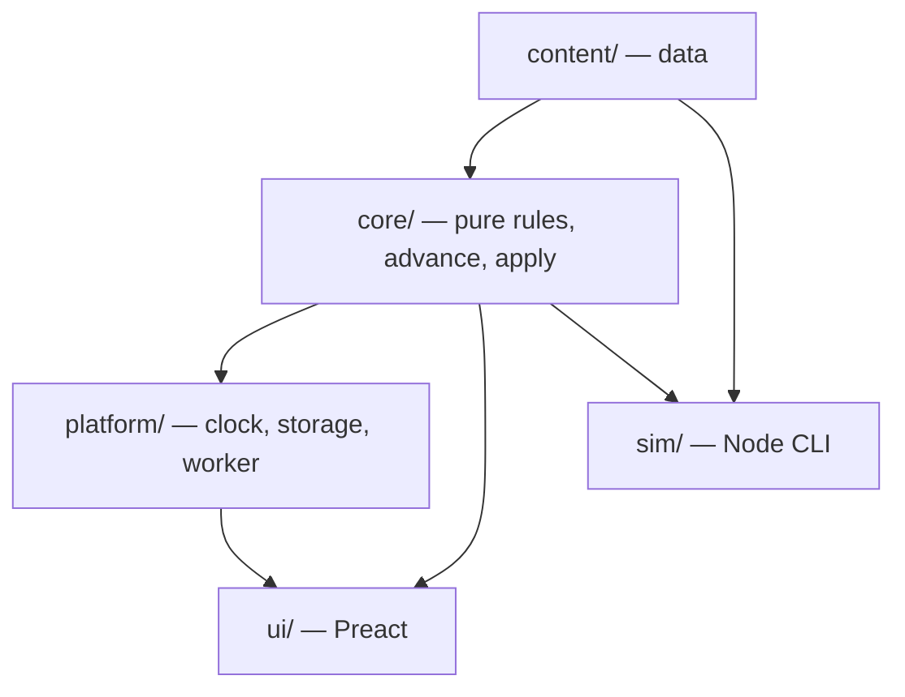

# The Last Hold — Technical Design

**Status:** Approved (D33). Revised after the plan review (D34); edits marked ⚑.
**Reads with:** `gdd.md` (what to build), `decisions.md` (why), `implementation-plan.md` (in what order).
**Markers:** **[JC]** = judgment call. **MUST** / **NEVER** = rules that also appear in `CLAUDE.md`.

---

## 1. Goals and constraints

From the brief and the decisions log:

| Constraint | Source |
|---|---|
| Static web app, no server; hosted on GitHub Pages; installable PWA; playable offline | Brief |
| Phone-first, scaling up to desktop | D02 |
| Saves in browser storage, plus an export code and a downloadable save file | Brief |
| Offline progress calculated on load, capped at 12 h (24 h ceiling) | D08, GDD §5.2 |
| Data-driven content | Brief, D24.5 |
| Deterministic and testable; seeded RNG | Brief |
| Maintainable by Claude Code across many separate sessions | Brief |
| Strong typing, automated tests, minimal dependencies, fast on phones | Brief |
| CC0 art only | D14 |

**What "maintainable across sessions" means here.** Every session starts cold. So:
- The code must be easy to find your way around: predictable folders, one concept per file, and no clever indirection.
- Rules must be enforced by tooling (types, lint, tests), not by memory.

---

## 2. Stack and rationale (D17)

| Layer | Choice | Why |
|---|---|---|
| Language | **TypeScript 5.x, `strict` plus `noUncheckedIndexedAccess`** | Types are the cheapest way to keep many cold-start sessions consistent. Content files are type-checked for free (D24.5). |
| Build and dev | **Vite** | Fast, minimal config, first-class TypeScript and Web Workers. The de-facto standard, so it's well known to Claude Code. |
| Tests | **Vitest** | Shares Vite's config. Its bundled `vite-node` also runs the simulator, so no extra runner is needed. Built-in benchmarking. |
| UI | **Preact + @preact/signals** | About 4 KB. React-style components that Claude Code writes reliably. Signals give fine-grained updates without a state library. |
| PWA | **vite-plugin-pwa** (Workbox) | Generates the service worker and manifest correctly. Hand-written service workers are a classic source of stale-cache bugs. |
| Browser tests | **Playwright** *(from v0.1, D24.7; moved up, D61)* | The smoke test and the cross-engine determinism and golden suites (§14) |
| Lint and format | **ESLint (flat config) + Prettier** | Enforces the layer rules (§4.2) and the no-`Math.random` rule mechanically |

**Runtime dependencies: 2** (`preact`, `@preact/signals`). Everything else is a dev dependency.

**Alternatives considered:**
- **Vanilla TypeScript UI:** no dependency, but every screen would reinvent state-to-DOM syncing, and that's where cold-start sessions drift.
- **React:** fine, but about 10× heavier than Preact for no benefit here.
- **Svelte or Solid:** good, but less common in training data, so more mistakes from Claude Code.
- **A game engine (Phaser and similar):** wrong shape. This game is mostly menus, lists, and numbers, not a canvas.

**Versions:** Node **22 LTS**, npm (lockfile committed). Exact dependency versions are pinned in v0.0 **[JC]**.

---

## 3. Repository layout

```
the-last-hold/
├─ CLAUDE.md                     # rules for every session (read first)
├─ README.md
├─ docs/                         # design, lore, plan, decisions (source of truth)
│  ├─ gdd.md · setting-primer.md · lore-secrets.md (added at v0.5, D36)
│  ├─ technical-design.md · implementation-plan.md · decisions.md
│  └─ credits.md                 # generated from the asset manifest (§12)
├─ src/
│  ├─ core/                      # pure game logic: no DOM, no clock, no Math.random
│  │  ├─ state/                  # GameState types, creation, selectors
│  │  ├─ systems/                # economy, peasants, contracts, combat, bestiary, alchemy…
│  │  ├─ sim/                    # advance(), the event queue, offline catch-up
│  │  ├─ commands/               # apply(state, command): every player action
│  │  ├─ rng/                    # seeded PRNG, streams, roll sources
│  │  ├─ breakdown/              # Breakdown trees (GDD §5.0)
│  │  ├─ format/                 # number and time formatting (pure)
│  │  └─ save/                   # schema, migrations, encode/decode (pure parts)
│  ├─ content/                   # data only: typed TS modules
│  │  ├─ balance.ts              # every constant from GDD §7
│  │  ├─ buildings.ts · jobs.ts · ages.ts · hunters.ts · traits.ts
│  │  ├─ monsters.ts · clues.ts · villages.ts · ingredients.ts · consumables.ts
│  │  ├─ text/                   # flavor text: building blurbs, resident lines, notices
│  │  ├─ assets.ts               # asset manifest (§12)
│  │  └─ palette.ts              # the 32-color palette
│  ├─ platform/                  # browser-only adapters
│  │  ├─ clock.ts · storage.ts · download.ts · compression.ts · lifecycle.ts
│  │  └─ worker/                 # odds and suggest worker (GDD §6.5)
│  ├─ ui/                        # Preact components; no game rules
│  │  ├─ app/ · screens/ · sheets/ · widgets/ · debug/
│  │  └─ styles/                 # CSS tokens, themes
│  └─ main.ts
├─ sim/                          # balance simulator (Node, via vite-node)
│  ├─ cli.ts · policies/ · checks/ · targets.ts · report.ts
│  └─ baseline.json              # last accepted results, for diffs
├─ tests/                        # cross-cutting tests (unit tests live next to code)
│  ├─ golden/ · determinism/ · saves/fixtures/ · content/ · e2e/
├─ tools/                        # dev-only scripts: recolor, generate portraits, credits
├─ public/assets/                # final PNGs (packs + generated), fonts, icons
└─ .github/workflows/ci.yml · deploy.yml
```

- **Unit tests sit next to their code** (`economy.ts` → `economy.test.ts`).
- **`tests/`** holds the cross-cutting suites: golden fights, determinism, save fixtures, content validation, and end-to-end.

---

## 4. Architecture

### 4.1 Layers



### 4.2 Layer rules (enforced by ESLint `no-restricted-imports` and custom rules)

- **`core/` MUST NOT import** `ui/`, `platform/`, or any browser global (`window`, `document`, `localStorage`).
- **`core/` MUST NOT call `Math.random()`, `Date.now()`, `new Date()`, `performance.now()` or `crypto.getRandomValues()`, or any math function outside the portable set (§7.4).** Time arrives as a parameter, and randomness comes from `core/rng`. A custom lint rule fails the build if they appear *(⚑ ban list widened, plan review A8/B8)*.
- **`content/` exports data only:** no functions except trivial constructors, and no imports from `core/` except types.
- **`ui/` MUST NOT compute game rules.** It calls selectors and dispatches commands. Display formatting is allowed.
- **`sim/` uses only `core/` and `content/`,** never `platform/` or `ui/`.

### 4.3 The two entry points into the core

```ts
apply(state: GameState, cmd: Command, now: number): ApplyResult   // player actions
advance(state: GameState, toTime: number): AdvanceLog            // the passage of time
```

- **Every player action is a `Command`:** a plain JSON object such as `{ type: 'build.buy', building: 'cottage', count: 1 }`. The UI, the simulator, and the debug panel all go through `apply`. So the simulator plays the real game, not a model of it.
- **`apply` validates and returns `{ ok: true } | { ok: false, reason }`.** A refused command never changes state.
- **State is mutated in place** inside `apply` and `advance`, for speed and simplicity. Anything that needs a hypothetical, such as the odds preview or "what would this buy give me", works on a `structuredClone(state)` **[JC]**. No immutability library is needed.

---

## 5. Data model

### 5.1 Content (static)

- **IDs** are kebab-case string literals, typed as unions (`type BuildingId = 'cottage' | 'farm' | …`), generated from the content arrays with `as const`. A typo in an ID is a compile error.
- **`balance.ts`** is one `as const` object whose keys match GDD §7 exactly (`balance.costGrowth.count`, `balance.provisions.base`, …). **No numeric game constant may appear anywhere else.** A lint rule flags numeric literals in `core/systems/` except an **allowlist: 0, 1, −1, 2, 100, and array indices**; test files are exempt *(⚑ allowlist widened, plan review A14)*.
- **Each `balance.ts` entry is marked `tunable` or `locked`** *(⚑ plan review A15)*. The tuning pass may change only `tunable` entries. `locked` entries are design decisions (the list is in `implementation-plan.md` §0.6) and change only through a decisions row the owner approves.
- **Content validation tests** (`tests/content/`) run on every change:
  - Every referenced ID exists.
  - The coverage rules from GDD §8.3.1, including that clue-tag sets are distinct within each cell.
  - Every recipe's ingredients exist.
  - Every asset ID referenced has a manifest entry.
  - Every proper noun appears in the collision-checked list (§14).
  - *(⚑ plan review A12)* Every **text key** and **unlock reference** resolves.
  - **The GDD §7 key list matches the `balance.ts` keys exactly.** A small script extracts the backticked keys from GDD §7, and the test compares the two sets in both directions.

### 5.2 Game state (saved)

```ts
interface GameState {
  meta: {
    schemaVersion: number
    gameSeed: string                 // fixed for the save's lifetime
    createdAt: number; lastSeen: number
    clockHighWater: number           // latest time ever seen (backward-clock guard, D21)
    debugUsed: boolean               // informational only
  }
  cycle: { number: number; age: AgeId }         // AgeId gains citadel, bastion (v0.4)
  resources: Record<ResourceId, number>          // food, wood, iron, silver
  peasants: { total: number; jobs: Record<JobId, number>; autoSettle: boolean;
              priority: JobId[]; lastSettleAt: number }
  buildings: Record<BuildingId, number>          // count or level
  hunters: Record<HunterId, HunterState>         // owned only (v0.2)
  roster: { active: HunterId[] }                 // anything owned and not active is in the reserve
  board: { open: ContractInstance[]; nextArrivalAt: number; tierProgress: Record<number, number> }
  running: RunningContract[]
  results: ContractResult[]                      // unread results (rewards already applied, GDD §5.4.3)
  bestiary: Record<MonsterId, { level: 0|1|2|3|4; kills: number }>   // v0.3
  stores: Record<ConsumableId | IngredientId, number>                // v0.3
  queues: { brewing: KettleJob[]; investigation: InvestigationSlot[] } // v0.3; v0.6: brews and experiments
  threat: number                                 // v0.4; counts only once arrivalDue is false
  embers: number                                 // v0.4; unspent
  upgrades: Record<UpgradeId, number>            // v0.4; warden upgrade levels
  relics: { id: RelicId; cycle: number }[]       // v0.4; owned, with the cycle found
  arrivalDue: boolean                            // v0.4; a pre-v0.4 save still faces its first Long Night
  cycles: CycleRecord[]                          // v0.4; one short entry per cycle
  story: StoryState                              // v0.5; acts, documents, names, letters, trust (below)
  book: RecipeBook                               // v0.6; revealed properties per ingredient, pairs tried
  skills: Record<SkillId, number>                // v0.6; warden skill XP (the level is derived)
  items: ItemState[]                             // v0.8; every item owned: equipped or in Stores (cap 40)
  legendaries: { id: LegendaryId; cycle: number }[]  // v0.8; found, kept forever
  events: EventsState                            // v0.9; tokens, rests, the boss visit, hunt points (below)
  stats: LifetimeStats                           // trophies this cycle, totals
  log: { recentFights: FightRef[] }              // seeds + inputs, not full logs (§5.3)
  settings: Settings
}
```

```ts
interface EventsState {
  opened: boolean                    // true once the Citadel has been reached (D366); never goes back
  sceneSeen: boolean                 // the one-time scene (GDD §5.12.1)
  clock: { value: number; high: number }  // the monotone event clock (below); `value` is event time in ms, `high` the latest real time seen
  tokens: { count: number; at: number | null }  // tokens at event time `at`; at is null until events first open
  attempts: number                   // monotone counter; part of every attempt's seed
  rest: Record<HunterId, number>     // restUntil in event time, ms; entries already in the past are dropped on load
  boss: { visit: number              // 0-based; the boss is order[visit % 3], the pass is floor(visit / 3)
          tier: number | null        // fixed at the visit's first attempt
          pool: number | null        // Health left; null until the first attempt
          paid: number               // milestones already paid this visit, 0–4
          attempts: number }         // attempts made in this visit
  hunts: Record<HuntId, { points: number; unlocked: boolean }>
  last: EventResult | null           // the latest attempt's result, kept until read (a closed app still shows it)
  recent: FightRef[]                 // the last `events.recentKeep` (10) event fights: seeds and inputs, never logs (§5.3)
}
```

- **Cycle history** *(v0.4, D113)*: each `CycleRecord` holds when the cycle started, when each Rank was reached, when the stand was made, waves held, the Embers breakdown, the relics found, and the stand's inputs (party snapshots, preparation, defense levels, Threat, seed), so its wave logs can be rebuilt like contract fights (§5.3). About 200 bytes per cycle; v0.5's Roll of Wardens reads it. The stand's wave list is not stored: it comes from the stand seed. Walls and Watchtower are ordinary entries in `buildings`. *(v0.9: also `standPool: 'base' | 'dross' | null`, below.)*
- **The story** *(v0.5, plan T5.3)*: each `CycleRecord` also holds the **act** it tells (null for cycles before v0.5, and for a cycle still owed the v0.4 arrival) and the **warden's name** (up to 24 characters; null until named). `StoryState` holds: the v0.5 arrival flag; when Ilse arrived; one `ActProgress` per act begun (its cycle, start time, and the counters that run from then: wins, wins by village, ruin wins); documents found (id, cycle, time, how); names found (roll number, cycle, time) and the count of Ribbonshades defeated; each hunter's **highest level ever** (letters read it, D155); letters reached; each village's trust (level, progress toward the next step, wins counted, Triumphant stands); and the unread Archive items for the badge. Nothing in it resets at the Long Night. The v4 → v5 migration starts Act I in the current cycle (D149), or with the cycle after a pending v0.4 arrival; it sets each hunter's highest level from their level now or at death, and every village to its starting trust.
- **Alchemy discovery and skills** *(v0.6, plan T6.3, D218)*: `book` holds, for each ingredient, which of its three properties (by index in the §8.6 order) are revealed, and the pairs already tried (`a+b`, in ingredient-list order). It opens with the 15 properties the nine v0.3 recipes prove. `skills` holds XP per warden skill; levels are derived. Both are kept through the Long Night. The kettle queue holds `KettleJob`s: a **brew** records the recipe it was paid with (`paid`), so a cancel refunds exactly that whichever recipes the book knows later; an **experiment** records its two ingredients and the units paid. `RunningContract`, `FightRef` and `StandRecord` carry the **Alchemy level** frozen at launch (0 for anything made before v0.6, so every replay is unchanged, D206); a `StandRecord` also carries its **band**, so a stand keeps the band it earned under the thresholds of its day (D194). The six new brews have empty store slots. The v5 → v6 migration (`save/migration-v6.ts`) holds frozen copies of the v0.3 recipes, the 15 known properties and the old thresholds (9 and 12) so later content changes never rewrite an old save.
- **Delves and Act IV** *(v0.7, plan T7.1 and T7.5, D245, D246, D267)*: `delve` holds the Delve state, all kept forever: the active run (`seed`, `baseTier` fixed at its start, `floor` 1–6 or 7 for the guardian, the `party` of three, each hunter's `health` with 0 meaning down, `blessings` taken, the `stage` on screen (the two doors, the offered cards, or the next fight), `lastDoors`, the Unlit doors used, whether Re-roll was used, a `rules` bag for the ★ rules' bookkeeping, and `earned` so far); the `result` of a finished run until its sheet is read; `runs` started (the seed's number); `riftglass`; the banked `allowance` and `allowanceAt`, when it last grew (null until the first Keep); `sceneSeen`; `unlitOpen`; the `shop` (Late hours level, alternate traits bought and in use, cosmetics, Chosen start, Re-roll); `deep` (knowledge of the Deep guardians, outside the bestiary); `relics`; `echoes`; the rarities `taken` from each patron (which finds the echoes); and, for v0.8, Delve `kills` per family and `guardiansBeaten` (D278). Each `ActProgress` also holds `winsByFamily`, which Act IV's margins count (D4-02, D4-03). The v6 → v7 step (`save/migration-v7.ts`) gives every act an empty family count and the Delves their starting state, and **re-bases Act IV (D246)**: the cycles' act numbers above III were story-less in v6, so they are cleared, the current cycle becomes Act IV, the counters recorded for story-less acts are dropped, and Act IV begins fresh at the save's time; the `story.startActIV` command then plays D4-01 on load (`via` 'arrival'), finding an Act IV Rank document only if that Rank is already behind the save this cycle. The guard is `save/validate-delve.ts`: unknown content ids are dropped with a warning, and a run that cannot be trusted refuses the load.
- **Hunter depth and Act V** *(v0.8, plan T8.5, D306–D317)*:
  - **`items`:** every item the hold owns, each with an id, its base piece, tier, rarity (Common, Fine, Rare, Heroic), its bonus lines (kind, size, and the family for a bane line), what was paid into it (for Salvage), and where it is (a hunter's weapon or armor slot, or Stores).
  - **Each `HunterState`:** gains `rank` (apprentice, wright, masterWright), `stars` (0–5), `talents` (picked ids), `keepsake` (a Legendary id or null), and its `weapon` and `armor` as item ids.
  - **`legendaries`:** the ones found, with the cycle.
  - **Trophies spent this cycle** are recorded beside the cycle's trophies, so trophies on hand = earned − spent.
  - **The Long Night** keeps ranks, stars, talents, keepsakes and Legendaries, and drops every other item.
  - **`ActProgress.winsByFamily`** is now separate for each act (D318).
  - **The v7 → v8 step** (`save/migration-v8.ts`):
    - turns each hunter's gear tiers into equipped Common items with today's numbers;
    - gives each hunter the rank their highest level ever qualifies for (D311), with stars 0 and talents empty;
    - finds Legendaries whose milestone is already met;
    - keeps Act IV's family counts and clears Acts I–III's;
    - starts Act V on load when the current cycle has no act (D246, generalising `story.startActIV` to `story.startAct`).
- **Events and Act VI** *(v0.9, plan T9.1–T9.3, D358–D387)*:
  - **`events`** holds everything above. It is **kept through the Long Night** (GDD §5.12.10) and is small (well under 1 KB).
  - **The event clock (D359, D387).** `eventNow(state, now) = clock.value + max(0, now − clock.high)`. Whenever the game loads or runs a command, it first folds in the elapsed time: `if now > clock.high { clock.value += now − clock.high; clock.high = now }`. A clock set **back** changes nothing (`now < high`, so no time passes and none is lost); a clock set back **then forward** adds time only beyond `high`, so **no free time** is gained. **There is no `rebaseEvents`.** This is uncapped (the offline cap does not apply) and independent of `lastSeen` and the production high-water mark of §6.4.
  - **Tokens are derived, not ticked.** `tokens.count` is the bank at event time `tokens.at`; with `t = eventNow(state, now)`, the bank now is `count` if `count ≥ boss.tokenMax`, otherwise `min(tokenMax, count + floor((t − at) / tokenInterval))`, with progress `(t − at) mod tokenInterval`. A spend normalises first: from a full bank it sets `at = now`; from a part-full bank it keeps the progress (`at = now − progress`). `at = null` means events have not opened yet.
  - **Rest is derived.** A hunter rests while `rest[id] > eventNow(state, now)`. A resting hunter is not blocked from contracts or Delves (GDD §5.12.2).
  - **Eligibility** is a selector: not on a contract, not in a Delve, not recovering, not resting.
  - **The boss's pool** is stored in Health points, not as a share, so the preview and the milestones read the same number. Milestone thresholds are `boss.milestones` × the visit's starting pool (`poolStart` is recomputed from the fixed tier and `boss.poolBase`, never stored).
  - **`last`** holds a short result (damage dealt, the pool left, milestones paid, XP per hunter, loot lines, the `FightRef`) so a result is never lost if the app closes during playback. It is cleared when read.
  - **`CycleRecord.standPool`** is set when the cycle's wave list is first fixed (Bastion reached): `dross` if **Act VI has begun in the save at that moment** (Act VI's own cycle and every cycle after it, whether or not it carries an act; owner, D386), otherwise `base`. Null before Bastion. **No wave of the Dross-Tide is guaranteed**; a `dross` pool only makes it possible. It is copied into the stand's saved inputs, so a rebuilt wave list uses the same pool (GDD §5.9.3, D363).
  - **New content ids** (unknown ids drop with a warning on load, never a crash): hunters `gest-tall-torch`, `ragnhild-eye-taker`, `radmila-of-the-reeds`; Great Beasts `lindworm-of-velk-fjord`, `barrow-king`, `mother-of-the-river`; quarries `stoneback-fell-troll`, `mara-of-kettle-barrow`, `likho-one-eyed`; hunts `stoneback`, `mara`, `likho` (tracks `…-1` to `…-3`); documents `D6-01` to `D6-10`; the document type `rime`.
  - **Story:** `story.startAct` already generalises (v8); Act VI adds its `ActProgress` the same way. `ActProgress.winsByFamily` stays separate per act (D318).
- **Derived values** stay derived: the pool bar, the milestone marks, the tier, the preview, odds, points totals and every rest time come from selectors that take `now` and return `Breakdown` trees.
- **Derived values are never stored:** rates, the active-roster cap, odds. They come from **selectors** (`core/state/selectors.ts`). Each selector that feeds a visible number also returns a `Breakdown` tree (§5.4).
- **Fight logs are not stored.** A `FightRef` holds the seed and the inputs (party, preparation, monster instance), and the log is **regenerated on demand** by re-running the fight. This keeps saves small and proves determinism every time a log opens.

### 5.3 Fight references

```ts
interface FightRef { contractId: string; seed: string; party: HunterSnapshot[];
                     prep: PrepSnapshot; monster: MonsterInstance; result: 'win'|'loss' }
```

*(v0.9, an addition: every existing field stays, including `location`, `rulesVersion`, `time` and the Alchemy level the real save records; see `v8-owner.json` `recentFights`.)*

```ts
interface FightRef { /* … all existing fields unchanged … */
                     event?: { kind: 'boss' | 'hunt'; attempt: number; id: string } }  // v0.9, optional
// and on the monster record (MonsterInstance snapshot): healthOverride?: number   // v0.9, optional
```

- **Snapshots freeze hunter stats at launch,** so later level-ups don't change a replayed log. An event fight's `monster` holds the Great Beast at the visit's tier with the optional **`healthOverride` equal to the pool at launch** (absent on every older record, so old snapshots stay valid); **the Alchemy level is frozen at launch for event fights**, as for contracts (D206); `event` is absent on every older reference, so every old snapshot replays unchanged (D337 (8), D340 (13) pattern). For an event fight `contractId` holds the string `event:${attempt}`.
- **If the combat code ever changes in a way that alters an old replay,** the replay shows *"recorded with an older rules version"*. From v0.8 the note shows only when the replay actually differs from the record (D319); a replay that matches shows nothing. A `rulesVersion` constant bumps whenever combat math changes (5 from v0.8, D308).

### 5.4 Breakdown trees (GDD §5.0, D10)

```ts
type Breakdown = { label: string; value: number; formula?: string;
                   bucket?: BucketId; key?: BalanceKey; children?: Breakdown[] }
```

- **Selectors build the number and its breakdown in the same function,** so they can't disagree.
- The UI renders any `Breakdown` with one generic sheet component.

---

## 6. Time, the tick, and offline progress

### 6.1 Clock

- `platform/clock.ts` provides `now(): number` (epoch milliseconds).
- **The core never reads a clock.** Every `apply` and `advance` receives `now` or `toTime`.
- The simulator uses a virtual clock that starts at Monday 07:00 (GDD §6.1).

### 6.2 `advance(state, toTime)`: event-driven (GDD §5.2, D30)

```
while state.time < toTime:
    rates  ← currentRates(state)                  # constant until the next event
    tNext  ← min(nextEventTime(state, rates), toTime)
    integrate resources linearly from state.time to tNext
    state.time ← tNext
    if tNext is an event time: applyEvent(state, event)   # may change rates
```

**Event sources,** each with an exact time:

| Event | When it fires |
|---|---|
| Settle due | `max(lastSettleAt + 30 s, time when food reaches settleCost)`, while housing is free and auto-settle is on |
| Contract completes | Its end time. Rewards, injuries, and XP apply here (D31/B9). |
| Recovery ends | Its timer |
| Brew finishes / clue revealed | Their timers |
| Board refill | `nextArrivalAt` |

- **Ties at the same instant** apply in a fixed order: completions → recoveries → brews → clues → refills → settles **[JC]**. **v0.9 adds no event source and no slot:** the token tick, a hunter's rest ending and a pool being emptied are **not `advance` events.** They are functions of the stored timestamps and of `now`, evaluated by selectors and by `apply(state, cmd, now)`, so the tie order is unchanged (D359).
- **Floating-point drift.** Resources are doubles. Event times are computed, not stepped, so 12 h of 1-s ticks and one 12 h jump agree within `1e-9` relative error. That's the **equivalence test** (D30).
- **How the equivalence test compares states** *(⚑ plan review A9)*: integer fields (counts, levels, IDs, booleans) must match **exactly**; float fields within **1e-9 relative or 1e-6 absolute**, whichever is looser; event timestamps within **1 ms**. The live tick is **1 s** (§6.3).
- **Event timers and the offline cap** *(v0.9, D359)*. The 12 h offline cap (24 h ceiling) limits how much *production* `advance` integrates; it does **not** limit the token bank or rest, because those are worked out from timestamps, so they are right at any `now` however long the game was closed. The offline report is unchanged except the one away-sheet line when the bank filled. **Equivalence tests for events:** (1) the token count after 30 h in one jump equals the count after 30 h in a 12 h + 12 h + 6 h sequence of loads (integers, exactly equal); (2) spending at an instant gives the same bank as ticking to it in 1-s steps and then spending.
- **Backward clock (D21) for events:** the event clock of §5.2 is monotone, so nothing special happens on a backward step: the existing handler resets `lastSeen` and applies elapsed 0, and `events.clock` simply does not move. Tests: (1) a clock moved back 3 h leaves tokens-to-next and every rest remaining exactly as they were; (2) **the round trip**: moved back 3 h and then forward 3 h, the bank and every rest equal what they were before both moves (no free time); (3) forward 3 h past the old high-water mark adds exactly 3 h.
- **Riftglass differs on purpose:** its allowance grows inside `advance` and respects the offline cap; tokens and rests do not. After a long absence the two banks behave differently; the away sheet only mentions the token bank when it filled.

### 6.3 The live loop

- **A 1-second interval** calls `advance(state, clock.now())`. The UI redraws through signals; nothing animates by polling.
- **When the page hides** (`visibilitychange` → hidden, `pagehide`), the game saves immediately.
- **When the page becomes visible again:**
  - Away less than 60 s: just advance.
  - Away 60 s or more: run **offline catch-up** (§6.4) and show the "While you were away" sheet if the gap is 5 min or more **[JC]**.
- **Autosave** runs every 30 s and after every successful command.

### 6.4 Offline catch-up

```
elapsed = clamp(now − meta.lastSeen, 0, offlineCap(state))
if now < meta.clockHighWater: elapsed = 0; lastSeen = now          # backward clock, D21
```

- **Catch-up runs in 60 s chunks of `advance`** (GDD §5.2). After every 50 chunks it yields to the browser with `await` and a zero-delay timeout, so the progress bar paints. Twelve hours is 720 chunks, which should take well under a second on a phone **[JC: no worker needed]**.
- **The away summary** is a diff: `state` before vs after, plus the `AdvanceLog` events collected during catch-up.
- **Time beyond the cap is reported, not simulated:** *"14 h 20 m away · 12 h counted."*

---

## 7. Randomness

### 7.1 Generator

- **`sfc32`**: a small, fast 32-bit PRNG with a 128-bit state that serializes as 4 numbers.
- **Seeding** from strings uses a **`cyrb128`-style hash** **[JC]**.
- **Both are about 20 lines, written in-repo** with no dependency. Each has golden-value tests (fixed seed → fixed first 10 outputs) so an accidental change is caught.

### 7.2 Streams

Each kind of randomness gets its own derived seed. That way, adding a roll in one system never shifts another system's results.

| Stream | Seed string |
|---|---|
| Board arrivals | `${gameSeed}:board:${arrivalIndex}` |
| A real fight | `${gameSeed}:fight:${contractId}:${partyIds}:${prepIds}` (GDD §5.4.2) |
| Odds preview, sample i | `${gameSeed}:odds:${contractId}:${partyIds}:${i}`, a distinct prefix, so it never equals the real fight; no preparation, so prepared and unprepared previews share their dice (D98) |
| Suggest, stage 1 | `${gameSeed}:suggest:${contractId}:${i}`, **the same seeds for every party** (GDD §6.5) |
| Clues and investigation | `${gameSeed}:clues:${contractId}` |
| Contract loot (v0.8) | `${gameSeed}:loot:${contractId}` (fixed at launch, like the fight) |
| Delve guardian loot (v0.8) | `${runSeed}:loot` |
| Boss attempt (v0.9) | `${gameSeed}:boss:${attempt}:${partyIds}:${prepIds}` (`attempt` is the monotone counter, so the same party twice differs) |
| Hunt attempt (v0.9) | `${gameSeed}:hunt:${attempt}:${huntId}:${track}:${partyIds}:${prepIds}` |
| Boss kill item (v0.9) | `${gameSeed}:eventloot:${visit}` (rolled once, at the kill, in the order base, rarity, lines, like contract loot) |
| Boss preview, sample i | `${gameSeed}:bossodds:${visit}:${partyIds}:${i}`, a distinct prefix, so it never equals the real attempt; same dice for every party |
| Hunt odds, sample i | `${gameSeed}:huntodds:${huntId}:${track}:${partyIds}:${i}` (prepared and unprepared share their dice, as D98) |
| Suggest for events | `${gameSeed}:eventsuggest:${visit or huntId-track}:${i}`, a distinct prefix; **the same seeds for every party** |
| Stand waves (unchanged) | `${gameSeed}:stand:${cycle}`, drawn from the pool named by `CycleRecord.standPool`; the `base` pool draws exactly as before v0.9, so no existing stream or stand shifts |
| Simulator | `sim:${runSeed}` (the simulator also picks its own `gameSeed`) |

New streams never reuse an existing prefix, so adding events shifts no other system's results.

### 7.3 Roll sources (for the exact test)

```ts
interface RollSource { next(): number }   // [0, 1)
```

- `seeded(seedString)` returns an sfc32-backed source.
- `scripted([0.40, 0.50, …])` returns rolls from a list and **throws if the list runs out or isn't fully consumed**. This powers the GDD §5.5.1 golden test.
- **Combat code receives a `RollSource`** and never constructs one. Roll order is exactly as GDD §5.5 specifies.

### 7.4 Portable math *(⚑ new, plan review A8)*

**Why.** Tests run in Node (V8), but your phone may run WebKit. The JavaScript spec only requires *approximately* correct results for `Math.pow`, `Math.exp`, `Math.log` and the trigonometric functions, so engines can differ in the last bit. One differing bit in a cost or a damage roll would break determinism between your phone and CI.

**Rule.** Anything in `src/core/` that feeds saved state, rolls, or displayed game values uses only operations the spec defines exactly:
- `+ − × ÷`, `Math.sqrt`, `Math.floor/ceil/round/trunc/abs/min/max/sign`, `Math.imul`, bit operations, and comparisons;
- `Number.prototype.toFixed` and `toPrecision` (exactly specified) for formatting.

**Helpers in `core/math/`:**
- `intPow(base, n)`: integer exponents by repeated squaring. Every exponent in the GDD is a whole number (`r^n`, `1.6^(tier−1)`, `2.2^(tier−1)`, `1.35^(t−t₀)`, `1.5^(L−1)`).
- `maxAffordable(...)`: an exponential search followed by a binary search on k. **GDD §5.1.2's `log` formula stays as the definition**, and a test checks that the search matches it (computed in the test with `Math.log`) across a table of cases.
- The formatter picks suffixes by comparing against thresholds, not `log10`.

**Banned in `src/core/`** (lint): `Math.pow`, `**`, `Math.exp`, `Math.expm1`, `Math.log`, `Math.log1p`, `Math.log2`, `Math.log10`, `Math.sin/cos/tan/asin/acos/atan/atan2`, `Math.sinh/cosh/tanh`, `Math.cbrt`, `Math.hypot`, `Math.fround`.

**`tools/` is exempt.** OKLab color math never feeds game state.

**Proof:** the determinism and golden suites also run in **Playwright's WebKit and Chromium** (§14).

---

## 8. Numbers and formatting (D18)

- **All quantities are JavaScript doubles.** The **overflow check** (GDD §6.3 #7) fails the simulator if any value passes `1e300`; a big-number library would come in only then (D18).
- **Health and damage are integers** (GDD §5.0). Resources are fractional internally.
- **Affordability uses the exact value. Display floors**, so the UI never shows "100" for 99.7 when the cost is 100 **[JC]**.

`core/format/number.ts`:

| Range | Format | Example |
|---|---|---|
| < 1,000 | Integer (floored); rates under 10 get one decimal | `847`, `4.5/min` |
| 1e3 – 1e21 | 3 significant digits plus a suffix: K, M, B, T, Qa, Qi | `1.23K`, `45.6M`, `789Qa` |
| ≥ 1e21 | Scientific with 3 significant digits | `1.23e21` |

- Breakdown sheets show exact values with thousands separators.
- The formatter follows the portable-math rule (§7.4): thresholds, not logarithms.
- **Time format:** `45s`, `12m`, `3h 10m`, `2d 4h`.
- **Table-driven tests** cover every boundary (999.99, 1000, 999,500, …).

---

## 9. Saves

### 9.1 Storage

| Slot | Key | When written |
|---|---|---|
| Main | `lasthold:save` | Autosave (§6.3) |
| Backup | `lasthold:backup` | Every 10 minutes, as a copy of the last good main save |
| Quarantine | `lasthold:corrupt:<ts>` | A main save that failed to load, kept for recovery |

- **`localStorage` with JSON** **[JC]**. The expected save size is well under 1 MB, because logs are regenerated (§5.2). It's synchronous and simple, and plenty here.
- **On first run** the game calls `navigator.storage.persist()` to request persistent storage.
- **Namespacing** *(⚑ plan review A2)*: every key is prefixed by the build channel, `lasthold:` for live and `lasthold-preview:` for preview builds (§11.3). A preview build can never read, migrate, or overwrite the live save.
- **On iPhone, the Home Screen app keeps its own storage, separate from Safari** *(⚑ plan review A3)*. The install tip says: install before you start playing, and use export and import to move a save between Safari and the app.
- **Honest note about iPhone:** Safari can clear storage for websites that go unused for 7 days. Apps **added to the Home Screen** are counted separately, by their own days of use, so regular play keeps them safe. The game shows a one-time tip to install it, and **the export code is the real safety net.**

### 9.2 Envelope

```json
{ "app": "the-last-hold", "schemaVersion": 3, "rulesVersion": 2,
  "savedAt": 1760000000000, "state": { … } }
```

### 9.3 Export and import

**Save code:** `LH1.` + base64url( deflate-raw( UTF-8 JSON envelope ) ) + `.` + an 8-hex-digit FNV-1a checksum.
- Compression uses the browser's built-in `CompressionStream`. No dependency. If a browser lacks it, the game writes an uncompressed code with the prefix `LH0.` instead, and both kinds import.
- Import checks, in order: the prefix, the checksum, decompression, parsing, the version, migration, then validation.
- Any failure shows a plain-language reason and **never touches the current save**.

**Save file:** a download of the plain JSON envelope, named `the-last-hold-YYYY-MM-DD.json`. It's human-readable on purpose.

### 9.4 Versioning and migrations (CLAUDE.md rule)

- `schemaVersion` is an integer. `core/save/migrations.ts` holds an ordered list, where `migrations[n]` upgrades version n to n+1. They're pure functions on plain JSON.
- **Every schema change MUST add:**
  1. a migration;
  2. a **fixture**: a real save at the old version, in `tests/saves/fixtures/vN.json`;
  3. a test that loads every fixture, migrates it to the current version, validates it, and round-trips it (save → load → equal).
- **v8 → v9** *(v0.9; `save/migration-v9.ts`; fixture `tests/saves/fixtures/v8-owner.json`, the owner's real save of 2026-10-20: cycle 19, Bastion, Act IV, 11 hunters, one Legendary)*:
  - adds `events` with `opened: false`, `sceneSeen: false`, `tokens: { count: 0, at: null }`, `attempts: 0`, empty `rest`, `boss: { visit: 0, tier: null, pool: null, paid: 0, attempts: 0 }`, `hunts` for the three hunts at `points: 0, unlocked: false`, `last: null`, `recent: []`;
  - sets `standPool: 'base'` on every past cycle record; on the current cycle record, `'base'` if Bastion has been reached, otherwise `null`;
  - leaves every hunter, item, Legendary, story and stand record **as it is** (no gear changes, no new Common items, no new documents);
  - does **not** open events: **the load path does,** by the same function the live game uses on reaching the Citadel (`openEvents(state, now)`), so the migration needs no clock. For a save at or past the Citadel it sets `opened: true`, `tokens.at = now` (an empty bank) and the scene pending. For the owner's save: events open on the first load, with an empty bank.
  - **Validation additions:** `tokens.count` is clamped to 0–`boss.tokenMax`; `points` to 0–`hunt.unlockPoints`; `boss.tier` to null or 3–12; `paid` to 0–4; unknown hunt, boss or hunter ids drop with a warning; a `rest` entry in the past is dropped.
  - **`clock`** starts as `{ value: 0, high: <load time> }`.
  - **Tests:** the fixture loads, migrates, validates and round-trips (save → load → equal); the migrated owner save has `opened` true after the load path, an empty bank, `standPool: 'base'` on cycle 19, `cycles[18].stand` still null (the current cycle's stand record), and **every existing golden fight replays line for line, and every recorded fight and stand keeps its result** (recorded fights keep only their result, D344 (1); stop and ask otherwise, D308). A second fixture, **`tests/saves/fixtures/v9.json`**, is the migrated owner save played 72 h under a fixed seed, as v5, v6 and v8 each have one.
- **Validation** is a hand-written guard (`validateState(json): Result`) that checks types, ranges, and that every ID exists in content **[JC: no schema library]**. Unknown IDs (for example, content that was removed) are dropped with a warning in the load report, never a crash.
- **Loading a save from a newer version** is refused with "This save is from a newer version of the game", leaving the current state untouched.

---

## 10. UI architecture

- **State to UI:** one `gameState` object, plus a `version` signal that's bumped after every `apply` and `advance`. Components read through `useComputed(() => selector(state))`, which re-runs only when `version` changes. Selectors are cheap enough that there's no memoization layer **[JC]**.
- **Navigation:** a tab enum in a signal, plus a sheet stack. No router dependency. **Deep links are only `?debug`.**
- **Styling:** plain CSS with custom-property tokens (`--c-ember`, `--space-2`, …) and CSS Modules (built into Vite). Dark theme by default, light in Settings (GDD §9.1).
- **Fonts** **[JC]:**
  - A **CC0 pixel font** for headings and resource-bar numbers, per D14 (for example, one of Kenney's CC0 fonts). Recorded in `credits.md`.
  - The system font stack for body text.
- **Accessibility basics:** 44 px touch targets, `prefers-reduced-motion`, rem-based type that follows system text size, and visible focus styles.
- **Layout:** CSS grid. The 900 px and 1300 px breakpoints switch to 2 and 3 columns (GDD §9.1).
- **Pixel art:** `image-rendering: pixelated`, integer scale factors only, and a `<Sprite id>` component (§12).

### 10.1 The odds and suggest worker (GDD §6.5)

- `platform/worker/odds.worker.ts` imports the **same `core/` combat code**. Vite bundles workers natively.
- **Protocol:** `{ type: 'odds' | 'suggest', requestId, stateSlice, contract, party?, prep? }` → `{ requestId, result }`. Stale responses are dropped by `requestId`.
- **The UI debounces** party and preparation changes by 150 ms before asking for odds.
- **Fallback:** if workers are unavailable, the same functions run on the main thread at reduced sample counts, and the panel labels the result *"quick estimate"*.

---

## 11. PWA, build, and deploy

### 11.1 PWA

- **vite-plugin-pwa** in `generateSW` mode. It precaches every built asset, so the game is **fully playable offline after the first load**.
- **Manifest:** name *The Last Hold*, `display: standalone`, portrait-first, a theme color from the palette, and icons generated from one source PNG.
- **Updates:** when a new version is ready, a small banner offers *"New version: reload when ready."* **It never reloads automatically.** Accepting saves first, then reloads. iPhone home-screen apps may need to be closed and reopened to pick up an update, and the About screen says so.
- **Base path:** `/the-last-hold/` for GitHub Pages, set once in `vite.config.ts`.

### 11.2 CI and deploy (GitHub Actions)

| Workflow | Trigger | Steps |
|---|---|---|
| `ci.yml` | Every push and pull request | `npm ci` → typecheck → lint → unit and content tests → golden and determinism tests → fast simulator checks → build → Playwright smoke plus the determinism and golden suites in WebKit and Chromium *(⚑ from v0.1)* |
| `sim.yml` *(⚑)* | Pull requests to `main`, and on demand | The full 5-seed `sim:check`, **split into parallel jobs** (for example the Monday Standard and Delver runs, and everything else) plus a final job that combines their results and judges every row (D320). Same runs, seeds and rows; each job must finish in **5 minutes or less**. |
| `bench.yml` *(⚑ plan review A10)* | Pull requests, and on demand | Benchmarks. **Warns** at the budget and **fails only at 2×** the budget. Not part of `npm run check`. |
| `deploy.yml` | Push to `main` or `milestone/*` | Builds live and preview (§11.3) → deploys |

- **Milestones end with a tag** (`v0.1.0`, …). The version string shows in About.
- **Budgets** *(⚑ plan review A11)*: **`npm run check` must finish in 90 s or less** on a laptop-class machine. CI (`ci.yml`) should finish in 10 minutes or less. **"Fast" simulator checks** = the Opening policy plus the Standard policy, **1 seed**, run through the current milestone's last time target. The full suite runs in `sim.yml` and at milestone end.
- **Workflow actions** use versions that don't run on the deprecated Node 20 (D323).
- **Pull request descriptions** use `.github/pull_request_template.md`, in plain language: what changed, what to playtest, known issues, deferred or skipped.

### 11.3 Preview builds *(⚑ new, P1)*

- **Every push to the active `milestone/*` branch** deploys a preview to **`/the-last-hold/preview/`**. `main` keeps deploying to the root.
- **GitHub Pages serves one artifact per site,** so `deploy.yml` builds both on every push to `main` or `milestone/*`: the latest `main` into the root and the latest milestone branch into `preview/`. Then it uploads them together. **Only one preview exists at a time**, the most recently pushed milestone branch **[JC]**.
- **Isolation:**
  - Build channel `preview`, which sets the storage namespace `lasthold-preview:` (§9.1).
  - The PWA manifest is named **"The Last Hold (Preview)"**, with `scope` and `start_url` of `/the-last-hold/preview/`, and its own service worker registered at that scope.
  - **The live service worker's `navigateFallbackDenylist` excludes `/preview/`**, so the live app never serves or caches preview pages.
  - A **"PREVIEW"** ribbon on every screen, plus the build's branch and commit in About.
- **Install the preview separately** on your phone to playtest. Its saves never touch the live game.

---

## 12. Art asset pipeline (GDD §9.12, D14)

### 12.1 Manifest

`src/content/assets.ts`:

```ts
{ id: 'portrait.hunter.zora', file: 'portraits/zora.png', size: [64, 64],
  source: 'generated', generator: 'portrait', seed: 'zora',
  license: 'CC0 (project-generated)', credit: 'The Last Hold' }

{ id: 'tile.grass.1', file: 'tiles/grass1.png', size: [32, 32],
  source: 'pack', pack: '<pack name>', url: '<source URL>',
  license: 'CC0', credit: '<author>' }
```

- **`<Sprite id>`** renders the manifest file. If the ID or the file is missing, it falls back to a **placeholder**: a palette-colored silhouette by asset kind, with the subject's initials. **Missing art never breaks a screen.**
- **Swapping art = replacing a file or changing a manifest row.** Never code.

### 12.2 Palette and recoloring

- **`src/content/palette.ts`** holds the 32 colors. They're chosen in v0.1 from a palette published for free use, with its source recorded.
- **`tools/recolor.ts`** maps every pack PNG to the nearest palette color, using perceptual distance in OKLab, and writes the result to `public/assets/`. Originals stay in `art-src/packs/` for re-runs.
- **Dev-only dependency:** `pngjs` for reading and writing PNGs in Node **[JC]**.

### 12.3 Generators

**Generators run at build-authoring time, not at runtime** **[JC]**. They write PNGs that get committed, so the game ships plain images and the art can be hand-edited later.

| Generator | Output | Method |
|---|---|---|
| `tools/gen-portraits.ts` | 64 px hunter portraits | Layered parts (face shape, skin, hair, beard, headgear, armor collar, weapon silhouette) drawn as small pixel arrays in TypeScript. Each hunter's content entry names its parts and a palette ramp. Deterministic from the hunter's seed. |
| `tools/gen-monsters.ts` | 64 px portraits + 32 px battle sprites | Part templates per family (body mass, head, limbs, features), with per-species overrides in content |
| `tools/gen-placeholders.ts` | Fallback sprites | Silhouettes by kind |

A **contact sheet** (`tools/contact-sheet.ts`) renders every generated asset onto one page, for the playtest screenshot pass (GDD §9.11).

### 12.4 Credits and license checks

- `tools/gen-credits.ts` writes `docs/credits.md` from the manifest.
- **A CI test fails** if any `pack` asset lacks `license: 'CC0'`, a URL, or a credit, or if any file in `public/assets/` isn't listed in the manifest.

**Honest note:** the generators will produce consistent but plain results, and the folklore monsters will be the weakest art (GDD §9.12). Two things limit the damage: the palette recolor makes pack and generated art sit together, and the manifest makes later replacement cheap.

---

## 13. Balance simulator

### 13.1 Shape

- **`sim/cli.ts`,** run with `npm run sim -- --policy standard --days 14 --seeds 5`.
- It **plays the real core** through `apply` and `advance`, using a virtual clock.
- **Policies** (`sim/policies/`) are functions `(state, now) => Command[]`, called at each check-in time from the GDD §6.1 schedules. The Opening policy acts every 10 s.
- **The Eventer** *(v0.9, D367)* is `sim/policies/eventer.ts`: Standard's decisions at every check-in, plus the event rules of GDD §6.1. It issues only `Command`s (`boss.attempt`, `hunt.attempt`) through the same `apply`, ignores check-ins made while events are locked, and plays until all content like the Monday Standard runs. It runs the **Monday seeds only**, as its own shard (below). Standard, Light, Heavy, Opening and the Delver **issue no event command**, so their reports **before Act VI's content equal the v0.8 baseline**; from cycle 6, Act VI's documents and the Dross-Tide stands change what they see, so those baselines are re-recorded once at T9.12 and the old rows re-judged on them.
- **They share the best-payback valuation** (`core/systems/valuation.ts`) with the UI's ● hint (D30/B7).

### 13.2 Outputs

| Output | Contents |
|---|---|
| `sim/reports/<run>.json` | Time to every GDD §6.2 milestone; resource income by source; check-in activity; peak values |
| `sim/reports/<run>.md` | Human-readable summary, with a diff against `sim/baseline.json` |
| Exit code | Non-zero if any **check** fails |

`sim/reports/` is git-ignored. `sim/baseline.json` is committed, updated deliberately with `npm run sim:accept`, and the change is noted in `decisions.md` when it moves a target.

### 13.3 Checks

`sim/checks/` holds one file per GDD §6.2 target and §6.3 check, with thresholds read from `sim/targets.ts`. That file mirrors the GDD tables, row for row.
- **Each milestone enables its own checks** (the "Enforced from" column).
- **v0.9 checks** are in `sim/checks/v09.ts` and read thresholds from `sim/targets.ts` (new rows, **their own commit**, owner-approved): first boss attempt within 24 h of the Citadel; first boss defeated by the end of the second cycle after events open; first legendary hunter by the end of the third; tokens not wasted (full bank at no more than 15% of the Eventer's unlocked check-ins); and the existing silver check (#6) with boss silver counted. Two more rows are **proposed** (D383): *Act VI lands in its cycle* and *the Dross-Tide stand probe*. All are judged on the **median of the 5 Monday seeds**; Saturday is reported only. The cycle in which events open is cycle 1 for the cycle-counting rows. The old stand rows are judged only to cycle 3 and never reach Act VI, so the Dross-Tide stand probe is the check on those stands.
- **Shards** (`sim/shards.ts`, D351): the Eventer's 5 runs are a **fourth shard, `events`,** played as its own parallel job; the `judge` job downloads four result files. No existing shard grows, so each job stays within the 5 min limit (D320). **If any job goes over 5 min, stop and ask; never trim seeds or rows.**
- **A run uses 5 seeds by default.** Time targets are judged on the **median**, and engagement checks on **every** seed **[JC]**.

### 13.4 Performance

- **Budgets:** a 3-cycle run in **60 s or less**; the full suite in **5 min or less per CI job** (GDD §6.5, D320); the fast set within `npm run check`'s 90 s (§11.2).
- The simulator runs **without the worker**. Contract odds come from the core directly, at stage-1 sample counts **[JC]**. The engine is fast because `advance` is event-driven: nothing is simulated second by second.

---

## 14. Testing strategy

| Suite | What it proves | From |
|---|---|---|
| **Unit** (next to code) | Each system's formulas match GDD §7 | v0.1 |
| **Content validation** | IDs, coverage, recipes, assets, names (§5.1) | v0.1 |
| **Formatter tables** | Every boundary in §8 | v0.1 |
| **Offline equivalence** | 12 h live ticks equal one 12 h catch-up (D30) | v0.1 |
| **Backward clock** | Elapsed 0, no penalty, `lastSeen` reset | v0.1 |
| **Determinism** | Same seed and commands twice → byte-identical state | v0.1 |
| **Save round-trip and migrations** | Every fixture loads, migrates, validates, and re-saves equal | v0.1 |
| **Export code** | Encode → decode equal; corrupted codes rejected with a reason | v0.1 |
| **PRNG goldens** | sfc32 and seeding outputs fixed | v0.1 |
| **Golden fight** | GDD §5.5.1, line for line, via a scripted `RollSource` | v0.2 |
| **Seeded golden fights** | A few fixed-seed fights recorded once, then frozen | v0.2 |
| **Odds honesty** | Simulated success rates match displayed odds (GDD §6.3 #5) | v0.2 |
| **Performance benchmarks** | Suggest and odds within budget (Vitest bench), in `bench.yml`, warn-only below 2× *(⚑)* | v0.2 |
| **Playwright smoke** | Phone viewport: load → buy a Cottage → reload → state persists; offline reload works. v0.2 adds: launch a contract → skip time → collect. *(⚑ moved to v0.1)* | v0.1 |
| **Cross-engine determinism** *(⚑ new)* | The determinism and golden suites, run in Playwright WebKit and Chromium | v0.1 (golden fight from v0.2) |
| **Simulator checks** | GDD §6.2–6.3 | v0.1 onward, by milestone |
| **Event timers** | Token bank and rest are right at any `now`: 30 h in one jump equals 12 + 12 + 6 h loads; a spend equals ticking to it; a backward clock changes no remaining time; **a clock set back then forward gives no free time** | v0.9 |
| **Boss attempt** | Same seed and inputs twice → the same pool and the same log; the pool never rises; milestones are paid once per visit, in order; a kill starts the next visit; the tier is fixed at the first attempt | v0.9 |
| **Hunt attempt** | Restrictions admit exactly the legal hunters; points add up and cap at the total; unlock arrives once, at the right level, as a Wright if that level is 5 or more and an Apprentice otherwise; a replay pays no points | v0.9 |
| **New combat effects** | Sit the Vigil (once per fight, only for another hunter), Fjord Roar and Weir-Pull (hunters' meters pushed back), Ill Luck (crit aura) and a boss with the shared pool as Health each change only fights that include them; Hold the Stair and Sit the Vigil on one hit resolve Arvid's moved hit first | v0.9 |
| **Stand pool** | `base` pools are unchanged for every recorded stand and golden fight; a `dross` pool differs only by the Dross-Tide; the flag is set once, at Bastion, to `dross` whenever Act VI has begun in the save, including the story-less cycles after it; a save that begins Act VI after its pool was fixed keeps `base` | v0.9 |
| **Content: events** | No required name, document or bestiary entry is event-only; every track has at least 4 legal hunters among the starting eleven; every Great Beast and quarry has a "What it was" line and a resistance row; the Act VI Names column holds exactly #1–3 | v0.9 |
| **Names (Act VI)** | Names #1–3 each have exactly one source (the Rank documents D6-03 to D6-05); none of the 37 others is carried; no Act VI text says, asks for or begins the names | v0.9 |
| **Simulator checks** | The v0.9 rows | v0.9 |

**About the performance proxy [JC]:** CI can't run a real phone. The bench therefore targets **one-quarter of the phone budget** on the CI runner (Suggest ≤ 75 ms, odds ≤ 25 ms), as a proxy for a mid-range phone at about 4× slower. Shared runners vary, so it **warns** at that target and **fails only at 2×** *(⚑)*. **Your phone is the real test**, using the debug timing readout during playtests.

**Name collision list:** `tests/content/names.ts` lists every proper noun that has passed the GDD §2.3 search, with the date checked. v0.9 adds the names in `flesh-out/v0.9/OUT-6`; the content test fails until they are listed.
- **How names are found** *(⚑ plan review A13)*: every `name`, `title`, `epithet`, and `place` field in `src/content/`, plus each content file's `properNouns` array (for names that appear only inside text). The content test fails if any of them is missing from the list.
- **If a session can't search the web,** it adds the unchecked names to `docs/questions.md` and marks the task `[?]`. The test stays red for those names; it is never skipped.

---

## 15. Debug panel (GDD §9.10)

- **Enabled** in dev builds, or with `?debug` in the URL. Hidden otherwise.
- **Every debug action is a `debug.*` command** through `apply`: time skip (through the real offline path), add resources, set seed, unlock Rank, force a contract outcome (v0.2), and run a simulator policy for N hours in the browser.
- `debug.addToken`, `debug.fillBank`, `debug.endRests` and the existing `debug.startAct` for Act VI. They are core commands, not UI-only switches, so the Eventer and the tests can use them.
- **Using any debug command sets `meta.debugUsed = true`.** It's shown in About, with no other effect (D21).
- **Timing readout:** the last Suggest, odds, and catch-up durations, for checking performance on a real phone.

### 15.1 Diagnostics *(⚑ new, plan review A18; available in every build, not just debug)*

- `window.onerror`, `unhandledrejection`, and a Preact error boundary capture errors into a list of the **last 50** (message, stack, time, screen). It's stored under its own namespaced key, so a bad save can't erase it.
- **More → Diagnostics** shows the list.
- **"Copy diagnostics"** copies, as plain text you can paste into a session: build version, channel (live or preview), commit, `schemaVersion`, `rulesVersion`, the browser user-agent, the last 20 errors, and the current save code.
- When an error-boundary crash happens, the screen shows a calm fallback with **"Copy diagnostics"** and **"Reload"**. The save isn't touched.

---

## 16. Coding conventions (summarized in `CLAUDE.md`)

- **Named exports only;** one main concept per file; files under about 300 lines where practical.
- **Pure functions in `core/`.** Side effects only in `platform/` and `ui/`.
- **Errors:** commands return `{ ok: false, reason }` and never throw for game rules. Throwing is only for programmer errors.
- **No `any`.** Use `unknown` with guards at boundaries (save loading, worker messages).
- **Comments explain *why*,** and cite GDD sections (`// GDD §5.4.2: provisions paid at launch`).
- **Commit messages** follow Conventional Commits (`feat:`, `fix:`, `test:`, `docs:`, `balance:`).

---

## 17. Risks and honest notes

| Risk | Likelihood | Mitigation |
|---|---|---|
| **Balance feels wrong** even when the checks pass | High | The checks catch walls and dead zones, not fun. Playtest at the end of every milestone (GDD §6.4); constants live in one file. |
| **iPhone clears storage** for a non-installed site | Medium | Install tip, `persist()` request, export code, backup slot |
| **Generated art looks plain** | High | Palette unification, contact sheet, manifest swaps (§12) |
| **Service-worker update confusion** | Medium | No auto-reload; explicit banner; version shown in About |
| **Floating-point drift** between live and offline | Low | Event-driven `advance` plus the equivalence test |
| **Combat rule changes break replays** | Medium | `rulesVersion` plus the "older rules" label (§5.3) |
| **Claude Code drifts across sessions** | Medium | Lint-enforced layers, content validation, golden tests, `CLAUDE.md`, a milestone-scoped plan |

---

## Judgment calls in the technical design

1. **TypeScript strict plus `noUncheckedIndexedAccess`; Node 22; npm; versions pinned in v0.0.**
2. **The core mutates state in place;** hypotheticals use `structuredClone`.
3. **A lint rule bans numeric literals** in `core/systems/` other than the allowlist 0, 1, −1, 2, 100, and array indices (§5.1, A14).
4. **Fight logs are regenerated from stored references, not saved;** a `rulesVersion` guards replays.
5. **Tie order for simultaneous events:** completions → recoveries → brews → clues → refills → settles.
6. **The away sheet appears after 5+ minutes away;** catch-up runs on the main thread, not a worker.
7. **sfc32 plus cyrb128 seeding,** written in-repo.
8. **Display floors values;** affordability uses exact values.
9. **`localStorage` with a JSON envelope,** a backup every 10 minutes, and a quarantine slot for failed loads.
10. **Save validation by hand-written guards** (no schema library). Unknown IDs are dropped with a warning.
11. **No router and no memoization layer** in the UI.
12. **A CC0 pixel font** (Kenney-style) for headings; system fonts for body text.
13. **Art generators run at authoring time,** with committed PNGs. `pngjs` is the only art-tool dependency.
14. **Simulator:** 5 seeds; medians for time targets, every seed for engagement checks; no worker.
15. **The performance proxy** is one-quarter of the phone budget on CI.
16. **A name-collision list** is enforced by a content test.
17. **The full simulator suite** runs in CI on pull requests to `main` and on demand (`.github/workflows/sim.yml`, lines 5–8, matching §11.2). Since v0.8 (T8.15, D320) it is live: three shard jobs (`long`: Standard and the Delver; `rest`: Opening and Light; `heavy`) and a final job that combines their runs and judges every row (`sim/shards.ts`).
