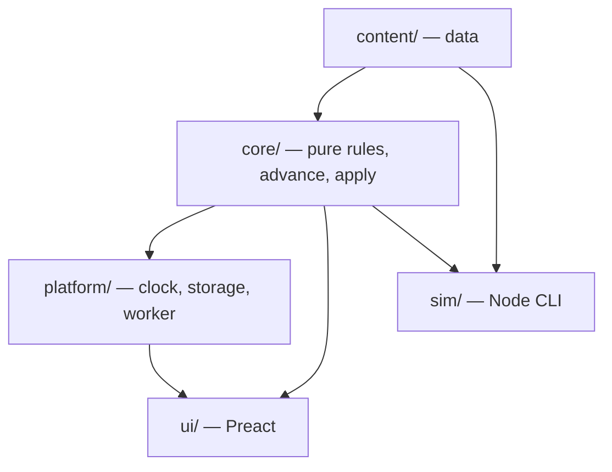

# The Last Hold — Technical Design

**Status:** Approved (D33). Revised after the plan review (D34); edits marked ⚑.
**Reads with:** `gdd.md` (what to build), `decisions.md` (why), `implementation-plan.md` (in what order).
**Markers:** **[JC]** = judgment call. **MUST** / **NEVER** = rules that also appear in `CLAUDE.md`.

---

## 1. Goals and constraints

From the brief and the decisions log:

| Constraint | Source |
|---|---|
| Static web app, no server; hosted on GitHub Pages; installable PWA; playable offline | Brief |
| Phone-first, scaling up to desktop | D02 |
| Saves in browser storage, plus an export code and a downloadable save file | Brief |
| Offline progress calculated on load, capped at 12 h (24 h ceiling) | D08, GDD §5.2 |
| Data-driven content | Brief, D24.5 |
| Deterministic and testable; seeded RNG | Brief |
| Maintainable by Claude Code across many separate sessions | Brief |
| Strong typing, automated tests, minimal dependencies, fast on phones | Brief |
| CC0 art only | D14 |

**What "maintainable across sessions" means here.** Every session starts cold. So:
- The code must be easy to find your way around: predictable folders, one concept per file, and no clever indirection.
- Rules must be enforced by tooling (types, lint, tests), not by memory.

---

## 2. Stack and rationale (D17)

| Layer | Choice | Why |
|---|---|---|
| Language | **TypeScript 5.x, `strict` plus `noUncheckedIndexedAccess`** | Types are the cheapest way to keep many cold-start sessions consistent. Content files are type-checked for free (D24.5). |
| Build and dev | **Vite** | Fast, minimal config, first-class TypeScript and Web Workers. The de-facto standard, so it's well known to Claude Code. |
| Tests | **Vitest** | Shares Vite's config. Its bundled `vite-node` also runs the simulator, so no extra runner is needed. Built-in benchmarking. |
| UI | **Preact + @preact/signals** | About 4 KB. React-style components that Claude Code writes reliably. Signals give fine-grained updates without a state library. |
| PWA | **vite-plugin-pwa** (Workbox) | Generates the service worker and manifest correctly. Hand-written service workers are a classic source of stale-cache bugs. |
| Browser tests | **Playwright** *(from v0.1, D24.7; moved up, D61)* | The smoke test and the cross-engine determinism and golden suites (§14) |
| Lint and format | **ESLint (flat config) + Prettier** | Enforces the layer rules (§4.2) and the no-`Math.random` rule mechanically |

**Runtime dependencies: 2** (`preact`, `@preact/signals`). Everything else is a dev dependency.

**Alternatives considered:**
- **Vanilla TypeScript UI:** no dependency, but every screen would reinvent state-to-DOM syncing, and that's where cold-start sessions drift.
- **React:** fine, but about 10× heavier than Preact for no benefit here.
- **Svelte or Solid:** good, but less common in training data, so more mistakes from Claude Code.
- **A game engine (Phaser and similar):** wrong shape. This game is mostly menus, lists, and numbers, not a canvas.

**Versions:** Node **22 LTS**, npm (lockfile committed). Exact dependency versions are pinned in v0.0 **[JC]**.

---

## 3. Repository layout

```
the-last-hold/
├─ CLAUDE.md                     # rules for every session (read first)
├─ README.md
├─ docs/                         # design, lore, plan, decisions (source of truth)
│  ├─ gdd.md · setting-primer.md · lore-secrets.md (added at v0.5, D36)
│  ├─ technical-design.md · implementation-plan.md · decisions.md
│  └─ credits.md                 # generated from the asset manifest (§12)
├─ src/
│  ├─ core/                      # pure game logic: no DOM, no clock, no Math.random
│  │  ├─ state/                  # GameState types, creation, selectors
│  │  ├─ systems/                # economy, peasants, contracts, combat, bestiary, alchemy…
│  │  ├─ sim/                    # advance(), the event queue, offline catch-up
│  │  ├─ commands/               # apply(state, command): every player action
│  │  ├─ rng/                    # seeded PRNG, streams, roll sources
│  │  ├─ breakdown/              # Breakdown trees (GDD §5.0)
│  │  ├─ format/                 # number and time formatting (pure)
│  │  └─ save/                   # schema, migrations, encode/decode (pure parts)
│  ├─ content/                   # data only: typed TS modules
│  │  ├─ balance.ts              # every constant from GDD §7
│  │  ├─ buildings.ts · jobs.ts · ages.ts · hunters.ts · traits.ts
│  │  ├─ monsters.ts · clues.ts · villages.ts · ingredients.ts · consumables.ts
│  │  ├─ text/                   # flavor text: building blurbs, resident lines, notices
│  │  ├─ assets.ts               # asset manifest (§12)
│  │  └─ palette.ts              # the 32-color palette
│  ├─ platform/                  # browser-only adapters
│  │  ├─ clock.ts · storage.ts · download.ts · compression.ts · lifecycle.ts
│  │  └─ worker/                 # odds and suggest worker (GDD §6.5)
│  ├─ ui/                        # Preact components; no game rules
│  │  ├─ app/ · screens/ · sheets/ · widgets/ · debug/
│  │  └─ styles/                 # CSS tokens, themes
│  └─ main.ts
├─ sim/                          # balance simulator (Node, via vite-node)
│  ├─ cli.ts · policies/ · checks/ · targets.ts · report.ts
│  └─ baseline.json              # last accepted results, for diffs
├─ tests/                        # cross-cutting tests (unit tests live next to code)
│  ├─ golden/ · determinism/ · saves/fixtures/ · content/ · e2e/
├─ tools/                        # dev-only scripts: recolor, generate portraits, credits
├─ public/assets/                # final PNGs (packs + generated), fonts, icons
└─ .github/workflows/ci.yml · deploy.yml
```

- **Unit tests sit next to their code** (`economy.ts` → `economy.test.ts`).
- **`tests/`** holds the cross-cutting suites: golden fights, determinism, save fixtures, content validation, and end-to-end.

---

## 4. Architecture

### 4.1 Layers



### 4.2 Layer rules (enforced by ESLint `no-restricted-imports` and custom rules)

- **`core/` MUST NOT import** `ui/`, `platform/`, or any browser global (`window`, `document`, `localStorage`).
- **`core/` MUST NOT call `Math.random()`, `Date.now()`, `new Date()`, `performance.now()` or `crypto.getRandomValues()`, or any math function outside the portable set (§7.4).** Time arrives as a parameter, and randomness comes from `core/rng`. A custom lint rule fails the build if they appear *(⚑ ban list widened, plan review A8/B8)*.
- **`content/` exports data only:** no functions except trivial constructors, and no imports from `core/` except types.
- **`ui/` MUST NOT compute game rules.** It calls selectors and dispatches commands. Display formatting is allowed.
- **`sim/` uses only `core/` and `content/`,** never `platform/` or `ui/`.

### 4.3 The two entry points into the core

```ts
apply(state: GameState, cmd: Command, now: number): ApplyResult   // player actions
advance(state: GameState, toTime: number): AdvanceLog            // the passage of time
```

- **Every player action is a `Command`:** a plain JSON object such as `{ type: 'build.buy', building: 'cottage', count: 1 }`. The UI, the simulator, and the debug panel all go through `apply`. So the simulator plays the real game, not a model of it.
- **`apply` validates and returns `{ ok: true } | { ok: false, reason }`.** A refused command never changes state.
- **State is mutated in place** inside `apply` and `advance`, for speed and simplicity. Anything that needs a hypothetical, such as the odds preview or "what would this buy give me", works on a `structuredClone(state)` **[JC]**. No immutability library is needed.

---

## 5. Data model

### 5.1 Content (static)

- **IDs** are kebab-case string literals, typed as unions (`type BuildingId = 'cottage' | 'farm' | …`), generated from the content arrays with `as const`. A typo in an ID is a compile error.
- **`balance.ts`** is one `as const` object whose keys match GDD §7 exactly (`balance.costGrowth.count`, `balance.provisions.base`, …). **No numeric game constant may appear anywhere else.** A lint rule flags numeric literals in `core/systems/` except an **allowlist: 0, 1, −1, 2, 100, and array indices**; test files are exempt *(⚑ allowlist widened, plan review A14)*.
- **Each `balance.ts` entry is marked `tunable` or `locked`** *(⚑ plan review A15)*. The tuning pass may change only `tunable` entries. `locked` entries are design decisions (the list is in `implementation-plan.md` §0.6) and change only through a decisions row the owner approves.
- **Content validation tests** (`tests/content/`) run on every change:
  - Every referenced ID exists.
  - The coverage rules from GDD §8.3.1, including that clue-tag sets are distinct within each cell.
  - Every recipe's ingredients exist.
  - Every asset ID referenced has a manifest entry.
  - Every proper noun appears in the collision-checked list (§14).
  - *(⚑ plan review A12)* Every **text key** and **unlock reference** resolves.
  - **The GDD §7 key list matches the `balance.ts` keys exactly.** A small script extracts the backticked keys from GDD §7, and the test compares the two sets in both directions.

### 5.2 Game state (saved)

```ts
interface GameState {
  meta: {
    schemaVersion: number            // 13 from v1.3 (D543); 12 from v1.1 (D502); GameState also gains layout: HoldLayoutState (§19.1) and vigil: VigilState (§21.1)
    gameSeed: string                 // fixed for the save's lifetime
    createdAt: number; lastSeen: number
    clockHighWater: number           // latest time ever seen (backward-clock guard, D21)
    debugUsed: boolean               // informational only
  }
  cycle: { number: number; age: AgeId }         // AgeId gains citadel, bastion (v0.4)
  resources: Record<ResourceId, number>          // food, wood, iron, silver
  peasants: { total: number; jobs: Record<JobId, number>; autoSettle: boolean;
              priority: JobId[]; lastSettleAt: number }
  buildings: Record<BuildingId, number>          // count or level
  hunters: Record<HunterId, HunterState>         // owned only (v0.2)
  roster: { active: HunterId[] }                 // anything owned and not active is in the reserve
  board: { open: ContractInstance[]; nextArrivalAt: number; tierProgress: Record<number, number> }
  running: RunningContract[]
  results: ContractResult[]                      // unread results (rewards already applied, GDD §5.4.3)
  bestiary: Record<MonsterId, { level: 0|1|2|3|4; kills: number }>   // v0.3
  stores: Record<ConsumableId | IngredientId, number>                // v0.3
  queues: { brewing: KettleJob[]; investigation: InvestigationSlot[] } // v0.3; v0.6: brews and experiments
  threat: number                                 // v0.4; counts only once arrivalDue is false
  embers: number                                 // v0.4; unspent
  upgrades: Record<UpgradeId, number>            // v0.4; warden upgrade levels
  relics: { id: RelicId; cycle: number }[]       // v0.4; owned, with the cycle found
  arrivalDue: boolean                            // v0.4; a pre-v0.4 save still faces its first Long Night
  cycles: CycleRecord[]                          // v0.4; one short entry per cycle
  story: StoryState                              // v0.5; acts, documents, names, letters, trust (below)
  book: RecipeBook                               // v0.6; revealed properties per ingredient, pairs tried
  skills: Record<SkillId, number>                // v0.6; warden skill XP (the level is derived)
  items: ItemState[]                             // v0.8; every item owned: equipped or in Stores (cap 40)
  legendaries: { id: LegendaryId; cycle: number }[]  // v0.8; found, kept forever
  events: EventsState                            // v0.9; tokens, rests, the boss visit, hunt points (below)
  orders: OrdersState                            // v0.10; standing, seats, chapters (Orders block below)
  remembering: RememberingState                  // v0.11; the ending (below)
  stats: LifetimeStats                           // trophies this cycle, totals
  log: { recentFights: FightRef[] }              // seeds + inputs, not full logs (§5.3)
  settings: Settings
}
```

```ts
interface EventsState {
  opened: boolean                    // true once the Citadel has been reached (D366); never goes back
  sceneSeen: boolean                 // the one-time scene (GDD §5.12.1)
  clock: { value: number; high: number }  // the monotone event clock (below); `value` is event time in ms, `high` the latest real time seen
  tokens: { count: number; at: number | null }  // tokens at event time `at`; at is null until events first open
  attempts: number                   // monotone counter; part of every attempt's seed
  rest: Record<HunterId, number>     // restUntil in event time, ms; entries already in the past are dropped on load
  boss: { visit: number              // 0-based; the boss is order[visit % 3], the pass is floor(visit / 3)
          tier: number | null        // fixed at the visit's first attempt
          pool: number | null        // Health left; null until the first attempt
          paid: number               // milestones already paid this visit, 0–4
          attempts: number }         // attempts made in this visit
  hunts: Record<HuntId, { points: number; unlocked: boolean }>
  last: EventResult | null           // the latest attempt's result, kept until read (a closed app still shows it)
  recent: FightRef[]                 // the last `events.recentKeep` (10) event fights: seeds and inputs, never logs (§5.3)
}
```

- **Cycle history** *(v0.4, D113)*: each `CycleRecord` holds when the cycle started, when each Rank was reached, when the stand was made, waves held, the Embers breakdown, the relics found, and the stand's inputs (party snapshots, preparation, defense levels, Threat, seed), so its wave logs can be rebuilt like contract fights (§5.3). About 200 bytes per cycle; v0.5's Roll of Wardens reads it. The stand's wave list is not stored: it comes from the stand seed. Walls and Watchtower are ordinary entries in `buildings`. *(v0.9: also `standPool: 'base' | 'dross' | null`, below. v1.3: the stand's saved inputs also carry an optional `vigilLevel`, §21.1.)*
- **The story** *(v0.5, plan T5.3)*: each `CycleRecord` also holds the **act** it tells (null for cycles before v0.5, and for a cycle still owed the v0.4 arrival) and the **warden's name** (up to 24 characters; null until named). `StoryState` holds: the v0.5 arrival flag; when Ilse arrived; one `ActProgress` per act begun (its cycle, start time, and the counters that run from then: wins, wins by village, ruin wins); documents found (id, cycle, time, how); names found (roll number, cycle, time) and the count of Ribbonshades defeated; each hunter's **highest level ever** (letters read it, D155); letters reached; each village's trust (level, progress toward the next step, wins counted, Triumphant stands); and the unread Archive items for the badge. Nothing in it resets at the Long Night. The v4 → v5 migration starts Act I in the current cycle (D149), or with the cycle after a pending v0.4 arrival; it sets each hunter's highest level from their level now or at death, and every village to its starting trust.
- **Alchemy discovery and skills** *(v0.6, plan T6.3, D218)*: `book` holds, for each ingredient, which of its three properties (by index in the §8.6 order) are revealed, and the pairs already tried (`a+b`, in ingredient-list order). It opens with the 15 properties the nine v0.3 recipes prove. `skills` holds XP per warden skill; levels are derived. Both are kept through the Long Night. The kettle queue holds `KettleJob`s: a **brew** records the recipe it was paid with (`paid`), so a cancel refunds exactly that whichever recipes the book knows later; an **experiment** records its two ingredients and the units paid. `RunningContract`, `FightRef` and `StandRecord` carry the **Alchemy level** frozen at launch (0 for anything made before v0.6, so every replay is unchanged, D206); a `StandRecord` also carries its **band**, so a stand keeps the band it earned under the thresholds of its day (D194). The six new brews have empty store slots. The v5 → v6 migration (`save/migration-v6.ts`) holds frozen copies of the v0.3 recipes, the 15 known properties and the old thresholds (9 and 12) so later content changes never rewrite an old save.
- **Delves and Act IV** *(v0.7, plan T7.1 and T7.5, D245, D246, D267)*: `delve` holds the Delve state, all kept forever: the active run (`seed`, `baseTier` fixed at its start, `floor` 1–6 or 7 for the guardian, the `party` of three, each hunter's `health` with 0 meaning down, `blessings` taken, the `stage` on screen (the two doors, the offered cards, or the next fight), `lastDoors`, the Unlit doors used, whether Re-roll was used, a `rules` bag for the ★ rules' bookkeeping, and `earned` so far); the `result` of a finished run until its sheet is read; `runs` started (the seed's number); `riftglass`; the banked `allowance` and `allowanceAt`, when it last grew (null until the first Keep); `sceneSeen`; `unlitOpen`; the `shop` (Late hours level, alternate traits bought and in use, cosmetics, Chosen start, Re-roll); `deep` (knowledge of the Deep guardians, outside the bestiary); `relics`; `echoes`; the rarities `taken` from each patron (which finds the echoes); and, for v0.8, Delve `kills` per family and `guardiansBeaten` (D278). Each `ActProgress` also holds `winsByFamily`, which Act IV's margins count (D4-02, D4-03). The v6 → v7 step (`save/migration-v7.ts`) gives every act an empty family count and the Delves their starting state, and **re-bases Act IV (D246)**: the cycles' act numbers above III were story-less in v6, so they are cleared, the current cycle becomes Act IV, the counters recorded for story-less acts are dropped, and Act IV begins fresh at the save's time; the `story.startActIV` command then plays D4-01 on load (`via` 'arrival'), finding an Act IV Rank document only if that Rank is already behind the save this cycle. The guard is `save/validate-delve.ts`: unknown content ids are dropped with a warning, and a run that cannot be trusted refuses the load.
- **Hunter depth and Act V** *(v0.8, plan T8.5, D306–D317)*:
  - **`items`:** every item the hold owns, each with an id, its base piece, tier, rarity (Common, Fine, Rare, Heroic), its bonus lines (kind, size, and the family for a bane line), what was paid into it (for Salvage), and where it is (a hunter's weapon or armor slot, or Stores).
  - **Each `HunterState`:** gains `rank` (apprentice, wright, masterWright), `stars` (0–5), `talents` (picked ids), `keepsake` (a Legendary id or null), and its `weapon` and `armor` as item ids.
  - **`legendaries`:** the ones found, with the cycle.
  - **Trophies spent this cycle** are recorded beside the cycle's trophies, so trophies on hand = earned − spent.
  - **The Long Night** keeps ranks, stars, talents, keepsakes and Legendaries, and drops every other item.
  - **`ActProgress.winsByFamily`** is now separate for each act (D318).
  - **The v7 → v8 step** (`save/migration-v8.ts`):
    - turns each hunter's gear tiers into equipped Common items with today's numbers;
    - gives each hunter the rank their highest level ever qualifies for (D311), with stars 0 and talents empty;
    - finds Legendaries whose milestone is already met;
    - keeps Act IV's family counts and clears Acts I–III's;
    - starts Act V on load when the current cycle has no act (D246, generalising `story.startActIV` to `story.startAct`).
- **Events and Act VI** *(v0.9, plan T9.1–T9.3, D358–D387)*:
  - **`events`** holds everything above. It is **kept through the Long Night** (GDD §5.12.10) and is small (well under 1 KB).
  - **The event clock (D359, D387).** `eventNow(state, now) = clock.value + max(0, now − clock.high)`. Whenever the game loads or runs a command, it first folds in the elapsed time: `if now > clock.high { clock.value += now − clock.high; clock.high = now }`. A clock set **back** changes nothing (`now < high`, so no time passes and none is lost); a clock set back **then forward** adds time only beyond `high`, so **no free time** is gained. **There is no `rebaseEvents`.** This is uncapped (the offline cap does not apply) and independent of `lastSeen` and the production high-water mark of §6.4.
  - **Tokens are derived, not ticked.** `tokens.count` is the bank at event time `tokens.at`; with `t = eventNow(state, now)`, the bank now is `count` if `count ≥ boss.tokenMax`, otherwise `min(tokenMax, count + floor((t − at) / tokenInterval))`, with progress `(t − at) mod tokenInterval`. A spend normalises first: from a full bank it sets `at = now`; from a part-full bank it keeps the progress (`at = now − progress`). `at = null` means events have not opened yet.
  - **Rest is derived.** A hunter rests while `rest[id] > eventNow(state, now)`. A resting hunter is not blocked from contracts or Delves (GDD §5.12.2).
  - **Eligibility** is a selector: not on a contract, not in a Delve, not recovering, not resting.
  - **The boss's pool** is stored in Health points, not as a share, so the preview and the milestones read the same number. Milestone thresholds are `boss.milestones` × the visit's starting pool (`poolStart` is recomputed from the fixed tier and `boss.poolBase`, never stored).
  - **`last`** holds a short result (damage dealt, the pool left, milestones paid, XP per hunter, loot lines, the `FightRef`) so a result is never lost if the app closes during playback. It is cleared when read.
  - **`CycleRecord.standPool`** is set when the cycle's wave list is first fixed (Bastion reached): `dross` if **Act VI has begun in the save at that moment** (Act VI's own cycle and every cycle after it, whether or not it carries an act; owner, D386), otherwise `base`. Null before Bastion. **No wave of the Dross-Tide is guaranteed**; a `dross` pool only makes it possible. It is copied into the stand's saved inputs, so a rebuilt wave list uses the same pool (GDD §5.9.3, D363).
  - **New content ids** (unknown ids drop with a warning on load, never a crash): hunters `gest-tall-torch`, `ragnhild-eye-taker`, `radmila-of-the-reeds`; Great Beasts `lindworm-of-velk-fjord`, `barrow-king`, `mother-of-the-river`; quarries `stoneback-fell-troll`, `mara-of-kettle-barrow`, `likho-one-eyed`; hunts `stoneback`, `mara`, `likho` (tracks `…-1` to `…-3`); documents `D6-01` to `D6-10`; the document type `rime`.
  - **Story:** `story.startAct` already generalises (v8); Act VI adds its `ActProgress` the same way. `ActProgress.winsByFamily` stays separate per act (D318).
- **Derived values** stay derived: the pool bar, the milestone marks, the tier, the preview, odds, points totals and every rest time come from selectors that take `now` and return `Breakdown` trees.
- **Derived values are never stored:** rates, the active-roster cap, odds. They come from **selectors** (`core/state/selectors.ts`). Each selector that feeds a visible number also returns a `Breakdown` tree (§5.4).
- **Fight logs are not stored.** A `FightRef` holds the seed and the inputs (party, preparation, monster instance), and the log is **regenerated on demand** by re-running the fight. This keeps saves small and proves determinism every time a log opens.

#### Orders (v0.10, D408–D425)

```ts
type OrderId = 'moot' | 'greyWives' | 'bellWatchers' | 'quenchers'   // this is also the list order

interface OrdersState {
  opened: Partial<Record<OrderId, { at: number }>>        // for good; `at` is the wall-clock `now` the game uses for `meta.lastSeen`
  counts: Record<OrderId, Record<string, number>>         // live per-source counts from v10 on, for ALL four Orders, opened or not
  start: Record<OrderId, number>                           // the one migration backfill, already capped (0 in a new game)
  triumphant: number                                       // Triumphant stands counted since v10 (applies to every Order)
  delveWindow: { start: number; used: number } | null      // event-clock start of the current window, and standing used in it
  levelHigh: Record<OrderId, number>                       // highest level ever reached (never drops)
  seats: OrderId[]                                         // length ≤ seat count, kept in list order
  thirdSeat: boolean                                       // opened once, kept forever
  lastChange: number | null                                // eventNow() of the last seat change
  chaptersRead: Record<OrderId, number>                    // 0 to 4
  readWith: Record<OrderId, OrderId[][]>                   // per chapter read, the seats at the time, in list order (D419)
  openingQueue: OrderId[]                                  // opening scenes waiting, in the order the Orders opened
  seatStepPending: boolean                                 // the one-time load "Seat your Orders" sheet
}
```

- **Standing is derived, never stored:** `standing(o) = start[o] + Σ counts[o][source] × weight[source] + triumphant × triumphantChunk`. **Level is derived** from standing and the thresholds and is the **higher of that and `levelHigh[o]`**, so tuning a weight down can never lower a level (D410). `levelHigh` is raised in the same command that adds standing.
- **Counts change only in the command or event that does the thing** (a contract resolves, a brew finishes, a document is found, a Delve floor's result is applied, a stand ends) — **including events inside `advance`** — never on a timer. A source counts for an Order whether or not it has opened. **Delve floors:** a floor counts only if its applied result paid at least 1 Riftglass; `delveWindow` starts at the first counted floor (as `eventNow`), `used` is capped at `orders.delveWeeklyCap`, and a floor after `start + orders.delveWindow` starts a new window.
- **Seat count** is `thirdSeat ? orders.seatsMax : orders.seatsStart`.
- **The third-seat check** (`checkThirdSeat`) runs **after any level change, at the Quenchers' opening and on load**; it sets `thirdSeat` once, when two Orders have `levelHigh = 4` and `opened.quenchers` exists. It is idempotent.
- **Cooldown:** a seat change is allowed when `lastChange === null` or `eventNow(state, now) − lastChange ≥ orders.swapCooldown`. It reuses the monotone clock of §5.2, so a rewound device clock gives no free change. A new warden's arrival sets `lastChange = null`. Seating into a free seat at an Order's opening does not set `lastChange`.
- **Nothing seats itself** (D422): `opened` and `openingQueue` are set by `openOrders` and the triggers; `seats` only by the player's commands.
- **Chapters are derived, not stored:** the playable chapter for an Order is `chaptersRead[o] + 1` when the Order is open and seated, `level(o) ≥` that number, and its condition holds (lore §33 Part B: OR-G1 Vesna on the roster; OR-G2 Ilse arrived; OR-G3 Ostap and Vesna on the roster; OR-M4 the Quenchers have opened; OR-Q4 the Moot has opened). The list of playable chapters is sorted by list order, then chapter number.
- **Long Night:** `orders` is kept whole (D410). A new warden does not clear `openingQueue`.
- **Validation:** `seats` has no duplicates, is in list order and has only opened Orders; `chaptersRead[o] ≤ levelHigh[o]`; `readWith[o].length === chaptersRead[o]`; `thirdSeat` implies two Orders with `levelHigh = 4` and `opened.quenchers`; counts are non-negative integers; unknown ids drop with a warning.

#### Orders commands (v0.10; names are the debug and sim interface)

`orders.seat(order)`, `orders.unseat(order)`, `orders.swap(out, in)`, `orders.setSeats(list)` (the new-warden step and the load sheet; no cooldown), `orders.readChapter(order)` (reads **that Order's** next playable chapter, records the seats in list order, raises nothing else), `orders.finishOpening(order, seatIt)` (pops that Order from `openingQueue`; seats it only if `seatIt` and a seat is free). Every command is pure on `(state, now)`, returns a result with a reason when refused, and rolls nothing.

#### The Remembering (v0.11)

```ts
interface RememberingState {
  nearSeen: boolean                              // Pechko's near-scene (R-01 or R-02) was closed with Continue
  readyNoted: boolean                            // the "The Remembering is ready" line has been shown (D466)
  endings: EndingRecord[]                        // endings reached, in the order chosen; at most 2 entries
}
interface EndingRecord {
  ending: 'remember' | 'vigil'
  at: number                                     // information only; never compared (D461)
  cycle: number                                  // the cycle number when it was chosen
}
```

- **Derived, never stored:** the gate (`rememberingGate(state)`: 40 names found **and** every contract species' stored knowledge level is Studied or better; the contract-species list is content and is pinned by a content test, so changing it needs a decisions row); `actVIStandApplied(state)` (Act VI's cycle has its `stand` record set, or a later cycle exists; Claude Code confirms the exact field in the repo); `endingChoosable(state)` = both; the card's form; the Order cards of the ending (`endingOrderCards(state)`, from `orders.chaptersRead` and `orders.readWith[o][3]`, and from whether `orders.opened.quenchers` exists); whether the hearth is warm (`endings` has `remember`).
- **Nothing in `orders` or `skills` changes** because of the ending. The ending reads `readWith`; it never writes it. Current `seats` and levels are not read at all. R-11 is derived from `endings` and is **not** a found document (no standing, no Lore XP, no Archive badge, no act grouping; D463).
- **Validation (array order, not time):** `endings` has at most one `remember` and one `vigil`; ids are known; `cycle` is an integer from 1 to the current cycle number; `at` is a non-negative number and is **not compared**; a `vigil` must come **before** a `remember` in the array; an ending recorded while `actVIStandApplied` is false is **dropped with a warning** (it cannot happen in play); an ending whose gate no longer holds in the loaded state is **kept, with a warning** (content may have changed). Unknown ids drop with a warning. A device clock set back changes nothing here.
- **Commands (names are the debug and sim interface):**
  - `remembering.seeNear()` — sets `nearSeen`; the UI calls it when the scene is closed with Continue (the ✕ leaves it waiting, D432 (4)).
  - `remembering.noteReady()` — sets `readyNoted`; the UI calls it when the ready line is shown.
  - `remembering.choose(ending)` — refused unless `endingChoosable`; `remember` refused if already recorded; `vigil` refused if already recorded or after `remember`; records `{ending, at: now, cycle}`.
  - Re-reading is UI only and is not a command.
  - **Debug (D462):** `debug.remembering.openGate()` sets the 40 names found and every contract species to Studied in the stored fields the game reads, **without** running the found-document hooks, and marks `debugUsed`; `debug.remembering.finishActVI()` applies Act VI's stand result by the T10.12 pattern (or uses an existing debug stand command). Neither stores an override.
- **Where scenes are decided:** `rememberingNearPending(state)` = `actVIStandApplied && !nearSeen`. `rememberingReadyLine(state)` = `nearSeen && gate && !readyNoted && endings empty`. **No `advance` change.**
- **The core stays pure.** The reading's pace, fades and reduced-motion handling are UI only, kept in `src/ui/remembering/timing.ts` (a presentation timing, not a game constant; D464 (4)). The core supplies the ordered list of 40 `{name, village, year}` from content.

### 5.3 Fight references

```ts
interface FightRef { contractId: string; seed: string; party: HunterSnapshot[];
                     prep: PrepSnapshot; monster: MonsterInstance; result: 'win'|'loss' }
```

*(v0.9, an addition: every existing field stays, including `location`, `rulesVersion`, `time` and the Alchemy level the real save records; see `v8-owner.json` `recentFights`.)*

```ts
interface FightRef { /* … all existing fields unchanged … */
                     event?: { kind: 'boss' | 'hunt'; attempt: number; id: string } }  // v0.9, optional
// and on the monster record (MonsterInstance snapshot): healthOverride?: number   // v0.9, optional
```

- **Snapshots freeze hunter stats at launch,** so later level-ups don't change a replayed log. An event fight's `monster` holds the Great Beast at the visit's tier with the optional **`healthOverride` equal to the pool at launch** (absent on every older record, so old snapshots stay valid); **the Alchemy level is frozen at launch for event fights**, as for contracts (D206); `event` is absent on every older reference, so every old snapshot replays unchanged (D337 (8), D340 (13) pattern). For an event fight `contractId` holds the string `event:${attempt}`.
- **If the combat code ever changes in a way that alters an old replay,** the replay shows *"recorded with an older rules version"*. From v0.8 the note shows only when the replay actually differs from the record (D319); a replay that matches shows nothing. A `rulesVersion` constant bumps whenever combat math changes (5 from v0.8, D308).

### 5.4 Breakdown trees (GDD §5.0, D10)

```ts
type Breakdown = { label: string; value: number; formula?: string;
                   bucket?: BucketId; key?: BalanceKey; children?: Breakdown[] }
```

- **Selectors build the number and its breakdown in the same function,** so they can't disagree.
- The UI renders any `Breakdown` with one generic sheet component.

---

## 6. Time, the tick, and offline progress

### 6.1 Clock

- `platform/clock.ts` provides `now(): number` (epoch milliseconds).
- **The core never reads a clock.** Every `apply` and `advance` receives `now` or `toTime`.
- The simulator uses a virtual clock that starts at Monday 07:00 (GDD §6.1).

### 6.2 `advance(state, toTime)`: event-driven (GDD §5.2, D30)

```
while state.time < toTime:
    rates  ← currentRates(state)                  # constant until the next event
    tNext  ← min(nextEventTime(state, rates), toTime)
    integrate resources linearly from state.time to tNext
    state.time ← tNext
    if tNext is an event time: applyEvent(state, event)   # may change rates
```

**Event sources,** each with an exact time:

| Event | When it fires |
|---|---|
| Settle due | `max(lastSettleAt + 30 s, time when food reaches settleCost)`, while housing is free and auto-settle is on |
| Contract completes | Its end time. Rewards, injuries, and XP apply here (D31/B9). |
| Recovery ends | Its timer |
| Brew finishes / clue revealed | Their timers |
| Board refill | `nextArrivalAt` |

- **Ties at the same instant** apply in a fixed order: completions → recoveries → brews → clues → refills → settles **[JC]**. **v0.9 adds no event source and no slot:** the token tick, a hunter's rest ending and a pool being emptied are **not `advance` events.** They are functions of the stored timestamps and of `now`, evaluated by selectors and by `apply(state, cmd, now)`, so the tie order is unchanged (D359).
- **Floating-point drift.** Resources are doubles. Event times are computed, not stepped, so 12 h of 1-s ticks and one 12 h jump agree within `1e-9` relative error. That's the **equivalence test** (D30).
- **How the equivalence test compares states** *(⚑ plan review A9)*: integer fields (counts, levels, IDs, booleans) must match **exactly**; float fields within **1e-9 relative or 1e-6 absolute**, whichever is looser; event timestamps within **1 ms**. The live tick is **1 s** (§6.3).
- **Event timers and the offline cap** *(v0.9, D359)*. The 12 h offline cap (24 h ceiling) limits how much *production* `advance` integrates; it does **not** limit the token bank or rest, because those are worked out from timestamps, so they are right at any `now` however long the game was closed. The offline report is unchanged except the one away-sheet line when the bank filled. **Equivalence tests for events:** (1) the token count after 30 h in one jump equals the count after 30 h in a 12 h + 12 h + 6 h sequence of loads (integers, exactly equal); (2) spending at an instant gives the same bank as ticking to it in 1-s steps and then spending.
- **Backward clock (D21) for events:** the event clock of §5.2 is monotone, so nothing special happens on a backward step: the existing handler resets `lastSeen` and applies elapsed 0, and `events.clock` simply does not move. Tests: (1) a clock moved back 3 h leaves tokens-to-next and every rest remaining exactly as they were; (2) **the round trip**: moved back 3 h and then forward 3 h, the bank and every rest equal what they were before both moves (no free time); (3) forward 3 h past the old high-water mark adds exactly 3 h.
- **Riftglass differs on purpose:** its allowance grows inside `advance` and respects the offline cap; tokens and rests do not. After a long absence the two banks behave differently; the away sheet only mentions the token bank when it filled.

#### Orders and `advance` (v0.10)

`advance` **does** touch Orders, in three ways, and each needs a test:
1. **Standing is added by events inside it** (a contract completing, a brew or experiment finishing, a clue revealing a property, a document found by a condition met in the catch-up).
2. **The Quenchers' Threat factor works over time:** the hourly Rank rate is multiplied by `1 − threatStep × level` for the seated level, so `advance` over a long gap must equal many short steps (the **time-away equivalence test**, run with the Quenchers seated and with a seat change inside the gap).
3. **An Order can open during the catch-up** (D5-08 found). `advance` only records the facts; **`openOrders` runs after the catch-up** so contracts finishing in it are counted once (their counts come from the events, not from a backfill).

**Order of a load:** migrate → catch up (`advance`) → `openOrders` (flags, `openingQueue`, `seatStepPending` for a migrated save) → `checkThirdSeat` → the UI shows scenes (act scenes, the events scene, Orders openings, the "Seat your Orders" sheet, chapters). **v0.11 (D459, D461): the UI scene order is now:** the Orders scenes (opening scenes and the "Seat your Orders" step, as in v0.10), then Act VI's D6-07 if due, then Pechko's near-scene if `rememberingNearPending`. The ending itself never starts on load (D459 (3)). The same order holds on the **live path** straight after Act VI's stand result: the stand's result sheet, D6-06, then the Orders and D6-07 scenes if due, then the near-scene on the next Hold-screen visit.

The only time-based Orders value besides Threat is the cooldown, derived from `eventNow`, like tokens and rest (§6.2, D359). The offline cap does not touch it.

### 6.3 The live loop

- **A 1-second interval** calls `advance(state, clock.now())`. The UI redraws through signals; nothing animates by polling.
- **When the page hides** (`visibilitychange` → hidden, `pagehide`), the game saves immediately.
- **When the page becomes visible again:**
  - Away less than 60 s: just advance.
  - Away 60 s or more: run **offline catch-up** (§6.4) and show the "While you were away" sheet if the gap is 5 min or more **[JC]**.
- **Autosave** runs every 30 s and after every successful command.

### 6.4 Offline catch-up

```
elapsed = clamp(now − meta.lastSeen, 0, offlineCap(state))
if now < meta.clockHighWater: elapsed = 0; lastSeen = now          # backward clock, D21
```

- **Catch-up runs in 60 s chunks of `advance`** (GDD §5.2). After every 50 chunks it yields to the browser with `await` and a zero-delay timeout, so the progress bar paints. Twelve hours is 720 chunks, which should take well under a second on a phone **[JC: no worker needed]**.
- **The away summary** is a diff: `state` before vs after, plus the `AdvanceLog` events collected during catch-up.
- **Time beyond the cap is reported, not simulated:** *"14 h 20 m away · 12 h counted."*

---

## 7. Randomness

### 7.1 Generator

- **`sfc32`**: a small, fast 32-bit PRNG with a 128-bit state that serializes as 4 numbers.
- **Seeding** from strings uses a **`cyrb128`-style hash** **[JC]**.
- **Both are about 20 lines, written in-repo** with no dependency. Each has golden-value tests (fixed seed → fixed first 10 outputs) so an accidental change is caught.

### 7.2 Streams

Each kind of randomness gets its own derived seed. That way, adding a roll in one system never shifts another system's results.

| Stream | Seed string |
|---|---|
| Board arrivals | `${gameSeed}:board:${arrivalIndex}` |
| A real fight | `${gameSeed}:fight:${contractId}:${partyIds}:${prepIds}` (GDD §5.4.2) |
| Odds preview, sample i | `${gameSeed}:odds:${contractId}:${partyIds}:${i}`, a distinct prefix, so it never equals the real fight; no preparation, so prepared and unprepared previews share their dice (D98) |
| Suggest, stage 1 | `${gameSeed}:suggest:${contractId}:${i}`, **the same seeds for every party** (GDD §6.5) |
| Clues and investigation | `${gameSeed}:clues:${contractId}` |
| Contract loot (v0.8) | `${gameSeed}:loot:${contractId}` (fixed at launch, like the fight) |
| Delve guardian loot (v0.8) | `${runSeed}:loot` |
| Boss attempt (v0.9) | `${gameSeed}:boss:${attempt}:${partyIds}:${prepIds}` (`attempt` is the monotone counter, so the same party twice differs) |
| Hunt attempt (v0.9) | `${gameSeed}:hunt:${attempt}:${huntId}:${track}:${partyIds}:${prepIds}` |
| Boss kill item (v0.9) | `${gameSeed}:eventloot:${visit}` (rolled once, at the kill, in the order base, rarity, lines, like contract loot) |
| Boss preview, sample i | `${gameSeed}:bossodds:${visit}:${partyIds}:${i}`, a distinct prefix, so it never equals the real attempt; same dice for every party |
| Hunt odds, sample i | `${gameSeed}:huntodds:${huntId}:${track}:${partyIds}:${i}` (prepared and unprepared share their dice, as D98) |
| Suggest for events | `${gameSeed}:eventsuggest:${visit or huntId-track}:${i}`, a distinct prefix; **the same seeds for every party** |
| Stand waves (unchanged) | `${gameSeed}:stand:${cycle}`, drawn from the pool named by `CycleRecord.standPool`; the `base` pool draws exactly as before v0.9, so no existing stream or stand shifts |
| Simulator | `sim:${runSeed}` (the simulator also picks its own `gameSeed`) |

New streams never reuse an existing prefix, so adding events shifts no other system's results.

**Orders (v0.10).** Orders use no random stream. Nothing is rolled; chapter variants are chosen from the seats. This is stated so no one adds one.

### 7.3 Roll sources (for the exact test)

```ts
interface RollSource { next(): number }   // [0, 1)
```

- `seeded(seedString)` returns an sfc32-backed source.
- `scripted([0.40, 0.50, …])` returns rolls from a list and **throws if the list runs out or isn't fully consumed**. This powers the GDD §5.5.1 golden test.
- **Combat code receives a `RollSource`** and never constructs one. Roll order is exactly as GDD §5.5 specifies.

### 7.4 Portable math *(⚑ new, plan review A8)*

**Why.** Tests run in Node (V8), but your phone may run WebKit. The JavaScript spec only requires *approximately* correct results for `Math.pow`, `Math.exp`, `Math.log` and the trigonometric functions, so engines can differ in the last bit. One differing bit in a cost or a damage roll would break determinism between your phone and CI.

**Rule.** Anything in `src/core/` that feeds saved state, rolls, or displayed game values uses only operations the spec defines exactly:
- `+ − × ÷`, `Math.sqrt`, `Math.floor/ceil/round/trunc/abs/min/max/sign`, `Math.imul`, bit operations, and comparisons;
- `Number.prototype.toFixed` and `toPrecision` (exactly specified) for formatting.

**Helpers in `core/math/`:**
- `intPow(base, n)`: integer exponents by repeated squaring. Every exponent in the GDD is a whole number (`r^n`, `1.6^(tier−1)`, `2.2^(tier−1)`, `1.35^(t−t₀)`, `1.5^(L−1)`).
- `maxAffordable(...)`: an exponential search followed by a binary search on k. **GDD §5.1.2's `log` formula stays as the definition**, and a test checks that the search matches it (computed in the test with `Math.log`) across a table of cases.
- The formatter picks suffixes by comparing against thresholds, not `log10`.

**Banned in `src/core/`** (lint): `Math.pow`, `**`, `Math.exp`, `Math.expm1`, `Math.log`, `Math.log1p`, `Math.log2`, `Math.log10`, `Math.sin/cos/tan/asin/acos/atan/atan2`, `Math.sinh/cosh/tanh`, `Math.cbrt`, `Math.hypot`, `Math.fround`.

**`tools/` is exempt.** OKLab color math never feeds game state.

**Proof:** the determinism and golden suites also run in **Playwright's WebKit and Chromium** (§14).

---

## 8. Numbers and formatting (D18)

- **All quantities are JavaScript doubles.** The **overflow check** (GDD §6.3 #7) fails the simulator if any value passes `1e300`; a big-number library would come in only then (D18).
- **Health and damage are integers** (GDD §5.0). Resources are fractional internally.
- **Affordability uses the exact value. Display floors**, so the UI never shows "100" for 99.7 when the cost is 100 **[JC]**.

`core/format/number.ts`:

| Range | Format | Example |
|---|---|---|
| < 1,000 | Integer (floored); rates under 10 get one decimal | `847`, `4.5/min` |
| 1e3 – 1e21 | 3 significant digits plus a suffix: K, M, B, T, Qa, Qi | `1.23K`, `45.6M`, `789Qa` |
| ≥ 1e21 | Scientific with 3 significant digits | `1.23e21` |

- Breakdown sheets show exact values with thousands separators.
- The formatter follows the portable-math rule (§7.4): thresholds, not logarithms.
- **Time format:** `45s`, `12m`, `3h 10m`, `2d 4h`.
- **Table-driven tests** cover every boundary (999.99, 1000, 999,500, …).

---

## 9. Saves

### 9.1 Storage

| Slot | Key | When written |
|---|---|---|
| Main | `lasthold:save` | Autosave (§6.3) |
| Backup | `lasthold:backup` | Every 10 minutes, as a copy of the last good main save |
| Quarantine | `lasthold:corrupt:<ts>` | A main save that failed to load, kept for recovery |

- **`localStorage` with JSON** **[JC]**. The expected save size is well under 1 MB, because logs are regenerated (§5.2). It's synchronous and simple, and plenty here.
- **On first run** the game calls `navigator.storage.persist()` to request persistent storage.
- **Namespacing** *(⚑ plan review A2)*: every key is prefixed by the build channel, `lasthold:` for live and `lasthold-preview:` for preview builds (§11.3). A preview build can never read, migrate, or overwrite the live save.
- **On iPhone, the Home Screen app keeps its own storage, separate from Safari** *(⚑ plan review A3)*. The install tip says: install before you start playing, and use export and import to move a save between Safari and the app.
- **Honest note about iPhone:** Safari can clear storage for websites that go unused for 7 days. Apps **added to the Home Screen** are counted separately, by their own days of use, so regular play keeps them safe. The game shows a one-time tip to install it, and **the export code is the real safety net.**

### 9.2 Envelope

```json
{ "app": "the-last-hold", "schemaVersion": 3, "rulesVersion": 2,
  "savedAt": 1760000000000, "state": { … } }
```

### 9.3 Export and import

**Save code:** `LH1.` + base64url( deflate-raw( UTF-8 JSON envelope ) ) + `.` + an 8-hex-digit FNV-1a checksum.
- Compression uses the browser's built-in `CompressionStream`. No dependency. If a browser lacks it, the game writes an uncompressed code with the prefix `LH0.` instead, and both kinds import.
- Import checks, in order: the prefix, the checksum, decompression, parsing, the version, migration, then validation.
- Any failure shows a plain-language reason and **never touches the current save**.

**Save file:** a download of the plain JSON envelope, named `the-last-hold-YYYY-MM-DD.json`. It's human-readable on purpose.

### 9.4 Versioning and migrations (CLAUDE.md rule)

- `schemaVersion` is an integer (currently **13**, from v1.3, D543; 12 from v1.1, D502). `core/save/migrations.ts` holds an ordered list, where `migrations[n]` upgrades version n to n+1. They're pure functions on plain JSON.
- **Every schema change MUST add:**
  1. a migration;
  2. a **fixture**: a real save at the old version, in `tests/saves/fixtures/vN.json`;
  3. a test that loads every fixture, migrates it to the current version, validates it, and round-trips it (save → load → equal).
- **v8 → v9** *(v0.9; `save/migration-v9.ts`; fixture `tests/saves/fixtures/v8-owner.json`, the owner's real save of 2026-10-20: cycle 19, Bastion, Act IV, 11 hunters, one Legendary)*:
  - adds `events` with `opened: false`, `sceneSeen: false`, `tokens: { count: 0, at: null }`, `attempts: 0`, empty `rest`, `boss: { visit: 0, tier: null, pool: null, paid: 0, attempts: 0 }`, `hunts` for the three hunts at `points: 0, unlocked: false`, `last: null`, `recent: []`;
  - sets `standPool: 'base'` on every past cycle record; on the current cycle record, `'base'` if Bastion has been reached, otherwise `null`;
  - leaves every hunter, item, Legendary, story and stand record **as it is** (no gear changes, no new Common items, no new documents);
  - does **not** open events: **the load path does,** by the same function the live game uses on reaching the Citadel (`openEvents(state, now)`), so the migration needs no clock. For a save at or past the Citadel it sets `opened: true`, `tokens.at = now` (an empty bank) and the scene pending. For the owner's save: events open on the first load, with an empty bank.
  - **Validation additions:** `tokens.count` is clamped to 0–`boss.tokenMax`; `points` to 0–`hunt.unlockPoints`; `boss.tier` to null or 3–12; `paid` to 0–4; unknown hunt, boss or hunter ids drop with a warning; a `rest` entry in the past is dropped.
  - **`clock`** starts as `{ value: 0, high: <load time> }`.
  - **Tests:** the fixture loads, migrates, validates and round-trips (save → load → equal); the migrated owner save has `opened` true after the load path, an empty bank, `standPool: 'base'` on cycle 19, `cycles[18].stand` still null (the current cycle's stand record), and **every existing golden fight replays line for line, and every recorded fight and stand keeps its result** (recorded fights keep only their result, D344 (1); stop and ask otherwise, D308). A second fixture, **`tests/saves/fixtures/v9.json`**, is the migrated owner save played 72 h under a fixed seed, as v5, v6 and v8 each have one.
- **Validation** is a hand-written guard (`validateState(json): Result`) that checks types, ranges, and that every ID exists in content **[JC: no schema library]**. Unknown IDs (for example, content that was removed) are dropped with a warning in the load report, never a crash.
- **Loading a save from a newer version** is refused with "This save is from a newer version of the game", leaving the current state untouched.

- **v9 → v10** *(v0.10; `save/migration-v10.ts`; fixture `tests/saves/fixtures/v9-owner.json`, the owner's real save (see OUT-8))*:
  - adds `orders` with empty `opened`, zero `counts`, `triumphant: 0`, `delveWindow: null`, `levelHigh` all 0, `seats: []`, `thirdSeat: false`, `lastChange: null`, `chaptersRead` 0, `readWith` empty, `openingQueue: []`, `seatStepPending: false`;
  - **backfills once:** `start[o]` = the standing the save's history gives for the sources it holds (every source in GDD §5.13.2; past Triumphant stands from `cycles[].stand` bands), **capped at `thresholds[o][orders.backfillCapLevel − 1]`**, and `levelHigh[o]` = the level that standing gives; the backfill returns the list of sources it **could not recover**, which the load puts in the warnings and the diagnostics (those start at 0);
  - does **not** open any Order or queue any scene: **`openOrders` does,** after the catch-up, by the same function the live game uses at a trigger;
  - **Tests:** the fixture loads, migrates, validates and round-trips; `start` equals an independent recount, capped; the warnings name the unrecoverable sources; no `opened`, `openingQueue` or `seats` is set by the migration; **every golden fight replays line for line.** Then, in T10.6, the openings are checked against a table worked out from the fixture itself (not hard-coded to one act).

- **v10 → v11** *(v0.11; `save/migration-v11.ts`; fixtures `tests/saves/fixtures/v10.json` (the owner's save migrated to v10, not played) and `v10-played.json`, both already in the repo, and the new scripted `v11-played.json`; see OUT-8)*:
  - adds `remembering: { nearSeen: false, readyNoted: false, endings: [] }`;
  - changes nothing else; records no ending; sets no flag;
  - **Tests:** each v10 fixture loads, migrates, validates and round-trips (save → load → equal); the migrated save has an empty block; `rulesVersion` is still 5; **`orders` is identical before and after the migration step itself** (the load path after it may legitimately change `orders`); **every golden fight replays line for line, and every recorded fight and stand keeps its result;** a save with `schemaVersion` 12 is refused by v11 code with the usual "newer version" message; `v11-played.json` loads, validates, round-trips and has `vigil` before `remember`; the migration runs within the budget approved under D445's route.

- **v12 → v13** *(v1.3; `save/migration-v13.ts`; fixtures `tests/saves/fixtures/v12-owner.json` (the owner's real save, exported by the owner before the preview build opens it), `v13.json` (that save migrated, not played) and the scripted `v13-played.json`; see §21.6)*:
  - adds `vigil: { on: false, stands: 0 }`;
  - changes nothing else: no stand record gets a `vigilLevel` (absent means 0); sets no flag;
  - **Tests:** each fixture loads, migrates, validates and round-trips (save → load → equal); the migrated save has the empty block and no `vigilLevel` anywhere; `rulesVersion` is still 5; **every golden fight replays line for line, and every recorded fight and stand keeps its result;** the "newer version" guard is tested with the current code refusing schema 14 (v12 code cannot run in the tests); `v13-played.json` loads, validates, round-trips and has three recorded levels 1, 2, 3 and one stand with no `vigilLevel` between; the migration runs in ≤ 100 ms (the benchmark row, GDD §6.5).

---

## 10. UI architecture

- **State to UI:** one `gameState` object, plus a `version` signal that's bumped after every `apply` and `advance`. Components read through `useComputed(() => selector(state))`, which re-runs only when `version` changes. Selectors are cheap enough that there's no memoization layer **[JC]**.
- **Navigation:** a tab enum in a signal, plus a sheet stack. No router dependency. **Deep links are only `?debug`.**
- **Styling:** plain CSS with custom-property tokens (`--c-ember`, `--space-2`, …) and CSS Modules (built into Vite). Dark theme by default, light in Settings (GDD §9.1).
- **Fonts** **[JC]:**
  - A **CC0 pixel font** for headings and resource-bar numbers, per D14 (for example, one of Kenney's CC0 fonts). Recorded in `credits.md`.
  - The system font stack for body text.
- **Accessibility basics:** 44 px touch targets, `prefers-reduced-motion`, rem-based type that follows system text size, and visible focus styles.
- **Layout:** CSS grid. The 900 px and 1300 px breakpoints switch to 2 and 3 columns (GDD §9.1).
- **Pixel art:** `image-rendering: pixelated`, integer scale factors only, and a `<Sprite id>` component (§12).

#### Orders (v0.10)

The Orders card, Order sheets, the seat step and the Library shelf read only `standing`, `level`, `seats`, the derived playable chapters, `openingQueue` and `readWith` through selectors. Perk factors are computed in the core and passed to the breakdown trees (§5.4) as named lines; the UI never multiplies anything itself. **Scene order on one load is fixed in the UI shell:** act scenes, the events scene, Orders openings, the "Seat your Orders" sheet, chapters.

### 10.0 The Remembering (v0.11)

- **Scene order** after Act VI's stand and on load: see §6.2 above. The near-scene is a scene sheet like the Orders scenes; the card is a Hold-screen card after the Orders card; the ready line is an away-sheet or result-sheet line, once.
- **The ending sequence** is one scene stack played from the card or the Library: R-03, the reading screen, R-04, R-04b (Sigrun on the roster), the Order cards, R-09, R-11. Skip exists on the reading screen only. Fake-timer tests drive the pace.

### 10.1 The odds and suggest worker (GDD §6.5)

- `platform/worker/odds.worker.ts` imports the **same `core/` combat code**. Vite bundles workers natively.
- **Protocol:** `{ type: 'odds' | 'suggest', requestId, stateSlice, contract, party?, prep? }` → `{ requestId, result }`. Stale responses are dropped by `requestId`.
- **The UI debounces** party and preparation changes by 150 ms before asking for odds.
- **Fallback:** if workers are unavailable, the same functions run on the main thread at reduced sample counts, and the panel labels the result *"quick estimate"*.

---

## 11. PWA, build, and deploy

### 11.1 PWA

- **vite-plugin-pwa** in `generateSW` mode. It precaches every built asset, so the game is **fully playable offline after the first load**.
- **Manifest:** name *The Last Hold*, `display: standalone`, portrait-first, a theme color from the palette, and icons generated from one source PNG.
- **Updates:** when a new version is ready, a small banner offers *"New version: reload when ready."* **It never reloads automatically.** Accepting saves first, then reloads. iPhone home-screen apps may need to be closed and reopened to pick up an update, and the About screen says so.
- **Base path:** `/the-last-hold/` for GitHub Pages, set once in `vite.config.ts`.

### 11.2 CI and deploy (GitHub Actions)

| Workflow | Trigger | Steps |
|---|---|---|
| `ci.yml` | Every push and pull request | `npm ci` → typecheck → lint → unit and content tests → golden and determinism tests → fast simulator checks → build → Playwright smoke plus the determinism and golden suites in WebKit and Chromium *(⚑ from v0.1)* |
| `sim.yml` *(⚑)* | Pull requests to `main`, and on demand | The full 5-seed `sim:check`, **split into parallel jobs** (for example the Monday Standard and Delver runs, and everything else) plus a final job that combines their results and judges every row (D320). Same runs, seeds and rows; each job must finish in **5 minutes or less**. |
| `bench.yml` *(⚑ plan review A10)* | Pull requests, and on demand | Benchmarks. **Warns** at the budget and **fails only at 2×** the budget. Not part of `npm run check`. |
| `deploy.yml` | Push to `main` or `milestone/*` | Builds live and preview (§11.3) → deploys |

- **Milestones end with a tag** (`v0.1.0`, …). The version string shows in About.
- **Budgets** *(⚑ plan review A11)*: **`npm run check` must finish in 90 s or less** on a laptop-class machine. CI (`ci.yml`) should finish in 10 minutes or less. **"Fast" simulator checks** = the Opening policy plus the Standard policy, **1 seed**, run through the current milestone's last time target. The full suite runs in `sim.yml` and at milestone end.
- **Workflow actions** use versions that don't run on the deprecated Node 20 (D323).
- **Pull request descriptions** use `.github/pull_request_template.md`, in plain language: what changed, what to playtest, known issues, deferred or skipped.
- **v0.11 (D464):** The reachability row (D464) is **judged only in `sim.yml` (the full suite).** The fast set inside `npm run check` (Opening and Standard, 1 seed, to the current milestone's last time target) is **not extended** for it, to keep `npm run check` inside 90 s.

### 11.3 Preview builds *(⚑ new, P1)*

- **Every push to the active `milestone/*` branch** deploys a preview to **`/the-last-hold/preview/`**. `main` keeps deploying to the root.
- **GitHub Pages serves one artifact per site,** so `deploy.yml` builds both on every push to `main` or `milestone/*`: the latest `main` into the root and the latest milestone branch into `preview/`. Then it uploads them together. **Only one preview exists at a time**, the most recently pushed milestone branch **[JC]**.
- **Isolation:**
  - Build channel `preview`, which sets the storage namespace `lasthold-preview:` (§9.1).
  - The PWA manifest is named **"The Last Hold (Preview)"**, with `scope` and `start_url` of `/the-last-hold/preview/`, and its own service worker registered at that scope.
  - **The live service worker's `navigateFallbackDenylist` excludes `/preview/`**, so the live app never serves or caches preview pages.
  - A **"PREVIEW"** ribbon on every screen, plus the build's branch and commit in About.
- **Install the preview separately** on your phone to playtest. Its saves never touch the live game.

---

## 12. Art asset pipeline (GDD §9.12, D14)

### 12.1 Manifest

`src/content/assets.ts`:

```ts
{ id: 'portrait.hunter.zora', file: 'portraits/zora.png', size: [64, 64],
  source: 'generated', generator: 'portrait', seed: 'zora',
  license: 'CC0 (project-generated)', credit: 'The Last Hold' }

{ id: 'tile.grass.1', file: 'tiles/grass1.png', size: [32, 32],
  source: 'pack', pack: '<pack name>', url: '<source URL>',
  license: 'CC0', credit: '<author>' }
```

- **`<Sprite id>`** renders the manifest file. If the ID or the file is missing, it falls back to a **placeholder**: a palette-colored silhouette by asset kind, with the subject's initials. **Missing art never breaks a screen.**
- **Swapping art = replacing a file or changing a manifest row.** Never code.

### 12.2 Palette and recoloring

- **`src/content/palette.ts`** holds the 32 colors. They're chosen in v0.1 from a palette published for free use, with its source recorded.
- **`tools/recolor.ts`** maps every pack PNG to the nearest palette color, using perceptual distance in OKLab, and writes the result to `public/assets/`. Originals stay in `art-src/packs/` for re-runs.
- **Dev-only dependency:** `pngjs` for reading and writing PNGs in Node **[JC]**.

### 12.3 Generators

**Generators run at build-authoring time, not at runtime** **[JC]**. They write PNGs that get committed, so the game ships plain images and the art can be hand-edited later.

| Generator | Output | Method |
|---|---|---|
| `tools/gen-portraits.ts` | 64 px hunter portraits | Layered parts (face shape, skin, hair, beard, headgear, armor collar, weapon silhouette) drawn as small pixel arrays in TypeScript. Each hunter's content entry names its parts and a palette ramp. Deterministic from the hunter's seed. |
| `tools/gen-monsters.ts` | 64 px portraits + 32 px battle sprites | Part templates per family (body mass, head, limbs, features), with per-species overrides in content |
| `tools/gen-placeholders.ts` | Fallback sprites | Silhouettes by kind |

A **contact sheet** (`tools/contact-sheet.ts`) renders every generated asset onto one page, for the playtest screenshot pass (GDD §9.11).

### 12.4 Credits and license checks

- `tools/gen-credits.ts` writes `docs/credits.md` from the manifest **and, from v1.2, from the audio list (§20.2)**.
- **A CI test fails** if any `pack` asset lacks `license: 'CC0'`, a URL, or a credit, or if any file in `public/assets/` isn't listed in the manifest **or, for `public/assets/audio/`, in the audio list (§20.2)**.

**Honest note:** the generators will produce consistent but plain results, and the folklore monsters will be the weakest art (GDD §9.12). Two things limit the damage: the palette recolor makes pack and generated art sit together, and the manifest makes later replacement cheap.

---

## 13. Balance simulator

### 13.1 Shape

- **`sim/cli.ts`,** run with `npm run sim -- --policy standard --days 14 --seeds 5`.
- It **plays the real core** through `apply` and `advance`, using a virtual clock.
- **Policies** (`sim/policies/`) are functions `(state, now) => Command[]`, called at each check-in time from the GDD §6.1 schedules. The Opening policy acts every 10 s.
- **The Eventer** *(v0.9, D367)* is `sim/policies/eventer.ts`: Standard's decisions at every check-in, plus the event rules of GDD §6.1. It issues only `Command`s (`boss.attempt`, `hunt.attempt`) through the same `apply`, ignores check-ins made while events are locked, and plays until all content like the Monday Standard runs. It runs the **Monday seeds only**, as its own shard (below). Standard, Light, Heavy, Opening and the Delver **issue no event command**, so their reports **before Act VI's content equal the v0.8 baseline**; from cycle 6, Act VI's documents and the Dross-Tide stands change what they see, so those baselines are re-recorded once at T9.12 and the old rows re-judged on them.
- **They share the best-payback valuation** (`core/systems/valuation.ts`) with the UI's ● hint (D30/B7).

### 13.2 Outputs

| Output | Contents |
|---|---|
| `sim/reports/<run>.json` | Time to every GDD §6.2 milestone; resource income by source; check-in activity; peak values |
| `sim/reports/<run>.md` | Human-readable summary, with a diff against `sim/baseline.json` |
| Exit code | Non-zero if any **check** fails |

`sim/reports/` is git-ignored. `sim/baseline.json` is committed, updated deliberately with `npm run sim:accept`, and the change is noted in `decisions.md` when it moves a target.

### 13.3 Checks

`sim/checks/` holds one file per GDD §6.2 target and §6.3 check, with thresholds read from `sim/targets.ts`. That file mirrors the GDD tables, row for row.
- **Each milestone enables its own checks** (the "Enforced from" column).
- **v0.9 checks** are in `sim/checks/v09.ts` and read thresholds from `sim/targets.ts` (new rows, **their own commit**, owner-approved): first boss attempt within 24 h of the Citadel; first boss defeated by the end of the second cycle after events open; first legendary hunter by the end of the third; tokens not wasted (full bank at no more than 15% of the Eventer's unlocked check-ins); and the existing silver check (#6) with boss silver counted. Two more rows are **proposed** (D383): *Act VI lands in its cycle* and *the Dross-Tide stand probe*. All are judged on the **median of the 5 Monday seeds**; Saturday is reported only. The cycle in which events open is cycle 1 for the cycle-counting rows. The old stand rows are judged only to cycle 3 and never reach Act VI, so the Dross-Tide stand probe is the check on those stands.
- **Shards** (`sim/shards.ts`, D351): the Eventer's 5 runs are a **fourth shard, `events`,** played as its own parallel job; the `judge` job downloads four result files. No existing shard grows, so each job stays within the 5 min limit (D320). **If any job goes over 5 min, stop and ask; never trim seeds or rows.**
- **A run uses 5 seeds by default.** Time targets are judged on the **median**, and engagement checks on **every** seed **[JC]**.

### 13.4 Performance

- **Budgets:** a 3-cycle run in **60 s or less**; the full suite in **5 min or less per CI job** (GDD §6.5, D320); the fast set within `npm run check`'s 90 s (§11.2).
- The simulator runs **without the worker**. Contract odds come from the core directly, at stage-1 sample counts **[JC]**. The engine is fast because `advance` is event-driven: nothing is simulated second by second.

#### Orders (v0.10)

- A new policy `sim/policies/orderer.ts` and a shard `orders` (Monday seeds only). Every other policy issues no `orders.*` command, so their reports equal the v0.9 baseline.
- The Orderer plays like Standard **and runs Delves as the Delver does once they are open**; it taps "Seat it" at an opening when a seat is free; it ranks Orders to seat by chapters playable now, then chapters unread, then list order.
- Report fields: first-open time per Order, chapter-1 time per Order, level-4 time per Order, chapter times, the silver and provisions shares, the stand results with the perk on and off, Embers per stand.
- The shard has its own 5-minute budget (D320).

#### The Remembering (v0.11)

- `sim/checks/v011.ts` holds the reachability check. **Sampling:** at the end of each cycle, the Standard player's report records whether `endingChoosable` is true and notes the first cycle in which it was (the one new report field, D464 (2)). A seed that never gets there counts as later than any N.
- No new player; Standard, Light, Heavy, Opening, the Delver, the Eventer and the Orderer never choose an ending.

---

## 14. Testing strategy

| Suite | What it proves | From |
|---|---|---|
| **Unit** (next to code) | Each system's formulas match GDD §7 | v0.1 |
| **Content validation** | IDs, coverage, recipes, assets, names (§5.1) | v0.1 |
| **Formatter tables** | Every boundary in §8 | v0.1 |
| **Offline equivalence** | 12 h live ticks equal one 12 h catch-up (D30) | v0.1 |
| **Backward clock** | Elapsed 0, no penalty, `lastSeen` reset | v0.1 |
| **Determinism** | Same seed and commands twice → byte-identical state | v0.1 |
| **Save round-trip and migrations** | Every fixture loads, migrates, validates, and re-saves equal | v0.1 |
| **Export code** | Encode → decode equal; corrupted codes rejected with a reason | v0.1 |
| **PRNG goldens** | sfc32 and seeding outputs fixed | v0.1 |
| **Golden fight** | GDD §5.5.1, line for line, via a scripted `RollSource` | v0.2 |
| **Seeded golden fights** | A few fixed-seed fights recorded once, then frozen | v0.2 |
| **Odds honesty** | Simulated success rates match displayed odds (GDD §6.3 #5) | v0.2 |
| **Performance benchmarks** | Suggest and odds within budget (Vitest bench), in `bench.yml`, warn-only below 2× *(⚑)* | v0.2 |
| **Playwright smoke** | Phone viewport: load → buy a Cottage → reload → state persists; offline reload works. v0.2 adds: launch a contract → skip time → collect. *(⚑ moved to v0.1)* | v0.1 |
| **Cross-engine determinism** *(⚑ new)* | The determinism and golden suites, run in Playwright WebKit and Chromium | v0.1 (golden fight from v0.2) |
| **Simulator checks** | GDD §6.2–6.3 | v0.1 onward, by milestone |
| **Event timers** | Token bank and rest are right at any `now`: 30 h in one jump equals 12 + 12 + 6 h loads; a spend equals ticking to it; a backward clock changes no remaining time; **a clock set back then forward gives no free time** | v0.9 |
| **Boss attempt** | Same seed and inputs twice → the same pool and the same log; the pool never rises; milestones are paid once per visit, in order; a kill starts the next visit; the tier is fixed at the first attempt | v0.9 |
| **Hunt attempt** | Restrictions admit exactly the legal hunters; points add up and cap at the total; unlock arrives once, at the right level, as a Wright if that level is 5 or more and an Apprentice otherwise; a replay pays no points | v0.9 |
| **New combat effects** | Sit the Vigil (once per fight, only for another hunter), Fjord Roar and Weir-Pull (hunters' meters pushed back), Ill Luck (crit aura) and a boss with the shared pool as Health each change only fights that include them; Hold the Stair and Sit the Vigil on one hit resolve Arvid's moved hit first | v0.9 |
| **Stand pool** | `base` pools are unchanged for every recorded stand and golden fight; a `dross` pool differs only by the Dross-Tide; the flag is set once, at Bastion, to `dross` whenever Act VI has begun in the save, including the story-less cycles after it; a save that begins Act VI after its pool was fixed keeps `base` | v0.9 |
| **Content: events** | No required name, document or bestiary entry is event-only; every track has at least 4 legal hunters among the starting eleven; every Great Beast and quarry has a "What it was" line and a resistance row; the Act VI Names column holds exactly #1–3 | v0.9 |
| **Names (Act VI)** | Names #1–3 each have exactly one source (the Rank documents D6-03 to D6-05); none of the 37 others is carried; no Act VI text says, asks for or begins the names | v0.9 |
| **Simulator checks** | The v0.9 rows | v0.9 |

**About the performance proxy [JC]:** CI can't run a real phone. The bench therefore targets **one-quarter of the phone budget** on the CI runner (Suggest ≤ 75 ms, odds ≤ 25 ms), as a proxy for a mid-range phone at about 4× slower. Shared runners vary, so it **warns** at that target and **fails only at 2×** *(⚑)*. **Your phone is the real test**, using the debug timing readout during playtests.

**Name collision list:** `tests/content/names.ts` lists every proper noun that has passed the GDD §2.3 search, with the date checked. v0.9 adds the names in `flesh-out/v0.9/OUT-6`; the content test fails until they are listed.
- **How names are found** *(⚑ plan review A13)*: every `name`, `title`, `epithet`, and `place` field in `src/content/`, plus each content file's `properNouns` array (for names that appear only inside text). The content test fails if any of them is missing from the list.
- **If a session can't search the web,** it adds the unchecked names to `docs/questions.md` and marks the task `[?]`. The test stays red for those names; it is never skipped.

#### Orders (v0.10)

- Standing sources (including inside `advance`), thresholds, the high-water level, the Delve window and cap, the Triumphant chunk (core unit tests).
- Seats: the third seat for every order of events, the cooldown on `eventNow`, the new-warden step (core unit tests).
- Perks: with nothing seated every result equals v0.9 (replay test); each factor equals `1 − step × level`; the perk-ceiling test; the **time-away equivalence test** with the Quenchers seated.
- Chapters: waiting, no blocking, order, the two holds, variants, recorded seats, a chapter that becomes playable without a command (core story tests).
- Content test: OUT-3 Part F (automated checks, with a planted-bad-text test for each).
- The Delve-optional test (D20, D271) lists Delve standing as a reward with an idle source.
- The names test: the four Order names, titles and level names are listed with the OUT-6 date.
- The migration test (above) and a scripted full run through the debug commands.
- Playwright: one seat change and one chapter on the phone viewport; no sideways scroll at 360, 900 and 1300 px.

#### v0.11 tests

| Area | Tests |
|---|---|
| Save | v10 → v11 on both v10 fixtures; `v11-played.json`; round-trip; schema 12 refused; `orders` unchanged across the migration step |
| Gate | closed at 39 names; closed at 3 kills on one species; open when all; reads stored knowledge level; contract-species list pinned; the base stand pool equals the contract species |
| Commands | `choose` refused before Act VI's stand, with a closed gate, twice, `vigil` after `remember`; `seeNear` only on Continue |
| Validation | ending dropped when the stand isn't applied; kept (warn) when the gate no longer holds; clock set back changes nothing |
| Orders cards | table over every case (none; one; all; Moot A/B; Quenchers A/B; Quenchers never opened); current seats and levels change nothing |
| No side effects | `orders` and `skills` unchanged across the whole ending; no document filed |
| Reading | 40 names in year order equal lore §20; fake timers; tap; Skip |
| Texts | lore §34.10 |
| Reachability | the sim row (full suite only) |
| Layout | Playwright: no sideways scroll, all 40 names fit |

---

## 15. Debug panel (GDD §9.10)

- **Enabled** in dev builds, or with `?debug` in the URL. Hidden otherwise.
- **Every debug action is a `debug.*` command** through `apply`: time skip (through the real offline path), add resources, set seed, unlock Rank, force a contract outcome (v0.2), and run a simulator policy for N hours in the browser.
- `debug.addToken`, `debug.fillBank`, `debug.endRests` and the existing `debug.startAct` for Act VI. They are core commands, not UI-only switches, so the Eventer and the tests can use them.
- **Using any debug command sets `meta.debugUsed = true`.** It's shown in About, with no other effect (D21).
- **v0.11 (D462):** `debug.remembering.openGate()` and `debug.remembering.finishActVI()` (D462). They mark `debugUsed` as every debug command does. The owner's path to the near-scene and the card is: *finishActVI*, then play the near-scene, then *openGate* (or leave the gate closed to see the not-ready card).
- **Timing readout:** the last Suggest, odds, and catch-up durations, for checking performance on a real phone.
- **Play sound (v1.2, D522 (6)):** one button per sound. A **UI-only action in the debug panel, not a `debug.*` core command**: it writes nothing, does not touch the save and does **not** set `meta.debugUsed` (a second recorded exception to the rule above, after "Set last export age", §18.6). It works only while Sound is On (§20).

- **v1.3 (D544):** `debug.vigil.setStands(n)` sets `vigil.stands` and nothing else. A core command through `apply`, marks `debugUsed` as every debug command does; refused for a negative or non-integer `n`. It lets the owner and the tests reach a high level without playing. The switch itself (`vigil.set`) is the real command, not a debug one.

### 15.1 Diagnostics *(⚑ new, plan review A18; available in every build, not just debug)*

- `window.onerror`, `unhandledrejection`, and a Preact error boundary capture errors into a list of the **last 50** (message, stack, time, screen). It's stored under its own namespaced key, so a bad save can't erase it.
- **More → Diagnostics** shows the list.
- **"Copy diagnostics"** copies, as plain text you can paste into a session: build version, channel (live or preview), commit, `schemaVersion`, `rulesVersion`, the browser user-agent, the last 20 errors, and the current save code.
- When an error-boundary crash happens, the screen shows a calm fallback with **"Copy diagnostics"** and **"Reload"**. The save isn't touched.

---

## 16. Coding conventions (summarized in `CLAUDE.md`)

- **Named exports only;** one main concept per file; files under about 300 lines where practical.
- **Pure functions in `core/`.** Side effects only in `platform/` and `ui/`.
- **Errors:** commands return `{ ok: false, reason }` and never throw for game rules. Throwing is only for programmer errors.
- **No `any`.** Use `unknown` with guards at boundaries (save loading, worker messages).
- **Comments explain *why*,** and cite GDD sections (`// GDD §5.4.2: provisions paid at launch`).
- **Commit messages** follow Conventional Commits (`feat:`, `fix:`, `test:`, `docs:`, `balance:`).

---

## 17. Risks and honest notes

| Risk | Likelihood | Mitigation |
|---|---|---|
| **Balance feels wrong** even when the checks pass | High | The checks catch walls and dead zones, not fun. Playtest at the end of every milestone (GDD §6.4); constants live in one file. |
| **iPhone clears storage** for a non-installed site | Medium | Install tip, `persist()` request, export code, backup slot |
| **Generated art looks plain** | High | Palette unification, contact sheet, manifest swaps (§12) |
| **Service-worker update confusion** | Medium | No auto-reload; explicit banner; version shown in About |
| **Floating-point drift** between live and offline | Low | Event-driven `advance` plus the equivalence test |
| **Combat rule changes break replays** | Medium | `rulesVersion` plus the "older rules" label (§5.3) |
| **Claude Code drifts across sessions** | Medium | Lint-enforced layers, content validation, golden tests, `CLAUDE.md`, a milestone-scoped plan |

#### Orders (v0.10)

- The backfill depends on what the owner's save keeps (Q35). A source the save does not hold starts at 0 and is named; the cap makes the start level 1 whatever the history.
- The Quenchers' Threat perk changes stand waves **and** the Embers per stand, so it is re-judged on the Orderer only; it is not tested against the old players because they never seat it.

## 18. v1.0 polish *(D473–D490)*

**No change to the core, the save schema (11), the RNG streams, `rulesVersion` (5) or the simulator's players.**

### 18.1 Settings: what stays, what is new
- The existing settings (theme, best-buy hint, rate unit, reduce motion) are part of `GameState` (`settings: Settings`, §5.2) and stay there, unchanged. **Reduce motion stays a boolean.**
- v1.0 adds one **settings key outside the save**, written by `src/platform/` and namespaced by channel like the other storage keys (§9.1): `lasthold:settings` and `lasthold-preview:settings`. It holds **only**: `textSize` (`'match' | 'large' | 'largest'`, default `'match'`), `backupReminder` (boolean, default on), `lastExportAt`, `snoozeUntil` and `firstSeenAt` (timestamps; `firstSeenAt` is set once, on the first run of v1.0). **v1.1 adds `holdView` (`'grid' | 'scene'`, default `'grid'`, D503, §19.4). v1.2 adds `sound` (`'on' | 'off'`, default `'off'`, D521, §20.1).**
- **Reset everything…** clears the three timestamps and keeps `textSize`, `backupReminder`, `holdView` (v1.1) and `sound` (v1.2). **Paste code, Load file and Restore do not touch this key.** The key is not part of the export code or file.
- The platform layer supplies the clock; the core is untouched (§4.2).

### 18.2 Text size
- Three steps (Match phone 100%, Large 115%, Largest 130% of the base body size) applied once, through one root variable, to **body-font text only.** The pixel font and all sprites and icons never scale (integer scaling, §10). The bottom tab bar and the resource bar are exempt. "Match phone" adds no scaling of its own; whether the system text size reaches the page depends on the browser, and the tests cover only the in-app steps.

### 18.3 Reduced motion
- Motion is reduced if the system says so (`prefers-reduced-motion`) **or** the existing boolean is on. One function combines them.
- **CSS:** a check script fails if `animation` or `transition` appears outside the reduced-motion gate selector. **JS motion** (fight and Delve playback, the reading, sprite frame swaps, sheet motion) goes through one registry (`src/ui/motion.ts` or the repo's equivalent), which a unit test enforces. **Playwright:** `document.getAnimations()` is empty on the named screens when motion is reduced and at least the v0.11 count when it is not. Under reduced motion playback keeps its timeline and pace with still frames.

### 18.4 Contrast check
- A Playwright check opens the screen list (GDD §9.20) in both themes, derives (text, background) and (UI glyph icon, background) pairs from the computed `color` and `background-color`, and fails below 4.5:1 for normal text and 3:1 for large text (18 pt, or 14 pt bold, at its rendered size) and UI glyph icons. Multi-colour pixel art and text over the pixel hold scene are not measured. The styled cards (Rime reader, document reader, reading screen, scene sheets) are on the list. Fixes use the existing theme tokens (§10).

### 18.5 Tap-target sweep
- `tests/e2e/polish-tap-targets.spec.ts` visits the screen list at 320 and 360 px and at each Text size and fails for any tappable element under 44 × 44 px, except inline text links in prose, the debug panel and long-press-only numbers. The ⓘ icons get a 44 px hit area with their visual size unchanged. No other allow-list entry is permitted without the owner's yes.

### 18.6 Backup reminder
- A pure function `backupReminder(now, settings)` returns nothing or the number of whole days to show: it is due when the switch is on, `now` is not earlier than the reference time, 14 or more whole days have passed since the later of `lastExportAt` and `firstSeenAt`, and `now` is past `snoozeUntil`. The UI only shows what it returns. A table test with a fake clock covers it.
- Only **Copy save code** (when the copy succeeds) and **Download save file** (when the download starts) set `lastExportAt`. Copy diagnostics, Paste code, Load file and Restore do not.
- **Debug exception (the first recorded exception to §15; v1.2 adds a second, "Play sound", §15, §20.5):** "Set last export age" is a **UI-only action in the debug panel, not a `debug.*` core command.** It writes only the settings key, does not touch the save and does **not** set `meta.debugUsed`.

### 18.7 Art tooling
- **Extend the existing `tools/contact-sheet.ts`** (§12.3): numbering stable by id, composite sheets per kind, 16 px icons at 4×, both theme backgrounds, scene overlays over their base scene; it is run by hand and is not part of the build. It covers the manifest rows whose `source` is **`generated`** (not `pack`).
- A redraw uses a **per-id override** (a template or parts used only by that id) so shared templates do not change pictures marked Keep. A test compares every Keep picture with the recorded hash of its v0.11 PNG (`art-src/v0.11-hashes.json`).
- **No runtime fallback is added:** the manifest row keeps its single `file` field and `<Sprite>` is unchanged (it still falls back to its silhouette placeholder for a missing file). The previous PNG is kept in git and in `art-src/previous/` for a one-step revert. The existing CI test that every file in `public/assets/` is in the manifest (§12.4) stays.
- Icons: the PWA manifest lists 192, 512 and a maskable 512; the page has an `apple-touch-icon` link (180 px) and a favicon; the preview build's icon has a visible corner mark.

### 18.8 The report-only species variant
- A script under `sim/tools/` (not in the folder `sim.yml` runs), with its own `package.json` entry (`sim:species-report`). It is Standard plus one rule (D485 (4)): among the contracts whose tier is within one of the tier Standard would pick, take the one whose species is not yet Studied (ties in Standard's order), else Standard's choice. It runs twice, labelled: (A) best case, true species; (B) realistic, the candidate list only. Same Monday seeds, up to 25 cycles, once. It reports days and cycles and its reports are copied to `docs/flesh-out/v1.0/` because `sim/reports/` is git-ignored (§13.2). A test asserts that `sim.yml`, the baseline and `sim/targets.ts` do not reference it.

### 18.9 Release checks
- **Extend** the existing tests, do not add competing ones: the offline reload smoke (§14: load the production build, wait for the service worker, go offline, reload, run N named commands, check the state), the credits/manifest test (§12.4), and the version shown in About & Credits (§11.2). The production build's download size is measured and a size row is proposed to the owner (D445 route).

---

## Judgment calls in the technical design

1. **TypeScript strict plus `noUncheckedIndexedAccess`; Node 22; npm; versions pinned in v0.0.**
2. **The core mutates state in place;** hypotheticals use `structuredClone`.
3. **A lint rule bans numeric literals** in `core/systems/` other than the allowlist 0, 1, −1, 2, 100, and array indices (§5.1, A14).
4. **Fight logs are regenerated from stored references, not saved;** a `rulesVersion` guards replays.
5. **Tie order for simultaneous events:** completions → recoveries → brews → clues → refills → settles.
6. **The away sheet appears after 5+ minutes away;** catch-up runs on the main thread, not a worker.
7. **sfc32 plus cyrb128 seeding,** written in-repo.
8. **Display floors values;** affordability uses exact values.
9. **`localStorage` with a JSON envelope,** a backup every 10 minutes, and a quarantine slot for failed loads.
10. **Save validation by hand-written guards** (no schema library). Unknown IDs are dropped with a warning.
11. **No router and no memoization layer** in the UI.
12. **A CC0 pixel font** (Kenney-style) for headings; system fonts for body text.
13. **Art generators run at authoring time,** with committed PNGs. `pngjs` is the only art-tool dependency.
14. **Simulator:** 5 seeds; medians for time targets, every seed for engagement checks; no worker.
15. **The performance proxy** is one-quarter of the phone budget on CI.
16. **A name-collision list** is enforced by a content test.
17. **The full simulator suite** runs in CI on pull requests to `main` and on demand (`.github/workflows/sim.yml`, lines 5–8, matching §11.2). Since v0.8 (T8.15, D320) it is live: three shard jobs (`long`: Standard and the Delver; `rest`: Opening and Light; `heavy`) and a final job that combines their runs and judges every row (`sim/shards.ts`).

## 19. The Hold's Layout (v1.1, schema 12, D500–D507; red-team M1–M5, S1, S6, S12, S13)

### 19.1 Save state (`state.layout`, schema 12)

`GameState` gains one persistent block, `layout: HoldLayoutState`:

```ts
export type HoldPieceId =
  | 'hearth-hall'
  | 'mill' | 'sawpit' | 'smithy' | 'bell-tower'
  | 'barracks' | 'trophy-hall' | 'lodge' | 'alchemist'
  | 'cottage-1' | 'cottage-2' | 'cottage-3'
  | 'farm-1' | 'farm-2' | 'farm-3'
  | 'woodcutter-1' | 'woodcutter-2' | 'woodcutter-3'
  | 'mine-1' | 'mine-2' | 'mine-3'
  | 'herb-garden-1' | 'herb-garden-2' | 'herb-garden-3'
  | 'silver-seam-1' | 'silver-seam-2'
  | 'watchtower-1' | 'watchtower-2' | 'watchtower-3'
  | 'wall-1' | 'wall-2' | 'wall-3' | 'wall-4' | 'wall-5' | 'wall-6'
  | 'wall-7' | 'wall-8' | 'wall-9' | 'wall-10' | 'wall-11';

export interface GridCoord {
  x: number; // integer 0..7 (2..4 for 2x2 hearth-hall anchor)
  y: number; // integer 0..7 (2..4 for 2x2 hearth-hall anchor)
}

export interface HoldLayoutState {
  /** Blueprint coordinates for placed pieces. Unplaced pieces are omitted. */
  placed: Partial<Record<HoldPieceId, GridCoord>>;
  /** Whether dormant blueprint pieces show as stone foundation outlines. */
  showGhosts: boolean;
}
```

- **Size (M5):** At most 40 keys in `placed`, each `{x, y}` with single-digit integers. Serialized JSON is ~1,050–1,100 bytes when full (≤ 1.5 KB, enforced by `tests/layout/save-size.test.ts`, D506).  
- **Long Night persistence:** `resetForLongNight` copies `state.layout` unchanged into the new cycle's state (D502). Starting buildings (Farm 1, Woodcutter 1, Young Families Cottages) wake up or auto-place at cycle start (M3).  
- **Zero combat/economy coupling in v1.1 (S11):** A static lint test verifies that no module in `core/systems/economy.ts`, `combat.ts`, `stand.ts`, `contracts.ts` or `advance.ts` imports or references `layout`. `rulesVersion` stays 5.

### 19.2 Layout Catalog & Canonical Auto-arrange (src/core/systems/layout-catalog.ts, S1)

`src/core/systems/layout-catalog.ts` defines piece footprints, `clearingBounds`, and `CANONICAL_LAYOUT: Record<HoldPieceId, GridCoord>`, ensuring defenses unlock cleanly in Citadel (M1):

- **Hearth Hall (2 × 2, M4):** `hearth-hall` at `(3, 3)` (covers `(3,3)`, `(4,3)`, `(3,4)`, `(4,4)`). Top-left anchor is restricted to `2..4 × 2..4` so it is always 100% inside Hamlet clearing (`2..5 × 2..5`) and never stranded by Long Night.  
- **Hamlet inner clearing (2..5 × 2..5, 12 remaining tiles, all Hamlet-unlocked):**  
  - Row 2: `silver-seam-2 (2,2)`, `smithy (3,2)`, `silver-seam-1 (4,2)`, `mine-1 (5,2)`.  
  - Row 3: `mill (2,3)`, [Hearth Hall (3,3), (4,3)], `sawpit (5,3)`.  
  - Row 4: `farm-1 (2,4)`, [Hearth Hall (3,4), (4,4)], `woodcutter-1 (5,4)`.  
  - Row 5: `cottage-1 (2,5)`, `cottage-2 (3,5)`, `farm-2 (4,5)`, `woodcutter-2 (5,5)`.  
- **Keep ring (1..6 × 1..6, 13 Keep-unlocked pieces):**  
  - West flank (`x = 1`): `alchemist (1,2)`, `herb-garden-1 (1,3)`, `herb-garden-2 (1,4)`, `herb-garden-3 (1,5)`.  
  - East flank (`x = 6`): `mine-2 (6,2)`, `mine-3 (6,3)`, `lodge (6,4)`, `barracks (6,5)`.  
  - South wing (`y = 6`): `trophy-hall (1,6)`, `bell-tower (2,6)`, `cottage-3 (3,6)`, `farm-3 (4,6)`, `woodcutter-3 (5,6)`.  
  *(Leaves row 1 free for Citadel defenses; leaving courtyard breather at (6,6)).*  
- **Citadel defense front (open from Citadel, 10 pieces):**  
  - Row 1 curtain wall (`y = 1`, 8 tiles): `wall-1 (0,1)`, `wall-2 (1,1)`, `watchtower-1 (2,1)`, `wall-3 (3,1)`, `wall-4 (4,1)`, `watchtower-2 (5,1)`, `wall-5 (6,1)`, `wall-6 (7,1)`.  
  - Row 2 wings (`y = 2`, 2 tiles): `wall-7 (0,2)`, `wall-8 (7,2)`.  
  *(Every Citadel defense piece sits inside Citadel clearing 0..7 × 1..6; none is locked out or dormant at Citadel!)*  
- **Bastion forward breach line (open from Bastion, y = 0, 4 pieces):**  
  - Row 0 breach defense: `wall-9 (2,0)`, `watchtower-3 (3,0)`, `wall-10 (4,0)`, `wall-11 (5,0)`.

**Migration v11 → v12 (`save/migration-v12.ts`):**  
- Migrated saves set `schemaVersion = 12` and `layout = { placed: structuredClone(CANONICAL_LAYOUT), showGhosts: true }`.  
- Brand new games (M3) start `placed` with `{ 'hearth-hall': { x: 3, y: 3 } }` (no ghosts for undiscovered buildings); `createNewGame` then calls `autoPlaceUnlocked`, which places the starting Farm and Woodcutter's Camp, so the tray starts empty.  
- **Validation order on load (`validateLayout`, S13):**  
  1. Bounds check: any coordinate outside `0..7 × 0..7` is dropped.  
  2. Hearth Hall anchor validation: must be within `2..4 × 2..4`; if missing or outside `2..4 × 2..4`, it is restored to `(3, 3)`.  
  3. Overlap check in catalog order (Hearth Hall first): any piece whose footprint overlaps an earlier piece's footprint is removed from `placed` (moved to `tray`) with a warning.  
  4. Unknown keys dropped with warnings.

### 19.3 Clearing bounds, piece states, and commands (src/core/systems/layout.ts)

- **Clearing bounds by Rank (`clearingBounds(age)`):**  
  - `hamlet`: `{ minX: 2, maxX: 5, minY: 2, maxY: 5 }` (16 tiles)  
  - `keep`: `{ minX: 1, maxX: 6, minY: 1, maxY: 6 }` (36 tiles)  
  - `citadel`: `{ minX: 0, maxX: 7, minY: 1, maxY: 6 }` (48 tiles)  
  - `bastion`: `{ minX: 0, maxX: 7, minY: 0, maxY: 7 }` (64 tiles)  
- **Mutually exclusive piece states (`getPieceStatus(state, pieceId)`, M2):**  
  - `locked`: not yet unlocked this cycle (`isPieceUnlocked(state, pieceId) === false`). If it has a coordinate in `state.layout.placed`, it renders as a faint stone foundation outline when `showGhosts` is true. It never occupies a tile and cannot be selected.  
  - `active`: unlocked in the current cycle and its saved footprint in `state.layout.placed` lies entirely inside `clearingBounds(state.hold.age)`. Occupies its tile footprint.  
  - `dormant-ring`: unlocked in the current cycle, and has a saved coordinate in `state.layout.placed`, but that coordinate lies outside `clearingBounds(state.hold.age)`. It waits peacefully at its saved coordinate (ghost rendered if On) and does **not** trigger the `[Layout ▸]` badge. Its blueprint is **never overwritten automatically**.  
  - `tray`: unlocked in the current cycle, but has no coordinate in `state.layout.placed` (unplaced, cleared to tray, or overflow). Only pieces in `tray` appear in the Tray UI and count toward the `[Layout (n) ▸]` badge.  
- **Commands (handled in `apply()`):**  
  - `layout.place({ pieceId, x, y })`: requires `isPieceUnlocked(state, pieceId)` and the target footprint to lie inside `clearingBounds(state.hold.age)`.  
    - For 1 × 1 pieces: if `(x, y)` is occupied by another active 1 × 1 piece `otherId`, the two pieces swap places (if `pieceId` came from Tray, `otherId` moves to Tray). If `(x, y)` overlaps `hearth-hall`, the command is refused.  
    - For `hearth-hall` (`x = 2..4, y = 2..4`, M4): any 1 × 1 pieces inside the target 2 × 2 that are not part of the old 2 × 2 are moved into vacated tiles of the old 2 × 2 (or to Tray if needed).  
  - `layout.unplace({ pieceId })`: refused for `hearth-hall`; otherwise deletes `state.layout.placed[pieceId]`.  
  - `layout.autoArrange()`: sets `state.layout.placed` to a fresh copy of `CANONICAL_LAYOUT` (adjusted so any currently unlocked piece whose canonical spot is outside the current Rank's clearing is placed in the first free open tile).  
  - `layout.clear()`: deletes all keys in `state.layout.placed` except `hearth-hall`, clearing dormant blueprints and sending active 1 × 1 pieces to Tray.  
  - `layout.setShowGhosts({ showGhosts })`: sets `state.layout.showGhosts`.  
- **Auto-placement hook (`autoPlaceUnlocked(state)`, M2, S6):**  
  - Blueprint protection: a saved blueprint coordinate is **never overwritten automatically**.  
  - When a piece unlocks: if it already has a coordinate in `state.layout.placed`: if inside clearing and free, it becomes `active`; if in outer ring, it becomes `dormant-ring`; if occupied, it waits in `tray`.  
  - If a piece has no coordinate in `state.layout.placed`: auto-placement assigns the first free tile in clearing order.  
  - Order: defenses prioritize row 1 (`x = 0..7`), then row 2 wings (`(0,2)`, `(7,2)`), then row 0. Other buildings prioritize tiles ordered by Manhattan distance from center `(3.5, 3.5)`, then `y` asc, then `x` asc.  
  - Other buildings never take a defense tile (row 1, the row 2 wings, row 0) by auto-placement; those tiles stay free for walls and towers (D510).
  - A tile held by any saved coordinate (including a piece not yet built) counts as taken when finding a free tile.
  - Defenses use only the defense order; if none of those tiles is open in the current clearing, the piece waits in the tray.
  - After a purchase, only pieces that purchase newly unlocked are placed; a piece the player sent to the tray stays there. A Rank-up, a new game and a new cycle place every unlocked piece that has no spot.
  - On `hold.rankUp`: `dormant-ring` pieces whose tiles opened wake up to `active`. Any items in `tray` auto-place onto free tiles.  
  - On cycle start after Long Night: starting buildings wake up or auto-place in Hamlet.

### 19.4 External setting (holdView, S4)

`AppSettings` in `src/platform/app-settings.ts` (key `lasthold:settings` / `lasthold-preview:settings`, D486) gains:
- `holdView: 'grid' | 'scene'` (default `'grid'`).  
- `resetAppSettingsTimestamps` (called on Reset everything…) keeps `holdView`, `textSize` and `backupReminder` and clears only export timestamps.

### 19.5 Forward-compatibility with v1.5 — The Breach (S12)

The 8 × 8 coordinate layout format and piece IDs are designed for direct reuse by v1.5. In v1.5, Last Stand records will store an optional layout snapshot without migrating `HoldLayoutState`.

## 20. Sounds of the Frontier (v1.2, D519–D528)

**No change to the core, the save schema (12), the RNG streams, `rulesVersion` (5), the simulator's players or any golden fight.** Sound is a UI-only layer: the UI watches what the game already shows and plays a cue. The core does not know it exists. **Sound is never the only signal.** Player-facing strings are in GDD §9.22.

### 20.1 The setting (D521)

`AppSettings` in `src/platform/app-settings.ts` gains one field:

- `sound: 'on' | 'off'`, default `'off'` (a type `SoundSetting`, a list `SOUND_SETTINGS = ['off', 'on'] as const` in the style of `TEXT_SIZES` and `HOLD_VIEWS`).
- `parseAppSettings`: a missing or unknown value falls back to `'off'`, like the other fields; a broken key never blocks the app.
- The function Reset everything… calls (`afterReset` in the code seen; §19.4 says `resetAppSettingsTimestamps`) keeps `sound`, with `textSize`, `holdView` and `backupReminder`, and clears only the three timestamps.
- Paste code, Load file and Restore never touch the key. The key is not part of the export code or file. A failed write leaves the setting for this session only, as for the other fields.
- Storage keys stay channel-namespaced: `lasthold:settings`, `lasthold-preview:settings`.

### 20.2 Files, the audio list and the cache (D522, D523, D524)

- **Format:** mono MP3, about 48 kbps, one small file per sound, **no loops**: `public/assets/audio/<id>.mp3` for the seven ids `build`, `launch`, `place`, `win`, `lose`, `fanfare`, `nightfall`. Converted by Claude Code at authoring time (generators run at authoring time, §12.3); the committed result ships.
- **The manifest.** `src/content/assets.ts` has **no audio section** (the earlier "reserved" slot was never created; D522 and GDD §10). `AssetKind` is `icon | building | scene | portrait | sprite | frame` and `<Sprite>` renders pictures, so audio does **not** go through `<Sprite>`. v1.2 adds a **separate typed list**, in `src/content/audio.ts` (or the nearest equivalent the repo makes simpler; Claude Code tells the owner if it chooses differently): each row has `id`, `file`, `bytes` (checked by a test against the file), `source: 'pack'`, `pack`, `url`, `license: 'CC0'`, `credit`, `originalFile`. `tools/gen-credits.ts` **and the About & Credits builder (the code behind GDD §9.20's credits screen, which shows the same text as `docs/credits.md`)** read this list as well as the picture manifest (§12.4), so the "credits.md is up to date" test and the About screen agree.
- **Size (D523).** The unit is 1 KB = 1,024 bytes. All files together ≤ 30 KB (target about 24 KB, about 3.8 s). The 600 KB row (614,400 bytes gzipped) is the binding limit for the whole build: **budget = 614,400 − (build without sounds) − 1,024, never more than 30 KB.** MP3 does not shrink under gzip. If the picks do not fit, stop and ask the owner; never change the row.
- **Offline.** The sounds must be in the service worker's precache. Claude Code **checks** that the Workbox `globPatterns` in `vite.config.ts` include `mp3` and adds it if not, and checks that the live worker's `navigateFallbackDenylist` still excludes `/preview/` (§11.3). The offline smoke (§14) fetches one sound path from the cache while offline and checks the status and byte length.
- **The audition build (D524 (2)).** Kenney's packs ship as OGG and the preview is built by CI from the branch, so the candidates are **converted to mono MP3 and committed under `art-src/audition/`** (about 35 small files, never under `public/`). The **preview channel's build step copies `art-src/audition/` and the audition page into its output; the live channel's does not** (the build knows its channel, §11.3). The candidates stay committed under `art-src/` and are never shipped. A test fails if any candidate file or the page reaches the live build or counts toward the 600 KB measurement. They are never listed in the shipped audio list. The page is generated from the committed `docs/flesh-out/v1.2/sound-marks.md` map.

### 20.3 The sound module (UI side, no core import)

A module under `src/platform/sound/` (or the repo's nearest equivalent; it is browser-only, like `clock.ts` and `storage.ts`, §3). **Nothing in `src/core/` may import or read it, or the `sound` setting.** The layer rule (§4.2) already bars `src/core/` from importing platform code; the non-coupling lint list (§19.1) also gains this module and the setting (D525 (5)).

- **A pure mapping:** a table from the 15 moments to the 7 sound ids (GDD §9.22), and a pure function `strongest(candidates)` that returns the winner in the fixed order `fanfare`, `nightfall`, `win`, `lose`, `build`, `launch`, `place`. Both are unit tested without any audio.
- **The player.** Web Audio only: `fetch` the file, `decodeAudioData`, play with an `AudioBufferSourceNode`. **No `<audio>` elements.** One `AudioContext`, created (suspended) when Sound is On and resumed on a `click` or `touchend` (see 20.4). Decoded buffers are kept for the session.
- **Silent switch:** before the audio context exists, the page sets `navigator.audioSession.type` to `ambient` where the browser has it, so the phone's silent switch applies (D529, D531).
- **With Sound Off:** the page creates no context and fetches and decodes nothing (the service worker still precaches the files at install; they count in the 600 KB). Turning Sound On creates and resumes the context in the same tap (the tap on the switch), then fetches and decodes the files.
- **The 150 ms hold** (owner's choice) is a UI timing constant in this module, not a `balance.ts` constant (D520 (5) (b)). Each requested sound is held 150 ms; the strongest of those requested inside the hold plays and the others are dropped. Tests drive it with a fake clock.
- **Failure is silence:** a file that fails to fetch or decode plays nothing, shows nothing and does not throw. A single failure never stops the other sounds.
- **Test hook (D522 (7)):** the module reads one documented global (for example `window.__lastholdSoundTest`). When a test sets it to a recording fake engine, the module sends `play(id)` calls to it instead of Web Audio. **The fake replaces only the output:** every readiness rule in 20.4 still runs, and tests can set the fake context's state (`running`, `suspended`, `interrupted`) and the page's visibility. It does nothing unless a test sets it.

### 20.4 Readiness and the skip rule (D520, D521, D522)

A sound plays only if all of these hold at the moment it is requested: Sound is On; the context exists and is `running`; the page is visible. Otherwise **it is skipped: never queued and never replayed.**

- **Unlock on iPhone.** Sound already On when the app opens: the context is created suspended and the files are fetched and decoded at once, so the first tap only has to resume it and the sound for that tap can play. Resume on `click` or `touchend`, not `pointerdown` or `touchstart` (recent iOS does not count those as a gesture for audio). After a call, a lock or returning from another app the context may be `suspended` or `interrupted` (treated as paused); the next tap resumes it. Sounds due before it are not replayed.
- **Hidden.** Nothing plays while `document.visibilityState` is `hidden`. What happened while hidden, or while the app was closed (the away sheet's contents), is silent.
- **Where a cue comes from.** The UI watches what the game already shows and plays at the trigger named in GDD §9.22: a command that succeeds (buy, launch, place, Rank-ups); a contract that finishes in the live tick while the app is open and visible, on any tab (never in a catch-up or a debug time skip); a result the first time it is shown (Delve floor, run end, guardian, event attempt; at once if skipped or closed early); the Long Night's sheet the first time it appears in live play. Not at Collect. **Anything not listed is silent.** **If a cue cannot be worked out without changing `src/core/`, stop and ask** (D522 (8)).
- **One sound per player command** (a bulk buy plays once). **A result is sounded only the first time it appears** (a reopened result sheet, a replay from a log or the Library: silent); **Skip during playback plays at most the final result's sound** (D522 (9)).
- **The silent switch** is respected and never worked around: no silent audio element and no other trick.

### 20.5 Debug

The debug panel gets a **Play sound** row (seven buttons). A UI-only action: it writes nothing, does not touch the save and does not set `meta.debugUsed`. It works only while Sound is On (§15).

### 20.6 Tests (D525)

| Area | Tests |
|---|---|
| Settings | Off by default; broken or missing falls back to Off; the Reset function keeps `sound`; Paste / Load / Restore leave it; a failed write |
| Mapping | all 15 moments map to the right sound; `strongest` for every pair in the stated order |
| Rules | not ready, hidden, suspended: nothing queued, nothing replayed; Sound Off: no fetch, no context; decode failure: silence, no throw; the hook does nothing unless set |
| Wiring (Playwright, fake engine, phone viewport) | each of the 15 moments plays its sound once; a bulk buy plays one; the silent list plays none; nothing while hidden; nothing for what happened away; the debug row plays each of the seven without touching the save |
| Files and credits | every shipped file is in the audio list and the reverse; every row has pack, URL, `CC0`, credit; `bytes` equals the file; total ≤ 30 KB; no candidate or audition page in the live build |
| Size | the production build, gzipped, ≤ 614,400 bytes; the measured number and the budget computation are written in the progress entry |
| Offline | the smoke fetches a sound from the cache while offline |
| Decode | every file decodes to a non-empty buffer in Chromium; in WebKit too if headless WebKit can decode MP3 in CI (otherwise the owner's phone is the test, Q55) |
| Non-coupling | the sound module is on the lint list: a planted import from `src/core/` fails |
| Layout | the Settings screen with the Sound row is in `polish-screens.ts` and passes the 44 px, width, Largest, motion and contrast sweeps; the motion counts equal v1.1's; a routine check-in is still 15 taps or fewer |
| Unchanged | all 55 simulator rows; 176 of 176 reports equal the v1.1 baseline; every golden fight and recorded stand replays line for line; schema 12 and `rulesVersion` 5 |

### 20.7 Risks and honest notes

- **iPhone behaviour cannot be proved by CI.** Web Audio needs a tap, follows the silent switch and can be interrupted by calls and locks. The owner's playtest on the real phone is the test (Q55).
- **Code size counts too.** The new module and rows are estimated at 3–6 KB gzipped (an estimate); SF.9 measures.
- **The repo grows by the zips** (D524 (4)); they stay in git history for good.
- **Test timing.** The e2e job has a 15-minute limit (D513) and `npm run check` warns at 90 s and fails at 120 s (D512). The new tests are small; SF.12 re-measures both.

## 21. Keep the Vigil: Rising Vigil (v1.3, D538–D551)

**Save schema 12 → 13 (§21.1, §21.6). `rulesVersion` stays 5 (D542). No new random stream (§7.2). No `advance` change: nothing happens over time; the level moves only when a stand is started.** The core does the arithmetic; the UI shows it and never computes it (§4.2). Player-facing strings are in GDD §9.23.

### 21.1 Save state (D543)

```ts
interface VigilState {
  on: boolean      // the switch as the player left it; kept through the Long Night
  stands: number   // stands already fought with the switch On; a non-negative integer
}
// GameState gains:  vigil: VigilState
// the stand's saved inputs gain: vigilLevel?: number   // the level the stand was fought at; absent means 0; an integer ≥ 1 when present
// (stored in the same record that holds standPool, Threat and the seed, which is what a rebuild reads, §5.2)
```

- A new game starts with `{ on: false, stands: 0 }`. `resetForLongNight` copies `vigil` **unchanged** into the new cycle (like `layout`, §19.1); a test proves it.
- The `vigil` block is about 30 bytes; each fought On stand adds about 16 bytes (`"vigilLevel":N`) to its stand record, for ever (no cap). **Save growth ≤ 0.5 KB** for the block plus 20 recorded levels (a unit test, GDD §6.5).
- **Not to be confused with the ending id.** `remembering.endings[].ending` has a value `'vigil'` (Keep the Vigil, §5.2). That is a different thing from `state.vigil` (Rising Vigil). A test proves `remembering.choose('vigil')` leaves `state.vigil` identical (Keep the Vigil changes nothing, D453, D539), and a comment at each says which is which.
- **Why `stands` is stored although it could be derived** from the count of stand records with `vigilLevel > 0` (D549 (8)): the owner approved the block, and the "next level" line and the debug command read it. Validation catches drift: a **warning** (never a refusal, never a repair) when `stands` differs from that count, ignored when `meta.debugUsed` is set.
- The settings key outside the save (§18.1) is **unchanged**: the switch is game state, not an app setting, and it is part of the export code and file.

### 21.2 Derived values and the two terms (D539, D540, D541)

All in one new file, `src/core/systems/vigil.ts` (or the nearest equivalent), built so the number and its `Breakdown` come from the same function (§5.4). Only `+ − × ÷` and comparisons are used, so the portable-math rule (§7.4) is met with no helper.

- `vigilAvailable(state)` = `endingChoosable(state)` (§5.2, The Remembering). Derived, never stored; it never closes again in play (names found and Studied knowledge never go down).
- `vigilLevelFor(state)` = `state.vigil.on && vigilAvailable(state) ? state.vigil.stands + 1 : 0`. This is what a stand started now would be fought at, and what the preview uses.
- `waveFactor(threat, level)` = `1 + balance.threat.waveStrengthPerPoint × threat + balance.vigil.strengthPerLevel × level`, with a `Breakdown` of two lines (Threat, Rising Vigil). It multiplies wave **Health and Might** where the Threat factor does today; the existing rounding to integers (GDD §5.0) is applied exactly where it is today.
- `embersMultiplier(threat, level)` = `1 + balance.embers.threatBonus × threat + balance.vigil.embersPerLevel × level`, with a `Breakdown`.
- **Level 0 is bit for bit the old result.** At `level = 0` the added term is `s × 0 = +0`, and adding `+0` to a double gives the identical double, so the old and new expressions agree exactly; the code also keeps the old call path for level 0 so a reader and a test can see it. A table test over Threat values proves `waveFactor(t, 0)` and `embersMultiplier(t, 0)` equal the old expressions with `===`.
- **Each term is computed in exactly one place.** The stand fight, the practice stands behind the preview, the wave-log rebuild and the Embers payout all call these functions. **Tested as: each of `threat.waveStrengthPerPoint`, `vigil.strengthPerLevel`, `embers.threatBonus` and `vigil.embersPerLevel` is read in exactly one file under `src/core`. If the existing code computes the Threat factor in more than one place and cannot be made one function, stop and ask.**
- If the owner answers Q57 with a compounding step, `waveFactor` becomes `(1 + w × threat) × intPow(1 + s, level)` (or the agreed form), using `intPow` (§7.4); the rest of this section does not change. It needs its own decisions row.

### 21.3 Commands (D544)

- `vigil.set { on: boolean }` through `apply()`. **Turning On is refused** (with a reason) when `vigilAvailable` is false or when this cycle's stand has already started; **turning Off is refused only when this cycle's stand has already started** (the switch is then read-only until the next cycle). Setting it to its current value is accepted and changes nothing. It rolls nothing and sets no flag.
- **Starting the Last Stand** (the existing stand-start command) reads the switch **once, at the moment it starts:** with `vigilAvailable` and `on`, it fixes `L = stands + 1`, increments `stands`, and writes `vigilLevel = L` into the stand's saved inputs, in the same step that fixes the stand's other inputs. Otherwise `L = 0` and nothing is written. Starting twice cannot add two levels (the existing "already started" refusal covers it; a test proves it). If the stand's start and the Long Night apply in one command, the window in which `vigil.set` is refused as "stand started" does not exist; Claude Code confirms in the code and tests that refusal only if it exists.
- The stand's saved inputs carry `L`, so **any later rebuild (a wave log, the Library replay) uses the saved level, never the switch's current state** (CLAUDE.md rule 2 of v1.3).
- `debug.vigil.setStands(n)` — §15.

### 21.4 Determinism and `rulesVersion` (D542)

- **`rulesVersion` stays 5** on the D363 precedent (`standPool` saved with the stand's inputs) and the v0.9 boss effects (new effects only in new kinds of fights). CLAUDE.md says combat math changes bump `rulesVersion`; D542 is the owner-gated reading that this is not a change to old combat math: the level-0 path is untouched and the new term exists only where a saved `vigilLevel ≥ 1` says so.
- **Every golden fight, every recorded fight and every recorded stand replays line for line.** If any does not, stop and ask. The stand's wave list is unchanged by the level (the stand seed fixes it, §7.2).
- No new random stream, no new `RollSource` use; the Orders-style statement "nothing is rolled" holds.

### 21.5 The preview (D544)

The odds worker's `stateSlice` (§10.1) carries `vigil.on`, `vigil.stands` and the gate result; the 100 practice stands use `vigilLevelFor(state)` and the same functions as §21.2, so flipping the switch recomputes expected waves (median with the 10th–90th range), the Embers now (with breakdown) and the Embers-tomorrow estimate (still labeled an estimate). Stale responses are dropped by `requestId` (§10.1), so a quick double flip shows the latest. The 1 s preview budget (GDD §6.5) holds; the odds benchmark rows do not change. With the switch Off, the preview equals the pre-v1.3 preview for any state (a table test).

### 21.6 Migration and fixtures (D543)

`save/migration-v13.ts` is described in §9.4. Fixtures: **`v12-owner.json`** (the owner's real save, exported at KV.1; the preview uses its own storage and cannot touch the live save, so the one-way moment is the merge and the owner exports again just before it), **`v13.json`** (migrated, not played) and **`v13-played.json`** (made in KV.4 with the real commands and `debug.vigil.setStands`: gate open, three On stands, one Off, one more On, so levels 1, 2, 3 and a gap, then the next On stand is level 4). Validation: unknown fields drop with a warning; `stands` a non-negative integer; `vigilLevel` an integer ≥ 1; the count-mismatch warning (§21.1).

### 21.7 The simulator (D546)

- **The probe** (the Dross-Tide stand probe's pattern, §13.3) works on a `structuredClone` of **the Vigilant's state at the check-in where it would start its first endless stand** (Bastion, Standard's stand-timing rule), per Monday seed; not its final state, because after its third stand the Long Night has reset the hold. For each level 0 to 10 it sets `vigil.on` and `stands` and runs the preview's 100 practice stands (`laststand.previewSamples`) with **the same seeds at every level**; waves held is the median of the 100 and Embers the median of total stand Embers (waves part plus trophies). It never touches a real run's state. It runs inside the `vigil` shard and counts in its 4-minute stop. KV.8 reports the curve for both the additive and the compounding step, at two Threat points, with the band at each level; **KV.9 picks `s`** whose median waves lost by level 3 is closest to 3 (pass band 2.5–3.5 in total, 0.5–1.5 per step) and **`e`** whose total Embers at levels 1–3 stay closest to level 0.
- **The Vigilant** (`sim/policies/vigilant.ts`): Standard's decisions at every check-in; after Act VI's stand has been applied it calls `debug.remembering.openGate()` once (declared in its report; marks `debugUsed`), calls `vigil.set { on: true }` before each stand, and plays 3 endless cycles. **Monday seeds only, its own shard `vigil`** (`sim/shards.ts`, the Orderer and Eventer pattern, D351, D445). No other policy issues `vigil.set`, so every other report equals the v1.2 baseline.
- **Judging:** rows A–C (GDD §6.2, Proposed) in `sim/checks/v013.ts`, thresholds from `sim/targets.ts` in their own commit after owner approval. Row A reads the Vigilant; rows B and C read the probe (the Embers tolerance is fixed before the final judging run). "A stand with the switch Off equals level 0" is a unit test (§21.8), not a row. **The probe is judged in `sim.yml` only** (the D464 pattern, §11.2) unless CI `npm run check` stays at 90 s or less on 3 runs with it in.
- **Budget:** the `vigil` shard must stay under 5 minutes per CI job (D320); **if it would pass 4 minutes, stop and ask; never trim seeds or rows.**
- Reported only: the waves-held and Embers curve per level (median of the 5 Monday seeds, with the range).

### 21.8 Tests (D548)

| Area | Tests |
|---|---|
| Save | v12 → v13 on all fixtures; round-trip; the current code refuses schema 14; `vigil` kept across `resetForLongNight`; `stands` mismatch warns, never refuses; the block plus 20 recorded levels ≤ 0.5 KB |
| Level 0 | `waveFactor(t, 0)` and `embersMultiplier(t, 0)` equal the old expressions with `===` for a table of Threat values; every recorded stand and golden fight replays line for line |
| Terms | with `L > 0` the factor and the Embers equal a table worked out independently; the breakdown lines add up to the number; each term has one implementation (a lint or grep test) |
| Commands | `vigil.set` accepted and refused in exactly the listed cases (table); starting a stand reads the switch once; two starts cannot add two levels; `debug.vigil.setStands` marks `debugUsed` and is refused for bad input |
| Rebuild | a stand fought at level 3 and rebuilt from its record gives identical logs; the switch flipped afterwards changes nothing |
| Keep the Vigil | `remembering.choose('vigil')` leaves `state.vigil` identical; Rising Vigil stays available after `remember` |
| Preview | flipping changes the preview exactly as a real stand at that level does; Off equals the pre-v1.3 preview; time within budget |
| UI (Playwright, phone viewport) | no row while the gate is closed; row, status line, confirmation and result lines in each state; buttons ≥ 44 px at 320 and 360 px and every Text size; no sideways scroll at 320 px Largest; contrast in both themes; a routine check-in is 15 taps or fewer |
| Roll | no mark without `vigilLevel`; mark and line with it; no file under `public/assets/` changed |
| Non-coupling | the vigil module and reads of `state.vigil` are on the lint list (imports and property reads, not the word: the ending id `'vigil'` exists); a planted read of `state.vigil` from `src/ui/` fails |
| Off equals level 0 | a stand fought with the switch Off after level 3 equals a level 0 stand: same waves, Embers and wave logs (unit test; true by construction) |
| Strings | the nine strings equal GDD §9.23 word for word (the v1.2 `sound-text.test.ts` pattern) |
| Simulator | rows A–C; the Vigilant's `debugUsed` is reported; every other report equals the v1.2 baseline (`176 of 176 same`) |
| Size | the production build, gzipped (the SF.9 method), ≤ 614,400 bytes; measured at KV.2, KV.3, KV.4, KV.6 and KV.10 and written in the progress entries |

### 21.9 Risks and honest notes

- **The additive step flattens the curve** (waves lost per level shrink); Q57 and KV.8's measured curve decide whether to compound, before KV.9 and before any vigil stand is recorded in a shipped save.
- **Embers have a finite use:** upgrades have maximum levels and stars stop at 5, so extra Embers buy nothing once those are bought (D541). The vigil is a challenge, not a reward track.
- **The download row has 3,892 bytes of room** and my 2–4 KB guess for the code is not measured. KV.2, KV.3, KV.4 and KV.6 measure early so an overrun is found in days, not at the end; the fallback order is in D547.
- **Two things called "vigil".** The ending id and the Rising Vigil block share a word; §21.1 and the tests keep them apart.
- **The Vigilant's gate shortcut** (Q58) proves the mechanics, not that a real player reaches the gate.
- **The stand's wave-strength code may not be one function today;** if it is not, making it one is KV.3, and if that needs a change beyond the stand code, stop and ask.
- **Test timing.** `npm run check` took 86–95 s on v1.2 against a 90 s warning and a 120 s failure; the new tests are small and no simulator test joins the fast set unless measured cheap. KV.10 and KV.11 re-measure, and the e2e shards (D533, D537) must each stay under 5 minutes.
