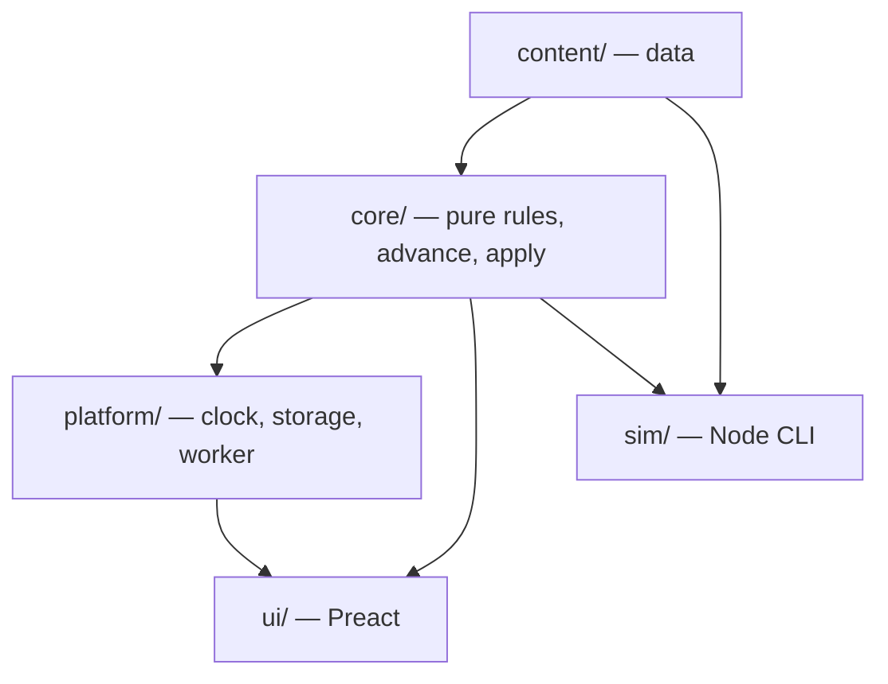

# The Last Hold — Technical Design

**Status:** Draft for review.
**Reads with:** `gdd.md` (what to build), `decisions.md` (why), `implementation-plan.md` (in what order).
**Markers:** **[JC]** = judgment call. **MUST** / **NEVER** = rules that also appear in `CLAUDE.md`.

---

## 1. Goals and constraints

From the brief and the decisions log:

| Constraint | Source |
|---|---|
| Static web app, no server; hosted on GitHub Pages; installable PWA; playable offline | Brief |
| Phone-first, scaling up to desktop | D02 |
| Saves in browser storage, plus an export code and a downloadable save file | Brief |
| Offline progress calculated on load, capped at 12 h (24 h ceiling) | D08, GDD §5.2 |
| Data-driven content | Brief, D24.5 |
| Deterministic and testable; seeded RNG | Brief |
| Maintainable by Claude Code across many separate sessions | Brief |
| Strong typing, automated tests, minimal dependencies, fast on phones | Brief |
| CC0 art only | D14 |

**What "maintainable across sessions" means here.** Every session starts cold. So:
- The code must be easy to find your way around: predictable folders, one concept per file, and no clever indirection.
- Rules must be enforced by tooling (types, lint, tests), not by memory.

---

## 2. Stack and rationale (D17)

| Layer | Choice | Why |
|---|---|---|
| Language | **TypeScript 5.x, `strict` plus `noUncheckedIndexedAccess`** | Types are the cheapest way to keep many cold-start sessions consistent. Content files are type-checked for free (D24.5). |
| Build and dev | **Vite** | Fast, minimal config, first-class TypeScript and Web Workers. The de-facto standard, so it's well known to Claude Code. |
| Tests | **Vitest** | Shares Vite's config. Its bundled `vite-node` also runs the simulator, so no extra runner is needed. Built-in benchmarking. |
| UI | **Preact + @preact/signals** | About 4 KB. React-style components that Claude Code writes reliably. Signals give fine-grained updates without a state library. |
| PWA | **vite-plugin-pwa** (Workbox) | Generates the service worker and manifest correctly. Hand-written service workers are a classic source of stale-cache bugs. |
| Browser tests | **Playwright** *(from v0.2, D24.7)* | One smoke test on a phone-sized viewport |
| Lint and format | **ESLint (flat config) + Prettier** | Enforces the layer rules (§4.2) and the no-`Math.random` rule mechanically |

**Runtime dependencies: 2** (`preact`, `@preact/signals`). Everything else is a dev dependency.

**Alternatives considered:**
- **Vanilla TypeScript UI:** no dependency, but every screen would reinvent state-to-DOM syncing, and that's where cold-start sessions drift.
- **React:** fine, but about 10× heavier than Preact for no benefit here.
- **Svelte or Solid:** good, but less common in training data, so more mistakes from Claude Code.
- **A game engine (Phaser and similar):** wrong shape. This game is mostly menus, lists, and numbers, not a canvas.

**Versions:** Node **22 LTS**, npm (lockfile committed). Exact dependency versions are pinned in v0.0 **[JC]**.

---

## 3. Repository layout

```
the-last-hold/
├─ CLAUDE.md                     # rules for every session (read first)
├─ README.md
├─ docs/                         # design, lore, plan, decisions (source of truth)
│  ├─ gdd.md · setting-primer.md · lore-secrets.md
│  ├─ technical-design.md · implementation-plan.md · decisions.md
│  └─ credits.md                 # generated from the asset manifest (§12)
├─ src/
│  ├─ core/                      # pure game logic: no DOM, no clock, no Math.random
│  │  ├─ state/                  # GameState types, creation, selectors
│  │  ├─ systems/                # economy, peasants, contracts, combat, bestiary, alchemy…
│  │  ├─ sim/                    # advance(), the event queue, offline catch-up
│  │  ├─ commands/               # apply(state, command): every player action
│  │  ├─ rng/                    # seeded PRNG, streams, roll sources
│  │  ├─ breakdown/              # Breakdown trees (GDD §5.0)
│  │  ├─ format/                 # number and time formatting (pure)
│  │  └─ save/                   # schema, migrations, encode/decode (pure parts)
│  ├─ content/                   # data only: typed TS modules
│  │  ├─ balance.ts              # every constant from GDD §7
│  │  ├─ buildings.ts · jobs.ts · ages.ts · hunters.ts · traits.ts
│  │  ├─ monsters.ts · clues.ts · villages.ts · ingredients.ts · consumables.ts
│  │  ├─ text/                   # flavor text: building blurbs, resident lines, notices
│  │  ├─ assets.ts               # asset manifest (§12)
│  │  └─ palette.ts              # the 32-color palette
│  ├─ platform/                  # browser-only adapters
│  │  ├─ clock.ts · storage.ts · download.ts · compression.ts · lifecycle.ts
│  │  └─ worker/                 # odds and suggest worker (GDD §6.5)
│  ├─ ui/                        # Preact components; no game rules
│  │  ├─ app/ · screens/ · sheets/ · widgets/ · debug/
│  │  └─ styles/                 # CSS tokens, themes
│  └─ main.ts
├─ sim/                          # balance simulator (Node, via vite-node)
│  ├─ cli.ts · policies/ · checks/ · targets.ts · report.ts
│  └─ baseline.json              # last accepted results, for diffs
├─ tests/                        # cross-cutting tests (unit tests live next to code)
│  ├─ golden/ · determinism/ · saves/fixtures/ · content/ · e2e/
├─ tools/                        # dev-only scripts: recolor, generate portraits, credits
├─ public/assets/                # final PNGs (packs + generated), fonts, icons
└─ .github/workflows/ci.yml · deploy.yml
```

- **Unit tests sit next to their code** (`economy.ts` → `economy.test.ts`).
- **`tests/`** holds the cross-cutting suites: golden fights, determinism, save fixtures, content validation, and end-to-end.

---

## 4. Architecture

### 4.1 Layers



### 4.2 Layer rules (enforced by ESLint `no-restricted-imports` and custom rules)

- **`core/` MUST NOT import** `ui/`, `platform/`, or any browser global (`window`, `document`, `localStorage`).
- **`core/` MUST NOT call `Math.random()` or `Date.now()` / `new Date()`.** Time arrives as a parameter, and randomness comes from `core/rng`. A custom lint rule fails the build if they appear.
- **`content/` exports data only:** no functions except trivial constructors, and no imports from `core/` except types.
- **`ui/` MUST NOT compute game rules.** It calls selectors and dispatches commands. Display formatting is allowed.
- **`sim/` uses only `core/` and `content/`,** never `platform/` or `ui/`.

### 4.3 The two entry points into the core

```ts
apply(state: GameState, cmd: Command, now: number): ApplyResult   // player actions
advance(state: GameState, toTime: number): AdvanceLog            // the passage of time
```

- **Every player action is a `Command`:** a plain JSON object such as `{ type: 'build.buy', building: 'cottage', count: 1 }`. The UI, the simulator, and the debug panel all go through `apply`. So the simulator plays the real game, not a model of it.
- **`apply` validates and returns `{ ok: true } | { ok: false, reason }`.** A refused command never changes state.
- **State is mutated in place** inside `apply` and `advance`, for speed and simplicity. Anything that needs a hypothetical, such as the odds preview or "what would this buy give me", works on a `structuredClone(state)` **[JC]**. No immutability library is needed.

---

## 5. Data model

### 5.1 Content (static)

- **IDs** are kebab-case string literals, typed as unions (`type BuildingId = 'cottage' | 'farm' | …`), generated from the content arrays with `as const`. A typo in an ID is a compile error.
- **`balance.ts`** is one `as const` object whose keys match GDD §7 exactly (`balance.costGrowth.count`, `balance.provisions.base`, …). **No numeric game constant may appear anywhere else.** A lint rule flags numeric literals in `core/systems/` other than 0, 1, and 100 **[JC]**.
- **Content validation tests** (`tests/content/`) run on every change:
  - Every referenced ID exists.
  - The coverage rules from GDD §8.3.1, including that clue-tag sets are distinct within each cell.
  - Every recipe's ingredients exist.
  - Every asset ID referenced has a manifest entry.
  - Every proper noun appears in the collision-checked list (§14).

### 5.2 Game state (saved)

```ts
interface GameState {
  meta: {
    schemaVersion: number
    gameSeed: string                 // fixed for the save's lifetime
    createdAt: number; lastSeen: number
    clockHighWater: number           // latest time ever seen (backward-clock guard, D21)
    debugUsed: boolean               // informational only
  }
  cycle: { number: number; age: AgeId; wardenName?: string /* v0.5 */ }
  resources: Record<ResourceId, number>          // food, wood, iron, silver
  peasants: { total: number; jobs: Record<JobId, number>; autoSettle: boolean;
              priority: JobId[]; lastSettleAt: number }
  buildings: Record<BuildingId, number>          // count or level
  hunters: Record<HunterId, HunterState>         // owned only (v0.2)
  roster: { active: HunterId[] }                 // anything owned and not active is in the reserve
  board: { open: ContractInstance[]; nextArrivalAt: number; tierProgress: Record<number, number> }
  running: RunningContract[]
  results: ContractResult[]                      // unread results (rewards already applied, GDD §5.4.3)
  bestiary: Record<MonsterId, { level: 0|1|2|3|4; kills: number }>   // v0.3
  stores: Record<ConsumableId | IngredientId, number>                // v0.3
  queues: { brewing: BrewJob[]; investigation: InvestigationSlot[] } // v0.3
  stats: LifetimeStats                           // trophies this cycle, totals
  log: { recentFights: FightRef[] }              // seeds + inputs, not full logs (§5.3)
  settings: Settings
}
```

- **Derived values are never stored:** rates, the active-roster cap, odds. They come from **selectors** (`core/state/selectors.ts`). Each selector that feeds a visible number also returns a `Breakdown` tree (§5.4).
- **Fight logs are not stored.** A `FightRef` holds the seed and the inputs (party, preparation, monster instance), and the log is **regenerated on demand** by re-running the fight. This keeps saves small and proves determinism every time a log opens.

### 5.3 Fight references

```ts
interface FightRef { contractId: string; seed: string; party: HunterSnapshot[];
                     prep: PrepSnapshot; monster: MonsterInstance; result: 'win'|'loss' }
```

- **Snapshots freeze hunter stats at launch,** so later level-ups don't change a replayed log.
- **If the combat code ever changes in a way that alters an old replay,** the replay shows *"recorded with an older rules version"* instead of a different log. A `rulesVersion` constant bumps whenever combat math changes **[JC]**.

### 5.4 Breakdown trees (GDD §5.0, D10)

```ts
type Breakdown = { label: string; value: number; formula?: string;
                   bucket?: BucketId; key?: BalanceKey; children?: Breakdown[] }
```

- **Selectors build the number and its breakdown in the same function,** so they can't disagree.
- The UI renders any `Breakdown` with one generic sheet component.

---

## 6. Time, the tick, and offline progress

### 6.1 Clock

- `platform/clock.ts` provides `now(): number` (epoch milliseconds).
- **The core never reads a clock.** Every `apply` and `advance` receives `now` or `toTime`.
- The simulator uses a virtual clock that starts at Monday 07:00 (GDD §6.1).

### 6.2 `advance(state, toTime)`: event-driven (GDD §5.2, D30)

```
while state.time < toTime:
    rates  ← currentRates(state)                  # constant until the next event
    tNext  ← min(nextEventTime(state, rates), toTime)
    integrate resources linearly from state.time to tNext
    state.time ← tNext
    if tNext is an event time: applyEvent(state, event)   # may change rates
```

**Event sources,** each with an exact time:

| Event | When it fires |
|---|---|
| Settle due | `max(lastSettleAt + 30 s, time when food reaches settleCost)`, while housing is free and auto-settle is on |
| Contract completes | Its end time. Rewards, injuries, and XP apply here (D31/B9). |
| Recovery ends | Its timer |
| Brew finishes / clue revealed | Their timers |
| Board refill | `nextArrivalAt` |

- **Ties at the same instant** apply in a fixed order: completions → recoveries → brews → clues → refills → settles **[JC]**.
- **Floating-point drift.** Resources are doubles. Event times are computed, not stepped, so 12 h of 1-s ticks and one 12 h jump agree within `1e-9` relative error. That's the **equivalence test** (D30).

### 6.3 The live loop

- **A 1-second interval** calls `advance(state, clock.now())`. The UI redraws through signals; nothing animates by polling.
- **When the page hides** (`visibilitychange` → hidden, `pagehide`), the game saves immediately.
- **When the page becomes visible again:**
  - Away less than 60 s: just advance.
  - Away 60 s or more: run **offline catch-up** (§6.4) and show the "While you were away" sheet if the gap is 5 min or more **[JC]**.
- **Autosave** runs every 30 s and after every successful command.

### 6.4 Offline catch-up

```
elapsed = clamp(now − meta.lastSeen, 0, offlineCap(state))
if now < meta.clockHighWater: elapsed = 0; lastSeen = now          # backward clock, D21
```

- **Catch-up runs in 60 s chunks of `advance`** (GDD §5.2). After every 50 chunks it yields to the browser with `await` and a zero-delay timeout, so the progress bar paints. Twelve hours is 720 chunks, which should take well under a second on a phone **[JC: no worker needed]**.
- **The away summary** is a diff: `state` before vs after, plus the `AdvanceLog` events collected during catch-up.
- **Time beyond the cap is reported, not simulated:** *"14 h 20 m away · 12 h counted."*

---

## 7. Randomness

### 7.1 Generator

- **`sfc32`**: a small, fast 32-bit PRNG with a 128-bit state that serializes as 4 numbers.
- **Seeding** from strings uses a **`cyrb128`-style hash** **[JC]**.
- **Both are about 20 lines, written in-repo** with no dependency. Each has golden-value tests (fixed seed → fixed first 10 outputs) so an accidental change is caught.

### 7.2 Streams

Each kind of randomness gets its own derived seed. That way, adding a roll in one system never shifts another system's results.

| Stream | Seed string |
|---|---|
| Board arrivals | `${gameSeed}:board:${arrivalIndex}` |
| A real fight | `${gameSeed}:fight:${contractId}:${partyIds}:${prepIds}` (GDD §5.4.2) |
| Odds preview, sample i | `${gameSeed}:odds:${contractId}:${partyIds}:${prepIds}:${i}`, a distinct prefix, so it never equals the real fight |
| Suggest, stage 1 | `${gameSeed}:suggest:${contractId}:${i}`, **the same seeds for every party** (GDD §6.5) |
| Clues and investigation | `${gameSeed}:clues:${contractId}` |
| Simulator | `sim:${runSeed}` (the simulator also picks its own `gameSeed`) |

### 7.3 Roll sources (for the exact test)

```ts
interface RollSource { next(): number }   // [0, 1)
```

- `seeded(seedString)` returns an sfc32-backed source.
- `scripted([0.40, 0.50, …])` returns rolls from a list and **throws if the list runs out or isn't fully consumed**. This powers the GDD §5.5.1 golden test.
- **Combat code receives a `RollSource`** and never constructs one. Roll order is exactly as GDD §5.5 specifies.

---

## 8. Numbers and formatting (D18)

- **All quantities are JavaScript doubles.** The **overflow check** (GDD §6.3 #7) fails the simulator if any value passes `1e300`; a big-number library would come in only then (D18).
- **Health and damage are integers** (GDD §5.0). Resources are fractional internally.
- **Affordability uses the exact value. Display floors**, so the UI never shows "100" for 99.7 when the cost is 100 **[JC]**.

`core/format/number.ts`:

| Range | Format | Example |
|---|---|---|
| < 1,000 | Integer (floored); rates under 10 get one decimal | `847`, `4.5/min` |
| 1e3 – 1e21 | 3 significant digits plus a suffix: K, M, B, T, Qa, Qi | `1.23K`, `45.6M`, `789Qa` |
| ≥ 1e21 | Scientific with 3 significant digits | `1.23e21` |

- Breakdown sheets show exact values with thousands separators.
- **Time format:** `45s`, `12m`, `3h 10m`, `2d 4h`.
- **Table-driven tests** cover every boundary (999.99, 1000, 999,500, …).

---

## 9. Saves

### 9.1 Storage

| Slot | Key | When written |
|---|---|---|
| Main | `lasthold:save` | Autosave (§6.3) |
| Backup | `lasthold:backup` | Every 10 minutes, as a copy of the last good main save |
| Quarantine | `lasthold:corrupt:<ts>` | A main save that failed to load, kept for recovery |

- **`localStorage` with JSON** **[JC]**. The expected save size is well under 1 MB, because logs are regenerated (§5.2). It's synchronous and simple, and plenty here.
- **On first run** the game calls `navigator.storage.persist()` to request persistent storage.
- **Honest note about iPhone:** Safari can clear storage for websites that go unused for 7 days. Apps **added to the Home Screen** are counted separately, by their own days of use, so regular play keeps them safe. The game shows a one-time tip to install it, and **the export code is the real safety net.**

### 9.2 Envelope

```json
{ "app": "the-last-hold", "schemaVersion": 3, "rulesVersion": 2,
  "savedAt": 1760000000000, "state": { … } }
```

### 9.3 Export and import

**Save code:** `LH1.` + base64url( deflate-raw( UTF-8 JSON envelope ) ) + `.` + an 8-hex-digit FNV-1a checksum.
- Compression uses the browser's built-in `CompressionStream`. No dependency. If a browser lacks it, the game writes an uncompressed code with the prefix `LH0.` instead, and both kinds import.
- Import checks, in order: the prefix, the checksum, decompression, parsing, the version, migration, then validation.
- Any failure shows a plain-language reason and **never touches the current save**.

**Save file:** a download of the plain JSON envelope, named `the-last-hold-YYYY-MM-DD.json`. It's human-readable on purpose.

### 9.4 Versioning and migrations (CLAUDE.md rule)

- `schemaVersion` is an integer. `core/save/migrations.ts` holds an ordered list, where `migrations[n]` upgrades version n to n+1. They're pure functions on plain JSON.
- **Every schema change MUST add:**
  1. a migration;
  2. a **fixture**: a real save at the old version, in `tests/saves/fixtures/vN.json`;
  3. a test that loads every fixture, migrates it to the current version, validates it, and round-trips it (save → load → equal).
- **Validation** is a hand-written guard (`validateState(json): Result`) that checks types, ranges, and that every ID exists in content **[JC: no schema library]**. Unknown IDs (for example, content that was removed) are dropped with a warning in the load report, never a crash.
- **Loading a save from a newer version** is refused with "This save is from a newer version of the game", leaving the current state untouched.

---

## 10. UI architecture

- **State to UI:** one `gameState` object, plus a `version` signal that's bumped after every `apply` and `advance`. Components read through `useComputed(() => selector(state))`, which re-runs only when `version` changes. Selectors are cheap enough that there's no memoization layer **[JC]**.
- **Navigation:** a tab enum in a signal, plus a sheet stack. No router dependency. **Deep links are only `?debug`.**
- **Styling:** plain CSS with custom-property tokens (`--c-ember`, `--space-2`, …) and CSS Modules (built into Vite). Dark theme by default, light in Settings (GDD §9.1).
- **Fonts** **[JC]:**
  - A **CC0 pixel font** for headings and resource-bar numbers, per D14 (for example, one of Kenney's CC0 fonts). Recorded in `credits.md`.
  - The system font stack for body text.
- **Accessibility basics:** 44 px touch targets, `prefers-reduced-motion`, rem-based type that follows system text size, and visible focus styles.
- **Layout:** CSS grid. The 900 px and 1300 px breakpoints switch to 2 and 3 columns (GDD §9.1).
- **Pixel art:** `image-rendering: pixelated`, integer scale factors only, and a `<Sprite id>` component (§12).

### 10.1 The odds and suggest worker (GDD §6.5)

- `platform/worker/odds.worker.ts` imports the **same `core/` combat code**. Vite bundles workers natively.
- **Protocol:** `{ type: 'odds' | 'suggest', requestId, stateSlice, contract, party?, prep? }` → `{ requestId, result }`. Stale responses are dropped by `requestId`.
- **The UI debounces** party and preparation changes by 150 ms before asking for odds.
- **Fallback:** if workers are unavailable, the same functions run on the main thread at reduced sample counts, and the panel labels the result *"quick estimate"*.

---

## 11. PWA, build, and deploy

### 11.1 PWA

- **vite-plugin-pwa** in `generateSW` mode. It precaches every built asset, so the game is **fully playable offline after the first load**.
- **Manifest:** name *The Last Hold*, `display: standalone`, portrait-first, a theme color from the palette, and icons generated from one source PNG.
- **Updates:** when a new version is ready, a small banner offers *"New version: reload when ready."* **It never reloads automatically.** Accepting saves first, then reloads. iPhone home-screen apps may need to be closed and reopened to pick up an update, and the About screen says so.
- **Base path:** `/the-last-hold/` for GitHub Pages, set once in `vite.config.ts`.

### 11.2 CI and deploy (GitHub Actions)

| Workflow | Trigger | Steps |
|---|---|---|
| `ci.yml` | Every push and pull request | `npm ci` → typecheck → lint → unit and content tests → golden and determinism tests → `sim:check` (fast set) → build → *(from v0.2)* Playwright smoke |
| `deploy.yml` | Push to `main` | Build → upload artifact → `actions/deploy-pages` |

- **Milestones end with a tag** (`v0.1.0`, …). The version string shows in About.
- **Budgets:** CI should finish in **10 minutes or less**. The full simulator suite (5 minutes or less) runs in CI only on `main` and on pull requests labeled `balance`.

---

## 12. Art asset pipeline (GDD §9.12, D14)

### 12.1 Manifest

`src/content/assets.ts`:

```ts
{ id: 'portrait.hunter.zora', file: 'portraits/zora.png', size: [64, 64],
  source: 'generated', generator: 'portrait', seed: 'zora',
  license: 'CC0 (project-generated)', credit: 'The Last Hold' }

{ id: 'tile.grass.1', file: 'tiles/grass1.png', size: [32, 32],
  source: 'pack', pack: '<pack name>', url: '<source URL>',
  license: 'CC0', credit: '<author>' }
```

- **`<Sprite id>`** renders the manifest file. If the ID or the file is missing, it falls back to a **placeholder**: a palette-colored silhouette by asset kind, with the subject's initials. **Missing art never breaks a screen.**
- **Swapping art = replacing a file or changing a manifest row.** Never code.

### 12.2 Palette and recoloring

- **`src/content/palette.ts`** holds the 32 colors. They're chosen in v0.1 from a palette published for free use, with its source recorded.
- **`tools/recolor.ts`** maps every pack PNG to the nearest palette color, using perceptual distance in OKLab, and writes the result to `public/assets/`. Originals stay in `art-src/packs/` for re-runs.
- **Dev-only dependency:** `pngjs` for reading and writing PNGs in Node **[JC]**.

### 12.3 Generators

**Generators run at build-authoring time, not at runtime** **[JC]**. They write PNGs that get committed, so the game ships plain images and the art can be hand-edited later.

| Generator | Output | Method |
|---|---|---|
| `tools/gen-portraits.ts` | 64 px hunter portraits | Layered parts (face shape, skin, hair, beard, headgear, armor collar, weapon silhouette) drawn as small pixel arrays in TypeScript. Each hunter's content entry names its parts and a palette ramp. Deterministic from the hunter's seed. |
| `tools/gen-monsters.ts` | 64 px portraits + 32 px battle sprites | Part templates per family (body mass, head, limbs, features), with per-species overrides in content |
| `tools/gen-placeholders.ts` | Fallback sprites | Silhouettes by kind |

A **contact sheet** (`tools/contact-sheet.ts`) renders every generated asset onto one page, for the playtest screenshot pass (GDD §9.11).

### 12.4 Credits and license checks

- `tools/gen-credits.ts` writes `docs/credits.md` from the manifest.
- **A CI test fails** if any `pack` asset lacks `license: 'CC0'`, a URL, or a credit, or if any file in `public/assets/` isn't listed in the manifest.

**Honest note:** the generators will produce consistent but plain results, and the folklore monsters will be the weakest art (GDD §9.12). Two things limit the damage: the palette recolor makes pack and generated art sit together, and the manifest makes later replacement cheap.

---

## 13. Balance simulator

### 13.1 Shape

- **`sim/cli.ts`,** run with `npm run sim -- --policy standard --days 14 --seeds 5`.
- It **plays the real core** through `apply` and `advance`, using a virtual clock.
- **Policies** (`sim/policies/`) are functions `(state, now) => Command[]`, called at each check-in time from the GDD §6.1 schedules. The Opening policy acts every 10 s.
- **They share the best-payback valuation** (`core/systems/valuation.ts`) with the UI's ● hint (D30/B7).

### 13.2 Outputs

| Output | Contents |
|---|---|
| `sim/reports/<run>.json` | Time to every GDD §6.2 milestone; resource income by source; check-in activity; peak values |
| `sim/reports/<run>.md` | Human-readable summary, with a diff against `sim/baseline.json` |
| Exit code | Non-zero if any **check** fails |

`sim/reports/` is git-ignored. `sim/baseline.json` is committed, updated deliberately with `npm run sim:accept`, and the change is noted in `decisions.md` when it moves a target.

### 13.3 Checks

`sim/checks/` holds one file per GDD §6.2 target and §6.3 check, with thresholds read from `sim/targets.ts`. That file mirrors the GDD tables, row for row.
- **Each milestone enables its own checks** (the "Enforced from" column).
- **A run uses 5 seeds by default.** Time targets are judged on the **median**, and engagement checks on **every** seed **[JC]**.

### 13.4 Performance

- **Budgets:** a 3-cycle run in **60 s or less**; the full suite in **5 min or less** (GDD §6.5).
- The simulator runs **without the worker**. Contract odds come from the core directly, at stage-1 sample counts **[JC]**. The engine is fast because `advance` is event-driven: nothing is simulated second by second.

---

## 14. Testing strategy

| Suite | What it proves | From |
|---|---|---|
| **Unit** (next to code) | Each system's formulas match GDD §7 | v0.1 |
| **Content validation** | IDs, coverage, recipes, assets, names (§5.1) | v0.1 |
| **Formatter tables** | Every boundary in §8 | v0.1 |
| **Offline equivalence** | 12 h live ticks equal one 12 h catch-up (D30) | v0.1 |
| **Backward clock** | Elapsed 0, no penalty, `lastSeen` reset | v0.1 |
| **Determinism** | Same seed and commands twice → byte-identical state | v0.1 |
| **Save round-trip and migrations** | Every fixture loads, migrates, validates, and re-saves equal | v0.1 |
| **Export code** | Encode → decode equal; corrupted codes rejected with a reason | v0.1 |
| **PRNG goldens** | sfc32 and seeding outputs fixed | v0.1 |
| **Golden fight** | GDD §5.5.1, line for line, via a scripted `RollSource` | v0.2 |
| **Seeded golden fights** | A few fixed-seed fights recorded once, then frozen | v0.2 |
| **Odds honesty** | Simulated success rates match displayed odds (GDD §6.3 #5) | v0.2 |
| **Performance benchmarks** | Suggest and odds within budget (Vitest bench) | v0.2 |
| **Playwright smoke** | Phone viewport: load → buy a Cottage → reload → state persists; offline reload works | v0.2 |
| **Simulator checks** | GDD §6.2–6.3 | v0.1 onward, by milestone |

**About the performance proxy [JC]:** CI can't run a real phone. The bench therefore requires **one-quarter of the phone budget** on the CI runner (Suggest ≤ 75 ms, odds ≤ 25 ms), as a proxy for a mid-range phone at about 4× slower. You can also check it by hand on your phone with the debug panel's timing readout.

**Name collision list:** `tests/content/names.ts` lists every proper noun that has passed the GDD §2.3 search, with the date checked. The content test fails if a content file uses a name that's not on the list.

---

## 15. Debug panel (GDD §9.10)

- **Enabled** in dev builds, or with `?debug` in the URL. Hidden otherwise.
- **Every debug action is a `debug.*` command** through `apply`: time skip (through the real offline path), add resources, set seed, unlock Age, force a contract outcome (v0.2), and run a simulator policy for N hours in the browser.
- **Using any debug command sets `meta.debugUsed = true`.** It's shown in About, with no other effect (D21).
- **Timing readout:** the last Suggest, odds, and catch-up durations, for checking performance on a real phone.

---

## 16. Coding conventions (summarized in `CLAUDE.md`)

- **Named exports only;** one main concept per file; files under about 300 lines where practical.
- **Pure functions in `core/`.** Side effects only in `platform/` and `ui/`.
- **Errors:** commands return `{ ok: false, reason }` and never throw for game rules. Throwing is only for programmer errors.
- **No `any`.** Use `unknown` with guards at boundaries (save loading, worker messages).
- **Comments explain *why*,** and cite GDD sections (`// GDD §5.4.2: provisions paid at launch`).
- **Commit messages** follow Conventional Commits (`feat:`, `fix:`, `test:`, `docs:`, `balance:`).

---

## 17. Risks and honest notes

| Risk | Likelihood | Mitigation |
|---|---|---|
| **Balance feels wrong** even when the checks pass | High | The checks catch walls and dead zones, not fun. Playtest at the end of every milestone (GDD §6.4); constants live in one file. |
| **iPhone clears storage** for a non-installed site | Medium | Install tip, `persist()` request, export code, backup slot |
| **Generated art looks plain** | High | Palette unification, contact sheet, manifest swaps (§12) |
| **Service-worker update confusion** | Medium | No auto-reload; explicit banner; version shown in About |
| **Floating-point drift** between live and offline | Low | Event-driven `advance` plus the equivalence test |
| **Combat rule changes break replays** | Medium | `rulesVersion` plus the "older rules" label (§5.3) |
| **Claude Code drifts across sessions** | Medium | Lint-enforced layers, content validation, golden tests, `CLAUDE.md`, a milestone-scoped plan |

---

## Judgment calls in the technical design

1. **TypeScript strict plus `noUncheckedIndexedAccess`; Node 22; npm; versions pinned in v0.0.**
2. **The core mutates state in place;** hypotheticals use `structuredClone`.
3. **A lint rule bans numeric literals** in `core/systems/` other than 0, 1, and 100.
4. **Fight logs are regenerated from stored references, not saved;** a `rulesVersion` guards replays.
5. **Tie order for simultaneous events:** completions → recoveries → brews → clues → refills → settles.
6. **The away sheet appears after 5+ minutes away;** catch-up runs on the main thread, not a worker.
7. **sfc32 plus cyrb128 seeding,** written in-repo.
8. **Display floors values;** affordability uses exact values.
9. **`localStorage` with a JSON envelope,** a backup every 10 minutes, and a quarantine slot for failed loads.
10. **Save validation by hand-written guards** (no schema library). Unknown IDs are dropped with a warning.
11. **No router and no memoization layer** in the UI.
12. **A CC0 pixel font** (Kenney-style) for headings; system fonts for body text.
13. **Art generators run at authoring time,** with committed PNGs. `pngjs` is the only art-tool dependency.
14. **Simulator:** 5 seeds; medians for time targets, every seed for engagement checks; no worker.
15. **The performance proxy** is one-quarter of the phone budget on CI.
16. **A name-collision list** is enforced by a content test.
17. **The full simulator suite** runs in CI only on `main` and on pull requests labeled `balance`.
